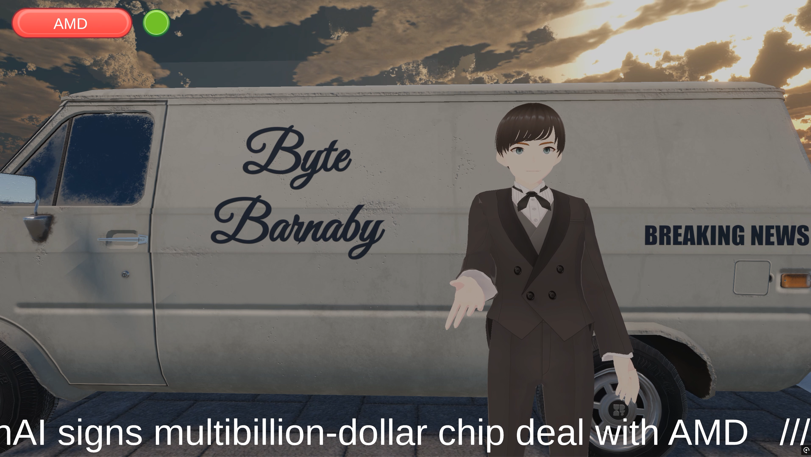
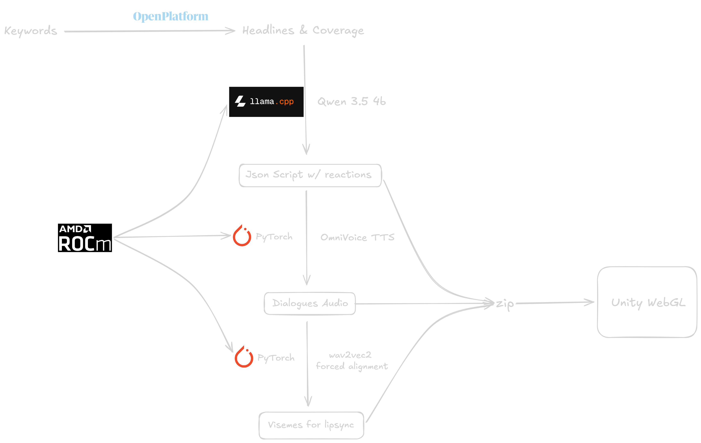

## 🎙️ Byte Barnaby: Autonomous Multimodal 3D News broadcaster

Byte Barnaby is a fully autonomous, local-first multimodal AI news broadcasting pipeline built natively for AMD Radeon GPUs. It ingests news via The Guardian OpenPlatform, synthesizes emotionally tagged scripts using a local LLM, generates expressive TTS audio, and calculates frame-accurate forced alignment to stream a fully lip-synced 3D broadcast into a decoupled Unity WebGL frontend.

#### **Demo Video**: [YouTube](https://youtu.be/41WrShNM5bI)
#### **Project Profile Document**: [PDF](ProjectProfileDoc.pdf)
#### **Poster**: [Image](Poster.png)



## Environment Configuration

To ensure maximum performace and compatibility, this project relies on native ROCm acceleration.

- **Operating System**: Linux (Ubuntu 22.04/24.04 recommended)
- **Hardware**: AMD Radeon GPU (Tested on Radeon PRO W7900)
- **Compute Stack**: AMD ROCm 7.2
- **Python**: 3.12

## Dependency List

The architecture relies on several highly optimized AI models and frameworks:

### Core Frameworks:

- **torch** (PyTorch optimized for ROCm 7.2 to utilize MIOpen/HIP primitives)
- **llama.cpp** (Official pre-compiled ROCm 7.2 binaries:  [llama-b10204-bin-ubuntu-rocm-7.2-x64.tar.gz](https://github.com/ggml-org/llama.cpp/releases/download/b10204/llama-b10204-bin-ubuntu-rocm-7.2-x64.tar.gz))

### Models:

- **Large Language Model**: [Qwen 3.5 4B](https://huggingface.co/unsloth/Qwen3.5-4B-GGUF)
- **Text To Speech**: [OmniVoice](https://huggingface.co/k2-fsa/OmniVoice)
- **Forced Alignment**: [Wav2Vec2](https://huggingface.co/facebook/wav2vec2-base-960h)

### Frontend: 
- Unity WebGL Build (included in the /Build directory). The C# scripts are included in /unity-scripts directory.


## Startup Guide

Clone the repository then follow these steps to successfully launch Byte Barnaby

### 1. Install uv if you don't have it already

```bash
curl -LsSf https://astral.sh/uv/install.sh | sh
```

### 2. Setup the Python Environment

```bash
uv venv --python 3.12
uv pip install -r requirements.txt
```

This will install ROCm compatible PyTorch, and OmniVoice, and openai client so it can access llama-server later.

### 3. Get ROCm compiled llama.cpp

```bash
wget https://github.com/ggml-org/llama.cpp/releases/download/b10238/llama-b10238-bin-ubuntu-rocm-7.2-x64.tar.gz

tar -xzf llama-b10238-bin-ubuntu-rocm-7.2-x64.tar.gz
```

### 4. Download the models via modelscope

```bash
uv pip install modelscope
# Qwen 3.5 4B
modelscope download --model unsloth/Qwen3.5-4B-GGUF Qwen3.5-4B-Q4_K_M.gguf --local_dir .
# OmniVoice TTS
modelscope download --model k2-fsa/OmniVoice --local_dir ./omnivoice_model
# Wav2Vec2
modelscope download --model AI-ModelScope/wav2vec2-base-960h --local_dir ./wav2vec2_model

```

### 5. Launch

```bash
# Serve Qwen via llama.cpp
cd llama-b10238
llama-server -m ../Qwen3.5-4B-GGUF Qwen3.5-4B-Q4_K_M.gguf --ctx-size 4096
cd ..
# Launch FastAPI app.
uvicorn main:app --port 8000
```

## Architecture



---