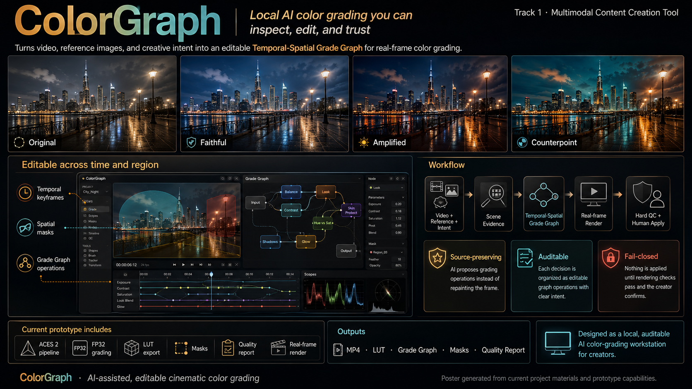

# ColorGraph

ColorGraph is a local, auditable AI-assisted color-grading workstation for
landscape and short-form video. It turns media analysis and natural-language
intent into an editable **Temporal-Spatial Grade Graph**, renders that graph with
PyTorch and FFmpeg, and keeps every creative proposal reversible and subject to
hard technical quality gates.

> **Submission status:** ColorGraph is an AMD Radeon Hackathon 2026 Track 1
> submission. This pull request includes the complete source, project profile,
> Radeon/ROCm evidence, final poster, and demo video. The large demo file is
> stored with Git LFS so the repository remains usable.



## Why ColorGraph

- **A grade, not a generated replacement.** ColorGraph analyzes and transforms
  the source frames; it does not redraw the video frame by frame.
- **Explicit color management.** New projects use the pinned OpenColorIO 2.5.2
  ACES 2 Studio Config, ACES2065-1 interchange, ACEScg working space, explicit
  ACEScct creative operations, and an ACES 2 display transform.
- **Editable, scoped decisions.** Exposure, balance, tone, looks, masks, and
  keyframes are typed graph nodes scoped to project, scene, shot, time, or region.
- **Three visibly distinct creative directions.** The offline Agent proposes
  `faithful`, `amplified`, and `counterpoint` candidates. Non-faithful proposals
  must clear a direction-specific effect floor before they can enter search.
- **Fail-closed candidate search.** Proposals are compiled deterministically,
  rendered on real frames, checked for asset integrity, graph integrity, finite
  values, and legal output gamut, and never alter the current graph without
  explicit confirmation.
- **Local-first media handling.** Models, source media, previews, and project data
  stay on the workstation by default. Networked creative providers are opt-in and
  require explicit configuration and consent.
- **High-bit-depth delivery.** The formal path uses high-bit-depth decode,
  FP32 grading, timestamp-aware CFR/VFR handling, HEVC Main10 output, LUTs, masks,
  the Grade Graph, and a quality report.

## System flow

```text
Video + optional reference image
  -> FFprobe metadata and color-evidence inspection
  -> shot boundaries, representative frames, exposure / white-balance analysis
  -> optional local scene, semantic-mask, depth, and temporal-mask inference
  -> typed Temporal-Spatial Grade Graph
  -> Creative Director -> 3 typed strategies -> deterministic compiler
  -> real-frame candidate render -> hard QC -> explicit user confirmation
  -> high-bit-depth FFmpeg/PyTorch render -> QA / bounded repair
  -> MP4 + LUT + Grade Graph + masks + quality report
```

The web workstation is React + TypeScript. The local API, analysis pipeline,
renderer, Agent, and evaluation gates are Python + FastAPI + PyTorch.

## Quick start

Reference development environment:

- Windows 11
- Node.js 20+ and npm
- Python 3.12
- [uv](https://docs.astral.sh/uv/)
- FFmpeg and FFprobe on `PATH`
- A PyTorch-supported GPU is recommended; CPU fallback exists for bounded tasks

Install dependencies from the repository root:

```powershell
uv sync --project backend --group dev
npm ci
```

Start the backend:

```powershell
.\scripts\start-backend.ps1
```

Start the frontend in a second PowerShell window:

```powershell
.\scripts\start-frontend.ps1
```

Open `http://127.0.0.1:4173`. The API is at `http://127.0.0.1:8010`,
with interactive OpenAPI documentation at `http://127.0.0.1:8010/docs`.

Check the runtime before importing media:

```powershell
uv run --project backend colorgraph doctor
```

## Reproducible public demo media

Demo videos are deliberately **not committed to Git**. Download the selected
redistributable Wikimedia Commons sources and verify their frozen SHA-256 values:

```powershell
.\scripts\fetch-demo-assets.ps1 -Asset all
```

Recommended roles:

- **Tbilisi life at night** — strongest public visual for comparing the three
  creative directions: blue-hour city texture, warm architecture, traffic, and
  clear cool/warm separation.
- **Snowdonia by drone** — best public end-to-end workflow clip: multiple cuts,
  green landscapes, water, roads, architecture, and useful semantic-mask targets.
- **Licensed DJI Mavic 3 Pro Cine D-Log snow canyon** — best local proof of the
  professional log/ACES/high-bit-depth path, but raw media and excerpts remain out
  of the public repository unless the actual agreement explicitly permits
  redistribution.

Analyze the public hero clip without the optional scene model:

```powershell
uv run --project backend colorgraph analyze `
  .\demo-assets\tbilisi-night-canon-eos-m3.ogv `
  --name "ColorGraph Public Demo - Tbilisi Night" `
  --skip-scene-model
```

See [Demo media and rights strategy](docs/DEMO_ASSETS.md) and
[Third-party media notices](THIRD_PARTY_MEDIA.md) before publishing any visual.

## CLI examples

```powershell
# Analyze a video and optionally build local masks
uv run --project backend colorgraph analyze .\input.mp4 --with-masks

# Render an analyzed project
uv run --project backend colorgraph render <project_id> --bit-depth 10

# Run the unified evaluation infrastructure
uv run --project backend colorgraph evaluate `
  <manifest.json> <observations.json> --output evaluation-report.json

# Compare CPU and the selected accelerator without treating the result as AMD proof
uv run --project backend colorgraph precision-gate `
  --output precision-gate.json --repeats 3
```

## Verification

```powershell
npm run typecheck
npm run build
uv run --project backend ruff check backend/colorgraph backend/tests
uv run --project backend pytest
```

The CI workflow runs frontend type/build checks and the non-AMD backend lint/test
suite. Hardware-specific evidence must be produced on the named target device;
CUDA or CPU results are never relabeled as Radeon/ROCm results.

## Repository map

```text
src/                       React workstation
backend/colorgraph/        API, media analysis, renderer, Agent, evaluation
backend/tests/             Backend regression and contract tests
docs/                      Architecture, protocols, status, submission material
public/assets/             Repository-owned static visual assets
scripts/                   Local setup, demo-asset, and evidence commands
output/pdf/                Generated Project Profile deliverable
```

## Current boundaries

- The Creative Agent remains human-confirmed and fail-closed. Formal automatic
  selection still requires content-bound expert review and Critic calibration.
- The Gold Set intake/evaluation machinery exists, but pending annotations and
  rights review are not represented as accepted Gold.
- The reduced submission gate passed on a supported Radeon Cloud ROCm host. The
  archived report proves that frozen run only; the final recorded demo must show
  the same device identity and must not generalize it into broader production
  performance claims.
- Private or licensed media is not made redistributable by being usable in a
  commercial showcase. See the rights strategy for the exact separation.
- No open-source license has yet been selected for ColorGraph itself. Until the
  repository owner adds one, the source is visible but no reuse permission is
  granted by this repository.

## Submission material

- [Submission checklist](docs/SUBMISSION_CHECKLIST.md)
- [Project Profile PDF](output/pdf/ColorGraph-Project-Profile.pdf)
- [Track 1 submission poster](submission/ColorGraph-Poster.png)
- [Track 1 demo video](submission/ColorGraph-Demo-Video.mp4)
- [Demo media and rights strategy](docs/DEMO_ASSETS.md)
- [Project status](docs/PROJECT_STATUS.md)
- [Evaluation protocol](docs/EVALUATION_PROTOCOL.md)
- [ROCm backend boundary](docs/ROCM_BACKEND.md)
- [Remote AMD UI and recording workflow](docs/REMOTE_AMD_DEMO.md)
