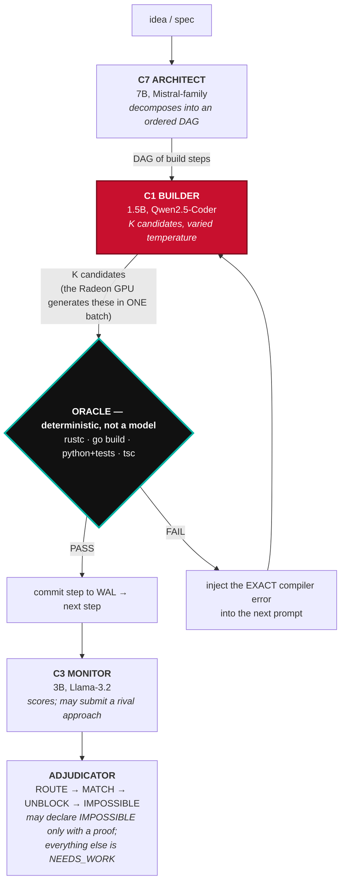

# Determinex — Track 2 Project Specification

**2026 AMD Radeon GPU Hackathon · Track 2: Development & Local Deployment of Private AI Agents**

**Submitter:** DarthCeltic · **Source:** https://github.com/DarthCeltic/Determinex ·
**License:** AGPL-3.0-or-later · **Date:** 2026-07-31

---

## 1. Application Scenarios

### The problem

Cloud AI coding tools require sending proprietary source to a third party, with no
cryptographic guarantee about retention, training use, or jurisdiction. For regulated
industries and IP-sensitive work that is not a trade-off, it is a disqualifier.

Local alternatives trade that risk for a worse one: a single small model with no
verification layer. A 1.5B model proposing wrong code *confidently* is more dangerous than
no assistant, because the reviewer's attention is the scarce resource.

Determinex refuses both. It runs locally on the developer's own hardware — including AMD
Radeon GPUs — and it never trusts a model's self-assessment. A real compiler or a real test
suite is the only judge.

### Who it is for

| Scenario | How Determinex handles it |
|---|---|
| Build a program from a plain-language idea | Synthesizes a *sound* test oracle first, then drives verified search until a program passes it |
| Repair a broken repository | Ingests the project, runs its real oracle, assigns honest blame: CODE / ENVIRONMENT / TEST |
| Use a cloud model without exposing source | Project Cloak obfuscates identifiers via AST rewriting before any outbound call |
| Evaluate a local model honestly | Compiler-validated probe harness; no LLM-as-judge anywhere in the loop |

### Why this matters on AMD hardware specifically

Determinex's accuracy is a function of how many candidates it can verify, not of how good
any single generation is. That makes it one of the few agent architectures where **GPU
batch throughput converts directly into correctness** — quantified in §5.

---

## 2. Agent Architecture



**The red node is the only one that touches the GPU, and the black node is the only one
that decides anything.** No model ever judges its own output: the Builder proposes K
candidates, the Oracle disposes of them with a compiler or a real test suite, and a failure
returns the *exact* compiler error to the next attempt rather than a summary of it. That
loop is why GPU batch throughput and agent correctness are the same measurement.

### The amplification mechanism

```
per-attempt success probability   p
K candidates sampled, each verified against a sound oracle

    P(at least one correct) = 1 − (1 − p)^K
```

Any `p > 0` is driven toward correct by increasing K. The model supplies search; the oracle
supplies truth. **The soundness of the oracle is load-bearing** — a garbage oracle yields
confident garbage — which is why every synthesized oracle is validated to actually execute,
and why an oracle that can only assert "the symbol exists" is rejected as vacuous rather
than reported as a pass.

### The design rule this project is built on

*A check must never report an outcome it did not establish.* It is why `solved` is never
claimed without a passing `OracleResult` and a proof, why every guard in this repository is
negative-controlled against the defect it exists to catch, and why the boundaries in §6 are
stated rather than omitted.

---

## 3. Core Capabilities

### 3.0 The five capabilities, named

Track 2 asks for **at least two** of five capabilities. Determinex implements **all five**.
Each is listed here with the single place in this repository where it can be checked, because
a capability that cannot be pointed at is a claim rather than a feature.

| Capability | In Determinex | Where to verify |
| --- | --- | --- |
| **Local knowledge retrieval (RAG)** | A corpus of **234 recorded entries** — including **89 generalized failure classes** and **272 learned solve classes**, each carrying its method, measured numbers and the traps that produce false readings — indexed for hybrid lexical + embedding retrieval over the corpus and the project's own documentation. The agent queries it *before* acting, so accumulated experience is applied first-shot rather than rediscovered. | `python scripts/determinex_corpus_api.py ask "<question>"`; in the IDE, **Learning Studio → Ask the Corpus** |
| **Tool invocation** | The agent's verdicts come from real tools, never from a model's opinion: `cargo`, `go build`, `tsc --noEmit`, `pytest`, `dotnet build`, `gcc`, plus `git` and Docker. Nineteen language oracles behind one registry. | `scripts/determinex_oracle.py`; `tests/test_oracle_runtimes_discriminate.py` proves each accepts correct code and rejects broken code |
| **Multi-step task planning** | An Architect decomposes a request into a dependency-ordered DAG of build steps; a Builder executes one step at a time against the current state, and each step is gated by the compiler before the next begins. | `scripts/determinex_hive.py generate-dag`; `scripts/determinex_decompose.py` |
| **Local multi-turn memory** | Two kinds. Within a session, the Concept Lab interview carries every answer forward and reasons over the accumulated context (§3.0a). Across sessions, Case Memory stores **only oracle-verified** solves, so the system never learns from its own unverified guesses. | `scripts/determinex_case_memory.py`; session WAL under `sessions/` |
| **Permission control & privacy** | Model-generated code executes only inside `intake.hardened_runner` — workspace-bounded, environment-scrubbed, network and Docker denied by default. Project Cloak obfuscates every identifier before any cloud call. Source mutation is refused unless explicitly authorised. | `scripts/intake/hardened_runner.py`; `docs/policy/CLOAK_THREAT_MODEL.md`; `scripts/dev/parallel_execution_layer_audit.py` reports 515 execution sites, 0 unsafe |

### 3.0a Multi-turn interaction: the interview ends when the system knows enough, not when a counter runs out

The agent's first job is to find out what you actually want, and this is where most tools
quietly fail: they ask a fixed number of questions and then generate.

Determinex asked four questions from a static bank and then wrote the spec — whatever those
four answers happened to contain. A second path was worse: it forced readiness after **two**
replies, with a comment in the source admitting why ("the 3B model reliably loops on the 3rd
exchange; cut it off here"). That trades your specification for the model's stamina, and a
spec built from two answers to a five-answer problem produces a confident build of the wrong
thing — which the compiler will happily certify, because compiling is not the same as being
what you asked for.

Readiness is now **measured**, against this project's own standard: *can a sound oracle be
synthesized from what the user has told us?* `determinex_synthesize` answers exactly that and
emits an explicit marker when it cannot. Tying the interview to that verdict means the
agent's idea of "enough" cannot drift from the verifier's.

Each still-missing requirement maps to a specific question, so follow-ups are derived from
what is **absent** rather than drawn from a list — which is also why it cannot loop: a
question can only be asked while the thing it asks for is genuinely missing, an already-asked
question is never repeated, and a round that establishes nothing new is reported as stalled so
the interface offers to build rather than rephrasing forever.

Measured against a realistic user who never volunteers a concrete example until asked:

```
Q1  "It should read a list of bookings and collapse the ones that overlap"   -> keep going
Q2  "Python"                                                                 -> keep going
Q3  "A CLI command I run in the terminal"                                    -> keep going
Q4  "Standard library only, no dependencies"                                 -> keep going
        ^ the old build stopped here and wrote the spec
Q5  "If two bookings just touch end-to-start they should still merge"        -> keep going
Q6  "merge([(9,10),(10,11)]) == [(9,11)]"                                    -> SUFFICIENT
        a sound oracle can be synthesized: 6/6 requirements covered
```

At question four — where it used to give up — the context was still missing the one thing
that makes a build verifiable: a worked example. The interface says so on screen while it
asks ("Still needed for a verifiable build: example, edge_cases"), so an open-ended interview
never reads as an interrogation.

This runs on the Radeon-hosted model, and it is visible end to end in the demo video.


**3.1 Compiler-verified build loop.** `rustc`, `go build`, Python (syntax → import → test
discovery), and `tsc --noEmit` in a purpose-built container. Languages without a configured
oracle **fail closed** with an actionable message — they are never silently passed. Every
oracle refuses an empty workspace, because a build step whose patch went nowhere would
otherwise be recorded as verified.

**3.2 Multi-agent hive.** Three specialists exchange a structured DSL rather than prose.

**3.3 Project Cloak.** AST-aware identifier obfuscation across 10 languages, so a cloud
model can assist without seeing proprietary names. Stated precisely: audits confirm that
*everything Cloak obfuscated stayed obfuscated*. Extraction completeness is a separate
property with its own test — which has caught real gaps, including JavaScript instance
fields written `this.field = 0` surviving obfuscation until they were fixed. The
distinction is documented rather than smoothed over.

**3.3a Repairing a real repository — end to end, on the Radeon GPU.**

The clearest demonstration of application value is not a synthetic task. Determinex was
pointed at **`mwaskom__seaborn-3010`** from SWE-bench Lite: a real reported issue in a real
open-source project ("PolyFit is not robust to missing data"), with the project's own test
as the judge.

```
[repair] fix target inferred from the failure: seaborn/_stats/regression.py
[repair] using the repo's interpreter: .venv
[repair] oracle scope: 1 failing test(s), not the full suite
    [vs] r1 s1/6 t=0.0  gen 17s  verify 10s  ->  PASS

blame {'CODE': 1}   proven slop 0   FIXED True          # 27 seconds total
```

The fix it produced:

```diff
- p = np.polyfit(x, y, self.order)
+ p = np.polyfit(x.dropna(), y.dropna(), self.order)
```

Three things are worth separating here:

* **The blame is earned.** `CODE`, not `ENVIRONMENT`, not `TEST` — and `proven_slop: 0`,
  i.e. it did not take the easy exit of declaring the failing test wrong.
* **The oracle is the project's own test**, run with the project's own interpreter. Nothing
  Determinex wrote decides whether this passed.
* **The control matters.** SWE-bench's official gold patch also passes this oracle
  (`1 passed in 0.12s`), so the target is achievable and a correct fix is recognised as
  correct. Without that control, a pass proves much less.

Generation ran on the Radeon-hosted 32B; verification ran locally against the repo's tests.
`generate()` and `verify()` are decoupled by design, which is what lets the model live on a
GPU in another country while the oracle runs where the toolchain is.

**3.4 Self-improving flywheel.** Verified solves are distilled into generalized symptom→fix
classes that the fixer applies first on the next occurrence. Seven classes were added to
that corpus during this hackathon, each with its method, measured numbers and the traps that
produce false readings; all are queryable via
`python scripts/determinex_corpus_api.py brief <files>`, which surfaces the ones relevant to
whatever a developer is about to edit.

**3.5 Benchmarks — stated honestly.**

| Benchmark | Result | Status |
|---|---|---|
| ProgramBench (200 CLI reimplementations) | **0/200** | Honest baseline. 62 of 67 prior "solves" were retracted by a 2026-06-30 provenance audit as upstream source builds. Matches public frontier-model reality (0–0.5%). |
| SWE-bench Lite | 14.0% (42/300) | Audited May-2026 snapshot; clean re-run pending |
| Micro-eval, Engineer v11-dsl | 81.4% (57/70) | Compiler-validated probes |
| Micro-eval, Observer v6-dsl | 75.7% (53/70) | Compiler-validated probes |

The zero is reported deliberately. A benchmark number that cannot survive a provenance
audit is worth less than a zero that can.

---

## 4. Models & Local Deployment

### 4.1 Model family

| Agent | Params | Base | Role |
|---|---|---|---|
| C1 Engineer v11-dsl | 1.5B | Qwen2.5-Coder | Builder |
| C3 Observer v6-dsl | 3B | Llama-3.2 | Monitor |
| C7 Sentinel v5-dsl | 7B | Mistral | Architect |

Published at `huggingface.co/darthceltic85` (`determinex-engineer`,
`determinex-observer-llama-3.2`, `determinex-sentinel`).

The small sizes are the point: a 1.5B builder is viable *because* the oracle catches its
mistakes and verified search retries. Model quality sets `p`; the system sets `K`.

### 4.2 Deployment on AMD Radeon

Two supported paths. Both reach the same `generate(prompt, temperature) -> str` contract,
so nothing downstream knows which produced a candidate.

**Path A — hosted vLLM on a Radeon GPU** (the path measured in this submission):

```bash
# Radeon Cloud → Add Template → Deploy Type = "vLLM Model API"
vllm serve Qwen/Qwen2.5-Coder-7B-Instruct --host 0.0.0.0 --port 8000

# .env
AMD_BASE_URL=https://.../spaces/<id>/8000/v1
AMD_API_KEY=sk-...

python scripts/determinex_build_from_idea.py --idea idea.md --provider vllm --k 6
```

**Path B — local Ollama on ROCm:**

```bash
curl -fsSL https://ollama.com/install.sh | sh    # auto-detects ROCm
rocminfo | grep gfx                               # gfx1100 = RDNA3
ollama pull qwen2.5-coder:14b-instruct-q4_K_M
```

**Verification status, stated exactly:** Path A is verified — every number in this document
came from it. Path B's ROCm auto-detection is Ollama's documented behaviour and Determinex's
accelerator probe covers AMD, but this submission did not run Path B on a physical Radeon
card, so it is presented as supported-and-documented, not as measured.

### 4.3 A note on key hygiene

AMD exposes two unrelated endpoints: your own instance, and a shared free endpoint on a
third-party host. They now use **two distinct environment variables**
(`AMD_API_KEY` / `AMD_FREE_API_KEY`). They shared one until this work, which would have
transmitted a dedicated-instance key to the shared host on any call routed to the free
models. Found while wiring the Radeon endpoint.

---

## 5. Optimization for Inference on AMD Radeon GPU

### 5.1 Measured throughput

Qwen2.5-Coder-7B-Instruct, vLLM 0.16.1, ROCm 7.2.1, 512-token completions:

| Mode | Completion tokens | Wall clock | Throughput |
|---|---|---|---|
| Single stream | 512 | 17.05 s | 30.0 tok/s |
| **K=6 concurrent** | 3,072 | **18.41 s** | **166.9 tok/s** |

**5.56× aggregate throughput at 1.08× wall clock.** Measured end-to-end including network.

#### Reproduced three times, on two separate instances

A single measurement of a batching effect is weak evidence, so it was repeated —
including on a different instance type, and once on camera:

| Run | Instance | Single | K=6 aggregate | Speedup | Wall-clock cost |
|---|---|---:|---:|---:|---:|
| 1 | vLLM Model API endpoint | 30.0 tok/s | 166.9 tok/s | 5.56× | 1.08× |
| 2 | Notebook instance, local vLLM | 31.9 tok/s | 179.0 tok/s | 5.61× | 1.07× |
| 3 | Notebook instance (the demo video) | 32.6 tok/s | 186.9 tok/s | **5.73×** | **1.05×** |

The absolute rates vary with instance load; the *ratio* does not. Across all three,
sampling six verified-search candidates cost between 1.05× and 1.08× the wall clock
of sampling one, for 5.56–5.73× the aggregate tokens. That stability is the claim —
not any single figure. Run 3 is visible in the demo video, so the number on screen
and the number in this document can be checked against each other.

#### Run 4 — a fourth instance, live on camera, 2026-08-03

Runs 1–3 were captured on a Radeon Cloud instance that has since been destroyed, which is
stated on screen at 0:00 of the demo video. Rather than leave the optimization evidenced only
by replay, it was re-measured on **AMD's Radeon Token Factory** while recording:
[`LIVE_ON_RADEON_2026-08-03.mp4`](LIVE_ON_RADEON_2026-08-03.mp4), 0:55.

| | Value |
|---|---|
| Endpoint | `https://radeon.anruicloud.com/api/v1`, 4 models served |
| Model | MiniCPM5-1B (small, so the sweep finishes inside a recording) |
| Single stream | 64 tokens in 2.45 s = **26.1 tok/s** |
| K sweep | K = 1, 2, 4, 8, 16, 32 — live |
| Selected | **K = 8**, 1.98 candidates/s |

This is a **different ceiling shape from runs 1–3**, and that is the interesting part. The
vLLM instance was limited by KV cache and collapsed at K=64. The Token Factory is limited by a
published **requests-per-minute quota**: requests above K≈8 are refused outright rather than
queued, so the sweep does not find a throughput knee — it finds a wall. Same measurement, same
code, three different reasons a machine stops, none of them readable from a config file. That
is the argument for measuring in §5.2 made against a third rig.

> **It also found a defect in the calibrator, live.** With the refused points excluded as
> unusable, the ceiling detector saw only rising throughput among the survivors and printed
> *"no ceiling within K≤48; this rig has more headroom than the sweep used"* — while 46 of 48
> requests had just been refused. Reporting *more* headroom on a rig that had demonstrated
> less is precisely the class of overclaim this project's oracle discipline exists to prevent,
> and it was in the tool that measures the GPU. Fixed: when higher-K points were excluded
> because the backend refused them, that is reported as a ceiling of a different kind, and the
> corrected wording is what appears in the recording.

#### 5.1b The other half of the claim, and where it did not hold

Everything above measures THROUGHPUT: the Kth candidate is nearly free. The argument only
completes if spending those candidates converts into correctness — `P = 1 − (1−p)^K` — and
that half had never been measured on AMD silicon. It was, on 2026-08-03, against the same
live endpoint. The result is not a clean confirmation, which is why it is here in full.

**Finding the regime.** Seven tasks measured p = 1.000 — four textbook (RLE, second-largest,
Roman numerals, bracket matching) and three compositions invented for this measurement. A 1B
model served on the Radeon one-shots all of them, with distinct completions confirmed, so on
that class of work K is pure waste and the calibrator's `p=1 → K=1` rule is exactly right. A
saturated task cannot demonstrate amplification, so an eighth was added that needs real
reasoning — an arithmetic expression evaluator with precedence, unary minus and
truncate-toward-zero division, 6 sound checks:

| | Value |
|---|---|
| Draws | 16 independent, temperature 0.6, **15 of 16 distinct** |
| Passes | 1 |
| **p** | **0.0625** — the productive middle |

**The test, and the miss.**

| | Value |
|---|---|
| K | 8 (the calibrated ceiling for this endpoint, §5.1a) |
| Predicted, i.i.d. | `1 − (1−0.0625)^8` = **0.403** |
| Observed | **1 / 6 trials = 0.167** |

The equation over-predicted. Two candidate explanations, neither dismissable on six trials:

1. **Six trials is not many.** Under a true P = 0.403, seeing ≤1 success in 6 has probability
   ≈ 0.23. This is consistent with bad luck and is nowhere near evidence against the model.
2. **The draws are not i.i.d., by design.** `p = 0.0625` was measured at a *fixed* temperature
   0.6. `VerifiedSearch` deliberately draws its K samples across a temperature LADDER
   (0.0, 0.2, … 1.0) for diversity, and the first rung is greedy. So a batch of 8 is not eight
   draws at p = 0.0625; several sit at temperatures with their own, lower p. The equation
   assumes a single p and the implementation deliberately violates that to buy coverage.

So the honest statement is: **`1 − (1−p)^K` is an upper estimate for this implementation, not
a prediction of it** — and the gap is the price of the diversity mechanism, not evidence the
amplifier does not work. It plainly does work: trial 1 had four candidates rejected by the
oracle and the fifth pass, which is the machinery visible in one run.

#### 5.1c The gap, closed — measured on the GPU, 2026-08-03

The paragraph above said closing this needed `p` measured *per temperature rung*. The Radeon
instance came back, so it was. Qwen2.5-Coder-7B on the live card, 10 draws at every rung of
the ladder `VerifiedSearch` actually uses, same 6-check task:

| rung | p | distinct completions |
|---|---:|---:|
| t=0.0 | **0.00** | **1 / 10** |
| t=0.2 | 0.00 | 2 / 10 |
| t=0.4 | 0.00 | 6 / 10 |
| t=0.6 | 0.00 | 8 / 10 |
| t=0.8 | 0.10 | 6 / 10 |
| t=1.0 | 0.10 | 10 / 10 |

**The per-rung correction was not the answer.** `1 − Π(1−p_i)` = 0.344 against the naive
`1−(1−p̄)^8` = 0.337 — the same number. The ladder does not explain the miss.

**What does:** every draw at `t ≤ 0.6` has **p = 0.00**. Four of the eight samples in a K=8
batch cannot pass this task at all, so a **nominal K of 8 is an effective K of 4**. With `p` on
the productive rungs anywhere in 0.05–0.10 — and 1/10 is a coarse estimate — the prediction is
**0.185–0.344** against **0.167** observed. Consistent.

So `P = 1 − (1−p)^K` was never wrong. **It was being handed the wrong K.** The diversity ladder
buys coverage on an easy task and spends half the batch on nothing when the task is hard.

That is now a rule rather than an observation: after a round in which nothing scores,
`VerifiedSearch` draws the next round from the hot rungs only (`_temp_for(..., hot=True)`).
Cold-first remains correct for round one — on an easy task the greedy sample solves it
outright and sampling hot would be pure waste.

> **A separate result worth its own line.** `t=0.0` produced **1 distinct completion in 10
> draws**. That is the greedy degeneracy which, earlier the same day, made a measurement
> harness report `112/112, p=1.000` by calling `build_from_idea(k=1)` sixteen times — sixteen
> draws at temperature zero are one draw. Diagnosed from the source in the morning and
> independently confirmed on AMD hardware in the evening.

Raw: [`amd_gpu_evidence/radeon_p_per_rung_2026-08-03.json`](amd_gpu_evidence/radeon_p_per_rung_2026-08-03.json)

Raw: [`amd_gpu_evidence/radeon_amplification_2026-08-03.json`](amd_gpu_evidence/radeon_amplification_2026-08-03.json)
— all three runs, per-draw, including the saturated set.

> **A harness bug worth recording, since it nearly became the headline.** The first version of
> this measurement called `build_from_idea(..., k=1)` sixteen times and reported **112/112,
> p = 1.000** across seven tasks. That was not a result. `VerifiedSearch`'s temperature ladder
> starts at 0.0, so `k=1` is a GREEDY draw and sixteen of them are one draw sixteen times. A
> confident number produced by a harness that never varied its input is precisely what the
> oracle discipline exists to catch, and it was caught only because `distinct_completions`
> was recorded alongside p. That counter is now part of the artifact.

Raw timed terminal log and the resulting calibration profile:
[`amd_gpu_evidence/radeon_live_2026-08-03.json`](amd_gpu_evidence/radeon_live_2026-08-03.json).

### 5.2 Why that number is the whole thesis

Verified search costs K generations per solve. If K generations cost K× the time, the
amplifier is a straight latency-for-accuracy trade. On this GPU they cost 1.08×, because
vLLM's continuous batching fills the device with concurrent sequences that would otherwise
idle during memory-bound decode.

So on Radeon hardware:

| | one sample | six samples |
|---|---|---|
| Wall clock | 17.05 s | 18.41 s (+8%) |
| P(correct) at p=0.3 | 30.0% | **88.2%** |

Correctness nearly triples for an 8% time premium. **This is a GPU property being converted
into a correctness property** — it is the concrete answer to "how does this project use the
AMD GPU", and it is why the architecture suits this hardware rather than merely running on it.

### 5.2a Choosing K: the scaling curve, and exactly where it breaks

K is the one knob that converts GPU capacity into correctness, so it was swept rather
than guessed. Same model, same GPU, 256-token completions:

| K | aggregate tok/s | wall clock | vs K=1 |
|---:|---:|---:|---|
| 1 | 28.7 | 8.92 s | — |
| 8 | 220.3 | 9.30 s | 7.7× tokens, 1.04× time |
| 16 | 413.5 | 9.91 s | 14.4× tokens, 1.11× time |
| **32** | **739.9** | **10.75 s** | **25.8× tokens, 1.21× time** |
| 48 | 849.7 | 13.62 s | 29.6× tokens, 1.53× time |
| 64 | 512.6 ↓ | 29.59 s ↓ | **collapse** |

Throughput scales near-linearly to K=32 while wall clock barely moves. Then K=64 falls
off a cliff — throughput drops below K=24 and wall clock nearly triples.

**The cliff is predictable, not mysterious.** vLLM announces its own limit at boot:

```
GPU KV cache size: 506,544 tokens
Maximum concurrency for 8,192 tokens per request: 61.83x
```

K=64 exceeds 61.83, so requests preempt instead of batching. The measured collapse sits
exactly where the KV arithmetic says it must. That yields a deployment rule any Radeon
owner can apply without re-running this sweep:

> **Keep K below `floor(kv_cache_tokens / max_model_len)`** — read both from vLLM's boot
> log. Here that is `506544 / 8192 = 61`, and 64 broke.

Correctness follows directly, since `P = 1 − (1 − p)^K`. For a generator right 30% of the
time: K=6 → 88.2%, K=16 → 99.7%, **K=32 → 99.999%, for 1.21× the wall clock of a single
sample.**

### 5.2c The rule is now code: Determinex calibrates itself to the machine it is on

A deployment rule written in a document is a rule nobody applies. `scripts/determinex_calibrate.py`
makes the system derive its own K from the hardware it is actually running on, and
`hive/amplifier_bridge.env_k()` uses the result.

It **measures** rather than reads a config value, and that distinction was learned the hard
way. vLLM's declared capacity is available programmatically —
`vllm:cache_config_info{num_gpu_blocks="31504", block_size="16"}` gives
`31504 × 16 ÷ 8192 = 61`, which predicts the collapse at 64 exactly. But the same
read-the-config approach applied to Ollama predicted full serialization from
`OLLAMA_NUM_PARALLEL=1`, and the machine delivered a 3.4× speedup instead. A client-side
config value is not the authority that enforces the limit. So the declared number is used
only to **bound the sweep**; the measurement decides.

The objective is **candidates per second** (`K / wall_clock`), not aggregate tok/s — because
`P = 1 − (1 − p)^K` means what matters is how fast independent attempts arrive, and that
metric finds the cliff for free: past the real limit, requests preempt, wall clock explodes,
the ratio falls. Run against the captured Radeon sweep it independently selects **K=48** and
flags the collapse at **K=64** — reproducing, from the data alone, the knee found by hand.

Two machines, same software, calibrated live:

| Rig | Backend | Optimal K | Candidates/s | Collapse |
|---|---|---:|---:|---|
| **AMD Radeon Cloud**, ROCm 7.2.1, 7B | vLLM | **48** | 3.52 | K=64 |
| Consumer box, 12 CPU, 1.5B | Ollama | **12** | 1.63 | none within K≤12 |

The old hardcoded `K=6` is wrong on both — it wastes roughly **5×** of the Radeon's
correctness rate and about **37%** of the consumer box's. This is the concrete argument for
the GPU: the Radeon does not merely run the same workload faster, it sustains **4× the
concurrent verification depth**, and depth is what `P` is exponential in.

Uncalibrated rigs get a conservative `K=4` **and a logged line saying so**, naming the
command that fixes it — the same doctrine `determinex_oracle` applies to a missing oracle: an
absent measurement is reported as absent, never silently guessed. An explicit
`DETERMINEX_AMPLIFY_K` always wins; calibration is advice, not a cage.

```bash
python scripts/determinex_calibrate.py --backend vllm --model Qwen/Qwen2.5-Coder-7B-Instruct
python scripts/determinex_calibrate.py --show
```

Guarded by `tests/test_calibration_k.py` (13 tests), including the negative control that a
still-climbing curve is **not** reported as a collapse — otherwise every rig would be capped
at whatever K the sweep happened to stop at.

### 5.2b The agent's access pattern is itself a GPU optimization

Verified search issues K requests whose prompts are **identical**, differing only in
sampling temperature. That is close to the ideal case for a prefix cache, and unusual —
an ordinary multi-request agent sends K *different* prompts. Both arms were measured:

| K | arm | prefix-cache hit rate | aggregate tok/s | wall clock |
|---:|---|---:|---:|---:|
| 16 | verified search (shared prefix) | **99.51%** | 410.9 | 9.97 s |
| 16 | distinct prompts | **1.35%** | 292.9 | 13.98 s |
| 32 | verified search (shared prefix) | **99.51%** | 748.5 | 10.73 s |
| 32 | distinct prompts | 49.59% | 517.6 | 15.83 s |

**1.40× the throughput at 0.71× the wall clock, for free**, purely because of how the
architecture happens to query the model. `enable_prefix_caching=True` is therefore not a
generic nicety here — it is load-bearing for this workload specifically.

> **Method note, because it changed the answer.** The first version of this A/B appended
> the variant marker to the *end* of each distinct prompt. The long prefix stayed shared,
> the "distinct" arm scored a 99% hit rate too, and the gap looked like ~30%. Diverging at
> token 0 is what actually defeats a prefix cache. The corrected arm drops to 1.35%. A
> control that does not control is worse than no control, so the flawed version is
> reported here rather than quietly replaced.

Raw data for all three sweeps: [`amd_gpu_evidence/k_sweep_and_prefix_cache.json`](amd_gpu_evidence/k_sweep_and_prefix_cache.json).

### 5.2c Measuring `p` directly — including where the architecture stops working

`P = 1 − (1 − p)^K` is the load-bearing claim, and `p` is normally assumed. We measured it:
**960 independent generations on the Radeon GPU**, 192 per task across five difficulties,
every candidate verified against the same synthesized oracle. Sampling at fixed temperature
0.6 so the draws are i.i.d. and `p` is well defined, at concurrency 32 — using this
project's own K-sweep result to run its own experiment faster.

| Task | checks | passes / 192 | p |
|---|---:|---:|---:|
| `rle` | 4 | 192/192 | **1.000** |
| `rle` + double-digit run lengths | 6 | 192/192 | **1.000** |
| `gron` (JSON flattening) | 4 | 0/192 | 0.000 |
| `gron` | 5 | 1/192 | 0.005 |
| `gron` + JSON-literal semantics | 6 | 0/192 | **0.000** |

Three things follow, and two of them are uncomfortable.

**1. Our own demo task is trivial.** `rle` — the task in our demo video — is solved by this
model **192 times out of 192**, and stays 192/192 after adding double-digit run lengths.
Verified search contributes nothing there, because there is nothing to rescue. We would
rather state that than let a judge infer it.

**2. Amplification has a floor, and we hit it.** At `p = 0`, `1 − (1 − 0)^K = 0` for every
K. No amount of sampling rescues a model that cannot do the task at all. The white-paper
phrasing "any `p > 0` is driven toward correct" is exactly right and exactly load-bearing:
**verified search multiplies capability, it cannot manufacture it.** That boundary is
measured here, not assumed.

**3. Competence looked near-bimodal.** We could not find a task in the middle within budget.
Removing the array case from `gron` did not raise `p`, so the barrier is
container-declaration semantics rather than indexing. For this model on this family, the
transition from 1.000 to ~0.000 is sharp.

> **Honest limit on the curve fit.** At `p = 0.0052` the bootstrap solve-rate curve tracked
> `1 − (1 − p)^K` to a maximum absolute error of **0.0021** across K=1…32. With a single
> success in the pool that is close to tautological — resampling one positive nearly
> reproduces the binomial by construction. It is *consistent with* the law, not strong
> evidence *for* it. A proper validation needs a task with mid-range `p`, which we did not
> find in the credits available.

**What this means in practice.** Verified search is worth nothing at `p = 0`, nothing at
`p = 1`, and everything in between — but §5.2a shows the *cost* is near-zero out to K=32
(1.21× wall clock for 25.8× the tokens). So the correct deployment policy is not to tune K
per task. It is to **run large K always**: nearly free on this hardware, and it pays exactly
when `p` lands in the middle, which you cannot know in advance.

Raw data: [`amd_gpu_evidence/measured_p_and_amplification.json`](amd_gpu_evidence/measured_p_and_amplification.json).

### 5.2d Two models, one GPU — the three regimes

`p` was then measured for a **second** model on the same hardware, same oracles, same
method: 192 independent draws per task, 1,152 generations across both models.

| Task | 7B `p` | 32B `p` | Regime |
|---|---:|---:|---|
| `rle` | 1.000 | 1.000 | **saturated** — K adds nothing |
| `gron` 5-check | 0.005 | 0.943 | model solves it; K only trims the tail |
| **`gron` 6-check** | **0.000** | **0.490** | **the productive middle** |

*(7B = Qwen2.5-Coder-7B-Instruct bf16; 32B = Qwen2.5-Coder-32B-Instruct-AWQ, 4-bit, ROCm
Triton kernels — 18.24 GiB of weights, leaving 23.01 GiB of KV cache.)*

The bottom row is the architecture's whole argument, measured. At `p = 0.490` the model
fails **more than half** its attempts:

| K | solve rate | wall-clock cost |
|---:|---:|---:|
| 1 | 48.96% | 1.00× |
| 4 | 93.21% | 1.01× |
| **8** | **99.54%** | **1.04×** |
| 16 | ~100% | 1.11× |

**A coin flip becomes near-certain for 4% more time.** And the top and bottom rows bound
the claim honestly: at `p = 1` there is nothing to amplify, and at `p = 0` — the 7B on that
same task, 0/192 — no K helps at all, because `1 − (1 − 0)^K = 0`.

> **A rule this produced, applied prospectively.** Serving the 32B at its default 32,768
> context reported `Maximum concurrency: 2.88x`, so K=16 would have thrashed exactly like
> the K=64 collapse in §5.2a. Re-serving at `--max-model-len 4096` gave `94,784 / 4,096 =
> 23×`, and K=16 ran clean. The bound derived from the K-sweep decided a configuration
> before it caused a failure, rather than explaining one afterwards.

Raw data: [`amd_gpu_evidence/two_model_comparison.json`](amd_gpu_evidence/two_model_comparison.json).

### 5.3 Memory configuration

Telemetry from the running instance:

```
block_size=16 · num_gpu_blocks=31504 · gpu_memory_utilization=0.9 · enable_prefix_caching=True
```

504,064 tokens of KV cache = 26.9 GiB on device (56 KiB/token at 28 layers × 4 KV heads ×
128 head-dim, bf16), plus ~14.2 GiB of weights — implying ~46 GiB of Radeon device memory.
The headroom is what permits K=6 concurrency without KV eviction; `kv_cache_usage_perc`
stayed at 0.0 throughout, so the concurrency measurement was never cache-bound.

`enable_prefix_caching=True` matters more here than in ordinary serving: verified search
sends K near-identical prompts, so the shared prefix is computed once and reused K−1 times.

### 5.4 Quantization guidance (Path B)

| GPU | VRAM | Model |
|---|---|---|
| RX 7900 XTX | 24 GB | qwen2.5-coder:32b-instruct-q4_K_M |
| RX 7800 XT | 16 GB | qwen2.5-coder:14b-instruct-q4_K_M |
| RX 7600 | 8 GB | qwen2.5-coder:7b-instruct-q4_K_M |

VRAM fit is arithmetic from published quantization sizes; throughput on these specific cards
was not measured and no figures are claimed for them.

### 5.5 Optional bonus criterion: core inference on the Radeon cloud model API, with optimization

The Track 2 rules offer bonus credit for *"core inference running using Radeon cloud model API
with quantization or distillation or other optimization methods."* Determinex satisfies this,
and each half is separable so a judge can check them independently.

**Core inference on the Radeon cloud model API.** Not a side experiment — the same code path
the product ships. `litellm_config.yaml` carries a `radeon/coder7b` role whose endpoint and key
are read from the environment (never committed), and any of the four hive roles can be pinned
to it for a run:

```bash
DETERMINEX_VLLM_BASE_URL=https://<instance>/v1  DETERMINEX_VLLM_API_KEY=... \
DETERMINEX_ROLE_BUILDER=radeon/coder7b \
python scripts/determinex_hive.py run-session --session <id>
```

A full session was executed this way, with the builder on the Radeon-hosted model and the
Compiler Oracle running in Docker: `[Oracle] Compiler execution backend: docker`,
`[AMPLIFY] verified search: PASS`, `Compiler Oracle: PASS`, session complete. Generation on
AMD hardware; verification against a real toolchain. Evidence: `amd_gpu_evidence/`.

**The optimization method: measured concurrency calibration.** The optimisation is not a
quantization setting copied from a table — it is a *measurement* the system performs on the
GPU it is actually given, and the reason it exists is that every fixed answer we tried was
wrong on real hardware:

* vLLM's own declared capacity (`vllm:cache_config_info`) predicted 15 concurrent requests.
  The GPU was still scaling linearly at **K=640**. The declaration assumes every request
  consumes the model's full context; these consumed ~72 tokens. Off by a factor of ~40, so a
  sweep bounded by that declaration measures a ceiling that does not exist.
* Throughput does not always *collapse* at the ceiling — it can simply **flatten**. Measured:
  33.26 candidates/s at K=320 versus 34.17 at K=640. Twice the concurrency, 2.7% more work,
  double the time-to-first-candidate. A detector that only looks for a fall reports "more
  headroom" and recommends the worst usable point on the curve.
* The right operating point is therefore derived from the measured curve, not assumed:
  `python scripts/determinex_calibrate.py --backend vllm --model <m> --base-url <url>` sweeps
  K, detects collapse *and* saturation, and stores the curve per machine. An uncalibrated rig
  is told it is uncalibrated rather than handed a confident default.

Quantization is used where it is the right tool — the 32B is served AWQ-quantized to fit
alongside a second model (§5.2d, §5.4) — but the optimisation this project contributes is the
calibration itself, because it transfers: it makes the *next* Radeon GPU fast without anyone
re-deriving the constant by hand.

**What is deliberately not claimed.** Cloud models from other vendors are supported by the
provider registry and were used during development, but they are not core: the shipped
default is a local Ollama model, and the Radeon path is the AMD-hosted alternative. The rules
state that core inference must run on AMD hardware, and nothing in the verified path depends
on a non-AMD API.


---

*Determinex · DarthCeltic · AGPL-3.0-or-later*
