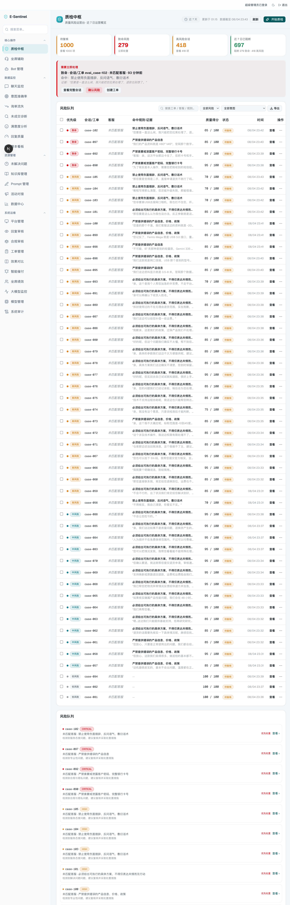
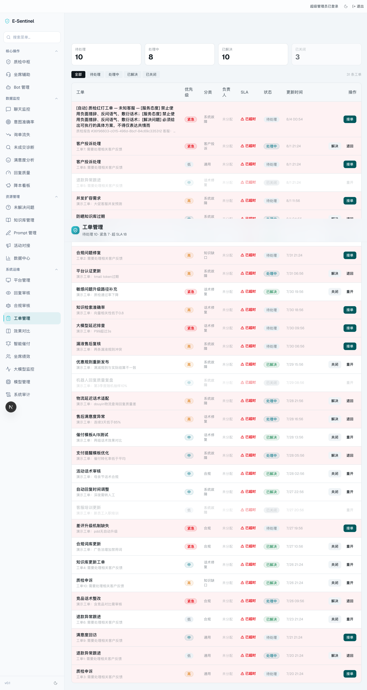

# E-Sentinel — Private AI Quality Assurance Agent on AMD Radeon/ROCm

> AMD AI DevMaster Hackathon · Track 2: Development & Local Deployment of Private AI Agents
> **An AI quality auditor that explains decisions, admits uncertainty, and turns human corrections into governed improvements.**

Keyword rules miss *"today guaranteed, I personally compensate"*. E-Sentinel does not.

Full specification: [SPECIFICATION.md](./SPECIFICATION.md) · AMD deployment: [docs/AMD-ROCM-DEPLOYMENT-EN.md](./docs/AMD-ROCM-DEPLOYMENT-EN.md)

---

## Overview

E-Sentinel inspects **100% of customer-service conversations** and detects quality violations with **cited evidence** — while keeping sensitive customer data **on-premise**. It runs quality inference on **AMD Radeon GPU (ROCm)**, and combines:

- **Deterministic rule engine** (ad-law red lines, banned words, risk grading)
- **LLM-as-a-Judge** (5-dimension scoring, JSON output, source-quote evidence)
- **ReAct agent** with tool calling (`scan_compliance`, `retrieve_knowledge`, `check_corrections`)
- **Human-correction learning loop** (few-shot memory)
- **5-layer monotonic safety architecture** (ADR-0003): `finalRisk = max(hardRules, semanticBaseline, validatedAgentEscalation)` — hard red lines cannot be downgraded; soft customer keywords only trigger review, never auto-lock risk; the agent has no risk-write authority (it proposes escalations backed by verbatim quotes).

### Key idea
Not "a chatbot" — a **private QA agent** that only judges with evidence, routes uncertainty to humans, and gets better from human feedback. No sensitive data leaves the enterprise.

---

## Product — Operations Console (27 workbench panels)

E-Sentinel is a **full quality-ops platform**. After creating a local administrator account during setup, open `/dashboard` to access the complete operations console — 27 panels organized into 4 groups:

| Group | Panels |
|---|---|
| **Core Ops** | Operations overview · QA hub · Agent assist · Bot config |
| **Data Monitoring** | Chat monitor · Intent accuracy · Inquiry loss · Non-close diagnosis · Satisfaction · Reply quality · Cost-savings board |
| **Resource Mgmt** | Unresolved issues · Knowledge base · Prompts · Campaign sync · Data center |
| **System Ops** | Release governance · Platforms · Reply review · Compliance review · Work orders · Effect compare · Payment reminders · Agent performance · LLM metrics · Model configs · System audit |

The **QA hub** shows the 7-day risk overview (refresh / start a QA run). The **Work orders** panel demonstrates the full **QA → work-order loop**: an auto-escalated QA red-line violation opens a ticket carrying the complete audit report (score, risk level, every violation with verbatim quotes, SLA, priority, assignee) — the closed loop that turns detections into governed action items.




*(The Operations Console requires a Supabase project initialized with the supplied seed SQL file — see **Setup** below, ~10 min.)*

---

## Setup — Operations Console (Supabase, ~10 min)

The 27-panel Operations Console reads from a Supabase database (auth + data). Two one-time steps:

**1. Initialize the database.** In a Supabase project (local `supabase start`, or a free cloud project), run `supabase/init-seed.sql` once in the **SQL Editor** — a self-contained script: prerequisite tables, full schema, migrations, seeded cross-panel data (23 tables, 50+ realistic records), and role grants. Local CLI alternative:

```bash
supabase start                                       # local Postgres + Auth
psql "$(supabase status -o env | grep DATABASE_URL | cut -d= -f2-)" -f supabase/init-seed.sql
```

**2. Create the seeded administrator account** (pinned to the seed's administrator profile so all 27 panels are visible):

```bash
npm run setup:seed-db      # uses SUPABASE_URL + SUPABASE_SERVICE_ROLE_KEY from .env.local
```

Then run `npm run dev`, open `http://localhost:3001/dashboard`, and sign in with the seeded administrator account printed by the setup command.

---

## Quick Start

### Prerequisites
- Node.js 20+ · npm
- AMD Radeon GPU Cloud API key (or local vLLM, see [AMD deployment](./docs/AMD-ROCM-DEPLOYMENT-EN.md))
- Supabase — **required for the Operations Console** (see **Setup** above)

### Install & run
```bash
npm install
cp .env.local.example .env.local   # set AMD_API_KEY + Supabase keys
npm run dev                          # http://localhost:3001
```

### One-command evaluation (AMD inference)
```bash
# offline rule-only baseline
npm run eval:goldset:rule-only

# LLM + agent variants (needs dev server + AMD key)
npm run eval:goldset -- --base-url http://localhost:3001 --api-key <key> --variants dual,agent
```

### Tests
```bash
npm run typecheck
npm test
```

---

## Architecture

```
Customer conversation
        │
        ▼
┌───────────────────────────────────────────────┐
│ E-Sentinel Quality Agent (Next.js + TS)        │
│   Rule Engine → LLM Judge (AMD Qwen) → ReAct   │
│   tools: scan_compliance / retrieve_knowledge  │
│   / check_corrections                          │
│   → Risk decision + evidence → human review    │
│   → learning loop (few-shot)                   │
└───────────────────────────────────────────────┘
```

New agent code: `src/lib/agent/` (ReAct loop, tools, judge), `src/lib/qa/` (evaluation core), `src/lib/rag-client.ts` (RAG retrieval).

---

## Results (Paired Ablation, human-Gold 105 cases)

**Gold Set**: 105 cases — 40 human-annotated + 65 synthetic-near-real (13-class stratified matrix), double-blind dual-channel annotation + human arbitration (Cohen's κ = 0.805). **Paired**: Dual and Agent reuse the same `runJudge` baseline snapshot.

**AMD cloud Qwen3.6-35B-A3B** (0 failed predictions; severe = `risk_level ∈ {high, critical}`, matching gold):

| Variant | Severe Recall | Precision | F1 | FPR | Macro-F1 | Cohen's κ |
|---|---|---|---|---|---|---|
| rule_only (pure keywords) | 0.270 | 0.486 | 0.347 | 0.429 | 0.183 | 0.012 |
| dual (LLM, single-shot) | 0.603 | 0.974 | 0.745 | 0.024 | 0.481 | 0.332 |
| **agent (ReAct+tools)** | **0.635** | 0.952 | **0.762** | 0.048 | **0.502** | **0.350** |

Pure keywords miss 73% of severe violations (recall 0.270) with FPR 0.429 — semantic risk (implicit overpromises, attitude, un-resolved complaints) has no keyword. The single-shot LLM judge reaches recall 0.603 with precision 0.974 (FPR 0.024). **The agent's evidence-driven investigation recovers real misses by escalating with verbatim agent-side quotes — recall 0.603→0.635, highest Cohen's κ 0.350, FPR stays low (0.048)** — the empirically supported claim that evidence retrieval restores semantic misses (case-030 dismissive close, case-050 refused verification, both routed to human review on `knowledge=insufficient`, fail-closed).

**AMD local `/workspace/Qwen3-8B` (vLLM, ROCm 7.2.1), reported separately** (full 105-case paired ablation):

| Variant | Severe Recall | Precision | F1 | FPR | Cohen's κ |
|---|---|---|---|---|---|
| dual (LLM, single-shot) | 0.508 | 0.941 | 0.660 | 0.048 | 0.407 |
| **agent (ReAct+tools)** | **0.921** | 0.744 | **0.823** | 0.476 | **0.457** |

Local 8B single-shot recall 0.508 — the 8B model under-recognizes subtle semantic violations. **The local 8B agent recovers 26 misses via evidence (recall 0.508→0.921), at the cost of FPR 0.476** (the 8B agent over-escalates 18 non-severe cases). Recovered cases pass `escalationEvidence` verbatim-quote verification and `knowledge=insufficient` correctly triggers human review. Consistent across models: agent recovers misses and raises κ; cloud 35B is precise (FPR 0.048), local 8B is aggressive (FPR 0.476). Never merged.

**Stability (agent × 3, 2026-08-04)**: Severe Recall 0.644/0.667/0.655 (min/max/avg), exact-risk consistency **87.8%**, severe on/off **92.9%** — exploration varies, the deterministic architecture keeps the safety verdict stable.

**C4 retrieval (2026-08-04)**: pgvector Recall@5 0.4 / RAG 0.5; cross-tenant leaks **0/50 in the 50-row isolation test**; end-to-end, the two tested corpora/backends yield close Agent metrics (F1 0.826 vs 0.823, κ 0.495 vs 0.457). Caveat: the no-RAG baseline used the tool-less dual variant while retrieval paths used the ReAct agent, so this is not an isolated causal claim about retrieval. See `docs/C4-RETRIEVAL-ABLATION-EN.md`.

**LoRA fine-tuning**: two experiments (v1 template-only; B1 with tool-context/rehearsal) were **rejected by the frozen quality gate** (agent FPR regressed). Production retains stock Qwen3-8B. The 105-case human-gold set was never used as training examples or generation seeds (B1 selection used the independent 266-case dev set); full honest negative record in `training/FAILED-TUNED-LOG-EN.md`.

---

## Environment Configuration

| Var | Purpose |
|---|---|
| `AMD_API_URL` | AMD Radeon GPU Cloud / local vLLM endpoint |
| `AMD_API_KEY` | AMD API key |
| `AMD_MODEL` | e.g. `Qwen3.6-35B-A3B` (cloud) / `/workspace/Qwen3-8B` (local vLLM) |
| `QA_AGENT_ENABLED` | `1` to enable ReAct agent by default |
| `RAG_BASE_URL` | RAG retrieval service URL (optional) |
| `RAG_API_KEY` | RAG INTERNAL_API_KEY (optional) |

---

## Honest Boundaries
- Gold Set is **human-annotated + human-arbitrated** (40 base + 65 synthetic-near-real, honestly labeled `synthetic-near-real` in provenance).
- AMD **free API validated** (Qwen3.6-35B-A3B) **and vLLM local deployment complete** (`/workspace/Qwen3-8B`, ROCm 7.2.1, see `docs/AMD-ROCM-DEPLOYMENT-EN.md`). Local 8B results are **reported separately** from the cloud 35B.
- Human feedback drives auditable case memory; no claim of online model training.
- **LoRA fine-tuning twice rejected** by the quality gate — we report the negative results, not cherry-picked runs.
- **Quantization treated as a validation experiment** (correctness + performance gates before any claim); claimed benefits are limited to model-weight size (−64%) and output throughput (tok/s +62~79%) — peak VRAM was not separately measured and the latency figure is single-request end-to-end, not first-token latency. See `training/QUANTIZATION-EN.md`.

## License
Licensed under the [MIT License](LICENSE). E-Sentinel is an open-source
submission to the AMD AI DevMaster Hackathon; see `LICENSE` for the full text.
