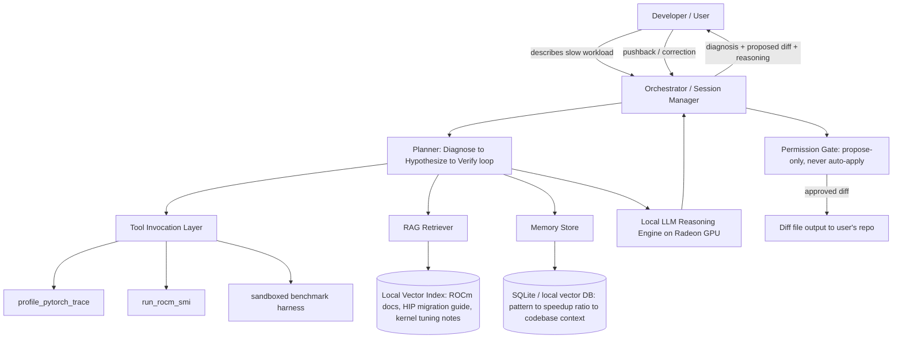

# OmniKernel-ROCm — Full Implementation Plan
### AMD AI DevMaster Hackathon 2026 · Track 2 (Private AI Agents)

**Deadline: August 6, 2026, 11:59 PM Beijing (8:59 AM PDT) — today is July 24. You have 13 days.**

---

## 0. Reality Check — Read This Before Anything Else

Thirteen days, team of up to 3, and a submission that requires: a spec document, a full source repo with README, a 3–5 minute demo video, and one supplementary artifact (PPT/poster). That means your actual *build* window is closer to **9–10 days**, because the last 3–4 days need to go to video, docs, packaging, and buffer for the inevitable ROCm environment surprises.

The single biggest risk to this project is not technical difficulty — it's **scope**. Cut hard, cut early, and cut in writing (see Section 6, "What You Are NOT Building"). Revisit that list every time you're tempted to add "one more thing."

---

## 1. Final Concept

**OmniKernel-ROCm** is a local, conversational ROCm/HIP performance-diagnosis agent. A developer describes a slow AMD GPU workload; the agent inspects live profiler and `rocm-smi` data, retrieves grounded ROCm documentation, forms a specific hypothesis about the bottleneck, proposes a concrete fix as a diff (never auto-applies or mutates the environment), and defends or revises that hypothesis when the developer pushes back. Across a session and across days, it remembers which optimization patterns actually paid off on *this* codebase, so its later suggestions get sharper, not generic.

**What makes it different from "hipify wrapped in a chatbot":** it reasons about *why*, cites the specific architectural cause, and can be argued with. Diagnosis and memory are the product, not the patch itself.

---

## 2. Rubric Mapping (know exactly what earns points, before you write a line of code)

| Rubric Line | Points | What Satisfies It |
|---|---|---|
| Clear task positioning & scenario | 20 | The pitch framing: "ROCm engineers judging you get a tool built for ROCm engineers" — make this explicit in your spec doc |
| Task decomposition, tool invocation, RAG, memory | 20 | Section 7 components below — all four, real not decorative |
| Smooth multi-turn interaction | 20 | The pushback/revision loop (Section 7.4) — THIS is your differentiator, protect the time budget for it |
| Core inference on Radeon GPU | 20 | Local LLM (not API) doing the reasoning, verified and shown in demo |
| Targeted inference speed optimization | 20 | Quantization + batching choices, documented with before/after numbers |
| Bonus: quantization/distillation via Radeon cloud model API | +20 | Stretch goal only — see Section 6 |

Two of five optional capabilities are the minimum; you're building all five, but unevenly (see Section 6). This gets you the "more capabilities = extra credit" language without blowing the schedule.

---

## 3. System Architecture



**Design principle enforced everywhere:** the agent never writes to the user's environment, driver, or repo without an explicit approval step. It proposes a diff to a file; a human applies it. This is both a safety decision and a rubric decision (permission control is an explicit scored capability).

---

## 4. Tech Stack

| Layer | Choice | Why |
|---|---|---|
| Local LLM | Quantized 7–8B instruct model (e.g., Qwen2.5-Coder or Llama-3.1-8B-Instruct, GGUF/AWQ) served via **vLLM or llama.cpp with ROCm backend** | Explicitly listed as optional framework in the rules; small enough to run comfortably and fast on a single Radeon GPU |
| Agent orchestration | **LangChain or a hand-rolled orchestrator** (see note below) | Rules require a "neutral framework" — hand-rolled is safest if time allows, LangChain if you need speed |
| RAG | **LlamaIndex or a plain FAISS/Chroma index** over a curated ROCm doc corpus | Don't index the entire ROCm docs site — curate 30–50 high-value pages/sections (HIP porting guide, common kernel pitfalls, `rocprof`/`rocm-smi` field reference) |
| Profiling tools | `rocm-smi` CLI wrapper, PyTorch profiler (`torch.profiler`) trace parser | Both are officially supported and produce structured, parseable output |
| Memory store | **SQLite** with a simple schema (Section 7.3) — no need for a vector DB here, this is structured data | Keeps it debuggable and fast to build |
| Benchmark sandbox | Subprocess isolation (`subprocess.run` with timeout, resource limits via `ulimit`/cgroups if time allows) | Never run candidate code in-process; never touch driver/env config |
| Frontend | Simple CLI + optional lightweight web UI (Gradio or plain Flask+HTML) | CLI is enough for the demo; Gradio buys you a nicer video with ~1 hour of work |
| Dev environment | **Antigravity** (see Section 5) locally, ported to **Radeon Cloud** for final GPU validation | Per hackathon rules — core inference must run on AMD Radeon GPU for judging |

**A note on "neutral framework":** the rules explicitly require any agent framework you use to be neutral (Dify/LangChain/LlamaIndex/AutoGen/CrewAI/OpenWebUI/CherryStudio, "any you love"). If you hand-roll the orchestrator instead of using one of these, say so plainly in your spec doc — it's allowed and arguably reads as more senior, but don't imply you used a framework you didn't.

---

## 5. Development Workflow: Antigravity → Radeon Cloud

Building and iterating entirely against a remote GPU environment is slow and will eat your 13 days. Recommended flow:

1. **Days 1–7 (mostly): build and iterate locally in Antigravity.** Use a small quantized model that runs on whatever GPU/CPU you have locally, or CPU-only for logic development where inference speed doesn't matter yet (orchestration, RAG indexing, memory schema, prompt engineering skeleton). This is where you get fast iteration loops.
2. **Day 5–6: first Radeon Cloud checkpoint.** Don't wait until the end to touch the real environment — get a "hello world" inference call working on Radeon Cloud + ROCm early, so you discover driver/dependency surprises while you still have time to fix them, not on day 12.
3. **Days 8–11: port and validate on Radeon Cloud.** Move the working local pipeline over, swap in the ROCm-backed inference engine, re-run your profiling/benchmark tools against the real hardware, and re-tune anything that behaved differently (quantization format support, memory limits, batch sizes).
4. **Days 12–13: everything runs exclusively on Radeon Cloud** for final demo recording, timing numbers, and submission packaging. Do not record your demo video against your local dev environment — the rules require you to demonstrate actual execution on AMD Radeon GPU, and judges will notice if it's clearly not.

**Follow the repo's actual environment instructions, not assumptions.** The hackathon doc points to `AMD-DEV-CONTEST/Radeon-hackathon-2026-07`'s README for how to access and configure Radeon Cloud — read that repo's README in full before Day 1, since exact provisioning steps, quotas, and any ROCm version pinning will be defined there, not in the rules doc you uploaded.

---

## 6. What You Are NOT Building (cut list — revisit this constantly)

- ❌ No live compilation of user code
- ❌ No autonomous driver or environment mutation, ever
- ❌ No AWQ quantization *pipeline* as a feature (you'll use an already-quantized model, not build a quantization tool)
- ❌ No massive RAG corpus — 30–50 curated pages beats 3,000 auto-scraped ones you haven't read
- ❌ No custom web UI framework work beyond Gradio/Flask basics — this is not where points live
- ❌ No multi-user/auth system
- ❌ Bonus tier (Radeon cloud model API + quantization/distillation, +20 pts) is **explicitly optional and last** — only attempt after everything else is demo-ready. Don't let it eat Day 8–9.

If you find yourself building something not in Section 7, stop and ask whether it's actually load-bearing for one of the five rubric lines in Section 2.

---

## 7. Core Components — Deep Dive

### 7.1 Tool Invocation Layer
Four tools, each a thin, well-tested wrapper:
- `run_rocm_smi()` → structured dict of utilization, VRAM, temp, clocks
- `profile_pytorch_trace(script_path)` → runs `torch.profiler` on a target script, returns parsed top-N ops by time/memory
- `run_benchmark(candidate_path, baseline_path)` → sandboxed subprocess execution, returns tokens/sec or latency comparison
- `propose_diff(original, patched)` → generates a unified diff, never writes it directly to the user's files

Keep each tool's output schema simple and consistent (JSON) — the LLM's reasoning quality depends heavily on clean structured input, not on tool sophistication.

### 7.2 RAG Retriever
Curate, don't scrape indiscriminately. Suggested corpus:
- HIP porting/migration guide (CUDA→HIP API mapping)
- Common ROCm performance pitfalls (occupancy, LDS bank conflicts, memory coalescing, wavefront size)
- `rocm-smi` and `rocprof` field reference docs
- 5–10 real-world "before/after" kernel optimization write-ups if you can find them (blog posts, AMD engineering blog, conference talks)

Chunk by logical section, not fixed token windows, so retrieved context is coherent enough to cite specifically in the agent's reasoning.

### 7.3 Memory Store Schema
```
optimization_attempts (
    id, timestamp, codebase_fingerprint, pattern_type,
    hypothesis, diff_summary, measured_speedup_ratio,
    outcome (accepted/rejected/regressed), notes
)
```
Query pattern: before proposing a new optimization, check whether a similar `pattern_type` was tried on this `codebase_fingerprint` before, and surface that history in the agent's reasoning ("last time we tried block-size tuning here, it regressed — here's why this is different").

### 7.4 The Multi-Turn Pushback Loop (your highest-value component)
This is what separates you from a one-shot pipeline and directly earns the 20-point interaction-experience line. Minimum viable version:

1. Agent states a diagnosis with a confidence level and cites the specific evidence (profiler line, doc section).
2. User can respond "that's not it" or "why do you think that."
3. Agent must **re-examine the actual evidence**, not just re-phrase — if the pushback is valid, it changes its diagnosis and says what changed its mind; if the evidence still supports it, it defends the position with the specific data point, not vague reassurance.
4. This loop is capped (e.g., 3 rounds) with a clear "let's just try both and benchmark" fallback so the demo doesn't get stuck in a loop.

Build this as *actual* re-grounding against tool output, not a canned "you're right, let me reconsider" — a technical judge will test this live if given the chance, and a shallow version will be exposed immediately.

### 7.5 Permission Gate
A simple, explicit allow-list config (what the agent may read vs. what requires confirmation to write) plus an audit log of every proposed action and whether it was approved. This is intentionally simple — the point-scoring value is that it's *real and enforced*, not that it's sophisticated.

---

## 8. The Signature Demo Moment

Pick **one specific, real optimization case** where the agent catches something non-obvious — before you write any orchestration code. Suggested candidates, pick whichever you can reproduce fastest:
- A batch-size threshold where memory coalescing breaks down and throughput cliffs
- An LDS (local data share) bank conflict in a simple custom kernel
- An occupancy limiter that isn't the "obvious" bottleneck a naive profiler read would suggest

Reproduce this case *first*, by hand, before building the agent around it. If you can't manually find and fix it in an hour, the agent won't magically do better under demo pressure. This becomes the spine of your demo video.

---

## 9. Phase-by-Phase Plan & Status (Updated July 28, 2026)

| Phase | Days | Goal | Status | Verification / Artifact |
|---|---|---|---|---|
| **0 — Setup & Hardware Access** | Day 1 | SSH to Radeon Cloud (`36.150.116.206`), GPU check (`0x744b`) | ✅ **COMPLETED** | `rocm-smi` verified, PyTorch 2.9 ROCm linked, pytest 63/63 passed |
| **1 — Core Reasoning Loop** | Days 2–4 | Diagnose → Hypothesize → Verify loop with mock & live backends | ✅ **COMPLETED** | Tested locally & on Radeon Cloud |
| **2 — RAG Expansion** | Day 5 | Add full `HIP Programming.md` (5,619 lines) to RAG corpus | ✅ **COMPLETED** | 371 chunks indexed with TF-IDF fallback |
| **3 — Cross-Session Memory** | Day 6 | SQLite schema & attempt tracking | ✅ **COMPLETED** | `optimization_attempts` table tracking speedups |
| **4 — Pushback Loop** | Days 7–8 | Multi-turn evidence-based challenge/re-examination | ✅ **COMPLETED** | Regex-extracted pushback responses citing ROCm metrics |
| **5 — Signature Hardware Benchmark**| Days 8–10 | Baseline vs Optimized kernel on real AMD Radeon RX 7900 XTX | ✅ **COMPLETED** | **10.13ms vs 6.85ms (1.48x speedup)** |
| **6 — Submission Materials** | Days 11–13 | Video demo, PPT/poster, repository fork & PR submission | ⏳ **NEXT CHAT** | Follow Section 10 checklist below |

---

## 10. Submission Package Checklist

Per the rules doc, Track 2 requires exactly these — track them explicitly:

- [ ] **Project Specification Document** covering: application scenario, agent architecture diagram (use the Mermaid diagram from Section 3, cleaned up), core capabilities intro, model + local deployment plan, inference-speed optimization description for Radeon GPU
- [ ] **Source code repository** — complete, with a README containing environment setup, startup guide, and full dependency list (test the README yourself on a clean checkout if you have time — this is where "reproducibility" points are won or lost)
- [ ] **Demo video, 3–5 minutes** — must show actual execution on AMD Radeon GPU, command line/GUI through to final result, fluidity and functional completeness
- [ ] **One supplementary item** — PPT or poster highlighting the scenario and value
- [ ] Fork the contest repo and submit via **pull request** per its README — don't leave this until the last hour, PR mechanics can surprise you

---

## 11. Demo Video Script Outline (3–5 min)

1. **0:00–0:30** — The problem, stated concretely: "Porting CUDA kernels to ROCm means digging through profiler traces and docs by hand. Here's an agent that does that reasoning with you."
2. **0:30–1:30** — Show the signature case: agent diagnoses the real bottleneck, cites specific evidence, proposes a diff.
3. **1:30–2:30** — The pushback moment: you challenge its diagnosis on camera, it re-examines and either revises or defends with evidence. This is the moment that proves it's not scripted.
4. **2:30–3:30** — Memory in action: run a second, related case and show it referencing the first attempt's outcome.
5. **3:30–4:15** — Quick architecture recap + the Radeon GPU performance numbers (inference latency, throughput) — this is where you satisfy the "optimization for inference speed" rubric line explicitly on screen.
6. **4:15–5:00** — Close: real-world value statement, what you'd build next.

Record on Radeon Cloud, not your local dev box — see Section 5.

---

## 12. Risk Register

| Risk | Mitigation |
|---|---|
| Radeon Cloud environment differs from local dev in ways that break things | Do the Day 5–6 checkpoint (Sec. 5) — surface this early, not on Day 12 |
| Pushback loop reads as scripted/shallow under live questioning | Build it against real tool re-invocation, test adversarially yourself before recording |
| RAG corpus too generic to look grounded | Curate manually, hand-pick sources, verify citations are specific not vague |
| Signature demo case doesn't reproduce reliably on Radeon Cloud | Reproduce it by hand FIRST (Sec. 8), before any agent code exists |
| Scope creep eats the schedule | Section 6 cut list — revisit daily |
| README doesn't actually reproduce for a judge | Test it on a clean environment/checkout before submitting |

---

## 13. Suggested Repo Structure

```
omnikernel-rocm/
├── README.md                     # setup, run, dependencies — this gets tested by judges
├── docs/
│   ├── spec.md                   # the Project Specification Document
│   └── architecture-diagram.png  # exported from the Mermaid diagram
├── src/
│   ├── orchestrator.py           # session/turn management, pushback loop
│   ├── planner.py                # diagnose → hypothesize → verify
│   ├── tools/
│   │   ├── rocm_smi.py
│   │   ├── profiler.py
│   │   ├── benchmark_sandbox.py
│   │   └── diff_proposer.py
│   ├── rag/
│   │   ├── index_builder.py
│   │   └── retriever.py
│   ├── memory/
│   │   ├── schema.sql
│   │   └── store.py
│   └── permission_gate.py
├── corpus/                       # curated ROCm docs for RAG
├── cases/                        # your signature demo case + fixtures
├── tests/
├── requirements.txt
└── scripts/
    ├── setup_radeon_cloud.sh
    └── run_demo.sh
```

---

## 14. Final Pre-Submission Checklist (Days 12–13)

- [ ] Everything in the demo video runs on real Radeon Cloud hardware, verifiably
- [ ] README tested on a clean checkout
- [ ] Spec doc covers every bullet the rules list, in the same order, so nothing is missed by a skimming judge
- [ ] Pushback loop tested adversarially by someone other than you
- [ ] Speedup numbers in the video match numbers in the spec doc (consistency matters to technical judges)
- [ ] No live driver/environment mutation code path exists anywhere in the repo
- [ ] PR opened against the contest repo following its README, with time to spare before the deadline
