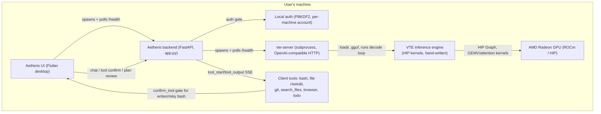

# Project Specification: Aetheris + VTE

**Track 2 — Development & Local Deployment of Private AI Agents**

A two-layer, fully local AI ecosystem for AMD Radeon GPUs: **VTE** (Vector & Tensor Engine), a from-scratch AMD-native inference engine with hand-written HIP kernels, and **Aetheris**, an agentic assistant built on top of it. Neither layer depends on a cloud API, a closed-source agent platform, or an existing inference runtime (llama.cpp/vLLM/Transformers) for its core path — both were built in-house specifically for this hardware.

## 1. Application Scenario

**Personal intelligent assistant, specialized for local software development.** Aetheris runs as a desktop app (Flutter UI + local HTTP backend) that chats, edits and reads files, runs shell commands, inspects git state, searches a codebase, browses the web read-only, and plans multi-step work — all while every token of inference happens on the user's own AMD Radeon GPU, never leaving the machine.

This scenario was chosen because it's the one the tool tree actually supports end-to-end (see [Core Capabilities](#3-core-capabilities)), not retrofitted onto it: bash execution, file read/write/edit, `git`, content search, and a todo/planning surface are exactly the primitives a local dev assistant needs, and nothing here assumes internet access at inference time.

## 2. Agent Architecture



**Request flow.** The Flutter UI launches `app.py` on startup (`BackendLauncher.ensureRunning()`, polling `/` every 500 ms, 20 s budget) and shows a connecting state until it's up. `app.py` lazily (or eagerly, via `/api/vte/warmup`) spawns `vte-server` as a subprocess and polls its `/health` endpoint (90 s budget) before serving the first real request. A chat turn streams over SSE; each round the model's output is scanned for a fenced tool-call block (` ```toolname\n...\n``` `) — this fenced-code-block convention is the *only* tool-invocation mechanism, chosen because it works with any instruction-tuned GGUF model without a native function-calling API.

**Tool dispatch is three-way**, not one flat list:
- **Server-executed** (`TOOL_REGISTRY`): `bash`, `read_file`, `write_file`, `edit_file`, `search_files`, `git`, `manage_memory` — run directly by the Python backend.
- **Client-executed** (`CLIENT_EXECUTED_TOOLS`): `navigate_browser`, `read_browser_page` — the backend can't drive a browser itself, so it emits a `browser_action` event and the Flutter process performs it, feeding the result back as a hidden continuation turn.
- **Confirmation-gated**: `write_file`/`edit_file` always, `bash` when the command matches a destructive pattern (`is_risky_bash_command`) — the round pauses, the UI shows a diff/command preview, and only a real user click resumes execution.

## 3. Core Capabilities

Implements **4 of the 5** optional capabilities listed in the task brief (2 are the stated minimum):

| Capability | Implementation |
|---|---|
| Tool invocation | Fenced-code-block calls dispatched to bash, file r/w/edit, `git` (status/diff/log/show/branch), content search, memory, browser navigation — see [Architecture](#2-agent-architecture) |
| Multi-step task planning | **Builder/Planner mode toggle.** In Planner mode the agent is restricted to read-only tools plus `write_plan`, which streams a Markdown plan to a floating review panel instead of acting; the user approves (→ Builder mode, agent executes) or sends revision feedback (plan gets rewritten, still Planner). Mode is enforced server-side (`BUILDER_ONLY_TOOLS`/`PLANNER_ONLY_TOOLS`), not just prompted |
| Local multi-turn memory | Full conversation history persisted per session; a separate `manage_memory` tool (add/search/forget) gives the agent durable memory across sessions, independent of the chat transcript |
| Permission control & privacy | Local username/password gate in front of the whole app; every internal API call requires a machine-local shared-secret header; destructive file writes and risky shell commands require an explicit human click before executing; `navigate_browser`/`read_browser_page` are read-only by construction — the agent cannot submit forms, enter credentials, or take side-effecting actions on the web |

Not implemented: local knowledge-base RAG (no embedding/vector-search layer exists yet).

## 4. Model Introduction & Local Deployment Plan

VTE loads raw **GGUF** checkpoints directly (no conversion step) and runs them through hand-written HIP kernels. Every model below is pulled from the *same* public GGUF the reference engines (llama.cpp/Ollama) use, so results are directly reproducible against a third party.

| Model | Params | Quant | Architecture | Source |
|---|---|---|---|---|
| Qwen2.5 1.5B Instruct | 1.5B | Q4_K_M | `qwen2` | [Qwen/Qwen2.5-1.5B-Instruct-GGUF](https://huggingface.co/Qwen/Qwen2.5-1.5B-Instruct-GGUF) |
| Qwen2.5 0.5B Instruct (draft) | 0.5B | Q4_K_M | `qwen2` | [Qwen/Qwen2.5-0.5B-Instruct-GGUF](https://huggingface.co/Qwen/Qwen2.5-0.5B-Instruct-GGUF) |
| Qwen2.5 7B Instruct | 7B | Q4_K_M | `qwen2` | [bartowski/Qwen2.5-7B-Instruct-GGUF](https://huggingface.co/bartowski/Qwen2.5-7B-Instruct-GGUF) |
| Qwen2.5 32B Instruct | 32.7B | Q4_K_M | `qwen2` | [bartowski/Qwen2.5-32B-Instruct-GGUF](https://huggingface.co/bartowski/Qwen2.5-32B-Instruct-GGUF) |
| Qwen3.5 2B | 2B | Q6_K | `qwen35` (hybrid full/linear attention) | [unsloth/Qwen3.5-2B-GGUF](https://huggingface.co/unsloth/Qwen3.5-2B-GGUF) |
| Granite 4.1 3B | 3B | Q8_0 | `granite` | [unsloth/granite-4.1-3b-GGUF](https://huggingface.co/unsloth/granite-4.1-3b-GGUF) |
| Granite 4.1 30B | 28.9B | Q8_0 | `granite` | [ibm-granite/granite-4.1-30b-GGUF](https://huggingface.co/ibm-granite/granite-4.1-30b-GGUF) |
| Llama 3.1 8B Instruct | 8B | Q4_K_M | `llama` | [bartowski/Meta-Llama-3.1-8B-Instruct-GGUF](https://huggingface.co/bartowski/Meta-Llama-3.1-8B-Instruct-GGUF) |

Three model families (`qwen2`, `qwen35`, `granite`, `llama` — four, counting Llama separately) are supported, spanning 0.5B to 32.7B parameters and three quantization schemes (Q4_K_M, Q6_K, Q8_0), on both a consumer RDNA3 card (RX 7600, 8 GB) and a workstation RDNA3 card (Radeon PRO W7900, 48 GB). Pull any of them with `vte pull <name>` (e.g. `vte pull qwen2.5:1.5b-q4_k_m`) or point `VTEModel.from_path()`/`from_pretrained()` at a manually-downloaded `.gguf`. GGUF integrity is checked against a known-good SHA-256 and a per-architecture metadata whitelist (layer count, tensor shapes) before any weight is loaded — see the environment/startup guide in the source repository's `README.md` for the exact commands.

## 5. Inference Speed Optimization on AMD Radeon GPU

All inference runs through **hand-written HIP kernels** (no llama.cpp/ggml/vLLM dependency in the core path): custom GEMV for Q4_K/Q5_0/Q6_K/Q8_0, Split-KV (Flash-Decoding-style) attention, HIP Graph-captured decode loop, and a GPU-side sampler restricted to top-k survivors instead of the full vocabulary.

### Single-sequence decode optimization history (RX 7600, batch=1)

| Stage | Throughput | Change |
|---|---|---|
| Naive per-thread GEMV | ~18.8 tok/s | Baseline |
| Coalesced GEMV | ~31.5 tok/s | Coalesced weight reads across a thread block |
| In-kernel Q4_K/Q6_K dequant | ~37.9 tok/s | Dequantize inline during the GEMV, no separate pass |
| QKV Two-Pass Split-K fusion | ~41.0 tok/s | Fills all CUs instead of leaving most idle |
| Vectorized sampler | ~62–70 tok/s | Top-k/top-p restricted to surviving candidates, not full vocab |
| LM Head captured into HIP Graph | ~71.7 tok/s | Removed the last eager (non-graph) kernel launch |
| Split-KV (Flash-Decoding) attention | ~78–79 tok/s, flat across generation length | Fixed a decline that used to reach ~50.8 tok/s by token 250 |
| Keep-alive pulse removed | **~100 tok/s** | A fixed-cost GPU clock-keepalive safety pulse became the largest artificial overhead once the loop above got fast enough |

GPU-only decode graph ceiling (HIP Graph replay in isolation): ~130 tok/s. Full write-up, including two independent optimization cycles that found no further gains and said so, in the source repository's `docs/PERFORMANCE.md`.

### Cross-engine comparison — VTE vs. llama.cpp, identical GGUF bytes on both sides

**RX 7600 (gfx1102, 32 CU, 8 GB)** — reference: Ollama (llama.cpp backend), `temperature=0`, decode-only timing:

| Model | VTE (tok/s) | Ollama/llama.cpp (tok/s) | VTE / reference |
|---|---|---|---|
| Qwen2.5 1.5B Q4_K_M | **112.98** | 110.76 | **102.0%** |
| Granite 4.1 3B Q8_0 | **55.65** | 50.84 | **109.5%** |
| Qwen3.5 2B Q6_K | 69.00 | 77.00 | 89.6% |
| Qwen2.5 7B Q4_K_M | 39.60 | 42.71 | 92.7% |

**AMD Radeon PRO W7900 (gfx1100, 96 CU, 48 GB)** — reference: `llama-cpp-python` built with `GGML_HIP=on` against the same ROCm 7.2.1 install, same 3 prompts, `max_tokens=150`:

| Model | VTE (tok/s) | llama.cpp (tok/s) | VTE / llama.cpp |
|---|---|---|---|
| Granite 4.1 30B Q8_0 | 20.2 | 22.5 | 89.8% |
| Qwen2.5 32B Q4_K_M | 22.70 | 28.56 | 79.5% |
| Llama 3.1 8B Q4_K_M | 72.68 | 93.45 | 77.8% |
| Qwen2.5 1.5B Q4_K_M | 140.2 | 201.5 | 69.6% |

The relative gap shrinks as model size grows (69.6% → 89.8%) regardless of architecture — confirmed by a controlled test: Llama 3.1 8B (a third, unrelated architecture) lands between the two Qwen data points, exactly where its size predicts, not near Granite's ratio. The real second variable is quantization, not architecture: the only Q8_0 point (Granite) is the one that breaks the size curve, consistent with `gemv_q4k`'s known per-superblock header-read redundancy that the Q8_0 kernel doesn't have. Full investigation, including a live experiment that ruled out GPU compute-unit under-scaling as the cause, in `docs/PERFORMANCE.md` and `docs/BENCHMARK_W7900.md`.

### GPU telemetry (W7900, Granite 4.1 30B, amd-smi, ~145 samples across load + generation)

| Metric | Min | Max | Mean |
|---|---|---|---|
| VRAM used | 26 MB (idle) | 31029 MB (~30.3 GiB) | 15632 MB |
| Hotspot temperature | 30 °C | 55 °C | 37.1 °C |
| Power draw | 7 W (idle) | 243 W | 72.9 W |
| GPU graphics utilization | 0% | 100% | 26.0% |

No thermal throttling observed at any point across either GPU (peak 55 °C on a 241 W-rated card).

## 6. Reproducibility

- Model links and exact quantizations: [Section 4](#4-model-introduction--local-deployment-plan).
- Environment setup, dependency list, and startup sequence: `README.md` at the repository root.
- Raw benchmark JSON results and per-sample GPU telemetry (not just the aggregated tables above): `VTE/docs/benchmark_data_w7900/`.
- Full optimization and bug-fix history with methodology for every number in this document: `VTE/docs/PERFORMANCE.md`, `VTE/docs/BENCHMARK_W7900.md`.
