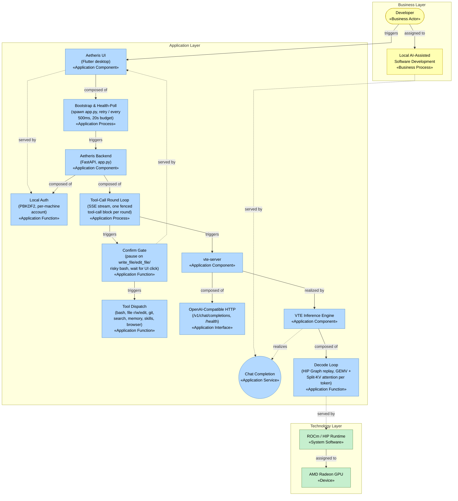

# Project Specification: Aetheris + VTE

**Track 2: Development & Local Deployment of Private AI Agents**

A two-layer, fully local AI ecosystem for AMD Radeon GPUs: **VTE** (Vector & Tensor Engine), a from-scratch AMD-native inference engine with hand-written HIP kernels, and **Aetheris**, an agentic assistant built on top of it. Neither layer depends on a cloud API, a closed-source agent platform, or an existing inference runtime (llama.cpp/vLLM/Transformers) for its core path. Both were built in-house specifically for this hardware.

## 1. Application Scenario

**Personal intelligent assistant, specialized for local software development.** Aetheris runs as a desktop app (Flutter UI + local HTTP backend) that chats, edits and reads files, runs shell commands, inspects git state, searches a codebase, browses the web read-only, and plans multi-step work, all while every token of inference happens on the user's own AMD Radeon GPU, never leaving the machine.

This scenario was chosen because it's the one the tool tree actually supports end-to-end (see [Core Capabilities](#3-core-capabilities)), not retrofitted onto it: bash execution, file read/write/edit, `git`, content search, and a todo/planning surface are exactly the primitives a local dev assistant needs, and nothing here assumes internet access at inference time.

## 2. Agent Architecture

Modeled in **ArchiMate** notation (Business / Application / Technology layers), all confined to a single node since this is a fully local, single-machine deployment with no distributed or cloud tier:



Legend: solid arrows are ArchiMate **triggering**/**assignment**/**composition** relationships (active behavior, structural containment); dotted arrows are **realization**/**serving** (a concrete element fulfilling a more abstract service). `Boot`, `Loop`, `Gate`, and `Decode` are the actual internal processes/functions behind each component, not just black boxes: bootstrap and health-polling, the per-round SSE tool-call loop, the human-in-the-loop confirmation pause, and the HIP-Graph decode step, respectively.

**Request flow.** The Flutter UI launches `app.py` on startup (`BackendLauncher.ensureRunning()`, polling `/` every 500 ms, 20 s budget) and shows a connecting state until it's up. `app.py` lazily (or eagerly, via `/api/vte/warmup`) spawns `vte-server` as a subprocess and polls its `/health` endpoint (90 s budget) before serving the first real request. A chat turn streams over SSE; each round the model's output is scanned for a fenced tool-call block (` ```toolname\n...\n``` `). This fenced-code-block convention is the *only* tool-invocation mechanism, chosen because it works with any instruction-tuned GGUF model without a native function-calling API.

**Tool dispatch is three-way**, not one flat list:
- **Server-executed** (`TOOL_REGISTRY`): `bash`, `read_file`, `write_file`, `edit_file`, `search_files`, `git`, `manage_memory`, which are run directly by the Python backend.
- **Client-executed** (`CLIENT_EXECUTED_TOOLS`): `navigate_browser`, `read_browser_page`. The backend can't drive a browser itself, so it emits a `browser_action` event and the Flutter process performs it, feeding the result back as a hidden continuation turn.
- **Confirmation-gated**: `write_file`/`edit_file` always, `bash` when the command matches a destructive pattern (`is_risky_bash_command`). The round pauses, the UI shows a diff/command preview, and only a real user click resumes execution.

**Cross-platform validation.** The Flutter UI itself is Windows-only (no `linux/` platform target configured), and the primary, full end-to-end demo (UI + backend + VTE) was built and runs on Windows/RX 7600. The agent *backend* (`app.py`, pure Python/FastAPI, no Windows-specific code) is not Windows-specific, though, and was separately validated headless (no UI, direct HTTP calls against the real `stream_agent` loop) on Linux, on the same AMD Radeon Cloud W7900 instance used for the inference-engine benchmarks in Section 5 -- confirming the agent itself, not just VTE, runs correctly cross-platform. Verified for real, not assumed: server-executed tool dispatch (`bash`, real subprocess execution with correct output), skill creation and retrieval (`manage_skill`, TF-IDF search returning the right skill with its full structured content), memory creation and retrieval (`manage_memory`, including one round that survived a model-generated typo in the tool tag thanks to the fence-tag tolerance fix), and the `write_file` confirmation gate end-to-end (the `confirm_tool` pause, `POST /api/tools/execute` performing the real write after simulated approval, and the file landing with the exact requested content).

## 3. Core Capabilities

Implements **all 5** optional capabilities listed in the task brief (2 are the stated minimum):

| Capability | Implementation |
|---|---|
| Tool invocation | Fenced-code-block calls dispatched to bash, file r/w/edit, `git` (status/diff/log/show/branch), content search, memory, skills, browser navigation (see [Architecture](#2-agent-architecture)) |
| Multi-step task planning | **Builder/Planner mode toggle.** In Planner mode the agent is restricted to read-only tools plus `write_plan`, which streams a Markdown plan to a floating review panel instead of acting; the user approves (→ Builder mode, agent executes) or sends revision feedback (plan gets rewritten, still Planner). Mode is enforced server-side (`BUILDER_ONLY_TOOLS`/`PLANNER_ONLY_TOOLS`), not just prompted |
| Local multi-turn memory | Full conversation history persisted per session; a separate `manage_memory` tool (add/search/forget) gives the agent durable memory across sessions, independent of the chat transcript |
| Local knowledge retrieval (RAG) | **Skill library**: reusable named procedures (`SKILL.md` files, YAML frontmatter + structured body) the agent writes for itself via `manage_skill` (add/search/forget) after solving something non-trivial, and searches before starting a task it may have solved before. Retrieval is TF-IDF cosine similarity over the current library, recomputed per query, which is deliberately not a neural embedding (no ONNX/sentence-transformers/extra model process): on the same RX 7600 that's already fully committed to the loaded chat model, a second model competing for the remaining ~4-6 GB of VRAM (or CPU cycles, for a "local" embedding server) isn't free the way it would be on a discrete deployment. TF-IDF costs nothing beyond the CPU time to tokenize a few dozen short skill files |
| Permission control & privacy | Local username/password gate in front of the whole app, generated automatically (random credentials) on first run rather than requiring manual setup; every internal API call requires a machine-local shared-secret header; destructive file writes and risky shell commands require an explicit human click before executing; `navigate_browser`/`read_browser_page` are read-only by construction; the agent cannot submit forms, enter credentials, or take side-effecting actions on the web |

## 4. Model Introduction & Local Deployment Plan

VTE loads raw **GGUF** checkpoints directly (no conversion step) and runs them through hand-written HIP kernels. Every model below is pulled from the *same* public GGUF the reference engines (llama.cpp/Ollama) use, so results are directly reproducible against a third party.

| Model | Params | Quant | Architecture | Source |
|---|---|---|---|---|
| Qwen2.5 1.5B Instruct | 1.5B | Q4_K_M | `qwen2` | [bartowski/Qwen2.5-1.5B-Instruct-GGUF](https://huggingface.co/Qwen/Qwen2.5-1.5B-Instruct-GGUF) |
| Qwen2.5 0.5B Instruct (draft) | 0.5B | Q4_K_M | `qwen2` | [bartowski/Qwen2.5-0.5B-Instruct-GGUF](https://huggingface.co/Qwen/Qwen2.5-0.5B-Instruct-GGUF) |
| Qwen2.5 7B Instruct | 7B | Q4_K_M | `qwen2` | [bartowski/Qwen2.5-7B-Instruct-GGUF](https://huggingface.co/bartowski/Qwen2.5-7B-Instruct-GGUF) |
| Qwen2.5 32B Instruct | 32.7B | Q4_K_M | `qwen2` | [bartowski/Qwen2.5-32B-Instruct-GGUF](https://huggingface.co/bartowski/Qwen2.5-32B-Instruct-GGUF) |
| Qwen3.5 2B | 2B | Q6_K | `qwen35` (hybrid full/linear attention) | [unsloth/Qwen3.5-2B-GGUF](https://huggingface.co/unsloth/Qwen3.5-2B-GGUF) |
| Granite 4.1 3B | 3B | Q8_0 | `granite` | [ibm-granite/granite-4.1-3b-GGUF](https://huggingface.co/unsloth/granite-4.1-3b-GGUF) |
| Granite 4.1 30B | 28.9B | Q8_0 | `granite` | [ibm-granite/granite-4.1-30b-GGUF](https://huggingface.co/ibm-granite/granite-4.1-30b-GGUF) |
| Llama 3.1 8B Instruct | 8B | Q4_K_M | `llama` | [bartowski/Meta-Llama-3.1-8B-Instruct-GGUF](https://huggingface.co/bartowski/Meta-Llama-3.1-8B-Instruct-GGUF) |

Three model families (`qwen2`, `qwen35`, `granite`, `llama`, or four, counting Llama separately) are supported, spanning 0.5B to 32.7B parameters and three quantization schemes (Q4_K_M, Q6_K, Q8_0), on both a consumer RDNA3 card (RX 7600, 8 GB) and a workstation RDNA3 card (Radeon PRO W7900, 48 GB). Pull any of them with `vte pull <name>` (e.g. `vte pull qwen2.5:1.5b-q4_k_m`) or point `VTEModel.from_path()`/`from_pretrained()` at a manually-downloaded `.gguf`. GGUF integrity is checked against a known-good SHA-256 and a per-architecture metadata whitelist (layer count, tensor shapes) before any weight is loaded (see the environment/startup guide in the source repository's `README.md` for the exact commands).

### Additional deployment target: Lemonade (AMD's own local LLM server)

Beyond powering Aetheris directly, VTE integrates as a native RDNA3 backend into [Lemonade](https://github.com/lemonade-sdk/lemonade), AMD's own local LLM server project, being not just "compatible with," but wired into Lemonade's actual backend contract:

- `vte-server` ([vte/server/http_server.py](VTE/vte/server/http_server.py)) was purpose-built to satisfy `WrappedServer`, the exact subprocess/HTTP contract every Lemonade backend implements (`load()`/`unload()`/`chat_completion()`/`completion()` over loopback HTTP, never in-process), which uses the same one-model-per-process crash-isolation pattern Aetheris itself relies on, reused rather than reinvented.
- A Lemonade-side recipe registration (`BackendDescriptor`, a `WrappedServer` subclass, and `server_models.json` entries) ships three validated model entries: `Qwen2.5-1.5B-Instruct-VTE`, `Granite-4.1-3B-VTE`, and `Qwen3.5-2B-VTE`, where each one was loaded and generated from for real, not just downloaded, before being registered.
- Building this integration surfaced a real bug in Lemonade's own configuration system: `RuntimeConfig::recipe_options()` only ever resolves `ctx_size` from the top-level global config, never from a per-recipe `recipe_options` entry, even though the shared-option mechanism (`uses_ctx_size`) implies it should. Confirmed by building and loading against real hardware, not by reading the code. A `config_extra` value that looked correct in `config.json` had zero effect on the resolved context size. Worked around per-model (each VTE entry pins its own `ctx_size` explicitly) since a large auto-tuned context on VTE's Split-KV attention measured a real ~15-20% throughput regression, not just a theoretical one. Full writeup in `VTE/docs/LEMONADE.md`.
- `vte-server` ships as a packaged, self-contained Windows release asset (~24 MB compressed) that Lemonade's own installer downloads by version tag. A naive PyInstaller bundle pulled in 541 MB of unused torch/transformers before the collection was scoped down to just the packages actually imported.

## 5. Inference Speed Optimization on AMD Radeon GPU

All inference runs through **hand-written HIP kernels** (no llama.cpp/ggml/vLLM dependency in the core path): custom GEMV for Q4_K/Q5_0/Q6_K/Q8_0, Split-KV (Flash-Decoding-style) attention, HIP Graph-captured decode loop, and a GPU-side sampler restricted to top-k survivors instead of the full vocabulary.

### Single-sequence decode optimization history (RX 7600, batch=1)

| Stage | Throughput | Change |
|---|---|---|
| Naive per-thread GEMV | ~18.8 tok/s | Baseline |
| Coalesced GEMV | ~31.5 tok/s | Coalesced weight reads across a thread block |
| In-kernel Q4_K/Q6_K dequant | ~37.9 tok/s | Dequantize inline during the GEMV, no separate pass |
| QKV Two-Pass Split-K fusion | ~41.0 tok/s | Fills all CUs instead of leaving most idle |
| Vectorized sampler | ~62–70 tok/s | Top-k/top-p restricted to surviving candidates, not full vocab |
| LM Head captured into HIP Graph | ~71.7 tok/s | Removed the last eager (non-graph) kernel launch |
| Split-KV (Flash-Decoding) attention | ~78–79 tok/s, flat across generation length | Fixed a decline that used to reach ~50.8 tok/s by token 250 |
| Keep-alive pulse removed | **~100 tok/s** | A fixed-cost GPU clock-keepalive safety pulse became the largest artificial overhead once the loop above got fast enough |

GPU-only decode graph ceiling (HIP Graph replay in isolation): ~130 tok/s. Full write-up, including two independent optimization cycles that found no further gains and said so, in the source repository's `docs/PERFORMANCE.md`.

### Cross-engine comparison: VTE vs. llama.cpp, identical GGUF bytes on both sides

**RX 7600 (gfx1102, 32 CU, 8 GB)** (reference: Ollama (llama.cpp backend), `temperature=0`, decode-only timing):

| Model | VTE (tok/s) | Ollama/llama.cpp (tok/s) | VTE / reference |
|---|---|---|---|
| Qwen2.5 1.5B Q4_K_M | **112.98** | 110.76 | **102.0%** |
| Granite 4.1 3B Q8_0 | **55.65** | 50.84 | **109.5%** |
| Qwen3.5 2B Q6_K | 69.00 | 77.00 | 89.6% |
| Qwen2.5 7B Q4_K_M | 39.60 | 42.71 | 92.7% |

**AMD Radeon PRO W7900 (gfx1100, 96 CU, 48 GB), accessed through AMD's official Radeon Cloud platform** ([radeon-global.anruicloud.com](https://radeon-global.anruicloud.com/), the same GPU-access program this hackathon's own README points participants to). Reference: `llama-cpp-python` built with `GGML_HIP=on` against the same ROCm 7.2.1 install, same 3 prompts, `max_tokens=150`:

| Model | VTE (tok/s) | llama.cpp (tok/s) | VTE / llama.cpp |
|---|---|---|---|
| Granite 4.1 30B Q8_0 | 20.2 | 22.5 | 89.8% |
| Qwen2.5 32B Q4_K_M | 22.70 | 28.56 | 79.5% |
| Llama 3.1 8B Q4_K_M | 72.68 | 93.45 | 77.8% |
| Qwen2.5 1.5B Q4_K_M | 140.2 | 201.5 | 69.6% |

The relative gap shrinks as model size grows (69.6% → 89.8%) regardless of architecture, which was confirmed by a controlled test: Llama 3.1 8B (a third, unrelated architecture) lands between the two Qwen data points, exactly where its size predicts, not near Granite's ratio. The real second variable is quantization, not architecture: the only Q8_0 point (Granite) is the one that breaks the size curve, consistent with `gemv_q4k`'s known per-superblock header-read redundancy that the Q8_0 kernel doesn't have. Full investigation, including a live experiment that ruled out GPU compute-unit under-scaling as the cause, in `docs/PERFORMANCE.md` and `docs/BENCHMARK_W7900.md`.

### GPU telemetry (W7900 via AMD Radeon Cloud, Granite 4.1 30B, amd-smi, ~145 samples across load + generation)

| Metric | Min | Max | Mean |
|---|---|---|---|
| VRAM used | 26 MB (idle) | 31029 MB (~30.3 GiB) | 15632 MB |
| Hotspot temperature | 30 °C | 55 °C | 37.1 °C |
| Power draw | 7 W (idle) | 243 W | 72.9 W |
| GPU graphics utilization | 0% | 100% | 26.0% |

No thermal throttling observed at any point across either GPU (peak 55 °C on a 241 W-rated card).

## 6. Reproducibility

- Model links and exact quantizations: [Section 4](#4-model-introduction--local-deployment-plan).
- Environment setup, dependency list, and startup sequence: `README.md` at the repository root.
- Raw benchmark JSON results and per-sample GPU telemetry (not just the aggregated tables above): `VTE/docs/benchmark_data_w7900/`.
- Full optimization and bug-fix history with methodology for every number in this document: `VTE/docs/PERFORMANCE.md`, `VTE/docs/BENCHMARK_W7900.md`.
