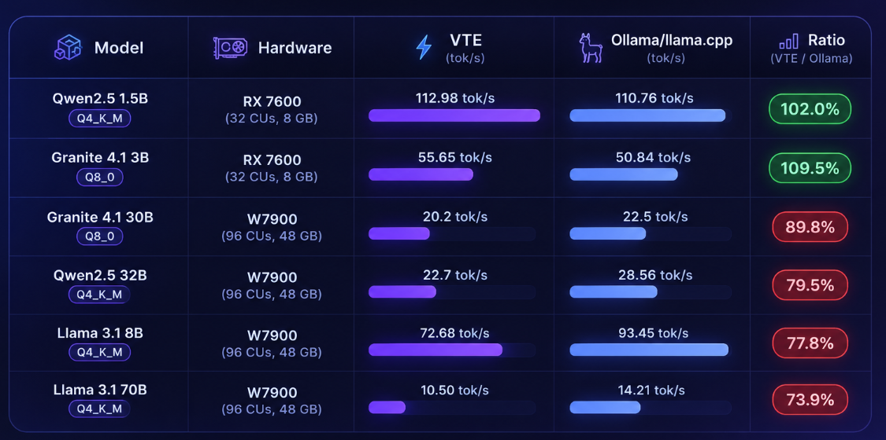

# Aetheris

**A local, private AI coding agent for AMD Radeon GPUs.** Chats, reads and edits files, runs shell commands, checks git state, searches your codebase, plans multi-step work, and remembers things across sessions, all running on your own machine. No cloud API key, no data leaving your GPU.

Built for **Track 2: Development & Local Deployment of Private AI Agents**.

Under the hood, Aetheris runs on **VTE**, a from-scratch inference engine we also built for this hardware instead of depending on an existing runtime. That part's genuinely interesting if you're into GPU kernels, and it gets its own section [below](#under-the-hood-vte-the-engine-we-built-to-power-this), but it's the supporting cast here, not the headline. Aetheris is the project; VTE is what lets it run entirely local.

## What it can actually do

Five capabilities, all real (not stubbed for the demo):

- **Tool use.** Reads/writes/edits files, runs shell commands, inspects `git` (status/diff/log/show/branch), searches your codebase, browses the web read-only.
- **Plans before it acts.** A Planner/Builder mode toggle: in Planner mode the agent can only read and write a plan, not touch anything, until you approve it. Enforced server-side, not just prompted.
- **Remembers across sessions.** A separate memory tool (add/search/forget), independent of chat history, so the agent doesn't start from zero every conversation.
- **Builds its own skill library.** When it solves something non-trivial, it can write itself a reusable procedure and retrieve it next time a similar task comes up, no separate embedding model needed for this.
- **Asks before doing anything risky.** File writes, edits, and destructive-looking shell commands pause for your explicit click (or, from the terminal, a typed `y`) before they run.

Full technical writeup of how each of these is wired: [`PROJECT_SPECIFICATION.md`](PROJECT_SPECIFICATION.md).

## Quickstart

Pick the row that matches your setup. All three talk to the exact same backend and agent loop, just through a different front end.

| | Windows | Linux |
|---|---|---|
| **App (GUI)** | ✅ [below](#windows-app-the-full-experience) | Not available yet, the desktop UI is a Windows build for now (see [Note on Linux](#note-on-linux)) |
| **Terminal** | ✅ [below](#terminal-windows-or-linux) | ✅ [below](#terminal-windows-or-linux) |

### Prerequisites (all paths)

- Python 3.10+
- An AMD Radeon GPU with the HIP runtime available: **Windows** needs the AMD HIP SDK installed, **Linux** needs ROCm (normally under `/opt/rocm`)
- Enough VRAM for whatever model you pick (run `vte list` after installing to see every curated model and its size; the default model, Llama 3.1 8B Instruct, needs about 5 GB)

VTE reads your GPU's real architecture and compute-unit count at startup; there's nothing to configure by hand beyond having the driver/SDK installed.

**Why Llama 3.1 8B Instruct**: it's noticeably better at the tool-calling this agent actually depends on (deciding when to read/write a file, run a command, or update a plan) than the tiny Qwen2.5 1.5B demo model, and it correctly mirrors the user's input language every time. IBM Granite 4.1 30B was tried first and is a strong reasoner, but it reproducibly defaults to Portuguese/Spanish greetings on short replies once the real tool-documentation system prompt is in context, regardless of instruction wording or position; see [Known limitations](VTE/docs/LIMITATIONS.md#model-compatibility) for the full writeup. Downloads straight from Hugging Face ([Meta-Llama-3.1-8B-Instruct-GGUF](https://huggingface.co/bartowski/Meta-Llama-3.1-8B-Instruct-GGUF)) into `VTE/Model/`, same `vte pull` mechanism as any other curated model. If your GPU is tighter on VRAM, `qwen2.5:1.5b-q4_k_m` (~1 GB) is the lighter fallback, selectable from the same dropdown.

### Windows: app (the full experience)

```bash
cd "Aetheris Studio"
python -m venv .venv
.venv\Scripts\pip install --upgrade pip
.venv\Scripts\pip install -e "..\VTE"
.venv\Scripts\pip install -r requirements.txt
.venv\Scripts\vte pull llama3.1:8b-instruct-q4_k_m

cd aetheris_ui
flutter pub get
flutter run -d windows
```

The UI starts the Python backend for you on launch and waits for it to come up; you don't run anything else by hand. First run generates a local login and writes it to `Aetheris Studio\GENERATED_LOGIN_READ_AND_DELETE.txt`, log in with those credentials once, then delete the file.

### Terminal (Windows or Linux)

Same backend the app uses, just driven from a small chat script instead of the Flutter UI. This is the primary way to run Aetheris on Linux today, and works just as well on Windows if you'd rather skip the Flutter build. No login here, unlike the app above: the username/password screen is a Flutter-only gate, the backend itself only ever checks the internal token `scripts/chat.py` already reads from `.env` automatically.

```bash
cd "Aetheris Studio"
python -m venv .venv

# Windows
.venv\Scripts\pip install --upgrade pip
.venv\Scripts\pip install -e "..\VTE"
.venv\Scripts\pip install -r requirements.txt

# Linux
.venv/bin/pip install --upgrade pip
.venv/bin/pip install -e "../VTE"
.venv/bin/pip install -r requirements.txt
```

Pull a model (downloads the public GGUF from Hugging Face into `VTE/Model/`):

```bash
.venv\Scripts\vte pull llama3.1:8b-instruct-q4_k_m    # Windows
.venv/bin/vte pull llama3.1:8b-instruct-q4_k_m         # Linux
```

Start the backend (leave this running in its own terminal):

```bash
.venv\Scripts\python app.py    # Windows
.venv/bin/python app.py        # Linux
```

In a second terminal, start chatting:

```bash
.venv\Scripts\python scripts\chat.py path\to\your\project    # Windows
.venv/bin/python scripts/chat.py path/to/your/project         # Linux
```

The `project` argument is the folder the agent's file/git/search tools operate on, defaults to the current directory if you leave it off. Type a message, press Enter, watch it stream, approve any file write/edit it proposes with `y`.

### Note on Linux

The Flutter desktop UI is a Windows-only build right now (no `linux/` target configured), so the app-with-a-window experience is Windows-only for the moment. The agent *backend* underneath it has no such limitation: it's plain Python/FastAPI, and this project's own testing ran it headless (no UI, real HTTP calls against the live agent loop) on an AMD Radeon Cloud W7900 Linux instance, confirming tool dispatch, memory, skills, and the write-confirmation gate all work identically there. `scripts/chat.py` above is that same validated path, just packaged as something you can actually type into instead of hand-rolling `curl` SSE parsing.

## Things to try

A few prompts to get a feel for what the agent actually does, assuming `project_path` points at some real codebase (yours, or this repo itself). Naming the tool explicitly ("use the X tool") is more reliable with the default 8B model than an open-ended ask -- confirmed directly: a vague *"what does this codebase do"* got a generic, hallucinated answer with zero tool calls in testing, while pointing at a specific real file first did not.

- *"Read the README.md and tell me in two paragraphs what this project does."* Grounded in a real file instead of an open-ended ask, which the model reliably explores; a vague version of this prompt answered from a guess without reading anything.
- *"Find every place `TODO` appears and summarize what's left."* `search_files` across the whole project.
- *"Use the git tool to show me the last 5 commits."* `git log`, no working-tree access needed.
- *"Use the edit_file tool to add a docstring to the `main` function in `<some file>`."* A real edit; you'll see the confirmation prompt before it lands.
- *"Plan out how you'd add rate limiting to this API, but don't touch anything yet."* Switches the agent into Planner mode, streams a plan, waits for your go-ahead.
- *"Remember that this project uses tabs, not spaces."* Writes to the memory tool; ask again in a later session and it recalls it without the fact being back in the chat transcript.
- *"Use the browser tool to look up the current stable version of \<some library> online."* Read-only, no form-filling or credentials, ever; without naming the tool the model sometimes reaches for `bash curl` instead, which works but skips the actual browser feature.

## Under the hood: VTE, the engine we built to power this

Aetheris needed a local inference engine that runs entirely on an AMD Radeon GPU with nothing else installed, so we wrote one: **VTE**, hand-written HIP kernels, no llama.cpp/vLLM/PyTorch in the inference path. It turned into its own small systems project along the way, GEMV kernels tuned against real memory-bandwidth measurements, a HIP-Graph-captured decode loop, custom attention, the works, and on some models it decodes *faster* than Ollama/llama.cpp on the same GGUF file, on both a consumer card and a workstation one:



| Model | Hardware | VTE | Ollama/llama.cpp | Ratio |
|---|---|---|---|---|
| Qwen2.5 1.5B Q4_K_M | RX 7600 (32 CUs, 8 GB) | **112.98 tok/s** | 110.76 tok/s | **102.0%** |
| Granite 4.1 3B Q8_0 | RX 7600 (32 CUs, 8 GB) | **55.65 tok/s** | 50.84 tok/s | **109.5%** |
| Granite 4.1 30B Q8_0 | W7900 (96 CUs, 48 GB) | 20.2 tok/s | 22.5 tok/s | 89.8% |
| Qwen2.5 32B Q4_K_M | W7900 (96 CUs, 48 GB) | 22.7 tok/s | 28.56 tok/s | 79.5% |
| Llama 3.1 8B Q4_K_M | W7900 (96 CUs, 48 GB) | 72.68 tok/s | 93.45 tok/s | 77.8% |
| Llama 3.1 70B Q4_K_M | W7900 (96 CUs, 48 GB) | 10.50 tok/s | 14.21 tok/s | 73.9% |

Real GPU telemetry (`amd-smi`, sampled every ~0.5s) from the W7900 runs above, load through 3 back-to-back generations each, no thermal throttling on any of them:

| Model | VRAM peak | Hotspot temp peak | Power peak |
|---|---|---|---|
| Granite 4.1 30B Q8_0 | 30.3 GiB | 55°C | 243 W |
| Qwen2.5 32B Q4_K_M | 20.4 GiB | 60°C | 295 W |
| Llama 3.1 8B Q4_K_M | 5.7 GiB | 48°C | 292 W |
| Llama 3.1 70B Q4_K_M | ~42.5 GiB | not sampled | not sampled |

VRAM peaks match the predicted weights+KV-cache+arena breakdown almost exactly in every case, on a card with a 241 W TDP.

The table above is decode speed; prefill (time-to-first-token) had its own gap, closed this same cycle: **batched prefill is on by default now**, processing the prompt in 64-token chunks through a dedicated HIP Graph (a custom WMMA GEMM kernel plus a tree-reduction causal-attention kernel, both hand-written, replacing the old one-token-at-a-time loop) instead of leaving it deferred. Measured on Llama 3.1 8B / W7900, median of 3 runs: **prefill TTFT went from 6.51s to 3.33s at 517 tokens (1.96x)** and from 13.45s to 7.14s at ~1033 tokens (1.88x), output verified byte-identical to the old sequential path at both sizes. Full story, including two dead ends ruled out first: [`VTE/docs/LIMITATIONS.md`](VTE/docs/LIMITATIONS.md#batching-and-prefill).

Decode itself also got faster this cycle, separately: profiling the sampler (not guessing) found 92.6% of its cost was one `np.argpartition` scan over the full 128K-token vocabulary per token, not the RNG or top-p/repetition-penalty logic. Moving just that scan to the GPU -- reusing and generalizing an existing top-k reduction kernel rather than building a new sampler subsystem -- measured **74.36 -> 79.54 tok/s, a 6.96% gain**, at the project's real default sampling settings (temperature=0.7, top_p=0.9, top_k=50), with the sampled distribution verified statistically identical to the old path (KL-divergence 0.0001) and greedy decoding confirmed untouched. On by default (`VTE_STOCHASTIC_TOPK_READBACK`). Full story: [`VTE/docs/LIMITATIONS.md`](VTE/docs/LIMITATIONS.md#kernel-efficiency-and-rejected-optimizations).

Both of those were built and measured on the W7900 during the same cloud session; neither had been checked back on the RX 7600 (the card the rest of this README's numbers come from, and the one with far less VRAM headroom) until a follow-up pass. Decode throughput on all five models available locally matched this project's own historical RX 7600 numbers exactly, no regression from either feature: Qwen2.5 1.5B 115.14 tok/s, Qwen3.5 2B 68.55 tok/s, Granite 4.1 3B 57.34 tok/s, Qwen2.5 7B 40.64 tok/s, Llama 3.1 8B 39.15 tok/s. That pass also caught a real, still-open bug: batched prefill's chunk-sized extra buffer was only ever sized against the W7900's 48GB, and on the RX 7600's 8GB it doesn't fit alongside a 7B+ model's weights, failing with a hard OOM at load instead of the graceful fallback to sequential prefill the design intended (the three smaller models fit fine). `VTE_BATCHED_PREFILL=0` works around it today; a real fix is the next thing being investigated. Full writeup: [`VTE/docs/PERFORMANCE.md`](VTE/docs/PERFORMANCE.md#batched-prefill-and-stochastic-sampling-validated-back-on-the-rx-7600-2026-07).

Full numbers across six models, three architectures, both cards: [`VTE/docs/BENCHMARK_W7900.md`](VTE/docs/BENCHMARK_W7900.md).

None of that is required reading to use Aetheris. If you're curious how it works or want the full kernel-optimization writeup (what worked, what didn't, and the real numbers behind each decision): [`VTE/README.md`](VTE/README.md) and [`VTE/docs/PERFORMANCE.md`](VTE/docs/PERFORMANCE.md).

The 70B row is a stretch test past the curated model set: loaded on a Radeon PRO W7900 via AMD's Radeon Cloud (`amd-oneclick-base:rocm7.2.1-py3.12-v20260416` image), no architecture-specific code needed for the jump in scale from the 8 GB RX 7600 it was designed against.

The W7900 run also caught a real bug no amount of RX 7600 testing ever could: `hipGetDeviceProperties` was resolving to a stale ABI symbol, so `gcnArchName` (the real ISA string) was silently missing and architecture detection fell back to matching the GPU's commercial name. On this card the fallback happened to land on the right answer anyway; on a different workstation family (e.g. a W6800) it would have silently picked the *wrong* GPU architecture with no error at all. Fixed by binding the correct versioned symbol (`hipGetDevicePropertiesR0600`) and prioritizing the real ISA string over the commercial name. Full writeup, plus two more real bugs this same hardware validation pass caught: [`VTE/docs/BENCHMARK_W7900.md`](VTE/docs/BENCHMARK_W7900.md).

One more sign of how real this is: VTE is currently in review to become an official experimental backend in [Lemonade](https://github.com/lemonade-sdk/lemonade), AMD's own local LLM server, not a submission sitting in a queue, an actual maintainer going through the code line by line. Six review rounds so far, each one catching something real and getting it fixed in the open: a runtime-lifecycle race between VTE's own idle-unload timer and Lemonade owning model lifetime, a GPU-exclusivity policy that had to be redesigned around each backend's *actual* resolved device instead of a static descriptor default, a checksum-registry collision, mixed-GPU-generation device selection. Full trail: [the PR](https://github.com/lemonade-sdk/lemonade/pull/2675), [the RFC discussion](https://github.com/lemonade-sdk/lemonade/issues/2679). One of those fixes (correct RX 7600 detection on Windows) already shipped and is credited by name in Lemonade's own [v11.5.0 release notes](https://github.com/lemonade-sdk/lemonade/issues/2776).

## Repository layout

- **`Aetheris Studio/`**: the agent, backend (FastAPI, `app.py`) plus the Flutter desktop UI (`aetheris_ui/`). Depends on VTE being installed.
- **`VTE/`**: the inference engine. Usable entirely on its own too, see its own README.
- **`PROJECT_SPECIFICATION.md`**: the full Track 2 submission writeup, architecture, capabilities, model list, benchmarks.
- **`PLATFORM_ISSUES.md`**: three ROCm/RDNA3 platform gaps found and reported while building this, with repro steps.

### Running VTE and Aetheris from two separate machines/checkouts

VTE has no compiled or frozen dependency on Aetheris. A `pip install -e` pointing at any VTE checkout works; there's no requirement that the two folders live side by side.

### Development extras

`pytest`/`mypy`/`pyinstaller` (not needed just to run inference or the agent):

```bash
cd VTE && .venv\Scripts\pip install -e ".[dev]"      # Windows
cd VTE && .venv/bin/pip install -e ".[dev]"          # Linux
```

> **Troubleshooting the Windows build.** If `flutter run -d windows` fails with a long wall of `Error when reading ... system cannot find the path specified`, it's stale generated build state, not a code problem: run `flutter clean` inside `aetheris_ui/`, then `flutter pub get`, then try again.

## Contact

kaue.costa15@outlook.com.br
