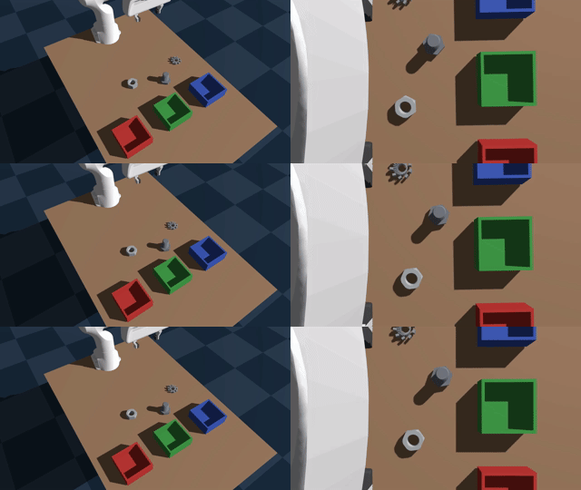

# Industrial Part Sorting System on AMD Radeon / ROCm — Track 3 Submission

**Team Answer.** Language-conditioned industrial part sorting (gear / hex nut /
bolt → red / green / blue boxes) with a SmolVLA vision-language-action policy,
trained on 100 % synthetic Genesis demonstrations — **everything runs on a
single AMD Radeon PRO W7900 (48 GB) under ROCm 7.2.1**.

> 🎥 **Demo Video:** [Watch on YouTube](https://www.youtube.com/watch?v=39ZYWDyvmC8) — 4-minute walkthrough of the complete pipeline: data generation, training, evaluation, and live web demo.

**Headline result (closed-loop, submitted checkpoint):**

| System | Evaluation | Success rate |
|---|---|---|
| 3-box language-conditioned sorting | Fixed-seed verification set (25 eps) | **13/25 = 52.0 %** |
| — gear | 11 episodes | 5/11 = 45.5 % |
| — bolt | 9 episodes | 5/9 = 55.6 % |
| — nut | 5 episodes | 3/5 = 60.0 % |



*Three successful closed-loop episodes from the verification set. **Left:** gear → blue box (s2003, 198 frames). **Center:** bolt → green box (s2014, 207 frames — fastest in the set). **Right:** nut → red box (s3521, rare nut success). World-camera views at 2× speed.*

### Judging Criteria Response

| # | Criterion (Points) | How Our Submission Addresses It |
|---|---|---|
| 1 | **Robot Capability** (30 pts) | Closed-loop language-conditioned sorting of 3 industrial parts by a single SmolVLA VLA policy — **13/25 = 52.0 %**. End-to-end perception-decision-control; no hand-written perception or grasp modules. Dual-camera live demo with real-time Genesis GPU rendering in browser. |
| 2 | **AMD Radeon GPU & ROCm Adoption** (20 pts) | Every stage on a single W7900 / ROCm 7.2.1: GPU-accelerated data generation, SmolVLA fine-tuning (BF16 AMP, AOTriton backend, ~3 GB VRAM), concurrent 3-way closed-loop eval, web demo with live GPU rendering + VLA inference. |
| 3 | **Innovation** (20 pts) | **First VLA-based industrial sorting system on AMD/ROCm.** First work to train and deploy a Vision-Language-Action policy end-to-end on AMD Radeon GPUs for real industrial part sorting. Also: checkpoint sweet-spot selection (20k-step scores 3× the final checkpoint), evidence-driven failure analysis (5 hypotheses, nut height-error root cause identified), honest-evaluation methodology with quantified noise. |
| 4 | **Application Value** (20 pts) | Real intralogistics task. Language-conditioned routing eliminates per-SKU reprogramming. 100 % synthetic pipeline — no real-robot data needed for new parts. Shipped with live web demo for immediate evaluation. |
| 5 | **Upstream Open-Source Contribution** (10 pts) | **Enables downstream industrial users to deploy VLA + Genesis + ROCm directly on AMD GPUs.** Documented ROCm-specific solutions (`libsvtav1` codec, headless Vulkan/X, ROCm wheels, offline SmolVLA loading). Self-contained web demo server as a turnkey baseline for industrial adaptation. Full Dockerfile and step-by-step AMD/ROCm reproduction guide. |

> **Reproduction note.** Closed-loop evaluation is *not* bit-deterministic:
> re-running the same (seed, object) pair flips the outcome in ~1 of 4–5 cases
> (measured). Our logged result is 13/25; evaluators re-running the verification
> set should expect a similar overall score, with individual episode outcomes
> varying per the per-episode flip probability.

---

## 1. Repository layout

```
.
├── README.md                 ← this file
├── TECHNICAL_REPORT.md       ← full technical report
├── Dockerfile                ← ROCm 7.2.1 environment (see §3)
├── pyproject.toml            ← dependency spec (reference; install per §3)
├── VIDEO_PLAN.md             ← assembly notes for the video
├── web_demo_server.py        ← web-based live demo (Flask + Genesis + VLA, see §1.1)
├── src/
│   ├── industrial_pick/      ← all V2 pipeline code (run in place)
│   │   ├── paths.py          # filesystem-layout constants
│   │   ├── scene_config.py   # scene constants (boxes, slots, SORT_TARGET)
│   │   ├── setup_assets.py   # asset check/populate
│   │   ├── build_scene.py    # Genesis scene + cameras (+ Layer-A DR)
│   │   ├── randomize.py      # per-episode randomization (Layer-B DR)
│   │   ├── grasp_demo.py     # scripted IK pick-and-place expert + success test
│   │   ├── record_dataset.py # expert → LeRobot v2 dataset
│   │   ├── aggregate_datasets.py
│   │   ├── sample_videos.py  # quick scene/video sanity samples
│   │   ├── train_vla_unfreeze.py  # SmolVLA fine-tuning used for the submitted model
│   │   ├── train_policy.py   # (upstream reference trainer, kept for comparison)
│   │   ├── eval_policy.py    # closed-loop evaluation (writes per-ep mp4 + summary.json)
│   │   ├── eval_sweep.py     # checkpoint-sweep helper (used for the §5.1 curve)
│   │   └── tools/            # diagnostics helpers
│   └── assets/               # part/robot/table meshes (47 MB)
├── verification-set/         # fixed-seed verification set (25 episodes, see §5)
└── docs/figures/             # report figures
```

### 1.1 Web-based live demo (≈20 s to start)

`web_demo_server.py` is a self-contained Flask application that puts a
**live Genesis simulator rendering + interactive VLA inference** into a
browser. Start it, open the page, type a language instruction (or click
one of the three preset buttons), and watch the robot execute the task in
real time.

```bash
# On the GPU server:
source .venv/bin/activate          # or /persistent/track3-robot/rdna/bin/activate
export HF_HOME=<path-to-hf-cache>  # e.g. /persistent/track3-robot/cache/huggingface

python -u web_demo_server.py \
    --checkpoint models/smolvla_industrial_sort_v2_ckpt20k \
    --dataset-id local/industrial_sort_v2 \
    --port 8765 --fps 8 \
    --fixed-demo

# On your local machine, create an SSH tunnel:
ssh -L 8765:localhost:8765 root@<server-ip> -p <port>

# Then open http://localhost:8765 in a browser.
```

**Three preset language instructions** (exact training-dataset strings):

| Object | Instruction |
|---|---|
| Gear | `pick the gear and place it in the blue box` |
| Hex Nut | `pick the hex nut and place it in the red box` |
| Bolt | `pick the bolt and place it in the green box` |

The web UI shows dual live camera streams (world + wrist), a text input with
quick-select buttons, live status, and per-episode success/failure results.
The backend runs Genesis GPU rendering, SmolVLA inference, and Flask HTTP
serving all in one process on the W7900. See `TECHNICAL_REPORT.md` §2.3 for
architecture details.

---

## 2. Requirements

- **GPU:** AMD Radeon with ROCm 7.2.1 support (developed on Radeon PRO W7900,
  gfx1100, 48 GB; ≥ 8 GB VRAM is enough — training peaks at ~3 GB)
- **Host OS:** Ubuntu 24.04 (or the Docker image in §3)
- **System packages:** `ffmpeg`, Vulkan/OpenGL runtime (+ `xvfb` if headless)
- **Python:** 3.12

## 3. Environment setup

### Option A — Docker (preferred)

```bash
docker build -f Dockerfile -t industrial-sort-vla:rocm7.2.1 .
docker run --rm -it --network=host \
    --device=/dev/kfd --device=/dev/dri \
    --group-add video --group-add render \
    --security-opt seccomp=unconfined --cap-add=SYS_PTRACE \
    --ipc=host --shm-size=8g \
    -v "$PWD":/workspace/app \
    industrial-sort-vla:rocm7.2.1
# inside the container: the ready venv is at /opt/venv
source /opt/venv/bin/activate
```

### Option B — bare metal venv

```bash
sudo apt-get install -y ffmpeg libgl1 libegl1 libvulkan1 mesa-vulkan-drivers xvfb
python3.12 -m venv .venv && source .venv/bin/activate

# ROCm 7.2.1 wheels (stock PyPI torch will NOT see the GPU):
pip install --index-url https://repo.radeon.com/rocm/manylinux/rocm-rel-7.2.1/ \
    torch torchvision torchaudio triton

pip install genesis-world==1.2.3 lerobot==0.4.4 \
    transformers==4.57.6 accelerate==1.14.0 datasets==4.8.5 \
    av==15.1.0 torchcodec==0.10.0 num2words==0.5.14 wandb==0.24.2 \
    numpy==2.1.2 opencv-python==5.0.0.93 imageio==2.37.4 imageio-ffmpeg==0.6.0 \
    trimesh==4.12.2 matplotlib==3.11.1 "numba>=0.59" "llvmlite>=0.42"
```

*(On our host, Genesis was an unmodified source checkout of upstream 1.2.3 —
commit `3427b23`; the PyPI `genesis-world==1.2.3` wheel is equivalent for this
project.)*

Verify: `python -c "import torch; print(torch.cuda.is_available(), torch.version.hip)"`
should print `True 7.2.x`.

## 4. Artifacts (checkpoints & datasets)

Large binary artifacts are hosted on Hugging Face (sizes: checkpoint 1.2 GB,
dataset ~250 MB):

| Artifact | Download | Install to |
|---|---|---|
| Final checkpoint `checkpoint_020000` (the submitted model) | [steve-jobs/smolvla_industrial_sort_v2_ckpt20k](https://huggingface.co/steve-jobs/smolvla_industrial_sort_v2_ckpt20k) | `./models/smolvla_industrial_sort_v2_ckpt20k/` |
| Dataset `industrial_sort_v2` (450 eps) | [steve-jobs/industrial_sort_v2](https://huggingface.co/datasets/steve-jobs/industrial_sort_v2) | `$HF_HOME/lerobot/local/industrial_sort_v2/` |

```bash
export HF_HOME=$PWD/hf_cache    # any writable dir; datasets resolve as $HF_HOME/lerobot/<repo-id>
```

*(If you re-generate the dataset yourself per §7, it is written directly into
`$HF_HOME/lerobot/local/industrial_sort_v2` via `--root`.)*

## 5. Reproduce the evaluation: verification set (≈20 min)

The shipped `verification-set/` contains a **25-episode fixed-seed verification
set**: all 25 seeds randomly generated with a fixed Python RNG
(`random.Random(20260803)`) from `[3000, 9999)` (11 gear, 9 bolt, 5 nut). Every
seed is locked in `verification_seeds.json` — same seed = same `EnvRandomizer`
state = fully reproducible episode.

```bash
source .venv/bin/activate            # or /opt/venv in Docker
cd verification-set

python -u run_verification.py \
    --eval-script ../src/industrial_pick/eval_policy.py \
    --checkpoint ../models/smolvla_industrial_sort_v2_ckpt20k --jobs 3
```

- **Our logged result: 13/25 = 52.0 %** (gear 5/11, bolt 5/9, nut 3/5).
- Per-episode world+wrist mp4s + `summary.json` land in
  `verification_videos/<pick>_s<seed>/`; aggregate in
  `verification_videos/verification_results.json`.
- **Monitoring:** count mp4 files, don't grep the log (block-buffered):
  `find verification_videos -name '*.mp4' | wc -l` → expected final 50.

## 6. Deploy the model: web-based live demo

After training, deploy the model as an interactive web demo via
`web_demo_server.py`. The backend runs Genesis GPU rendering, SmolVLA inference,
and Flask HTTP serving all in one process on the W7900.

### Fixed-demo mode (recommended)

Add the `--fixed-demo` flag to use verified-successful fixed seeds instead of
random ones, greatly increasing demo reliability:

| Part | Fixed seed | Track record |
| --- | --- | --- |
| Gear → Blue | 2003 | 4/4 career success (3× verified + latest rerun), 242–248 frames |
| Bolt → Green | 2014 | Fast success, 198–207 frames |
| Nut → Red | 2007 | Succeeded in latest rerun (239 f); nut is the hardest part |

```bash
python -u web_demo_server.py \
    --checkpoint models/smolvla_industrial_sort_v2_ckpt20k \
    --dataset-id local/industrial_sort_v2 \
    --port 8765 --fps 8 --fixed-demo

# On your local machine, create an SSH tunnel:
ssh -L 8765:localhost:8765 root@<server-ip> -p <port>
# Then open http://localhost:8765 in a browser.
```

Without `--fixed-demo`, random seeds are used (~30 % success rate); with it,
each of the three preset buttons uses a fixed high-reliability seed. See §1.1
for a quick start, and `TECHNICAL_REPORT.md` §2.3 for architecture details.

## 7. Full from-scratch reproduction (data → train → select → eval → deploy)

```bash
cd src/industrial_pick

# 1) Record the 450-episode dataset (scripted expert, both DR layers):
python -u record_dataset.py --episodes 300 --seed 0 \
    --repo-id local/industrial_sort_v2_main --vcodec libsvtav1 \
    --dr-appearance --dr-object-color --dr-runtime
python -u record_dataset.py --episodes 150 --seed 10000 \
    --repo-id local/industrial_sort_v2_topup --vcodec libsvtav1 \
    --dr-appearance --dr-object-color --dr-runtime
python aggregate_datasets.py \
    --dataset-root $HF_HOME/lerobot/local/industrial_sort_v2_main \
    --dataset-root $HF_HOME/lerobot/local/industrial_sort_v2_topup \
    --out $HF_HOME/lerobot/local/industrial_sort_v2

# 2) Fine-tune SmolVLA (30k steps, batch 8, ~1.7 h on the W7900, ~3 GB VRAM):
python -u train_vla_unfreeze.py --dataset-id local/industrial_sort_v2 \
    --n-steps 30000 --batch-size 8 --seed 42 \
    --output-dir ./training_out --run-name sort_v2 --save-every 2000

# 3) Checkpoint sweep: evaluate checkpoint_020000 (the sweet spot, see report §5.1)
#    with the commands in §5.
```

Recording time: roughly 1–2 h for 450 episodes on the W7900.
⚠️ Do **not** interrupt `record_dataset.py` mid-run — parquet footers are only
written at `finalize()`; a killed run corrupts the dataset (let it finish, or
delete and re-record).

```bash
# 4) Deploy the web demo (fixed-demo mode, recommended):
python -u web_demo_server.py \
    --checkpoint ./training_out/sort_v2/checkpoint_020000 \
    --dataset-id local/industrial_sort_v2 \
    --port 8765 --fps 8 --fixed-demo
```

## 8. Dependency specification (exact, as used)

| Package                | Version          | Package         | Version                                      |
| ---------------------- | ---------------- | --------------- | -------------------------------------------- |
| torch                  | 2.9.1+rocm7.2.1  | lerobot         | 0.4.4                                        |
| torchvision            | 0.24.0+rocm7.2.1 | genesis-world   | 1.2.3 (source checkout @3427b23, unmodified) |
| torchaudio             | 2.9.0+rocm7.2.1  | transformers    | 4.57.6                                       |
| triton                 | 3.5.1+rocm7.2.1  | accelerate      | 1.14.0                                       |
| numpy                  | 2.1.2            | datasets        | 4.8.5                                        |
| opencv-python          | 5.0.0.93         | av              | 15.1.0                                       |
| opencv-python-headless | 4.12.0.88        | torchcodec      | 0.10.0                                       |
| num2words              | 0.5.14           | wandb           | 0.24.2                                       |
| imageio                | 2.37.4           | imageio-ffmpeg  | 0.6.0                                        |
| trimesh                | 4.12.2           | matplotlib      | 3.11.1                                       |
| numba                  | 0.66.0           | llvmlite        | 0.48.0                                       |
| safetensors            | 0.8.0            | huggingface-hub | 0.35.3                                       |
| ROCm                   | 7.2.1            | Python          | 3.12                                         |

## 9. Troubleshooting / gotchas

- ** lerobot video crash on ROCm:** keep `--vcodec libsvtav1`; `auto` mis-selects
  the NVIDIA-only `h264_nvenc`.
- **Headless rendering:** Genesis needs Vulkan/X libs even on a GPU host; use
  `xvfb-run` or the Dockerfile's package set.
- **"Log looks stuck":** Python stdout to files is block-buffered — monitor
  progress by counting mp4 files in `--video-dir`, or always run `python -u`.
- **HF dataset root:** `local/<name>` repo ids resolve under
  `$HF_HOME/lerobot/` — set `HF_HOME` before running, or symlink.
- **Wrong-GPU torch:** `import torch; torch.cuda.is_available()` must be True;
  if False you installed PyPI torch instead of the ROCm wheels (§3).

## 10. Results log (what we measured, submitted checkpoint)

| Evaluation | Detail | Result |
|---|---|---|
| Fixed-seed verification set (25 eps) | §5, `run_verification.py --jobs 3` | **13/25 = 52.0 %** |
| — gear (11 eps) | seeds in `verification_seeds.json` | 5/11 = 45.5 % |
| — bolt (9 eps) | seeds in `verification_seeds.json` | 5/9 = 55.6 % |
| — nut (5 eps) | seeds in `verification_seeds.json` | 3/5 = 60.0 % |
