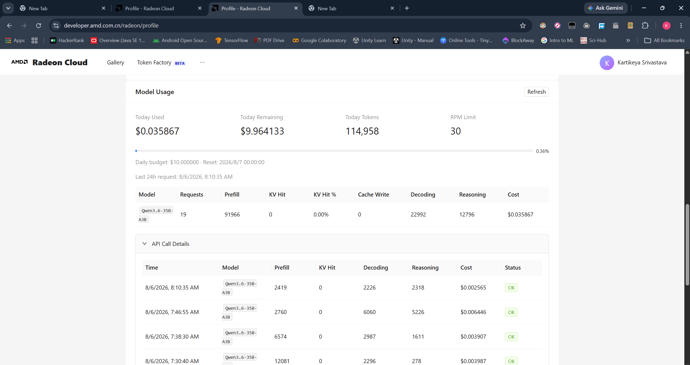

# Track 2, Kartikeya Srivastava, Ambient-AI

## Submission links

| Required material | Link |
| --- | --- |
| Project specification document | [View product specification](https://drive.google.com/file/d/1kTeahMn2T8ZGetF4PR-nQn6rxFyYmT4l/view?usp=sharing) |
| Complete source code, setup guide, and dependencies | [Ambient AI source repository](https://github.com/KarSri7694/Ambient-AI) |
| Demo video | [Watch the Radeon-backed demo](https://drive.google.com/file/d/1_uEGeon5ltyVhYnEq2U7MK8OG-lG36Oa/view?usp=sharing) |
| Supplementary presentation | [View the Ambient AI presentation](https://drive.google.com/file/d/1FAn5yIPbjt9sEuLFHs_oWgWDVzA6Sr77/view?usp=sharing) |

## Ambient AI

Ambient AI is a proactive, local-first assistant that turns permitted work context into visible, reviewable progress. It continuously organizes signals from approved local sources, preserves temporal context, and prepares the next useful step—such as a research brief, meeting follow-up, or evidence-backed checklist—while keeping the user in control of every consequential action.

The product boundary is deliberate: Ambient AI prepares, retrieves, summarizes, and proposes; external actions remain permission- and approval-gated. Local processing, exclusions, redaction, audit trails, and pause/stop controls keep the assistant useful without treating private context as an unrestricted automation surface.

## Track 2 capability implementation

| Track 2 capability | Implementation | Services and components |
| --- | --- | --- |
| Retrieval-augmented generation (RAG) | Time-stamped screenshots, transcripts, documents, and events are chunked, indexed, linked to work threads, and retrieved with recent context for grounded responses and proposals. | Chroma vector database, keyword index, SQLite metadata/configuration store, local artifact storage |
| Multi-turn chat and temporal memory | Conversations retain the relevant work thread, summaries, facts, preferences, and feedback signals so a user does not need to reconstruct context after interruptions. | Local observation store, thread grouping, temporal RAG, adaptive user profile |
| Tool calling | The planner can propose work through local tools such as file-system retrieval, search, code/document operations, browser actions, scheduling, and opt-in communication flows. | Intent understanding, task decomposition, context assembler, local tools, approval-gated browser/computer agents |
| Security and privacy | Capture exclusions, on-device redaction/PII scrubbing, capability policies, permission prompts, pause/resume, emergency stop, and full interaction tracing constrain what the agent can access and do. | Local capture agents, privacy/exclusion rules, policy engine, approval service, audit log |
| Memory and task planning | Signals are deduplicated, linked to entities and work threads, scored for importance, then converted into ordered sub-goals and actionable proposals. | Observation store, entity linking, temporal retrieval, task planner, resource-aware autonomy coordinator |

## AMD Radeon and ROCm implementation

Ambient AI is designed to keep its core inference and speech-processing path local on AMD Radeon hardware.

| Area | Radeon/ROCm implementation |
| --- | --- |
| Text model inference | A ROCm build of `llama.cpp` serves the local chat model. The ROCm backend enables GPU offload and AMD-accelerated inference, while the server is configured with five parallel slots to process concurrent agent workloads. |
| Speech recognition (ASR) | `faster-whisper` is used for local automatic speech recognition with a ROCm-compatible `CTranslate2` backend. This routes transcription compute to the GPU, accelerating permitted audio capture and keeping transcripts inside the local work context. |
| Runtime optimization | Benchmark evidence informs the selected deployment preset and micro-batch/ubatch configuration, balancing token throughput with responsiveness for interactive and background agent work. |
| Benchmark evidence | Review the [`benchmarks/`](https://github.com/KarSri7694/Ambient-AI/tree/main/benchmarks) directory in the Ambient AI repository for the Qwen 3.6 `llama.cpp` benchmark JSON results and the corresponding optimization records. |
| Radeon Cloud validation | The agent was also run through Radeon Cloud Model APIs using the Qwen 3.6 35B A3B model, confirming the same workflow against Radeon-hosted model infrastructure. |

## Registration and Radeon Cloud identities

| Purpose | Email address |
| --- | --- |
| Luma registration | `kartik.sri769@gmail.com` |
| Radeon Cloud GPU and Radeon Cloud Model APIs | `kartikeyasrivastava769@gmail.com` |

---

## Bonus-point evidence — Radeon Cloud Model API

Ambient AI was also exercised through the Radeon Cloud Model API, satisfying the optional Radeon Cloud Model API integration evidence. The recorded Radeon Cloud profile shows successful `Qwen3.6-35B-A3B` requests, including 19 requests and 114,958 processed tokens at the time of capture. The detailed request rows show an `OK` status.

**Radeon Cloud usage proof:**



### Runtime-log evidence

The complete runtime log captured during the Radeon cloud model API, `https://developer.amd.com.cn/radeon/tokenfactory` Ambient AI run is included below.

```text
INFO:httpx:HTTP Request: POST https://developer.amd.com.cn/radeon/api/v1/chat/completions "HTTP/1.1 200 OK"
INFO:LLMInteractionService:Calling tool: search_web_ddgs
INFO:LLMInteractionService:--- Iteration 2 (agent depth 0/3) ---
INFO:httpx:HTTP Request: POST https://developer.amd.com.cn/radeon/api/v1/chat/completions "HTTP/1.1 200 OK"
INFO:httpx:HTTP Request: POST https://developer.amd.com.cn/radeon/api/v1/chat/completions "HTTP/1.1 200 OK"
INFO:httpx:HTTP Request: POST https://developer.amd.com.cn/radeon/api/v1/chat/completions "HTTP/1.1 200 OK"
INFO:AutonomyCoordinatorService:Completed screen enrichment for ambient event eb800cd9a2904e29a4850d227a1d6d1c (mode=vision_enriched).
INFO:__main__:Parallel visual worker completed 1 capture event(s).
INFO:httpx:HTTP Request: POST https://developer.amd.com.cn/radeon/api/v1/chat/completions "HTTP/1.1 200 OK"
INFO:AutonomyCoordinatorService:Processing ambient event 42223d2f23b94146a871ffa06f7c0503 (lightweight_visual_capture, source=screen_capture).
INFO:AutonomyCoordinatorService:Completed screen enrichment for ambient event 42223d2f23b94146a871ffa06f7c0503 (mode=vision_enriched).
INFO:__main__:Parallel visual worker completed 1 capture event(s).
INFO:LLMInteractionService:Calling tool: search_web_ddgs
INFO:LLMInteractionService:Arguments: {"query": "silver rate today per kg India INR June 202 karat", "max_results": 3, "timelimit": "d"}
INFO:LLMInteractionService:--- Iteration 3 (agent depth 0/3) ---
INFO:httpx:HTTP Request: POST https://developer.amd.com.cn/radeon/api/v1/chat/completions "HTTP/1.1 200 OK"
INFO:httpx:HTTP Request: POST https://developer.amd.com.cn/radeon/api/v1/chat/completions "HTTP/1.1 200 OK"
INFO:httpx:HTTP Request: POST https://developer.amd.com.cn/radeon/api/v1/chat/completions "HTTP/1.1 200 OK"
INFO:AutonomyCoordinatorService:Completed screen enrichment for ambient event 42223d2f23b94146a871ffa06f7c0503 (mode=vision_enriched).
INFO:__main__:Parallel visual worker completed 1 capture event(s).
INFO:LLMInteractionService:Calling tool: add_task
INFO:LLMInteractionService:--- Iteration 1 (agent depth 0/3) ---
INFO:httpx:HTTP Request: POST https://developer.amd.com.cn/radeon/api/v1/chat/completions "HTTP/1.1 200 OK"
INFO:LLMInteractionService:Calling tool: search_web_ddgs
INFO:LLMInteractionService:Calling tool: search_web_ddgs
INFO:LLMInteractionService:Arguments: {"query": "MCP Model Context Protocol use_filesystem tool Windows allowed_paths sandboxing", "max_results": 10}
INFO:LLMInteractionService:--- Iteration 2 (agent depth 0/3) ---
INFO:httpx:HTTP Request: POST https://developer.amd.com.cn/radeon/api/v1/chat/completions "HTTP/1.1 200 OK"
INFO:LLMInteractionService:Calling tool: search_web_ddgs
INFO:LLMInteractionService:Arguments: {"query": "\"filesystem-mcp\" \"Permission denied\" OR \"access denied\" OR \"not allowed\" troubleshooting Windows root paths configuration", "max_results": 10}
INFO:LLMInteractionService:Calling tool: search_web_ddgs
INFO:LLMInteractionService:Arguments: {"query": "@modelcontextprotocol/server-filesystem \"at least ONE allowed directory\" configuration common errors", "max_results": 10}
INFO:LLMInteractionService:--- Iteration 3 (agent depth 0/3) ---
INFO:LLMInteractionService:--- Iteration 4 (agent depth 0/3) ---
INFO:httpx:HTTP Request: POST https://developer.amd.com.cn/radeon/api/v1/chat/completions "HTTP/1.1 200 OK"
INFO:httpx:HTTP Request: POST https://developer.amd.com.cn/radeon/api/v1/chat/completions "HTTP/1.1 200 OK"
INFO:LLMInteractionService:Calling tool: get_gmail_messages_content_batch
INFO:LLMInteractionService:Arguments: {"message_ids": ["c365562c5cee4974bc444a2895016a0d"], "body_format": "text", "format": "full"}
INFO:LLMInteractionService:--- Iteration 5 (agent depth 0/3) ---
INFO:httpx:HTTP Request: POST https://developer.amd.com.cn/radeon/api/v1/chat/completions "HTTP/1.1 200 OK"
INFO:LLMInteractionService:Model finished (no more tool calls)
INFO:httpx:HTTP Request: POST https://developer.amd.com.cn/radeon/api/v1/chat/completions "HTTP/1.1 200 OK"
INFO:LLMInteractionService:Model finished (no more tool calls)
INFO:httpx:HTTP Request: POST https://developer.amd.com.cn/radeon/api/v1/chat/completions "HTTP/1.1 200 OK"
INFO:httpx:HTTP Request: POST https://developer.amd.com.cn/radeon/api/v1/chat/completions "HTTP/1.1 200 OK"
INFO:httpx:HTTP Request: POST https://developer.amd.com.cn/radeon/api/v1/chat/completions "HTTP/1.1 200 OK"
INFO:__main__:Parallel downstream worker processed 1 event(s).
INFO:AutonomyCoordinatorService:Processing ambient event 8893c51188564f63ae099dbf12043e1a (visual_context_changed, source=passive_observer).
INFO:__main__:User activity detected; context judgment remains active.
INFO:httpx:HTTP Request: POST https://developer.amd.com.cn/radeon/api/v1/chat/completions "HTTP/1.1 200 OK"
INFO:AutonomyCoordinatorService:Ambient event 8893c51188564f63ae099dbf12043e1a was judged as background/noise.
```
