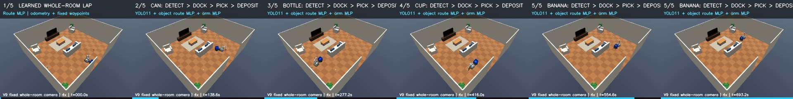
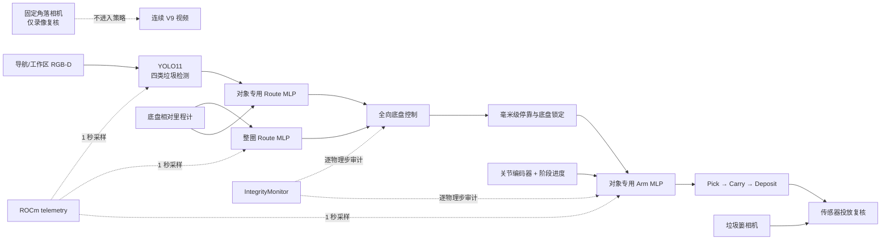
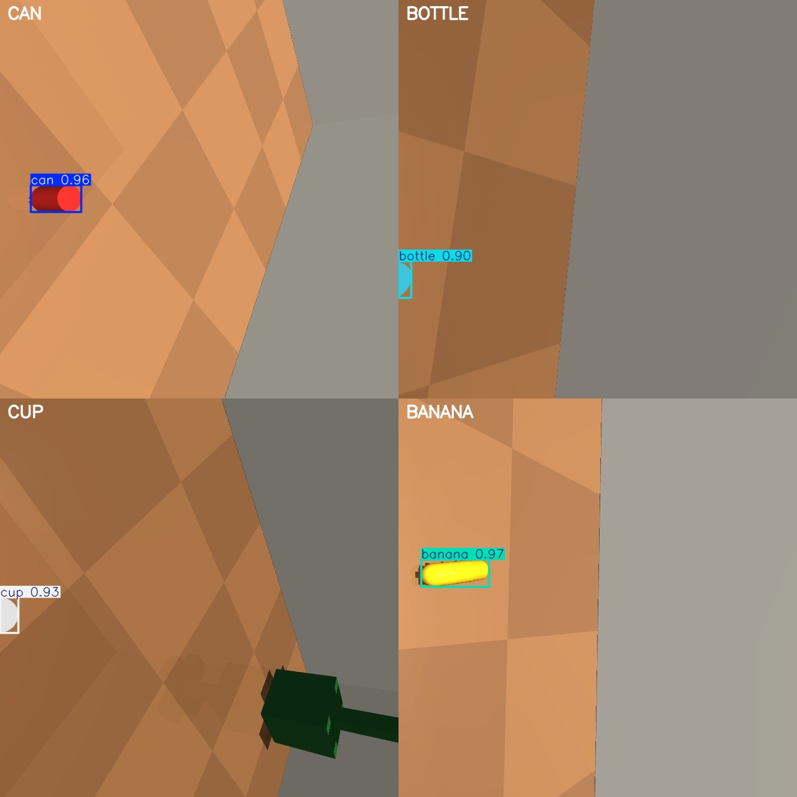
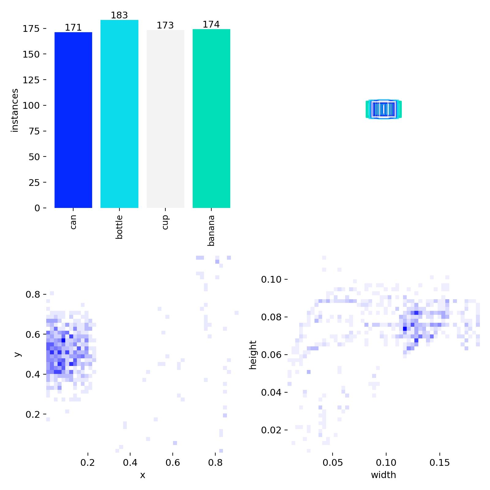
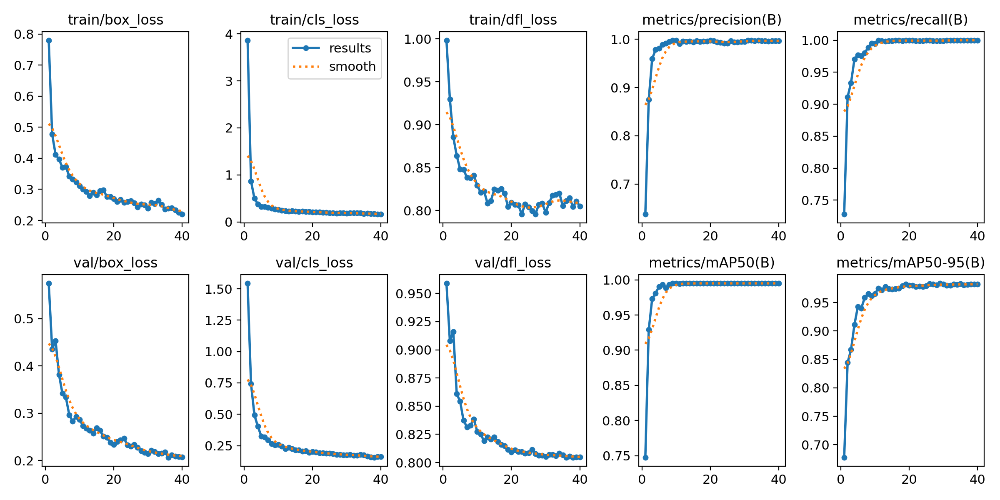

# TidyBot Whole-Room Cleanup

> 基于 MuJoCo、PyTorch 与 AMD ROCm 的房屋垃圾清洁机器人：先巡视房间，识别地面物品，
> 再停靠到目标前方，由机械臂完成夹取、搬运，并将垃圾投入车后方的垃圾篓。

<p align="center">
  
</p>

<p align="center">
  <strong>巡视 → 识别 → 接近 → 精确停靠 → 夹取 → 搬运 → 投放 → 传感器复核</strong>
</p>

## 项目概览

本项目构建了一个固定房间内的 TidyBot 垃圾清理系统。机器人由全向移动底盘、
八自由度机械臂和刚性双轮拖车组成，拖车上的货筐作为垃圾篓。最终任务包括：

1. 从房间入口出发，沿固定路线完整巡视房间一圈；
2. 依次寻找 `can`、`bottle`、`cup` 和 `banana`；
3. 使用视觉检测确认目标，学习式路线策略移动到目标前方并停止；
4. 锁定底盘，由对应的学习式机械臂策略完成夹取、搬运和投放；
5. 使用垃圾篓相机复核投放，并继续处理下一个目标。

最终 V9 在一个连续仿真回合内完成了整圈巡视和四个物体的稳定投放。V8、V9
连续两次完整成功。

## 最终演示与提交文件

### 主视频

| 视频 | 内容 | 时长 |
|---|---|---:|
| [V9 完整全房间视频](mujoco-cleanup-robot/final_submission/videos/v9_full_whole_room.mp4) | 原始连续回合；固定房间角落相机；无剪切 | 11:33.30 |
| [V9 方法展示版](mujoco-cleanup-robot/final_submission/videos/v9_method_whole_room_4x.mp4) | 仅保留全房间视角，4× 加速并标注各方法阶段 | 02:53.35 |

### 从 V9 按控制帧精确截取的阶段视频

| 片段 | 内容 | 时长 |
|---|---|---:|
| [完整巡视路线](mujoco-cleanup-robot/final_submission/videos/clips/01_learned_room_route.mp4) | Route MLP 完成整圈房间巡视 | 01:13.45 |
| [易拉罐识别与夹取](mujoco-cleanup-robot/final_submission/videos/clips/02_can_detect_stop_pick.mp4) | 识别、停靠、夹取、搬运、投放 | 01:28.65 |
| [瓶子识别与夹取](mujoco-cleanup-robot/final_submission/videos/clips/03_bottle_detect_stop_pick.mp4) | 识别、停靠、夹取、搬运、投放 | 01:32.65 |
| [杯子识别与夹取](mujoco-cleanup-robot/final_submission/videos/clips/04_cup_detect_stop_pick.mp4) | 识别、停靠、夹取、搬运、投放 | 01:45.60 |
| [香蕉识别与夹取](mujoco-cleanup-robot/final_submission/videos/clips/05_banana_detect_stop_pick.mp4) | 识别、停靠、夹取、搬运、投放 | 01:53.05 |

所有片段都来自同一个 V9 成功回合。物体片段从视觉确认前开始，保留最终停靠、
完整机械臂动作和稳定投放，并在画面上标出 `APPROACH / YOLO11 CONFIRMED /
PICK / CARRY / DEPOSIT / VERIFIED` 阶段。

最终上传目录：

- [`mujoco-cleanup-robot/final_submission/`](mujoco-cleanup-robot/final_submission/)
- [`mujoco-cleanup-robot/final_submission/README.md`](mujoco-cleanup-robot/final_submission/README.md)
- `tidybot_final_submission_v9.tar.gz`
- 压缩包 SHA256：
  `02938e034903e62493371cee179406300f9228fd405d61aa69dfb8ed273f5563`

## 系统工作流程



### 最终学习式策略

| 模块 | 输入 | 输出 | 最终工件 |
|---|---|---|---|
| YOLO11 检测器 | 工作区 RGB-D | 四类目标框、类别和置信度 | `mujoco-cleanup-robot/final_submission/models/detector/best.pt` |
| 整圈 Route MLP | 相对里程计、固定路线、路线进度 | 底盘 `vx / vy / wz` | `mujoco-cleanup-robot/final_submission/models/lap_route/policy.pt` |
| 四个对象路线 MLP | 相对里程计、对象停靠路线、路线进度 | 底盘 `vx / vy / wz` | `mujoco-cleanup-robot/final_submission/models/object_routes/` |
| 四个 Arm MLP | 机械臂编码器、对象/阶段 one-hot、阶段与回合进度 | 8 维执行器增量 | `mujoco-cleanup-robot/final_submission/models/arm/` |

对象专用路线策略用于解决稀有停靠段在统一路线模型中权重不足的问题。杯子采用与
示教目标相对位姿等价的西向停靠点，避免刚性拖车转向时扫碰沙发。

## 数据是如何采集和构建的

所有策略数据都遵守一个核心边界：**运行时策略只能读取传感器数据；MuJoCo 真值只可
用于离线自动标注或独立评测，不得进入 `observation.*` 或控制分支。**

### 1. 机械臂人工示教

机械臂示教以 20 Hz 采集。操作者通过浏览器鼠标/键盘或 SO-101 Leader 直接控制
TidyBot 执行器增量：

```text
mouse horizontal  -> joint_1
scroll / W / S    -> joint_2
A / D             -> joint_4
Q / E             -> joint_6
mouse / Space     -> gripper
```

- 不使用逆运动学或末端直线规划；
- 记录限速和关节限制后的**实际执行增量**，而不是未执行的请求值；
- 每个回合包含连续的 `pick → carry → deposit`，不是单帧样本；
- 策略视角包括 `overview / workspace / wrist / basket`；
- 固定房间角落相机只负责录制复核视频，不作为策略输入；
- 接触、抬升和入筐真值仅在采集页面作为人工提示，保存动作由操作者确认。

原始集共 51 个回合、109,840 帧；审计后有 49 个物理完整回合。原数据的阶段标签
曾全部落入 `pick`，因此通过
[`scripts/curate_tidybot_phases.py`](scripts/curate_tidybot_phases.py)
重建连续的 `pick / carry / deposit` 标签，得到
`datasets/tidybot/my_collection_v2_curated`。

最终固定场景 Arm MLP 从每类物体的物理成功示教中选择一个参考回合，以 12,000
训练步拟合四个对象策略。checkpoint 只保存网络参数、阶段长度和目标相对位姿，
不保存逐帧动作表。

完整采集说明：
[`docs/tidybot_dataset_collection.md`](docs/tidybot_dataset_collection.md)。

### 2. 视觉检测数据

视觉数据使用 MuJoCo 离线 segmentation buffer 自动生成像素级边界框。真值只存在于
数据生成阶段，训练后的 YOLO11 在运行时只读取 RGB 图像。

- 训练图像：720 张；
- 独立 held-out 图像：180 张；
- 类别：`can / bottle / cup / banana`；
- 训练实例数：171 / 183 / 173 / 174；
- held-out 实例数：41 / 44 / 44 / 43；
- 包含路线中的真实背景负样本；
- 相机、亮度、目标距离和横向偏移进行固定房间域内扰动。

生成入口：
[`scripts/generate_tidybot_detector_data.py`](scripts/generate_tidybot_detector_data.py)。

### 3. 巡视与对象停靠路线数据

路线监督由离线几何控制器生成，记录请求动作和经过速度限制后的 applied action。
运行时不加载该控制器，只加载训练后的 PyTorch MLP。

- 多路线训练集：25,601 个样本；
- 易拉罐专用路线：4,198 个样本；
- 瓶子专用路线：9,112 个样本；
- 杯子专用路线：5,503 个样本；
- 香蕉专用路线：10,603 个样本；
- 训练数据包含偏离路线、朝向误差和恢复样本；
- 路线与底盘状态统一表达在机器人 spawn frame 中。

生成和训练入口：

- [`scripts/generate_tidybot_route_data.py`](scripts/generate_tidybot_route_data.py)
- [`scripts/train_tidybot_route_policy.py`](scripts/train_tidybot_route_policy.py)

## 目标检测训练与识别效果

### 四类物体 held-out 预测



上图直接使用最终 `best.pt` 在四张 held-out 图像上推理，置信度分别约为
`0.96 / 0.90 / 0.93 / 0.97`。

### 数据分布



### 训练曲线与归一化混淆矩阵

<p align="center">
  
</p>

最终检测器训练 40 epochs。held-out 评测结果：

- mAP50：`0.995`
- mAP50–95：`0.984`
- Precision：`0.995`
- Recall：`0.999`
- 四类物体的 per-class mAP50 均为 `0.995`

训练原图和 Ultralytics 输出仍保存在
`runs/detect/outputs/detector/tidybot_fixed_v1_w0/`。

## 最终实测结果

| Gate | Measured result |
|---|---|
| Full learned mission | 2/2 consecutive successes (`v8`, `v9`) |
| Room lap policy | 3/3, 100% route coverage, zero blocking collisions |
| Fixed arm policies | 3/3 per object; 12/12 stable physical deposits |
| Detector held-out | mAP50 0.995, recall 0.999 |
| Final video ledger | 13,866 control steps = 13,866 video frames |
| Integrity monitor | clean, 352,006 MuJoCo steps, zero violations |

### V9 对象结果

| 目标 | 检测置信度 | 最终停靠位置误差 | 抓取并抬升 | 稳定投放 |
|---|---:|---:|---:|---:|
| Can | 0.960 | 1.98 mm | ✓ | ✓ |
| Bottle | 0.963 | 1.98 mm | ✓ | ✓ |
| Cup | 0.960 | 1.99 mm | ✓ | ✓ |
| Banana | 0.940 | 1.96 mm | ✓ | ✓ |

## 推理时延

所有时延都在 ROCm 设备同步后测量：

| 模块 | 调用次数 | p50 | p95 | 备注 |
|---|---:|---:|---:|---|
| Route MLP | 7,296 | 0.239 ms | 0.259 ms | 整圈路线与对象停靠 |
| Arm MLP | 6,281 | 0.669 ms | 0.720 ms | 四个对象完整操作 |
| YOLO11 | 4 | 11.03 ms warm | 11.16 ms warm | 首次 cold start 为 1,210.8 ms |

## ROCm telemetry

最终 V9 同时启动 1 秒采样周期的 ROCm telemetry sidecar，共得到 167 条有效记录，
无解析错误。

| 指标 | Mean | p50 | p95 | Max |
|---|---:|---:|---:|---:|
| GPU utilization | 22.89% | 28% | 40% | 44% |
| Board power | 68.31 W | 71 W | 78 W | 80 W |
| Temperature | 42.36°C | 43°C | 44°C | 44°C |
| SCLK | 1,323 MHz | 1,803 MHz | 2,089 MHz | 2,149 MHz |
| MCLK | 1,093 MHz | 1,124 MHz | 1,124 MHz | 1,124 MHz |

- 峰值显存：`867,450,880 / 51,522,830,336` bytes；
- 检测器训练平均 GPU 利用率 `77.02%`，p95 `100%`；
- 检测器训练峰值显存约 `11.17 GB`，峰值功耗 `300 W`，最高温度 `59°C`；
- 当前 `rocm-smi` 未提供 memory activity，因此该字段保留为 `null`。


## 运行时完整性边界

最终控制路径明确禁止：

- 人工教师或离线几何教师参与运行时决策；
- 示教动作回放或逐帧动作表；
- 逆运动学、Jacobian 求解或脚本化抓取；
- 使用物体真值、`qpos`/`qvel` 写入或 equality weld；
- 固定角落复核相机进入策略输入。

`IntegrityMonitor` 在每个 MuJoCo 物理步检查物体/底盘非物理跳变、物体 weld 和
垃圾物体上的 equality constraint。最终 V9 检查 352,006 个物理步，违规数为 0。

详细规则：
[`docs/integrity_monitoring.md`](docs/integrity_monitoring.md)。

## 快速复现

### 环境

最终集群任务使用：

```text
MuJoCo EGL headless rendering
AMD ROCm 7.2.3
PyTorch 2.9.1 ROCm
1 x AMD GPU exposed as cuda:0
20 Hz control and video
```

拉取 MuJoCo Menagerie：

```bash
git clone --depth 1 \
  https://github.com/google-deepmind/mujoco_menagerie.git \
  external/mujoco_menagerie
```

运行完整任务并同时记录 ROCm：

```bash
PYTHONPATH=src MUJOCO_GL=egl .venv/bin/python \
  scripts/run_with_rocm_telemetry.py \
  --output outputs/realtime/telemetry/full_mission.jsonl \
  --job full-mission --stage one-lap-four-objects --interval 1 -- \
  .venv/bin/python scripts/run_tidybot_full_learned.py \
  --route-checkpoint outputs/realtime/tidybot_route_policy_v3/policy.pt \
  --object-route-directory outputs/realtime/tidybot_object_routes_v1 \
  --arm-directory outputs/realtime/tidybot_fixed_arm_v1 \
  --detector-weights \
    runs/detect/outputs/detector/tidybot_fixed_v1_w0/weights/best.pt \
  --output outputs/realtime/tidybot_full_reproduction \
  --device 0
```

验证最终工件：

```bash
.venv/bin/python scripts/validate_tidybot_full_package.py \
  --run outputs/realtime/tidybot_full_learned_v9 \
  --route outputs/realtime/tidybot_route_policy_v3 \
  --object-routes outputs/realtime/tidybot_object_routes_v1 \
  --arm outputs/realtime/tidybot_fixed_arm_v1 \
  --detector runs/detect/outputs/detector/tidybot_fixed_v1_w0 \
  --manifest outputs/realtime/tidybot_full_learned_v9/artifact_manifest_v4.json \
  --output /tmp/tidybot_full_package_validation.json
```

最新本地验证：

- `249 passed, 1 skipped`
- Ruff：all checks passed
- 7 个最终视频均可解码，320×240、20 fps
- 最终上传目录逐文件 SHA256 校验通过

## 最终目录结构

```text
mujoco-cleanup-robot/final_submission/                              # 可直接上传的最终交付目录
├── README.md                                  # 交付包内容、指标与视频索引
├── MANIFEST.json                              # 交付文件大小及 SHA256 清单
├── tidybot_full_learned_v1.json               # 最终模型路径、版本和哈希锁
├── videos/                                    # 最终演示视频
│   ├── v9_full_whole_room.mp4                 # V9 原始连续全房间视角
│   ├── v9_method_whole_room_4x.mp4            # 4× 加速并标注方法阶段的展示版
│   └── clips/                                 # 从 V9 按控制帧截取的阶段片段
│       ├── 01_learned_room_route.mp4          # 学习式路线完整巡视一圈
│       ├── 02_can_detect_stop_pick.mp4        # 易拉罐识别、停靠、夹取与投放
│       ├── 03_bottle_detect_stop_pick.mp4     # 瓶子识别、停靠、夹取与投放
│       ├── 04_cup_detect_stop_pick.mp4        # 杯子识别、停靠、夹取与投放
│       └── 05_banana_detect_stop_pick.mp4     # 香蕉识别、停靠、夹取与投放
├── models/                                    # 最终运行所需的学习模型
│   ├── detector/                              # 四类垃圾 YOLO11 检测器
│   ├── lap_route/                             # 整圈房间巡视 Route MLP
│   ├── object_routes/                         # 四个对象专用停靠 Route MLP
│   └── arm/                                   # 四个对象专用机械臂 Arm MLP
├── metrics/                                   # 结果、遥测与可复现性记录
│   ├── summary.json                           # 精简任务结果和推理时延
│   ├── result.json                            # 完整事件、路线和命令账本
│   ├── rocm_telemetry.jsonl                   # 1 秒周期 ROCm 原始采样
│   ├── rocm_telemetry_summary.json            # GPU、显存、功耗和温度统计
│   ├── video_validation.json                  # 七个视频的帧数、格式和哈希
│   └── final_upload_validation.json           # 模型、视频与结果最终验收门
└── docs/                                      # 最终报告与许可证说明
    ├── full_learned_run_2026-08-06.md         # 完整实验、指标及复现命令
    └── THIRD_PARTY_NOTICES.md                 # 第三方组件来源和许可证
```

## 主要代码入口

| 路径 | 作用 |
|---|---|
| `src/realtime_cleanup/tidybot_full_runtime.py` | 整圈巡视与四物体清理状态机 |
| `src/realtime_cleanup/tidybot_full_task.py` | 固定房间、路线、停靠点与任务契约 |
| `src/realtime_cleanup/tidybot_route_policy.py` | Route MLP 与路线 tracker |
| `src/realtime_cleanup/tidybot_fixed_arm_policy.py` | 四物体 Arm MLP |
| `src/realtime_cleanup/tidybot_perception.py` | YOLO11 RGB-D 感知与 ROCm NMS fallback |
| `src/realtime_cleanup/rocm_telemetry.py` | ROCm telemetry 采集与统计 |
| `scripts/run_tidybot_full_learned.py` | 最终完整任务入口 |
| `scripts/record_tidybot_act.py` | 浏览器/SO-101 机械臂示教采集 |
| `scripts/generate_tidybot_detector_data.py` | 自动标注检测数据生成 |
| `scripts/generate_tidybot_route_data.py` | 路线监督数据生成 |

## 文档

- [最终学习式完整回合报告](docs/full_learned_run_2026-08-06.md)
- [集群复现说明](docs/cluster_reproduction.md)
- [TidyBot 数据采集流程](docs/tidybot_dataset_collection.md)
- [人工遥操作说明](docs/human_teleoperation_recording.md)
- [IntegrityMonitor 规则](docs/integrity_monitoring.md)
- [第三方依赖与许可证](THIRD_PARTY_NOTICES.md)

## 许可证与第三方组件

MuJoCo、LeRobot、Ultralytics YOLO、NoMaD 与 MuJoCo Menagerie 的许可证和来源记录在
[`THIRD_PARTY_NOTICES.md`](THIRD_PARTY_NOTICES.md)。Ultralytics YOLO 的使用需要遵守
AGPL-3.0 或相应商业许可。

