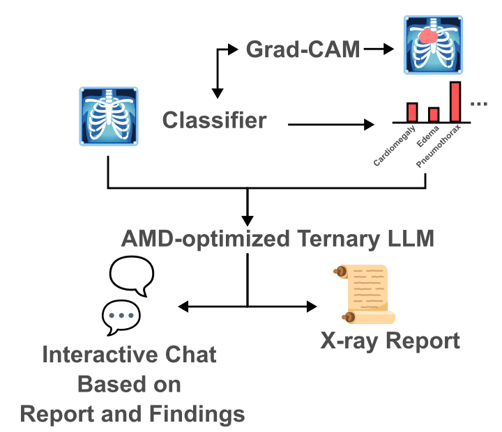

# RibEye - Explainable AI Radiology Assistant

A multimodal chest X-ray analysis web application that generates AI-assisted radiology reports and explains *why* by linking every report statement to the corresponding image region.
The AI assistant answers questions from the patient and clinical personnel to enable an interactive discussion.


## Table of contents

- [What it does](#what-it-does)
- [Architecture](#architecture)
- [Repository layout](#repository-layout)
- [Quick start](#quick-start)
- [Dependency List](#dependency-list)
- [Running tests](#running-tests)
- [Environment variables](#environment-variables)
- [Runtime analysis](#run-time-analysis)
- [Disclaimer](#disclaimer)

## What it does
1. Open the web UI.
2. Upload an X-ray, e.g., use this [exemplar](https://openi.nlm.nih.gov/imgs/512/294/3502/CXR3502_IM-1707-1001.png).
3. Click **Analyze X-ray**.
    - A classifier will predict structured findings of the provided image.
    - Grad-CAM will extract explanation maps for each predicted finding.
    - An AMD-optimized LLM will generate a structured radiology report.
5. Review detected findings and the generated report.
6. Hover over "Cardiomegaly" or "Pleural effusion" to see image overlays.
7. Ask: "Why did you mention cardiomegaly?"
    - The LLM will answer your questions based on the image, the findings, the report, and the chat history.
8. Download the report and chat history.

## Architecture



## Repository layout
```
backend/           FastAPI + PyTorch inference pipeline
  api/             REST endpoints
  models/          Classifier, localizer, report generator
  inference/       Pipeline orchestration
  kernels/         ROCm/HIP ternary GEMM extension
  benchmarks/      Performance benchmarking
  tests/           Smoke tests
frontend/          React + TypeScript UI
  components/      Upload, viewer, report, chat, benchmark panels
  pages/
  visualization/
kernels/           Source HIP kernel (ternary_gemm.hip)
docs/              Diagrams and deep-dive docs
sample_data/       Example chest X-rays
```

## Quick start
Clone the repository with
```bash
git clone https://github.com/Borakleon/Radeon_Hackathon_2026-RibEye.git
```
After that, follow the install instructions in [SETUP_AMD.md](SETUP_AMD.md).
Open http://localhost:3000 and upload a chest X-ray.
For testing purposes, you may use a [publicly available X-ray](https://openi.nlm.nih.gov/imgs/512/294/3502/CXR3502_IM-1707-1001.png).

## Dependency list
- [PrismML fork of llama.cpp](https://github.com/PrismML-Eng/llama.cpp)
- Python and dependencies as specified in [requirements.txt](./backend/requirements.txt)
- npm and dependencies as specified in the [frontend](./frontend)
- Models:
    - [Ternary-Bonsai-27B](https://huggingface.co/prism-ml/Ternary-Bonsai-27B-gguf/blob/main/Ternary-Bonsai-27B-Q2_0.gguf) including [vision encoder](https://huggingface.co/prism-ml/Ternary-Bonsai-27B-gguf/blob/main/Ternary-Bonsai-27B-mmproj-Q8_0.gguf)
    - [TorchXRayVision](https://huggingface.co/torchxrayvision/densenet121-res224-chex)

## Running tests

```bash
cd backend
python tests/test_pipeline.py
pytest tests/
```

## Environment variables

| Variable | Description |
|----------|-------------|
| `DEVICE` | `cuda`, `cpu`, or `rocm` (optional forcing some backend) |
| `CLASSIFIER_MODEL` | HuggingFace model name for the classifier (optional) |
| `CHAT_OPENAI_BASE_URL` | URL of an external OpenAI-compatible chat server, e.g. PrismML `llama-server` |
| `CHAT_OPENAI_MODEL` | Model name passed to the external chat server |

## Run-time analysis
Both GPUs require only 6.66 GiB of VRAM during LLM inference.
| GPU                          |VRAM|Price| Backend    | t/s (Prefill) | t/s (Decoding) |  t/s/$ (Prefill) |  t/s/$ (Decoding) |
| ---------------------------- |-|-----| ---------- | ------------: | -------------: |  --: | --: |
| Radeon Pro W7900|48 GB|$3,499|ROCm|434|47|0.124|0.013
| Nvidia A100 (SXM) |80GB|~$15,000*|CUDA|1340|69|0.089|0.004

The llama-bench benchmark produces these results and does not consider visual input. While the A100 achieves higher throughput, the W7900 dominates the cost-normalized throughput, essential for local deployment.

*This GPU was only sold as part of a DGX system. Current prices of used units are still >$10,000

## Disclaimer
- This is a demonstration and research prototype. It is **not** a diagnostic device.

## Created by
Team Neural Ninjas
Track 1: Multimodal AI
