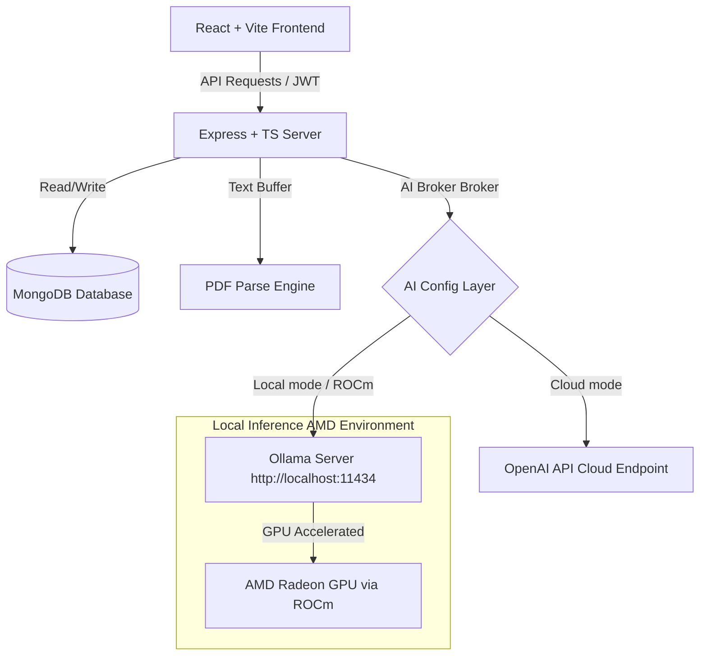

# CareerPilot AI – Intelligent Career & Placement Agent
### *Empowering Job Seekers with Local GPU-Accelerated Agentic AI*

CareerPilot AI is a production-grade, full-stack autonomous career mentorship application built for the **AMD AI DevMaster Hackathon (Agentic AI Track)**. It helps college students, fresh graduates, and professionals map skill gaps, audit resume ATS scores, practice speech-driven mock interviews, and organize custom 4-week study roadmaps.

---

## 🛠️ Tech Stack & Architecture

- **Frontend**: React (Vite), TypeScript, Tailwind CSS, Recharts (analytics dashboards), Framer Motion (glassmorphic layouts), Lucide Icons.
- **Backend**: Node.js, Express, TypeScript, REST APIs, MongoDB + Mongoose, JWT Authentication, Multer (file parser buffers), bcryptjs.
- **AI Engine**: Modular Dual-Mode Client supporting local **Ollama** (ROCm AMD accelerated) or cloud **OpenAI API**.



---

## 🚀 AMD ROCm & GPU Acceleration Guide

CareerPilot AI features a modular inference broker specifically designed to route workloads to a local **Ollama** server running on **AMD Radeon GPUs** through **ROCm**.

### 1. Requirements
- AMD Radeon™ GPU (ROCm supported architectures: RDNA 2, RDNA 3, CDNA e.g., RX 6000, RX 7000 series, or workstation cards).
- **Ollama** installed locally on your Windows/Linux machine.
- ROCm compatible runtime drivers.

### 2. Configure AMD GPU Acceleration on Windows
For many consumer Radeon cards (like RX 6600, 6700, 7600 etc.), Ollama automatically detects the card. If it does not, you can enforce graphic library compatibility by setting Windows environment variables:

```powershell
# In PowerShell (run as Administrator before starting Ollama)
$env:HSA_OVERRIDE_GFX_VERSION="10.3.0" 

# Or for RDNA 3 cards (e.g. RX 7000 Series)
$env:HSA_OVERRIDE_GFX_VERSION="11.0.0"
```

### 3. Start Local Inference Server
Pull and run the default lightweight models using Ollama:
```bash
# Pull the Llama 3 model (8 Billion Parameters)
ollama pull llama3

# Run the local server endpoint
ollama run llama3
```
Ollama will now host an OpenAI-compatible REST API at `http://localhost:11434/v1` backed by AMD ROCm GPU acceleration.

### 4. Enable ROCm Mode in CareerPilot AI
In your `backend/.env` file, configure the AI Broker:
```env
AI_PROVIDER=ollama
OLLAMA_BASE_URL=http://localhost:11434
OLLAMA_MODEL=llama3
```

---

## 📁 Repository Directory Structure

```
e:/AMD/
├── backend/
│   ├── src/
│   │   ├── config/          # MongoDB Adapter, AI Client Configuration (ROCm vs Cloud)
│   │   ├── controllers/     # API logic (Auth, Chat, Resume, Interview, Roadmap, Dashboard)
│   │   ├── middleware/      # Auth tokens, Multer memory storage, Error handlers
│   │   ├── models/          # Mongoose Schemas (User, Chat, Resume, Interview, Roadmap, Notification)
│   │   ├── routes/          # Express route bindings
│   │   ├── services/        # AI Service prompt brokers and structured parser helpers
│   │   ├── utils/           # Helper scripts
│   │   └── index.ts         # Backend server bootloader
│   ├── package.json
│   ├── tsconfig.json
│   └── .env.example
├── frontend/
│   ├── public/              # Global assets, favicons, logos
│   ├── src/
│   │   ├── components/      # UI components (GlassCard, Layout, EmptyState indicators)
│   │   ├── context/         # Auth contexts, Themes modes caching, Toast notifications
│   │   ├── hooks/           # useSpeech (Mic inputs, Web Speech Synthesis output)
│   │   ├── pages/           # Pages (Dashboard, Resume, Interview, Roadmaps, Settings)
│   │   ├── App.tsx          # Central router guard
│   │   ├── index.css        # Tailwind + Glassmorphism directives
│   │   └── main.tsx
│   ├── package.json
│   ├── tsconfig.json
│   ├── tailwind.config.js
│   └── vite.config.ts
```

---

## 🔧 Installation & Local Launch

Ensure you have **Node.js** (v18+) and **MongoDB** installed and running locally.

### Step 1: Set Up Backend Configurations
```bash
cd backend
npm install
```
Rename the `.env.example` file to `.env` and adjust variables if needed:
```env
PORT=5000
MONGODB_URI=mongodb://localhost:27017/careerpilot
AI_PROVIDER=ollama
OLLAMA_BASE_URL=http://localhost:11434
OLLAMA_MODEL=llama3
```

### Step 2: Set Up Frontend Configurations
```bash
cd ../frontend
npm install
```

### Step 3: Run the Development Servers
You can launch both applications in separate terminals:

```bash
# In terminal 1 (start backend API on port 5000)
cd backend
npm run dev

# In terminal 2 (start Vite React frontend on port 3000)
cd frontend
npm run dev
```

Open your browser and navigate to: **`http://localhost:3000`**

---

## 👥 Seed Demo Accounts
To test the application immediately without registration, you can use the default test account credentials:

- **Email**: `testpilot@careerpilot.ai`
- **Password**: `password123`

*(These test profiles will automatically hook up default dashboard metrics, resume reviews history logs, and learning roadmaps, enabling rapid testing).*

---

## 📡 REST API Documentation Reference

All requests must include the JWT token header: `Authorization: Bearer <token>` (except public auth endpoints).

| Method | Endpoint | Description | Payload |
|:---|:---|:---|:---|
| **POST** | `/api/auth/signup` | Register new profile account | `{ name, email, password }` |
| **POST** | `/api/auth/login` | Login and return JWT token | `{ email, password }` |
| **GET** | `/api/auth/profile` | Retrieve active profile details | *None* |
| **PUT** | `/api/auth/profile` | Update profile / target career | `{ name, targetCareer }` |
| **GET** | `/api/dashboard/overview` | Retrieve dashboard stats & checklist | *None* |
| **POST** | `/api/resume/analyze` | Parse PDF resume and calculate score | `file (FormData), targetJob` |
| **GET** | `/api/resume/latest` | Retrieve latest resume ATS critique | *None* |
| **POST** | `/api/interview/start` | Start new mock interview session | `{ type: 'technical'\|'hr', role }` |
| **POST** | `/api/interview/:id/answer`| Submit answer and get next question | `{ answer }` |
| **POST** | `/api/roadmap/analyze-gap` | Map skill gap & generate 4-week roadmap| `{ dreamJob, currentSkills }` |
| **PUT** | `/api/roadmap/toggle-task` | Toggle checklist task completion state | `{ taskId, isCompleted }` |
| **GET** | `/api/chat` | Get conversation chats list | *None* |
| **POST** | `/api/chat` | Create new consultation chat | `{ title }` |
| **POST** | `/api/chat/:id/message` | Send message to AI mentor | `{ content }` |

---

## 🏆 Gamified Achievement Badges

CareerPilot AI builds user engagement using unlockable achievements tracked on the profile dashboard page:
1. **Welcome Pilot**: Account created successfully.
2. **Profile Completed**: Career objectives and current skills populated.
3. **Resume Critic**: Uploaded first PDF resume.
4. **ATS Master**: Achieved a resume ATS rating of 80% or higher.
5. **Interview Explorer**: Completed first mock interview loop.
6. **Mock Superstar**: Achieved a mock score rating of 8.0/10 or higher.
7. **Roadmap Planner**: Generated first week-by-week learning plan.
8. **Pathfinder**: Checked off first learning task.
9. **Placement Graduate**: Achieved 100% completion on a roadmap.
10. **Deep Thinker**: Maintained 5 or more consultations chats.
