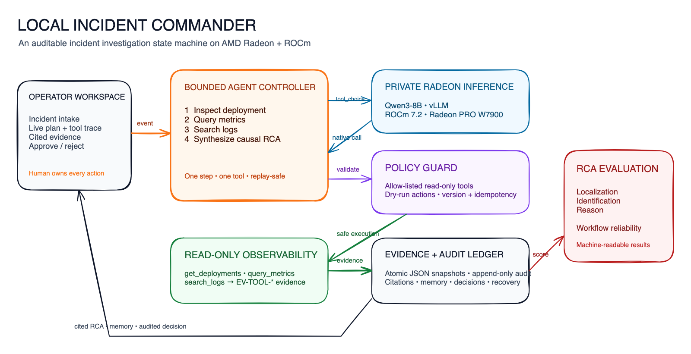

# Bunker 🔒
**Your AI. Your Data. Your Machine.**

Bunker is a private, local-first AI agent that runs on AMD Radeon GPUs via ROCm.
It is built for one demanding job: **confidential document operations for legal
and financial teams** — reviewing contracts, extracting clauses, summarizing
unreleased financials, and drafting approved documents — all without sending a
single character to a cloud model.


## The Scenario

A legal or financial team has a folder of confidential documents: merger NDAs,
contracts, fund performance memos, portfolio reviews. They need the *same* AI
capabilities cloud assistants offer — grounded Q&A over those documents,
multi-step tool use, follow-up conversations, and drafted outputs — **without**
uploading material non-public information (MNPI), PII, or trade secrets to an
external API.

Bunker addresses exactly that:

1. **Ingest locally** — documents are indexed into a local ChromaDB store using
   GPU (ROCm) embeddings. Nothing leaves the machine.
2. **Grounded Q&A with citations** — a multi-hop RAG pipeline answers from the
   documents and shows `[1] [2]`-style passage citations; it answers
   `INSUFFICIENT_CONTEXT` instead of hallucinating.
3. **Follow-up tool use** — the ReAct agent reads, searches, lists, drafts, and
   writes files through a permission controller, so destructive actions are
   denied by default unless you explicitly enable approval.
4. **Proof, not promises** — every inference and tool call is recorded by an
   audit log and a data-flow monitor, and the privacy dashboard shows the real
   local vs external numbers live.

A ready-to-record walkthrough lives in [`demo/demo_script.md`](demo/demo_script.md).

## Features

- 🚀 **Hardware Accelerated**: Native AMD ROCm support with INT4/INT8 GPTQ
  quantization via vLLM.
- 🔒 **Local-First by Default**: All inference runs on your GPU. Every call is
  telemetry-verified — the dashboard shows real local vs external counts, so
  "100% local" is a measured fact, not a slogan.
- 🧠 **Multi-Step Reasoning**: DSPy ReAct agent with a task planner for complex
  multi-step workflows.
- 📚 **Local RAG**: Document ingestion and multi-hop semantic search over
  ChromaDB with grounded `[pid]` citations.
- 🛠️ **Extensible Tools**: Nine gated tools (file read/write/search/list,
  email draft/search, calendar query/create, web search) with a
  `PermissionController` for write operations.
- 📊 **Privacy Dashboard**: Real-time Gradio UI showing audit logs, local vs
  external inference counts, and bytes processed.

## Inference Paths

Bunker supports three inference backends, selected with
`BUNKER_INFERENCE__BACKEND`. They are **not** interchangeable marketing terms:

### 1. Local AMD ROCm core path (recommended)

The production path. A **vLLM server on ROCm** runs the quantized model on your
AMD Radeon GPU; Bunker talks to it over `localhost`. This is the path the
benchmarks, the RAG pipeline, and the demo are built around.

```bash
export BUNKER_INFERENCE__BACKEND=vllm                 # default
export BUNKER_INFERENCE__PRIMARY_MODEL=Qwen/Qwen3-30B-A3B
```

### 2. Ollama dev-only path

For low-resource development on machines without ROCm, Bunker can talk to a
**local Ollama server** instead. Same privacy model (localhost), tiny models,
meant for end-to-end smoke testing only — not for production claims.

```bash
export BUNKER_INFERENCE__BACKEND=ollama
export BUNKER_INFERENCE__OLLAMA_MODEL=qwen3:0.6b
export BUNKER_INFERENCE__OLLAMA_BASE_URL=http://localhost:11434/v1
```

### 3. Radeon Cloud API — optional bonus fallback (external)

An **opt-in** AMD cloud tier. It is only active when a Radeon API key is set,
sends data to the Radeon Cloud, and always requests 4-bit quantized generation.
When it is used, the privacy dashboard reports it as **external** — the
"100% local" claim is only true when no external or failed events are recorded.

```bash
export BUNKER_INFERENCE__BACKEND=radeon_api
export BUNKER_INFERENCE__RADEON_API_KEY=your-key
```

## Quick Start

You can run Bunker entirely via Docker (recommended) or manually.

### Using Docker Compose

```bash
git clone https://github.com/monokpe/Radeon-hackathon-2026-07.git
cd Radeon-hackathon-2026-07
docker-compose up --build
```

Navigate to `http://localhost:7860` to access the UI.

### Manual Installation

```bash
python -m venv .venv310
source .venv310/bin/activate        # Windows: .venv310\Scripts\activate
pip install -r requirements.txt
```

### Running the App (API + Gradio UI)

```bash
# FastAPI app with the Gradio UI mounted at / — visit http://localhost:7860
uvicorn src.main:app --host 0.0.0.0 --port 7860
# or, equivalently:
python -m src.main
```

Useful endpoints once it is running:

- `GET /` — the Gradio UI (chat + privacy dashboard)
- `GET /health` — `{"status": "ok", "version": "1.0.0"}`
- `GET /api/privacy/status` — live local-vs-external data flow status

### Local Developer Smoke Test (Ollama path)

```powershell
# 1. Start Ollama and pull the tiny local model
ollama serve
ollama pull qwen3:0.6b

# 2. Point Bunker at Ollama (pydantic-settings prefix: BUNKER_ + __ delimiter)
$env:BUNKER_INFERENCE__BACKEND="ollama"
$env:BUNKER_INFERENCE__OLLAMA_MODEL="qwen3:0.6b"
$env:BUNKER_INFERENCE__OLLAMA_BASE_URL="http://localhost:11434/v1"

# 3. Smoke: verifies the active config, Ollama health, and app imports
.venv310\Scripts\python.exe scripts\local_smoke.py

# 4. Offline deterministic BDD smoke (no model needed)
make test-bdd
```

## Detailed Setup (AMD ROCm)

To take full advantage of AMD GPU acceleration, install ROCm 6.2 and use the
automated installer:

```bash
./scripts/setup_rocm.sh          # apt packages -> venv -> ROCm PyTorch -> vLLM -> verify
./scripts/download_models.sh     # pulls Qwen3-30B-A3B + Llama-3.1-8B-Instruct (quantized)
```

Set the ROCm environment (RX 7900 series example):

```bash
export HSA_OVERRIDE_GFX_VERSION=11.0.0   # RX 7900 series compatibility
export ROCM_PATH=/opt/rocm
export HIP_VISIBLE_DEVICES=0
export PYTORCH_HIP_ALLOC_CONF=max_split_size_mb:512
```

Then start the local vLLM server (or let `scripts/setup_rocm.sh` / Docker handle
it):

```bash
python3 -m vllm.entrypoints.openai.api_server \
    --model Qwen/Qwen3-30B-A3B --quantization gptq --dtype float16 \
    --max-model-len 32768 --gpu-memory-utilization 0.85 \
    --enable-prefix-caching --enable-chunked-prefill
```

### Validating AMD ROCm / Radeon Cloud

```bash
# Local ROCm stack: prints torch.version.hip, torch.cuda.is_available(),
# GPU name, and exits non-zero if ROCm is missing.
python scripts/validate_rocm.py

# Radeon Cloud API fallback (requires a key)
export BUNKER_INFERENCE__BACKEND=radeon_api
export BUNKER_INFERENCE__RADEON_API_KEY=your-key
python -c "from src.config import get_config; from src.inference.radeon_api import RadeonCloudAPI; api = RadeonCloudAPI(api_key=get_config().inference.radeon_api_key); print('Radeon Cloud available:', api.is_available()); print(api.generate([{'role': 'user', 'content': 'Say hello in one word.'}], max_tokens=8))"
```

## Architecture



```text
+-----------------------------------------------------------------+
|                         PRESENTATION LAYER                      |
|                  Gradio UI (Chat + Privacy Dashboard)           |
+-----------------------------------------------------------------+
|                           AGENT LAYER                           |
|       BunkerOrchestrator | DspyReActAgent | PermissionController|
+-----------------------------------------------------------------+
|                          SERVICES LAYER                         |
|   Memory (SQLite)  |  RAG (ChromaDB)  |  Tools (File, Email)    |
|   AuditLogger / DataFlowMonitor (telemetry on every inference)  |
+-----------------------------------------------------------------+
|                        INFERENCE LAYER                          |
|    vLLM (ROCm, primary) | local secondary | Ollama | Radeon API |
+-----------------------------------------------------------------+
|                         HARDWARE LAYER                          |
|                     AMD Radeon GPU (MI300X/RX7900)              |
+-----------------------------------------------------------------+
```

See [`docs/ARCHITECTURE.md`](docs/ARCHITECTURE.md) for the full layered diagram,
the agent runtime loop, and the data-flow walkthrough.

## Performance Benchmarks

*Reference numbers on AMD Radeon RX 7900 XTX (24GB), ROCm 6.2 — see
[`docs/BENCHMARKS.md`](docs/BENCHMARKS.md) for how to reproduce and for the
measurement methodology.*

| Precision | TTFT (ms) | Throughput (tok/s) | VRAM (GB) | Source |
| :--- | :--- | :--- | :--- | :--- |
| FP16 (Unquantized) | OOM | N/A | >24 | Measured |
| INT8 (GPTQ) | 125 | 35 | 18 | Sample (reference) |
| INT4 (GPTQ) | 85 | 65 | 11 | Sample (reference) |

Reproduce on your machine with `./scripts/benchmark.sh --vllm-url http://localhost:8000`
and compare your `artifacts/benchmark_<timestamp>.json` median values.

## Five Capabilities

1. **RAG**: Automatically index and retrieve contextual data from your local
   documents, with grounded `[pid]` citations.
2. **Tool Invocation**: The agent can read/write files, draft emails, and check
   your calendar — all gated.
3. **Multi-Step Planning**: Complex requests are broken down into logical steps
   by a DSPy task planner.
4. **Multi-Turn Memory**: Session context backed by SQLite with token-aware
   trimming.
5. **Permission Control**: Strict gating — dangerous actions are **denied by
   default**, with opt-in approval for recordings.

## Privacy Architecture

Bunker is **local-first and telemetry-verified**. The `AuditLogger` records every
operation — including each inference and its backend — to a local JSONL file.
The `DataFlowMonitor` tracks local vs external bytes in real time. The
`PermissionController` gates file writes, email drafts, and other irreversible
actions: dangerous tools are **denied by default** (a fail-safe — no prompt can
talk the model past the gate), and approval can be opted into for recordings via
`BUNKER_PRIVACY__DEMO_MODE=true`.

Because the system records *every* LM call (via `dspy_runtime` telemetry) and
classifies backends (`vllm`, `ollama`, `local_secondary` = local; `radeon_api` =
external; `failed` = never local), the privacy dashboard's "Local Inference %"
is a measured figure. The `DataEncryptor` is available as an **opt-in**
at-rest encryption utility (Fernet) for sensitive files; it is off by default
(`BUNKER_PRIVACY__ENABLE_ENCRYPTION=false`) and is not a substitute for
permission gating.

## Testing

The suite is layered; run it with `make` targets or pytest directly. Live-model
tests (integration, live perf probes) skip automatically when no server is on
`:8000`; perf VRAM and security "Deny" checks use deterministic mocks
everywhere so the whole suite is green on any machine.

```bash
make test-unit       # offline gate: 147 tests (+ 3 env-dependent skips)
make test-integration
make test-eval       # skips until artifacts/bunker_rag_mipro.json is compiled
make test-perf
make test-security
make test-negative
make test-compile
make test-bdd        # behave/Gherkin acceptance suite (4 scenarios, 23 steps)
make test-all        # every layer, end to end
```

Or run the offline-only gate directly:

```bash
pytest tests -m "not integration and not eval and not perf" -q
```

> **Generated artifacts:** `artifacts/` is gitignored and not committed.
> `make test-eval` skips (never fails) until you generate
> `artifacts/bunker_rag_mipro.json` with `python scripts/compile_bunker.py`
> against a live local model.

## Contributing

We welcome contributions! Please read `CONTRIBUTING.md` for guidelines on pull
requests, coding standards, and adding new MCP tools.

## License

This project is licensed under the MIT License - see the LICENSE file for details.
