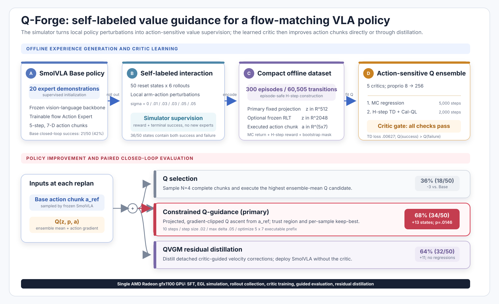
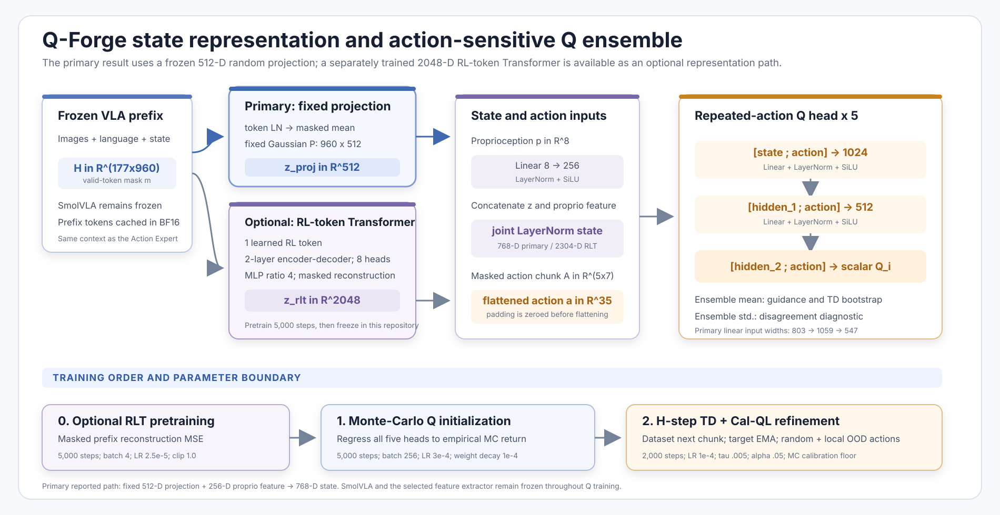
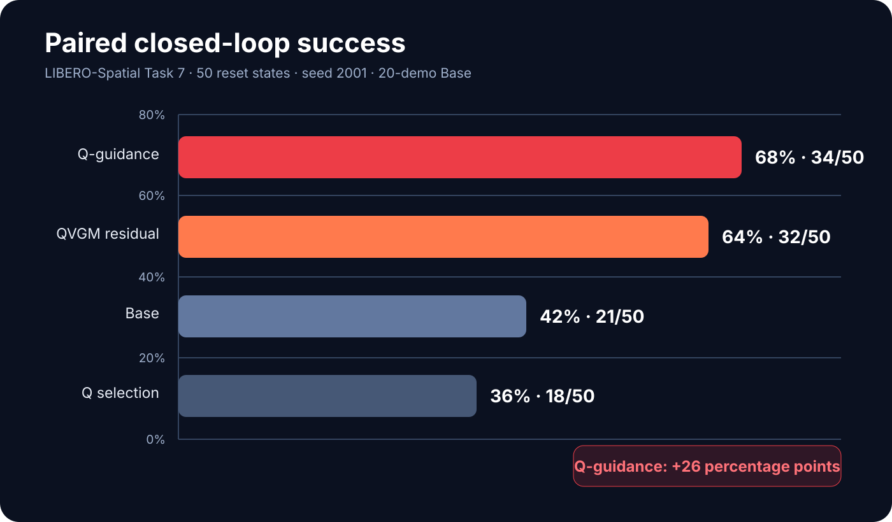

# Radeon-hackathon-2026-07

## how to apply and use AMD Radeon GPU
see [README](https://github.com/AMD-DEV-CONTEST/Radeon-hackathon-2026-07/blob/main/Radeon-Cloud-User%20Guide/README.md)

## Track 3 starter demo: robot simulation on AMD Radeon GPU

New to robotics, or want to learn how to run robot simulation on AMD GPUs? This reference demo is a quick, hands-on starting point for Track 3 participants — an end-to-end pipeline where a Franka Panda arm picks fruit off a table and places it in a bowl, built on the **Genesis** physics engine and **LeRobot**, running on an AMD Radeon (ROCm) GPU.

▶️ **Demo repo & videos:** https://github.com/wangxunx/franka_fruit_pick_demo

What you'll learn:
- Set up a robot simulation environment on an AMD Radeon GPU (ROCm), using the prebuilt ROCm PyTorch wheels
- Build a scene and run physics simulation with **Genesis**
- Record data, apply domain randomization, and train a visuomotor policy with **LeRobot**
- Go end-to-end — from a scripted pick-and-place to a trained, closed-loop policy, with evaluation videos

> Note: this is a learning reference to show how to run simulation and training on an AMD GPU with `genesis-world` + `lerobot`; the trained model's success rate is not guaranteed.

## when you submit
**pls fork this repo and open a pull request including the stuff that is mentioned in Rules&conditions of luma page. the title of pull request should be like "Track x, Team name, your application name"**

> [!IMPORTANT]
> Team name was an optional field on the Luma registration form. If you did not fill in a team name when you registered, please use your own name instead, so the title of the pull request should be like **"Track x, Your name, your application name"**.

> [!NOTE]
> All submission materials, project descriptions, and Pull Requests should be submitted in English.

## Submission Requirements

### Track 1: Development of Multimodal Content Creation Tools

1. **Project Profile Document (PDF)**
   - Project background
   - Target users & application scenarios
   - System architecture
   - Model & algorithm introduction
   - Adaptation description for AMD Radeon GPU / ROCm
2. **Project Source Code**
   - Complete source code repository
   - README file including environment configuration, startup guide and dependency list
3. **Demo Video**
   - Recommended duration: 3–5 minutes
   - Demonstrate the actual operation process
   - The actual execution performance on an AMD Radeon GPU, from command line/GUI to the final result (clarity, stability and diversity of outputs)
4. **Supplementary Materials (Choose One)**
   - PPT / Poster (highlight creative scenarios, practical value of the tool)

### Track 2: Development & Local Deployment of Private AI Agents

1. **Project Specification Document**
   - Application scenarios
   - Agent architecture diagram
   - Introduction to core capabilities
   - Model introduction & local deployment plan
   - Optimization description for inference speed on AMD Radeon GPU
2. **Project Source Code**
   - Complete source code repository
   - README file including environment configuration, startup guide and dependency list
3. **Demo Video**
   - Recommended duration: 3–5 minutes
   - Demonstrate the actual operation process
   - The actual execution performance on an AMD Radeon GPU, from command line/GUI to the final result (fluidity and functional completeness)
4. **Supplementary Materials (Choose One)**
   - PPT / Poster

### Track 3: Physical AI Challenge – Robotics Simulation and Application Design based on AMD Radeon GPUs and ROCm

1. **Technical Report** (should include, but is not limited to):
   - Definition and description of the target application
   - Overall system architecture and solution design
   - Description of the datasets used for training and/or evaluation
   - Explanation of how AMD Radeon GPUs are utilized during training, inference, and other relevant stages
   - Description of the innovations, key technical contributions, and important aspects of the project
   - Description of the final deliverables and output forms of the project
   - Any additional information that participants believe highlights the strengths or unique aspects of their work
   - Introduction of team members and their respective contributions
2. **Project Source Code**
   - Dedicated source code repositories
   - A Docker image containing the complete source code and all required components for running the project would be preferable
3. **Reproducibility Instruction README** — a detailed README document containing:
   - Environment setup instructions
   - Execution and usage instructions
   - Dependency specifications
   - Step-by-step reproduction procedures
   - Following the provided instructions should allow evaluators to reproduce the submitted results
4. **Demonstration Video** (Recommended Length 3~5 minutes)
   - The video should demonstrate the complete workflow of the project, including command-line and/or GUI operations, execution procedures, and results
5. **Supplementary materials** in other formats may be submitted to demonstrate the value of the proposed technical solution.

---

## Track 3 Submission — Q-Forge

**Participant:** Yuhao Cao 
**Application:** Q-Forge — Self-Labeled Q-Guidance for SmolVLA on AMD Radeon 
**Pull Request title:** `Track 3, Yuhao Cao, Q-Forge`

Q-Forge improves a flow-matching vision-language-action robot policy without
collecting additional expert demonstrations. Starting from a SmolVLA Base policy
fine-tuned on 20 demonstrations, it collects locally perturbed LIBERO rollouts,
uses simulator reward and terminal success as automatic labels, and trains a
five-member action-sensitive Q ensemble. The learned critic can either make
bounded action-chunk corrections at inference time or distill those corrections
into the policy for critic-free deployment.

The complete workflow—supervised fine-tuning, EGL simulation, rollout collection,
critic learning, Q-guided evaluation, residual distillation, and attention
profiling—was executed on one AMD Radeon `gfx1100` GPU with 96 compute units and
48 GiB VRAM.

### Core results

| LIBERO-Spatial task | Base | Q selection | Q-guidance | QVGM residual |
|---|---:|---:|---:|---:|
| Task 7 — black bowl on stove | 21/50 (42%) | 18/50 (36%) | **34/50 (68%)** | 32/50 (64%) |
| Task 3 — black bowl on cookie box | 38/50 (76%) | 35/50 (70%) | **44/50 (88%)** | 43/50 (86%) |

- Task 7 Q-guidance converts 19 Base failures into successes with 6 regressions:
  **+13 states, +26 percentage points, exact McNemar `p=0.0146`**.
- Task 3 conservative Q-guidance produces 6 improvements and no regressions:
  **+6 states, +12 percentage points, `p=0.03125`**.
- The primary Task 7 result uses a lightweight frozen 512-dimensional random
  projection; the optional 2048-dimensional RL-token path is documented as a
  separate representation experiment.
- End-to-end SmolVLA replanning latency is reduced from 321.8 ms to 289.3 ms,
  approximately **10.1%**, without retraining the policy.

### Visual overview

### Submission materials

| Material | Relative link |
|---|---|
| Submission index and Track 3 compliance matrix | [SUBMISSION.md](track3_YuhaoCao_Q-Forge/SUBMISSION.md) |
| Project overview and usage guide | [Project README](track3_YuhaoCao_Q-Forge/README.md) |
| English technical report | [TECHNICAL_REPORT.md](track3_YuhaoCao_Q-Forge/docs/TECHNICAL_REPORT.md) |
| Step-by-step reproduction guide | [REPRODUCTION.md](track3_YuhaoCao_Q-Forge/docs/REPRODUCTION.md) |
| Dataset and split documentation | [DATA.md](track3_YuhaoCao_Q-Forge/docs/DATA.md) |
| Audited result summary | [RESULTS.md](track3_YuhaoCao_Q-Forge/docs/RESULTS.md) |
| AMD Radeon and ROCm implementation notes | [AMD_ROCM.md](track3_YuhaoCao_Q-Forge/docs/AMD_ROCM.md) |
| Complete Python package | [src/](track3_YuhaoCao_Q-Forge/src) |
| Training, collection, evaluation, and benchmark tools | [scripts/](track3_YuhaoCao_Q-Forge/scripts) |
| Experiment configurations | [configs/](track3_YuhaoCao_Q-Forge/configs) |
| Unit and protocol tests | [tests/](track3_YuhaoCao_Q-Forge/tests) |
| 4:16 English demonstration video | [Q-Forge-demo.mp4](track3_YuhaoCao_Q-Forge/video/Q-Forge-demo.mp4) |
| Demo storyboard | [storyboard.md](track3_YuhaoCao_Q-Forge/video/storyboard.md) |
| English narration | [narration.txt](track3_YuhaoCao_Q-Forge/video/narration.txt) |
| English subtitles | [subtitles.srt](track3_YuhaoCao_Q-Forge/video/subtitles.srt) |
| Task 7 machine-readable results | [main_results.json](track3_YuhaoCao_Q-Forge/results/main_results.json) |
| Task 3 machine-readable results | [task3_results.json](track3_YuhaoCao_Q-Forge/results/task3_results.json) |
| Critic and guidance diagnostics | [critic_and_guidance.json](track3_YuhaoCao_Q-Forge/results/critic_and_guidance.json) |
| Interactive attention benchmark | [attention_bench_gfx1100.html](track3_YuhaoCao_Q-Forge/reports/attention_bench_gfx1100.html) |
| Inference optimization record | [inference_optimization_change_record.md](track3_YuhaoCao_Q-Forge/reports/inference_optimization_change_record.md) |
| License | [LICENSE](track3_YuhaoCao_Q-Forge/LICENSE) |
| Third-party notices | [THIRD_PARTY_NOTICES.md](track3_YuhaoCao_Q-Forge/THIRD_PARTY_NOTICES.md) |

**Participant contribution:** Yuhao Cao is the sole participant and is
responsible for project conception, system design, implementation, AMD ROCm
adaptation, experiments, evaluation, visualization, video production, and
documentation.
