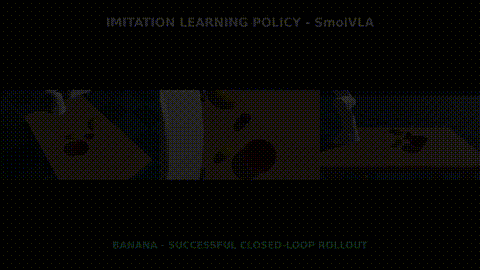
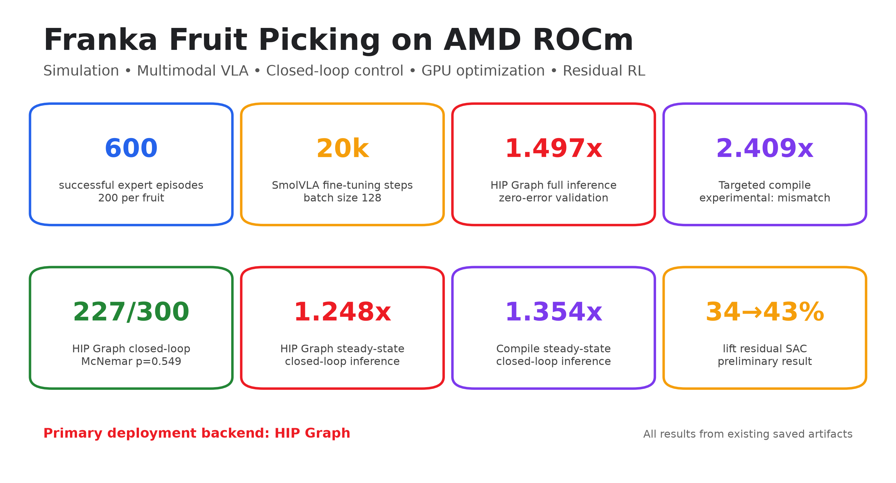
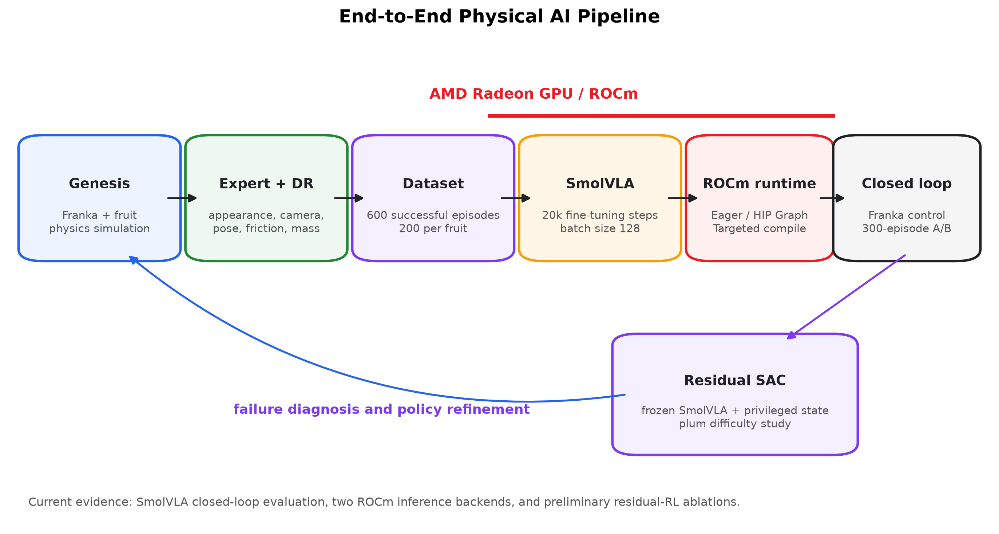

# Pick Fruit by SmolVLA on AMD ROCm

English | [Chinese version](README_ZH.md)

A multimodal Franka fruit-picking system built with Genesis, LeRobot, SmolVLA, AMD Radeon GPUs, and ROCm. This repository contains the competition technical report, minimal core source code, formal results, and figures. Large training datasets and model weights are managed as external artifacts rather than committed to Git.

[Technical report](docs/TECHNICAL_REPORT.md) · [Reproducibility guide](docs/REPRODUCIBILITY.md) · [Artifact manifest](artifacts/manifest.json)

## English SmolVLA Demo and Closed-Loop Examples

All videos below are closed-loop outputs of the fine-tuned SmolVLA imitation-learning policy, not scripted-expert playback.



[Watch the English-narrated demo](docs/video/smolvla_success_failure_demo.mp4)

### Video contents

The approximately 3:20 video uses English narration and synchronized 1080p three-view footage. It covers:

- the 600-successful-episode domain-randomized training dataset;
- complete successful banana, lemon, and plum pick-and-place runs;
- saved lemon and plum failures;
- HIP Graph deployment success rates of 99%, 94%, and 34%;
- approach error, weak grasp, lift failure, and transport-drop causes;
- the performance/correctness trade-off between HIP Graph and Targeted Compile on ROCm.

Success videos provide qualitative evidence; formal conclusions use 100 episodes per fruit. All ten saved banana visualization episodes succeeded, so no old-model failure was substituted. This does not imply zero banana failures: the formal 100-episode evaluation contains one failure. Video reconstruction and evidence boundaries are documented in [NARRATION_EN.md](docs/video/NARRATION_EN.md).

### Individual closed-loop videos

- [Banana success](docs/video/success_examples/banana_success.mp4)
- [Lemon success](docs/video/success_examples/lemon_success.mp4)
- [Plum success](docs/video/success_examples/plum_success.mp4)
- [Lemon failure](docs/video/failure_examples/lemon_failure.mp4)
- [Plum failure](docs/video/failure_examples/plum_failure.mp4)

## Key Results

| Item | Result |
|---|---|
| Domain-randomized data | 600 successful episodes; 200 each for banana, lemon, and plum |
| SmolVLA fine-tuning | 20,000 steps, batch size 128 |
| HIP Graph full inference | 153.81 → 102.76 ms, 1.497x, zero error under strict validation |
| Targeted Compile full inference | 153.81 → 63.86 ms, 2.409x, with numerical mismatch |
| HIP Graph closed loop | 224/300 → 227/300, 1.248x steady-state policy speedup |
| Targeted Compile closed loop | 218/300 → 222/300, 1.354x steady-state policy speedup |
| Lift residual SAC | 34/100 → 43/100, preliminary and not independently validated |

## Completed Training Records

These values come from original checkpoint metadata and training logs, not configuration inference.

| Training | Verified completed record | Artifact |
|---|---|---|
| SmolVLA fine-tuning | 20,000 steps, batch 128, seed 1000; saved every 2,000 steps for ten periodic checkpoints | Final model: 906,712,520 bytes |
| Lift-only residual SAC | 100,000 steps, warmup 10,000, batch 256; saved every 10,000 steps | `last.pt`: step 100,000, 62-D state, 9-D residual |

The residual training log contains 361 completed episodes and 169 successes (46.8%); the final 100 training episodes contain 45 successes. These are online training-monitoring statistics, not an independent test set. The project claim remains the paired evaluation on fixed seeds 2000–2099: 34/100 → 43/100. The original SmolVLA output did not retain per-step loss logs, so no unrecoverable loss curve is presented. See [verified training history](results/training/README.md).

HIP Graph is the current stable deployment candidate. Targeted Compile is faster but fails strict numerical equivalence, so it remains experimental. The two closed-loop experiments use different seed ranges and may only be compared with their own eager baselines.



## System Pipeline

```text
Genesis simulation
  → scripted expert + domain randomization
  → 600-episode LeRobot dataset
  → SmolVLA fine-tuning
  → Eager / HIP Graph / Targeted Compile
  → closed-loop Franka fruit picking
  → plum failure diagnosis + residual SAC exploration
```



## Repository Layout

```text
Pick-Fruit-By-SmolVLA/
├── README.md                         # English project overview (default)
├── README_ZH.md                      # Chinese project overview
├── pyproject.toml                    # Python project and core dependencies
├── .gitignore                        # Excludes data, weights, outputs, and video intermediates
├── docs/
│   ├── TECHNICAL_REPORT.md           # English competition report (default)
│   ├── TECHNICAL_REPORT_ZH.md        # Chinese competition report
│   ├── REPRODUCIBILITY.md            # English reproduction guide (default)
│   ├── REPRODUCIBILITY_ZH.md         # Chinese reproduction guide
│   ├── figures/                      # English architecture and result figures
│   └── video/
│       ├── smolvla_success_failure_demo.mp4  # 3:20 English-narrated demo
│       ├── preview.gif                       # Animated three-fruit preview
│       ├── success_examples/                 # Banana, lemon, and plum successes
│       ├── failure_examples/                 # Lemon and plum failures
│       ├── NARRATION_EN.md                    # Narration and evidence boundaries
│       └── build_success_failure_video.sh     # Reproducible video builder
├── franka_fruit_pick/
│   ├── build_scene.py                # Genesis scene and Franka/YCB assets
│   ├── randomize.py                  # Domain randomization
│   ├── record_dataset.py             # LeRobot expert-data recording
│   ├── aggregate_datasets.py          # Merge per-fruit LeRobot datasets
│   ├── train_policy.py               # LeRobot/SmolVLA training entry point
│   ├── eval_policy.py                # Eager/accelerated closed-loop evaluation
│   └── residual_rl/                  # Privileged-state residual SAC
├── optimization/
│   ├── common.py                     # Model loading and benchmark utilities
│   └── runtime/                      # HIP Graph, Targeted Compile, benchmarks, validation
├── scripts/
│   ├── train_smolvla_fruit_pick.sh
│   ├── train_residual_sac_lift.sh
│   ├── benchmark_rocm_backends.sh
│   ├── validate_rocm_backends.sh
│   └── evaluate_rocm_closed_loop.sh
├── configs/
│   ├── smolvla_train_config.json
│   └── residual_sac_lift_config.json
├── results/
│   ├── runtime/                      # Full-inference benchmarks and strict validation
│   ├── closed_loop/                  # HIP Graph/Compile closed-loop A/B summaries
│   ├── residual_rl/                  # Residual paired evaluation and ablations
│   └── training/
│       ├── README.md                 # English training record (default)
│       └── README_ZH.md              # Chinese training record
├── artifacts/
│   ├── manifest.json                 # External artifact size, SHA256, and URL
│   └── README.md                     # Artifact placement and verification
├── assets/                           # Franka and YCB runtime assets
└── docker/Dockerfile                 # AMD ROCm environment
```

One-off development scripts, historical AMD microbenchmarks, debug/handoff material, the old ACT path, training data, checkpoints, and intermediate video segments were not migrated. Data and weights are managed through `artifacts/manifest.json`; new outputs go to the Git-ignored `reproductions/` directory.

## Collecting the Training Dataset

The repository includes the complete data path. `franka_fruit_pick/record_dataset.py` runs the scripted expert in Genesis and writes only successful episodes in LeRobot format. `franka_fruit_pick/aggregate_datasets.py` merges the three per-fruit datasets. The commands below create new data under `reproductions/datasets/` and do not overwrite formal artifacts:

```bash
mkdir -p reproductions/datasets

for spec in \
  "011_banana banana 2000" \
  "014_lemon lemon 3000" \
  "018_plum plum 4000"; do
  set -- $spec
  xvfb-run -a -s '-screen 0 1920x1080x24' \
    python franka_fruit_pick/record_dataset.py \
      --episodes 200 --max-attempts 2000 --seed "$3" \
      --pick "$1" --repo-id "demo/${2}_pick_dr_200ep" \
      --root "reproductions/datasets/${2}_pick_dr_200ep" --vcodec h264 \
      --dr-appearance --dr-object-color --dr-table-jitter 0.15 \
      --dr-fov-jitter 2.0 --dr-rebuild-every 5 \
      --dr-runtime --dr-friction 0.6 1.4 --dr-mass 0.8 1.2 \
      --dr-cam-pos 0.01 --dr-cam-lookat 0.02
done

python franka_fruit_pick/aggregate_datasets.py \
  --dataset-root reproductions/datasets/banana_pick_dr_200ep \
  --dataset-root reproductions/datasets/lemon_pick_dr_200ep \
  --dataset-root reproductions/datasets/plum_pick_dr_200ep \
  --out reproductions/datasets/fruit_pick_dr_600ep \
  --aggr-repo-id demo/fruit_pick_dr_600ep
```

`--episodes 200` means 200 successful episodes are retained; failed attempts are discarded, while `--max-attempts` caps total attempts. The command enables appearance, object-color, camera, initial pose, friction, and mass randomization. It requires the complete project dependencies, a working Genesis GPU environment, `xvfb-run`, and an H.264 encoder. Inspect all options with:

```bash
python franka_fruit_pick/record_dataset.py --help
python franka_fruit_pick/aggregate_datasets.py --help
```

## Model Training

Training launchers are under `scripts/`. They read external data or weights from `artifacts/` by default and write new output to `reproductions/`, preserving the formal results included in this repository.

### 1. Fine-tune SmolVLA

After placing the 600-episode LeRobot dataset, run:

```bash
bash scripts/train_smolvla_fruit_pick.sh
```

The launcher reproduces the main training configuration: SmolVLA base, 20,000 steps, batch size 128, checkpoint every 2,000 steps, and AMD ROCm GPU execution. ROCm uses the PyTorch `cuda` device name. The final model is normally written to:

```text
reproductions/train/smolvla_fruit_pick_dr_600ep/checkpoints/last/pretrained_model/
```

Inspect the command without training:

```bash
DRY_RUN=1 bash scripts/train_smolvla_fruit_pick.sh
```

Override common parameters with environment variables:

```bash
PYTHON_BIN=/path/to/python STEPS=100 BATCH_SIZE=4 \
  DATASET_ROOT=/path/to/fruit_pick_dr_600ep \
  bash scripts/train_smolvla_fruit_pick.sh
```

Set `POLICY_PATH=/path/to/smolvla_base` for a local base model; otherwise `lerobot/smolvla_base` is resolved from Hugging Face. Full trainer output is stored in `<OUTPUT_DIR>.launcher.log`, and the launcher detects the LeRobot failure mode in which a traceback is printed with exit code zero. The historical configuration snapshot is [configs/smolvla_train_config.json](configs/smolvla_train_config.json).

### 2. Train residual SAC

Residual SAC freezes the fine-tuned SmolVLA model and trains a nine-dimensional privileged-state residual for plum:

```bash
bash scripts/train_residual_sac_lift.sh
```

The default is lift-only training for 100,000 steps with output under `reproductions/rl/plum_residual_sac/`. Both the dataset and SmolVLA checkpoint are required. Inspect the command with:

```bash
DRY_RUN=1 bash scripts/train_residual_sac_lift.sh
```

To use a newly reproduced SmolVLA checkpoint:

```bash
POLICY_PATH="$PWD/reproductions/train/smolvla_fruit_pick_dr_600ep/checkpoints/last/pretrained_model" \
  bash scripts/train_residual_sac_lift.sh
```

See [configs/residual_sac_lift_config.json](configs/residual_sac_lift_config.json), the [Residual SAC documentation](franka_fruit_pick/residual_rl/README.md), and the [reproducibility guide](docs/REPRODUCIBILITY.md).

Both training entry points passed real temporary one-step AMD GPU tests covering model/data loading, a parameter update, and checkpoint saving. Temporary test outputs were deleted and are not counted as formal training runs.

## Reproducing AMD ROCm Inference Acceleration

Three required entry points are provided:

```bash
# Benchmark full sample_actions() on Eager, HIP Graph, and Targeted Compile
bash scripts/benchmark_rocm_backends.sh

# Validate HIP Graph and Targeted Compile numerically against Eager
bash scripts/validate_rocm_backends.sh

# Reproduce Eager vs HIP Graph, 100 episodes per fruit by default
bash scripts/evaluate_rocm_closed_loop.sh
```

For the Targeted Compile closed loop:

```bash
CANDIDATE=targeted-compile SEED=<reported-seed> POLICY_SEED=<reported-seed> \
  bash scripts/evaluate_rocm_closed_loop.sh
```

New outputs are written to `reproductions/`. Use `DRY_RUN=1` to inspect commands. For debugging, use `ITERATIONS=1 WARMUP=0 BACKENDS=eager`, or `EPISODES=1 FRUITS=banana` for one paired banana episode. A full 300-episode run is time-consuming. HIP Graph should pass strict validation; Targeted Compile is faster but has the documented numerical mismatch.

## External Artifacts

The repository does not include these large files:

```text
artifacts/datasets/fruit_pick_dr_600ep/
artifacts/models/smolvla_fruit_pick_dr_600ep/
artifacts/models/plum_residual_sac_lift/last.pt
```

Final URLs still need to be filled in [artifacts/manifest.json](artifacts/manifest.json). Sizes and SHA256 values are already recorded for the SmolVLA and residual SAC weights. Without these artifacts, users can inspect the report, verify saved summaries, and run CLI/static checks, but cannot rerun model inference or closed-loop simulation.

## Environment Summary

- Ubuntu 24.04
- Python 3.12
- ROCm 7.2.1
- ROCm PyTorch 2.9.1
- ROCm Triton 3.5.1
- LeRobot 0.6.0
- Genesis 1.1.2 or a compatible version
- Development/container target: AMD Radeon AI PRO R9700

PyTorch retains the `torch.cuda` interface on ROCm, so `device=cuda` selects a HIP device in this environment.

## Quick Checks Without Weights

```bash
python -m compileall -q franka_fruit_pick optimization

python -m optimization.runtime.summarize_results \
  --results-dir results/runtime

python -m optimization.runtime.summarize_closed_loop_ab \
  results/closed_loop/hip_graph/raw \
  --episodes 100
```

The last command applies only when per-episode raw JSON is present. The compact repository provides generated closed-loop CSV and Markdown summaries directly.

## Running After Downloading Artifacts

Follow [REPRODUCIBILITY.md](docs/REPRODUCIBILITY.md) in this order:

1. Install or build the ROCm environment.
2. Place datasets and weights at manifest-defined paths.
3. Check the GPU, dependencies, and artifact hashes.
4. Run a one-episode closed-loop smoke test.
5. Reproduce full-inference benchmarks and correctness validation.
6. Run the longer closed-loop evaluations as needed.

## Main Submission Materials

- [English technical report](docs/TECHNICAL_REPORT.md)
- [Chinese technical report](docs/TECHNICAL_REPORT_ZH.md)
- [Evaluator reproducibility guide](docs/REPRODUCIBILITY.md)
- [Formal result notes](results/README.md)
- [Model and dataset artifacts](artifacts/README.md)
- [English-narrated success/failure video](docs/video/smolvla_success_failure_demo.mp4)
- [Banana success](docs/video/success_examples/banana_success.mp4)
- [Lemon success](docs/video/success_examples/lemon_success.mp4)
- [Plum success](docs/video/success_examples/plum_success.mp4)
- [Lemon failure](docs/video/failure_examples/lemon_failure.mp4)
- [Plum failure](docs/video/failure_examples/plum_failure.mp4)
- [ROCm runtime documentation](optimization/runtime/README.md)
- [Residual SAC documentation](franka_fruit_pick/residual_rl/README.md)

## Known Limitations

- Plum success is substantially lower than banana and lemon.
- Targeted Compile has a strict numerical mismatch and cold-compilation cost.
- Residual SAC uses privileged simulator state, and 34% → 43% lacks independent-seed validation.
- Results are simulated and have not been deployed on a real Franka.
- Camera rendering, preprocessing, and physics dilute model-inference speedups.
- External artifact URLs and a final dependency lock remain release tasks.

## License

Franka, YCB, Genesis, LeRobot, and SmolVLA retain their upstream licenses. Before release, add `LICENSE` and `THIRD_PARTY_NOTICES.md` and verify model, dataset, and asset redistribution terms.
