# RadeonNav

### A Heterogeneous Architecture for Robot RL Beyond GPU-Dominant Paradigms

**Track 3: Physical AI**  
**Team: N/A**  
**Project lead: Xiao He**

## Official Deliverables


| Requirement                 | Submission material                                                                                                                                                              |
| --------------------------- | -------------------------------------------------------------------------------------------------------------------------------------------------------------------------------- |
| Technical report            | [English PDF, 11 pages](RadeonNav/docs/Technical-Report.pdf)                                                                             |
| Dedicated source repository | [Hy1422/RadeonNav](https://github.com/Hy1422/RadeonNav)                                                                        |
| Demo video                  | [3:52 English 1080p film, narrated and subtitled](RadeonNav/experiment-results/quadrupedal-agility/videos/film/RadeonNav_film_final.mp4) |
| Project Page                | [hy1422.github.io/RadeonNav](https://hy1422.github.io/RadeonNav/)                                                              |


## Overview

RadeonNav connects NeuPAN with the released TSC and BBC locomotion policies
through their existing inputs. Single-obstacle tests determine whether to
traverse or detour, while route progress and planner/waypoint headings guide
skill execution. The system preserves the natural motions inherited from the
released weights and runs on a single AMD Radeon GPU with ROCm.

### Core Contributions

- Uses measured traversal results to choose between crossing and detouring.
- Combines planner steering with waypoint guidance and holds jump headings
  fixed for a stable approach.
- Fine-tunes only the depth encoder with planner-controlled data and runs the
  reconstructed UniLab tasks and NeuPAN's DUNE model on AMD ROCm.

## Full-Course Demo

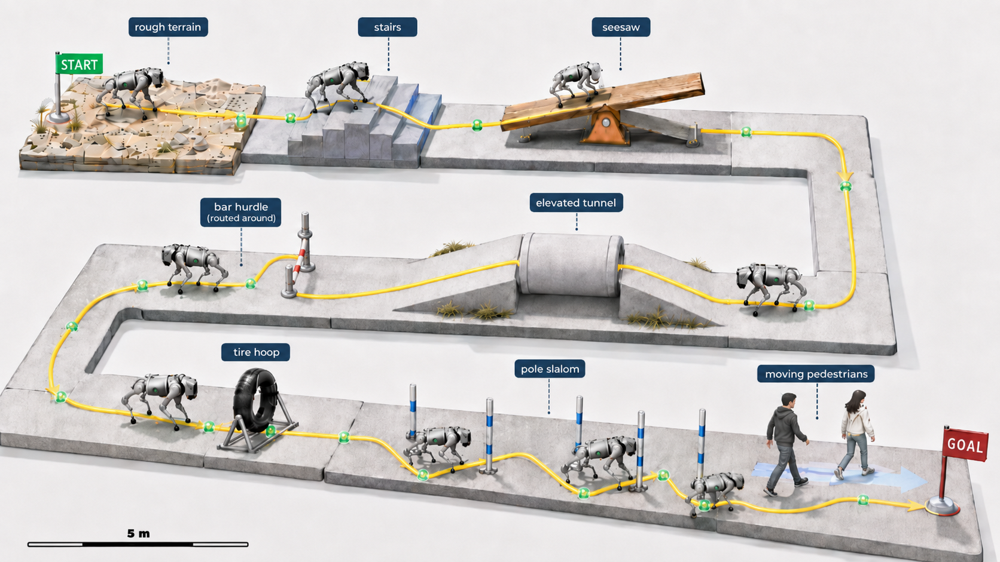

Nine task segments on a 28 m &times; 10 m serpentine course — rough terrain,
stairs, seesaw, elevated tunnel, hurdle detour, hoop jump, pole slalom, and
moving pedestrians — completed in one continuous rollout with zero collisions
and zero falls. Green markers are the sparse route anchors given to the
policy; the yellow trace is the executed trajectory. Full rollout video (real
speed): [radeon_nav_full.mp4](RadeonNav/experiment-results/quadrupedal-agility/videos/radeon_nav_full.mp4).

## Per-Task Comparison of the Four Strategies

All four columns share the same frozen locomotion networks and differ only in
what drives the high level: the teacher receives hand-authored goals plus
privileged terrain labels, the student infers both onboard, and the
planner-only and ours columns receive a 2-D route. &#9989; reached the goal,
&#10060; did not. Animations show the first 6 s of each run (10 s for the
hurdle and hoop; the pole-line detours run to arrival, 14&ndash;17 s); click
any clip to open its mp4. The dash marks fixtures a configuration does not
have.

<table>
  <tr>
    <th>Task</th>
    <th>NeuPAN (planner only)</th>
    <th>TSC+BBC teacher (privileged)</th>
    <th>TSC+BBC student (onboard)</th>
    <th>Ours (RadeonNav)</th>
  </tr>
  <tr>
    <td><b>Rough terrain</b></td>
      <td align="center"><a href="RadeonNav/experiment-results/quadrupedal-agility/videos/row1_planner_only/planner_rough.mp4">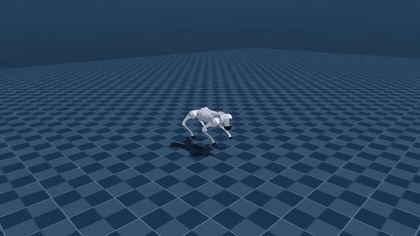</a><br/>&#9989; detour</td>
      <td align="center"><a href="RadeonNav/experiment-results/quadrupedal-agility/videos/row2_teacher_handgoals/teacher_rough_PASSED.mp4">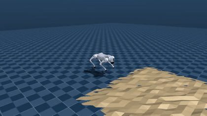</a><br/>&#9989;</td>
      <td align="center"><a href="RadeonNav/experiment-results/quadrupedal-agility/videos/row3_student_onboard/student_rough_FAILED.mp4">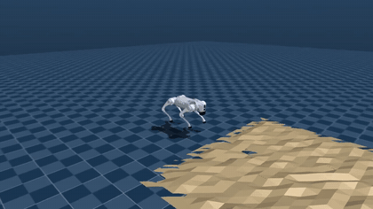</a><br/>&#10060;</td>
      <td align="center"><a href="RadeonNav/experiment-results/quadrupedal-agility/videos/row4_ours/ours_rough.mp4">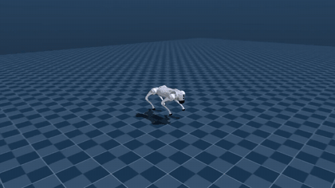</a><br/>&#9989; traverse</td>
  </tr>
  <tr>
    <td><b>Stairs</b></td>
      <td align="center"><a href="RadeonNav/experiment-results/quadrupedal-agility/videos/row1_planner_only/planner_stairs.mp4">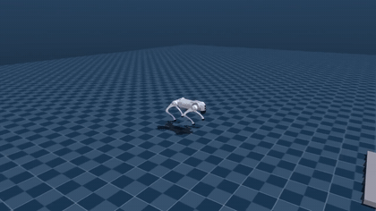</a><br/>&#9989; detour</td>
      <td align="center"><a href="RadeonNav/experiment-results/quadrupedal-agility/videos/row2_teacher_handgoals/teacher_stairs_PASSED.mp4">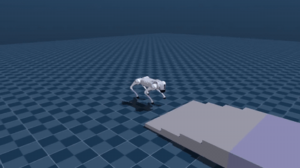</a><br/>&#9989;</td>
      <td align="center"><a href="RadeonNav/experiment-results/quadrupedal-agility/videos/row3_student_onboard/student_stairs_FAILED.mp4">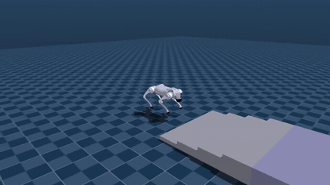</a><br/>&#10060;</td>
      <td align="center"><a href="RadeonNav/experiment-results/quadrupedal-agility/videos/row4_ours/ours_stairs.mp4"></a><br/>&#9989; traverse</td>
  </tr>
  <tr>
    <td><b>Seesaw</b></td>
      <td align="center"><a href="RadeonNav/experiment-results/quadrupedal-agility/videos/row1_planner_only/planner_seesaw.mp4">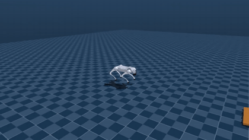</a><br/>&#9989; detour</td>
      <td align="center"><a href="RadeonNav/experiment-results/quadrupedal-agility/videos/row2_teacher_handgoals/teacher_seesaw_PASSED.mp4">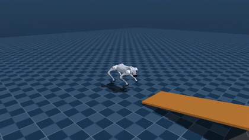</a><br/>&#9989;</td>
      <td align="center"><a href="RadeonNav/experiment-results/quadrupedal-agility/videos/row3_student_onboard/student_seesaw_FAILED.mp4">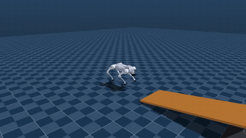</a><br/>&#10060;</td>
      <td align="center"><a href="RadeonNav/experiment-results/quadrupedal-agility/videos/row4_ours/ours_seesaw.mp4">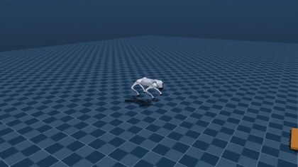</a><br/>&#9989; traverse</td>
  </tr>
  <tr>
    <td><b>Elevated tunnel</b></td>
      <td align="center"><a href="RadeonNav/experiment-results/quadrupedal-agility/videos/row1_planner_only/planner_tunnel.mp4">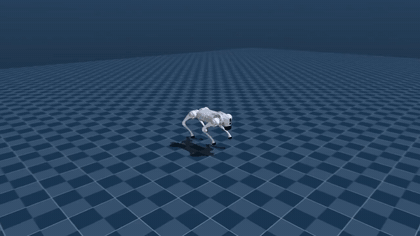</a><br/>&#9989; detour</td>
      <td align="center"><a href="RadeonNav/experiment-results/quadrupedal-agility/videos/row2_teacher_handgoals/teacher_tunnel_PASSED.mp4">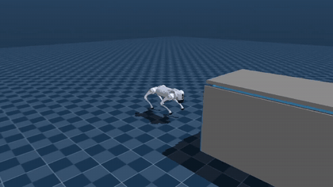</a><br/>&#9989;</td>
      <td align="center"><a href="RadeonNav/experiment-results/quadrupedal-agility/videos/row3_student_onboard/student_tunnel_FAILED.mp4">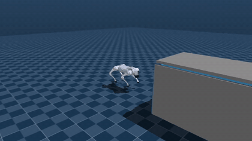</a><br/>&#10060;</td>
      <td align="center"><a href="RadeonNav/experiment-results/quadrupedal-agility/videos/row4_ours/ours_tunnel.mp4">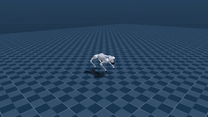</a><br/>&#9989; crawl through</td>
  </tr>
  <tr>
    <td><b>Bar hurdle</b></td>
      <td align="center"><a href="RadeonNav/experiment-results/quadrupedal-agility/videos/row1_planner_only/planner_bar.mp4">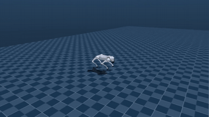</a><br/>&#9989; detour</td>
      <td align="center"><a href="RadeonNav/experiment-results/quadrupedal-agility/videos/row2_teacher_handgoals/teacher_bar_h020_FAILED.mp4">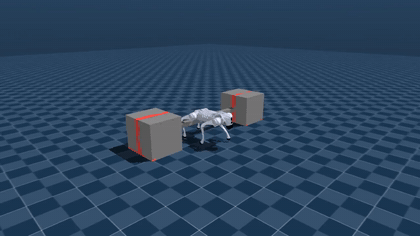</a><br/>&#10060; at 0.20 m (<a href="RadeonNav/experiment-results/quadrupedal-agility/videos/row2_teacher_handgoals/teacher_bar_h010_PASSED.mp4">&#9989; at 0.10 m</a>)</td>
      <td align="center"><a href="RadeonNav/experiment-results/quadrupedal-agility/videos/row3_student_onboard/student_bar_jump_FAILED.mp4">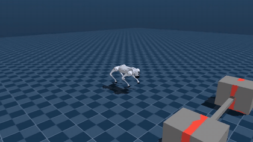</a><br/>&#10060; wedges under bar</td>
      <td align="center"><a href="RadeonNav/experiment-results/quadrupedal-agility/videos/row4_ours/ours_bar.mp4"></a><br/>&#9989; detour by measured traversal rule</td>
  </tr>
  <tr>
    <td><b>Tire hoop</b></td>
      <td align="center"><a href="RadeonNav/experiment-results/quadrupedal-agility/videos/row1_planner_only/planner_tire.mp4">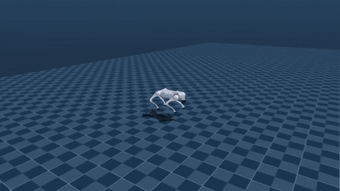</a><br/>&#9989; detour</td>
      <td align="center"><a href="RadeonNav/experiment-results/quadrupedal-agility/videos/row2_teacher_handgoals/teacher_tire_PASSED.mp4">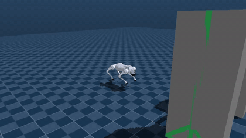</a><br/>&#9989;</td>
      <td align="center"><a href="RadeonNav/experiment-results/quadrupedal-agility/videos/row3_student_onboard/student_tire_jump_FAILED.mp4">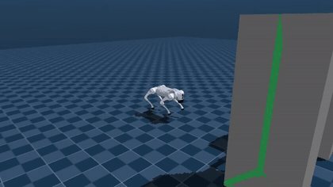</a><br/>&#10060;</td>
      <td align="center"><a href="RadeonNav/experiment-results/quadrupedal-agility/videos/row4_ours/ours_tire.mp4">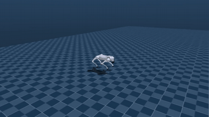</a><br/>&#9989; jump through</td>
  </tr>
  <tr>
    <td><b>Poles</b></td>
      <td align="center"><a href="RadeonNav/experiment-results/quadrupedal-agility/videos/row1_planner_only/planner_poles.mp4">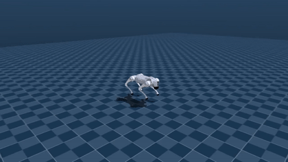</a><br/>&#9989; detour</td>
      <td align="center"><a href="RadeonNav/experiment-results/quadrupedal-agility/videos/row2_teacher_handgoals/teacher_poles_PASSED.mp4"></a><br/>&#9989; weaves the 1 m gaps</td>
      <td align="center"><a href="RadeonNav/experiment-results/quadrupedal-agility/videos/row3_student_onboard/student_poles_FAILED.mp4">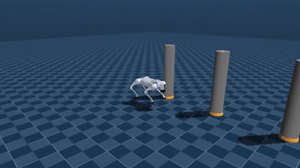</a><br/>&#10060;</td>
      <td align="center"><a href="RadeonNav/experiment-results/quadrupedal-agility/videos/row4_ours/ours_poles.mp4">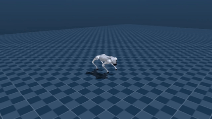</a><br/>&#9989; detour by measured traversal rule</td>
  </tr>
</table>

## Quick Start

### Environment Setup

Clone the Repository:

```bash
git clone https://github.com/Hy1422/RadeonNav.git
```

Requirements: an AMD GPU with ROCm, access to `/dev/kfd` and `/dev/dri`,
Python 3.12, and `ffmpeg`. Run all commands from the repository root.

```bash
cd RadeonNav
bash setup/setup_rocm.sh
bash scripts/verify_environment.sh
```

Set the `uv` binary or environment location when needed:

```bash
export UV_BIN=/opt/venv/bin/uv
bash setup/setup_rocm.sh
```

```bash
RADEONNAV_ENV=/large-disk/radeon-nav-venv bash setup/setup_rocm.sh
```

ROCm PyTorch uses the `torch.cuda` API and the `--device cuda` argument. The  
verification output should report a HIP version and an AMD GPU.

### Run RadeonNav

Run the default long-horizon task:

```bash
bash scripts/record_radeon-nav.sh
```

Run DUNE on ROCm while keeping NRMP on CPU/ECOS:

```bash
OUTPUT_DIR=outputs/radeon-nav/hybrid \
  bash scripts/record_radeon-nav.sh --rocm-dune
```

Use a custom depth-encoder checkpoint:

```bash
CHECKPOINT=outputs/historical-train/ft1_depth_encoder_epoch6.pt \
OUTPUT_DIR=outputs/radeon-nav/retrained \
  bash scripts/record_radeon-nav.sh
```

Results are written to:

```text
outputs/radeon-nav/<run-directory>/<video>.mp4
outputs/radeon-nav/<run-directory>/result.json
```

The runner returns a non-zero status when navigation, upright, collision,
numeric, or video checks fail. Failed runs retain their video and result JSON
when recording completes.

### Teacher and Student Tasks

Available tasks: `frame`, `tunnel`, `poles`, `bar_jump`, `tire_jump`, and
`seesaw`.

```bash
# Run all teacher tasks.
JOBS=4 bash scripts/record_teacher_tasks.sh

# Run all student tasks.
JOBS=4 bash scripts/record_student_tasks.sh
```

Run individual tasks:

```bash
bash scripts/record_teacher_tasks.sh \
  --tasks frame --rerun --require-policy-success
bash scripts/record_student_tasks.sh \
  --tasks tire_jump --rerun --require-policy-success
```

Override the bar height:

```bash
OUTPUT_DIR=outputs/recordings/teacher-bar-h010 \
  bash scripts/record_teacher_tasks.sh \
  --tasks bar_jump --bar-height 0.10 --rerun
```

Videos and manifests are stored under `outputs/recordings/teacher/` and
`outputs/recordings/student/`.

### NeuPAN Example

Run tire avoidance with the default CPU-DUNE configuration:

```bash
bash scripts/record_neupan_tire.sh --rerun
```

Run DUNE on ROCm:

```bash
bash scripts/record_neupan_tire.sh --rocm-dune --rerun
```

Outputs are stored in
`outputs/recordings/neupan-tire/neupan_tire_avoidance/`. The wrapper returns a
non-zero status when `episode_success` is false.

## Verification

Run the environment, NeuPAN integration, MuJoCo rollout, and RadeonNav
full-stack smoke tests:

```bash
bash scripts/test_radeon-nav.sh
```

Test results are written to `outputs/tests/radeon-nav/`.

## Data Collection

Collect one tire-jump episode:

```bash
bash scripts/run_python.sh experiments/neupan_agility/ft_collect.py \
  --family source \
  --scene tire_jump \
  --device cuda \
  --output-dir outputs/data-smoke
```

Recollect FT1:

```bash
JOBS=4 bash scripts/collect_dataset.sh ft1 outputs/recollected/FT1-DATA
```

Run the complete FT1/FT2 collection and training pipeline:

```bash
JOBS=4 bash scripts/collect_dataset.sh ft1 outputs/recollected/FT1-DATA

EPOCHS=6 bash scripts/train_depth_encoder.sh \
  outputs/recollected/FT1-TRAIN \
  outputs/recollected/FT1-DATA

JOBS=4 bash scripts/collect_dataset.sh \
  ft2 \
  outputs/recollected/FT2-DATA \
  outputs/recollected/FT1-TRAIN/ft1_depth_encoder_epoch6.pt

EPOCHS=6 bash scripts/train_depth_encoder.sh \
  outputs/recollected/FINAL-TRAIN \
  outputs/recollected/FT1-DATA \
  outputs/recollected/FT2-DATA
```

Collection resumes from valid existing episodes. Reduce `JOBS` if GPU memory
or EGL resources are limited.

## Training and Checkpoint Selection

Train a depth encoder with the bundled historical dataset:

```bash
EPOCHS=6 bash scripts/train_depth_encoder.sh outputs/historical-train
```

Select a checkpoint with the six-task probe:

```bash
JOBS=4 bash scripts/select_depth_encoder.sh \
  outputs/historical-train \
  outputs/historical-select
```

Use the selected checkpoint in subsequent runs:

```bash
export CHECKPOINT="$PWD/outputs/historical-train/ft1_depth_encoder_epoch6.pt"
```

Selection results are written to
`outputs/historical-select/selection_summary.json`.

## NeuPAN DUNE

The default planner configuration,
`experiments/neupan_agility/go2_planner.yaml`, runs DUNE and NRMP on CPU/FP32.
The `--device cuda` wrapper option controls the depth encoder, TSC, and BBC; it
does not override the NeuPAN planner configuration.

Retrain DUNE on ROCm without overwriting the bundled checkpoint:

```bash
bash scripts/train_neupan_dune.sh outputs/neupan-dune
```

Validate standalone ROCm DUNE inference:

```bash
bash scripts/run_python.sh NeuPAN/example/dune_rocm_smoke.py --iterations 100
```

Run the hybrid ROCm-DUNE/CPU-NRMP configuration:

```bash
OUTPUT_DIR=outputs/recordings/neupan-hybrid \
  bash scripts/record_neupan_tire.sh --rocm-dune --rerun

OUTPUT_DIR=outputs/radeon-nav/hybrid \
  bash scripts/record_radeon-nav.sh --rocm-dune

OUTPUT_DIR=outputs/tests/radeon-nav-hybrid \
  bash scripts/test_radeon-nav.sh --rocm-dune
```

See `[NeuPAN/ROCM_ADAPTATION.md](RadeonNav/NeuPAN/ROCM_ADAPTATION.md)` for implementation
details and known limitations.

### Experimental NRMP/MPAX Backend

The opt-in `mpax_rocm` backend solves the NRMP QP with JAX/MPAX on AMD GPUs.
The default remains `cvxpylayers_cpu` with ECOS.

Run the standalone validation before enabling the backend:

```bash
bash scripts/test_neupan_nrmp_rocm.sh \
  --json-output outputs/tests/neupan-nrmp-rocm.json
```

Enable it in the NeuPAN configuration:

```yaml
device: cpu

pan:
  nrmp_backend: mpax_rocm
  nrmp_fallback: true
  nrmp_solver_options:
    eps_abs: 1.0e-5
    eps_rel: 1.0e-5
    iteration_limit: 20000
```

Use the MPAX launcher for other NeuPAN entry points:

```bash
bash scripts/run_mpax_rocm.sh path/to/neupan_entry.py [arguments ...]
```


## Configuration Overrides

Wrappers default to `MUJOCO_GL=egl`, AMD GPU 0, and `DEVICE=cuda`. Override
devices and parallelism with environment variables:

```bash
HIP_VISIBLE_DEVICES=1 ROCR_VISIBLE_DEVICES=1 CUDA_VISIBLE_DEVICES=1 \
JOBS=1 DEVICE=cuda bash scripts/record_student_tasks.sh
```

Use `--rerun` to replace existing recordings. Keep generated outputs separate
from the bundled FT1/FT2 input directories.


## Related Repositories

- [NeuPAN](https://github.com/hanruihua/NeuPAN) — real-time point-cloud MPC
  planner with a learned distance field; provides the planning core, with its
  DUNE model adapted to ROCm in this work.
- [quadrupedal-agility](https://github.com/NJU-RLC/quadrupedal-agility) —
  released TSC/BBC locomotion policies with natural behaviours from canine
  motion capture; provides the frozen skills and the depth encoder we
  fine-tune.
- [UniLab](https://github.com/unilabsim/UniLab) — ROCm-native robot learning
  framework; every task, sensor, and evaluation run in this project is
  rebuilt inside it.