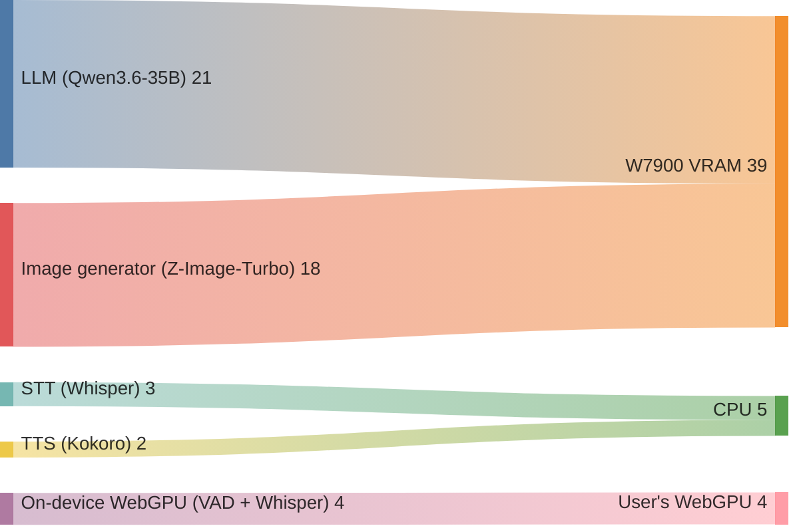
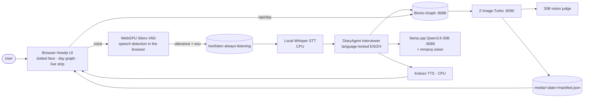
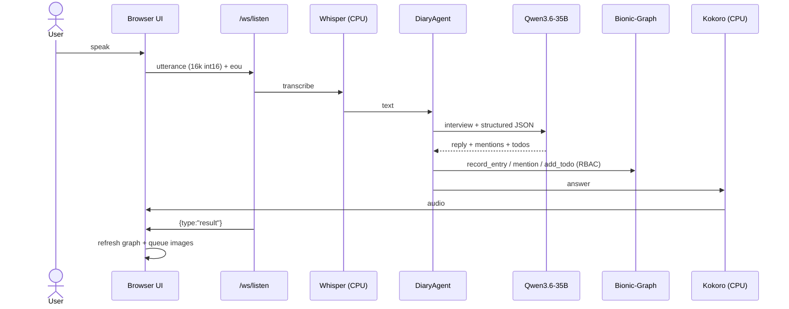
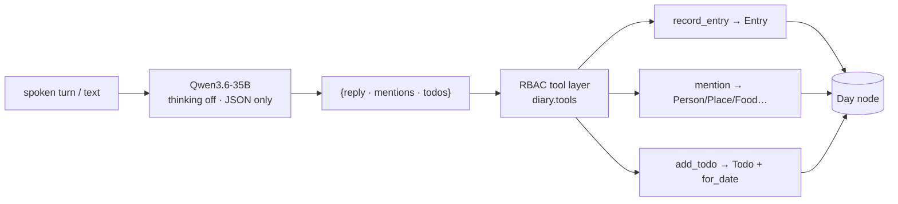
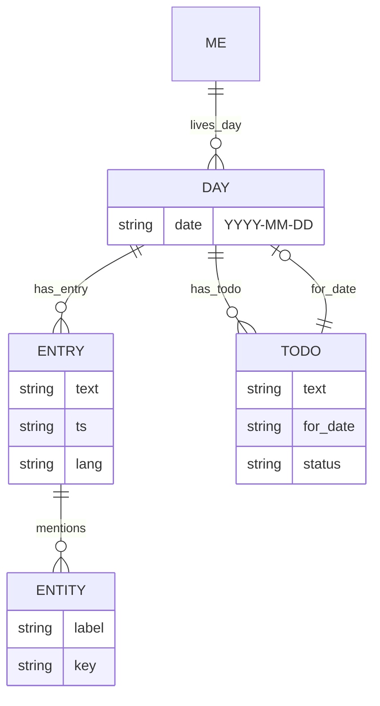
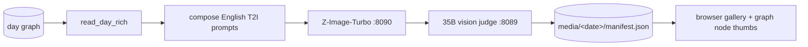

# Howdy · Voice Diary — Tech Report

> Your day, in structured graph structure.

This project contains a local-first voice diary for the AMD AI Hackathon. 

Most part of services runs on AMD's powerful W7900 pro GPU with ROCm 7.2.1. 

| Services | (V)RAM | host |
| LLM:Qwen3.6-35B-Q4 | 21G | GPU |
| T2I:ZImage-Turbo | 18G | GPU |
| STT:Whisper | 3G | CPU |
| TTS:Kokoro | 2G | CPU |
| VAD | 4G | WebGPU |

---

## 1. Overview

Howdy is a single-machine demo with appropriate usage of client's compute power:
the user speaks to an interviewer agent; each
turn is transcribed, parsed into structured facts, and persisted into a daily
knowledge graph (Bionic-Graph, Gremlin). A background worker illustrates the day,
and a separate path exports the day as prose in a famous writer's voice.

**Design decisions**

- **Local-first inference** — everything is served from this machine.
- **Graph as the source of truth** — entries, entities (Person / Place / Food /
  …) and todos are nodes; the day view is a live graph, not a log.
- **Budgeted GPU** — one shared 48 GB card hosts the LLM and the image model
  (see the sankey below); speech and text stay on CPU / the user's WebGPU.
- **English-first** — the app, README and generated image captions default to
  English (中文 is one toggle away).

## 2. Memory & hosting



The W7900's VRAM is dominated by the LLM (llama.cpp Qwen3.6-35B-A3B, IQ4_XS,
≈21 GB) and the image generator (Z-Image-Turbo, ≈18 GB). Whisper STT and Kokoro
TTS run on the **CPU**; the browser's on-device kernels (Silero VAD + a Whisper
encoder) run on the **user's WebGPU**. Image generation is kept at 768 / 512 px
so the shared GPU has headroom.

## 3. Architecture



| Service | Port | Role |
|---|---|---|
| Flask `server.py` | `:8080` | frontend + REST API + WebSocket |
| Bionic-Graph | `:8088` | Gremlin graph store (the `diary` graph) |
| llama.cpp `llama-server` | `:8089` | Qwen3.6-35B-A3B (IQ4_XS) + mmproj — interviewer LLM **and** image judge |
| Z-Image-Turbo | `:8090` | poster / thumbnail / comic generation (ai-toolkit env) |

## 4. Voice turn pipeline



**Underlying techniques**

- **On-device VAD** — Silero VAD quantized to int8 (~313 KiB) runs as hand-written
  WGSL on WebGPU: one 32 ms frame ≈ **0.4 ms** (p95 **2.4 ms** on RDNA3, realtime
  factor 0.075). An `UtteranceGate` (pre-roll · hysteresis · hangover · min-voiced)
  only releases complete utterances, so **silence never leaves the browser**.
  Without WebGPU it falls back to an equivalent server-side state machine.
- **Local STT** — Whisper-tiny on CPU; no cloud API.
- **Local TTS** — Kokoro (~80 M params, CPU), 24 kHz WAV.
- **Barge-in** — the mic stays live during playback; a detected utterance (or a
  loudness burst in server-VAD mode) cuts the TTS instantly.

## 5. Diary agent & knowledge graph





**Underlying techniques**

- **Structured extraction, not a separate NER model** — the LLM returns only
  `{"reply", "mentions", "todos"}`; facts are routed straight to the graph.
- **Stable identity** — every canonical node is upserted by a `stable_key`
  (`type:key`), so re-mentioning a person across days resolves to **one** node
  (Bionic-Graph's token search is unreliable for short tokens).
- **Todo keying** — todos are keyed by `(text, for_date)`, so restating a plan
  for a new date creates its own node and the future-plan nudge can find it.
- **Language lock** — EN / 中文 only; CJK input → Chinese, anything else →
  English, hard-pinned in the system prompt (no Arabic/mixed output).
- **Future-plan nudge** — the agent re-checks today/tomorrow's planned todos and
  asks about ones the user hasn't mentioned.
- **RBAC write path** — every write goes through `diary.tools`; the graph is
  otherwise read-only.

## 6. Image enrichment



**Underlying techniques**

- **English-only prompts** — Z-Image-Turbo is trained on English captions; diary
  text (possibly Chinese) is translated into rich English prompts, and prompts
  **forbid any text/lettering in the image** (rendered text comes out garbled).
- **Vision judge** — the 35B + mmproj critiques each image (match + artifacts),
  giving the pipeline a quality signal.
- **VRAM-aware sizing** — posters at 768 px, thumbnails at 512 px so image steps
  fit next to the 21 GB LLM; failed generations are **never recorded** in the
  manifest (no broken 404 thumbnails).
- **Idempotent & incremental** — a day with no new entries is skipped; new entries
  trigger regeneration on a background worker, off the voice path.

## 7. Frontend techniques

- **"Ocean of nodes"** — the day graph is a live force simulation: node repulsion +
  edge springs + a travelling sine wave. Relationships constrain the drift, so the
  graph gently undulates while nodes stay clickable; positions are cached across
  refreshes.
- **Dotted face** — a depth-aware dot-cloud rendered on canvas, with a state
  machine (listening / thinking / speaking / error) and a boundary-less
  silhouette; a portrait stipple mode swaps in a generated avatar.
- **Boundary-less UI** — no panel borders; the face floats in a sparse right-hand
  area, a unified mic sits beneath it, and a translucent transcript overlay
  appears only when there is content.
- **About modal** — renders this README, with mermaid diagrams drawn locally
  (vendored `mermaid.min.js`, no CDN).

## 8. Measured performance

| Stage | Figure |
|---|---|
| Silero VAD (WebGPU, RDNA3) | 0.4 ms/frame typical · p95 2.4 ms (0.075 realtime) · GPU-vs-ONNX `0.0207` |
| Whisper encoder (WebGPU) | 30 s window p50 `30.2 ms` / p95 `31.4 ms` → **~955× realtime** · 0 argmax flips |
| Whisper STT (CPU) | Whisper-tiny, offline |
| Kokoro TTS (CPU) | ~80 M params, 24 kHz WAV |
| LLM | Qwen3.6-35B-A3B (IQ4_XS, ≈21 GB) · 8k ctx · thinking disabled for speed |

## 9. Running

```bash
cp .env.example .env
./bionic-graph-linux-x64 --config settings.json &      # :8088
llama-server -m Qwen3.6-35B-A3B-IQ4_XS.gguf --host 127.0.0.1 --port 8089 \
             -c 8192 -ngl 999 --mmproj mmproj-model-f16.gguf &   # :8089
./image/run_service.sh                                   # :8090
pip install -e ".[dev]"
python server.py                                         # :8080
```

| Variable | Default |
|---|---|
| `DIARY_LLM_BASE_URL` / `DIARY_GRAPH_URL` / `IMAGE_SERVICE_URL` | `:8089/v1` / `:8088` / `:8090` |
| `DIARY_STT` | `local` (Whisper; `cloud` opt-in) |
| `DIARY_MEDIA_ROOT` | `./media` |

## 10. Project layout & security

`server.py` (Flask/WS) · `diary/` (agent, schema, tools/RBAC, day_view, article,
image_agent) · `database/` (Bionic-Graph client) · `audio/` (VAD, Whisper, stream
handler) · `tts/` (Kokoro) · `image/` (Z-Image service) · `frontend/` (UI, graph
renderer, WebGPU kernels, vendored mermaid) · `media/` (generated images).

**Security** — no secrets in the repo (`.env` ignored); every diary write goes
through the RBAC layer; `/media/*` is confined to `MEDIA_ROOT`; outputs are
language-locked to English / 中文 with a cleanup pass stripping other scripts.
