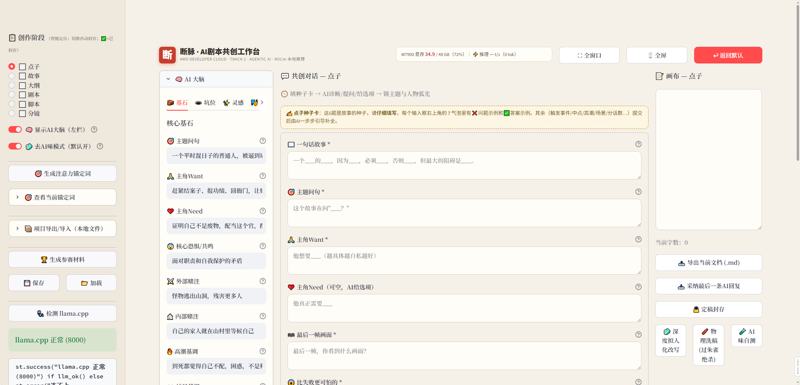

# 🎬 断脉 (Duanmai) · 状态化 AI 剧本共创引擎

**[🇬🇧 English README →](README.md)** ｜ *AMD Radeon Hackathon 2026 · Track 2 (Agentic AI)*

> **“我们不是在做一个聊天机器人，我们是在构建一个数字剧本总监的大脑——而且它完全运行在 AMD 硅片之上。”**

「断脉」是全球首款**状态化 Agent 剧本共创工作台**：把一句灵感火花，一路推演为可直接拍摄的六话剧本（点子→故事→大纲→剧本→脚本→分镜）。**零云端 API、零数据出机**，Qwen3.6-35B-A3B（Q8_0）经 llama.cpp **100% 本地运行**于 AMD Radeon™ PRO W7900（48GB / ROCm 7.2.1），实测 ≈70 tok/s。

---

## 🌌 降维打击：健忘的聊天框 vs 会记住一切的创作矩阵

市面所有 AI 写作工具都是**无状态对话框**：聊十轮就忘主角动机、忘世界观、忘结局。「断脉」以**持久化创作矩阵**破局——六大"脑模块"**全量注入每一次推理**：

| 脑模块 | 功能 |
|---|---|
| 🧱 核心基石 | 主题/Want/Need/核心恐惧/内外赌注/高潮结局基调，8 大故事 DNA |
| 🧠 永久记忆池 | 铁律级设定，AI 绝不可违；超长拒收、去重护栏、🧹一键整理 |
| 🕳️ 坑位看板 | 未填/已填悬念看板，**🪄 一键让 AI 填坑** |
| ✨ 灵感高光墙 | 对话中自动捕捉你的绝佳创意并永久上墙 |
| 🎭 角色档案 | 名字/身份/性格/视觉辨识点/人物弧光，防 OOC |
| 🧵 伏笔追踪 | 埋点↔回收表，已回收/未回收状态管理 |
| 📊 情绪曲线 | 每话"观众身体反应词"+强度滑杆，实时折线图 |

AI 通过独创 **`<state_update>` XML 协议**回写状态：记忆增删、坑位开合、灵感入墙——你只管写，UI 自己长大。

---

## 🚀 功能逐块拆解

### 🎛️ 顶栏 · 指挥舱 HUD
「断」字印章横幅 + **W7900 实时 KPI**（显存占用：torch.hip→rocm-smi→sysfs 多层兜底；实时解码速度）；⛶全窗口 / 🖥全屏 / 默认 三种布局模式。

### 📋 侧边栏 · 全局控制台
* **六阶段流水线**：**智能进度定位**（打开即定位到首个未封存阶段），切换阶段**自动封存**当前文档；
* 🧠 大脑折叠开关、🧼 去AI味总开关；
* **🎯 注意力锚定词**：基石+记忆压缩成"护身符"每次注入，专治长对话注意力稀释；
* **📦 项目导出/导入**：整个工作室状态一键下载/恢复为本地 JSON（与云侧 💾保存/加载 明确区分）；
* **🏆 生成参赛材料**：一键产出 README 大纲、3 分钟 Demo 解说稿、AMD/ROCm 优化亮点清单；
* **🩺 llama.cpp 健康探针**。

### 🧠 左栏 · AI 大脑（六个页签）
全部控件带 **❌问题示例 / ✅答案示例** 气泡提示，约 40 处自教学提示，小白零门槛。

### 💬 中栏 · 共创现场
* **点子种子卡**：6 道引导题；提交后 AI 进入**严师模式**（诊断≤3、提问≤3、选项≤3），并带**硬性收敛铁律**——最多 2 轮问答必须输出《定稿卡》并指引点击绿色"定稿转入"按钮，**绝无无限提问**；
* **写作工具箱**：✨润色 · 🎈扩写 · ✂️浓缩 · 🏮唐语化 · 🎬镜头化 · 🔍逻辑自检（对照记忆/角色/伏笔逐条审计）；
* **🧠 思维链查看器**：每条回复可展开 AI 的"内心独白"；
* **作家级输入框**：Enter=换行、**Ctrl+Enter=发送**（全局热键），下方标签说明照顾小白。

### 📝 右栏 · 画布
可编辑文档+字数统计、📤导出 .md、📥采纳 AI 回复、🔒定稿封存（封存后成为下一阶段**不可推翻**的上下文）、已封存档案库；以及去AI味三件套按钮（见下）。

---

## 🕵️ 反"AI味"引擎（过朱雀/GPTZero 级检测）

检测器只看三样：**困惑度、爆发度、模型指纹**。我们四层全打：

1. **防**：🧼模式注入"暴躁人类编剧"铁律（废笔注入、潜台词对白、封杀指纹词）+ 高扰动采样（temp 1.15 / top_p 0.98 / presence 0.6 / frequency 0.3），从源头粗糙化 logits 分布；
2. **治（LLM）**：🧼深度拟人化改写——二十年编辑人格，**只改笔法、不动情节**；
3. **治（代码）**：🧨**物理洗稿**——纯 Python 破坏标点、注入语气废笔、掐头去尾，不调 LLM、不留指纹；
4. **测**：🧪本地 AI 味自测（爆发度+黑名单+连接词开头+直陈情绪）+ **🔍高危句定位**——人工只改 10~20% 高危句即可翻盘。

---

## ⚙️ 两个脚本 · 工程说明

### 📜 `setup.sh` —— AMD 云"零接触"部署引擎
> ⚠️ **本脚本专为 AMD 开发者云（Radeon PRO W7900 / ROCm 7.2.1）实例量身定制，仅供参考；其他显卡或本地环境，请自行修改 CMAKE 目标、模型路径与镜像源！**

逐步执行：激活 `/opt/venv` → 修复云 DNS + 安装 tmux/aria2 等 → 安装 modelscope/streamlit/requests → 挂载 `/persistent` SFS 持久卷 → ModelScope 下载 35GB Q8_0 GGUF → **以 `GGML_HIP=ON -DAMDGPU_TARGETS=gfx1100` 编译 llama.cpp**（npmmirror + hf-mirror 双镜像修复，预置 index.html 根治 npm 卡死）→ 部署 WebUI。

### 🎬 `start.sh` —— 电影级推理启动器
我们做了一个** deliberate 的哲学取舍：不把参数调向极限 TPS。因为剧本创作需要"思考的留白"。** 我们主动牺牲一部分原始速度，换取 **32K 全故事视野、深度思维链与长文本结构稳定性**：

| 参数 | 取值 | 创作优先的设计理由 |
|---|---|---|
| `-ngl 999` | 全量 offload | 35B 模型整体驻留 W7900 显存，零 CPU 瓶颈 |
| `-c 32768` | 32K 上下文 | AI 同时"俯瞰"六话全局，杜绝健忘与漂移 |
| `--parallel 1` | 单槽 | 一位作者独享完整 32K 槽位，避免分槽截断 |
| `--flash-attn on` | 闪速注意力 | 让 32K 注意力装进 48GB |
| `--cache-type-k/v q8_0` | 量化 KV | 买下 32K 窗口的关键一招 |
| `--threads 16` | EPYC 9334 | 长提示快速消化 |
| `-b 1024 -ub 512` | 批处理 | 长 prompt 稳定处理 |
| `--jinja` + `--reasoning-format deepseek` | 原生模板+思维链 | UI 实时呈现 AI"内心独白" |
| `--no-mmap` | 禁 mmap | 容器化 SFS 存储下稳如磐石 |

脚本流程：清理旧进程 → tmux 启动 llama-server 并**智能健康轮询**（最长 180s）→ 无头启动 Streamlit → 拉起 Cloudflare 隧道并打印公网演示地址 → 输出完整服务状态报告。

---

## 💻 环境与实测

| 项 | 值 |
|---|---|
| GPU | AMD Radeon PRO W7900 48GB (gfx1100) |
| CPU | AMD EPYC 9334 (16 vCPU) |
| ROCm/HIP | 7.2.1 |
| 模型 | Qwen3.6-35B-A3B-Q8_0（约35GB，全量 offload） |
| 实测 | ≈70 tok/s · 显存 ≈36/48GB |

## 🏁 极简启动
```bash
bash setup.sh   # 仅一次：依赖+模型+ROCm 编译
bash start.sh   # 每次：引擎+WebUI+隧道
```

## 📁 仓库结构
`app.py`（单文件完整工作室）· `setup.sh` · `start.sh` · `README.md` · `README_zh.md`

## 🎥 演示

*左：AI 脑神经矩阵 · 中：共创现场 · 右：画布。顶栏 HUD 实时显示 W7900 显存与解码速度。*

## 🙏 致谢
用汗水与 ROCm 铸就。感谢 AMD Developer Cloud、llama.cpp、Streamlit 与 Qwen。
