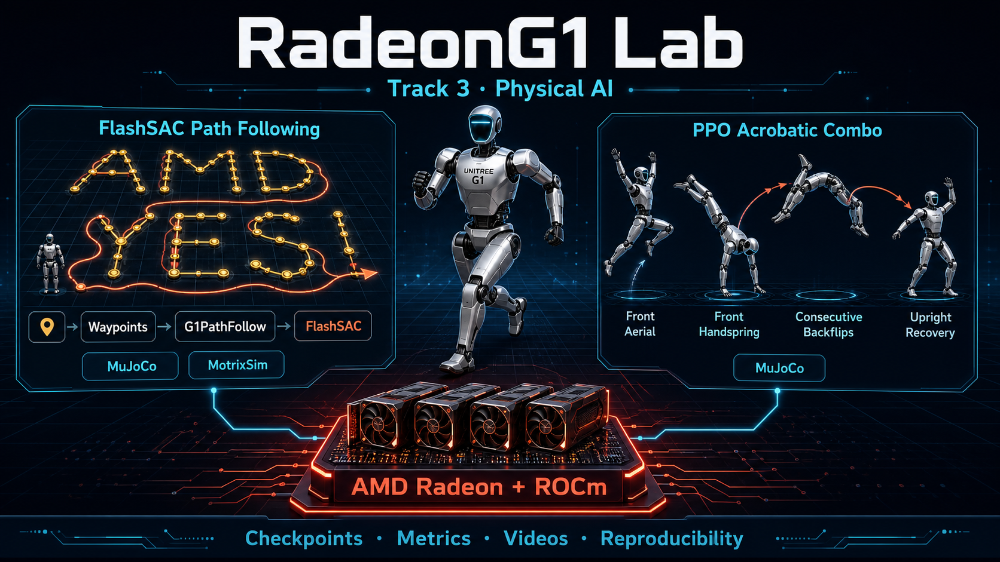
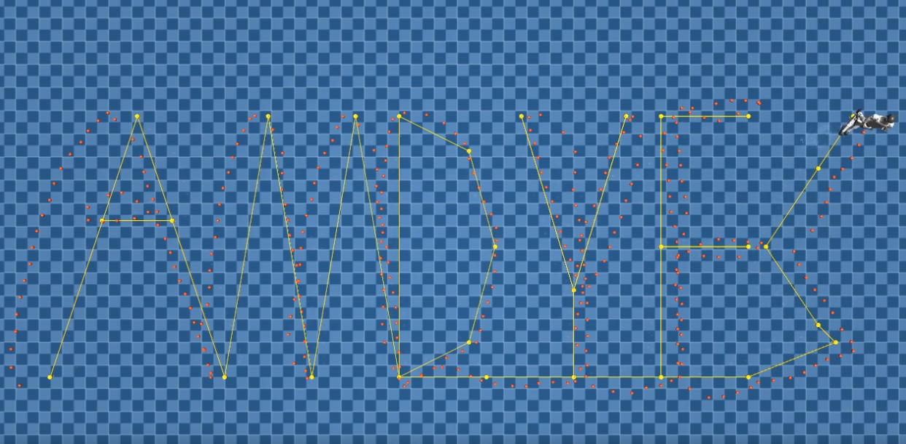
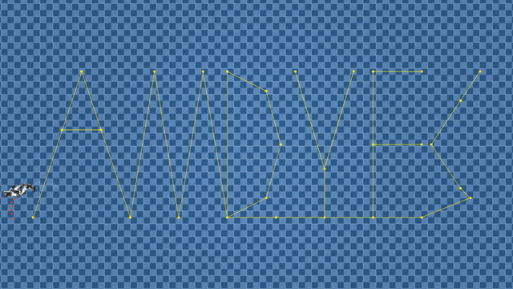
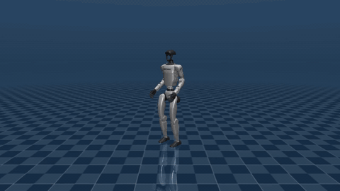
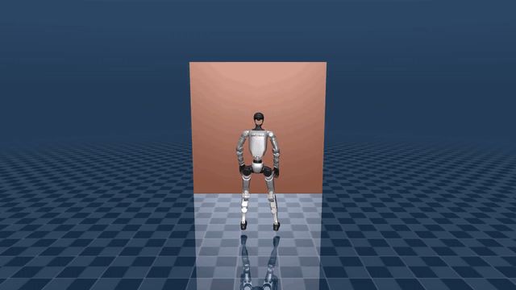

# RadeonG1 Lab — AMD Radeon Hackathon Track 3 Technical Report

<p align="center">
  
</p>

> **Unitree G1 humanoid robotics with UniLab: long-horizon path navigation and highly dynamic aerial skills**
>
> Contract-driven reinforcement learning on AMD Radeon GPUs, with MuJoCo and MotrixSim physics backends.

<p align="center">
  <a href="https://github.com/JasonZhw/UniLab/tree/a628f3e738cf78ad0958a0e837f85dc0d7137d52">Source Code (pinned commit)</a> · <a href="https://www.youtube.com/watch?v=D8glGwFC20o">Demo Video</a>
</p>

---

## 1. Project Overview

RadeonG1 Lab extends the UniLab reinforcement-learning framework to train a Unitree G1 humanoid for long-horizon navigation and two highly dynamic whole-body skills.

| Capability | Task | Algorithm | Backend | Status |
|---|---|---|---|---|
| Long-horizon navigation | Follow an “AMD YES!” letter path | FlashSAC | MuJoCo + MotrixSim | ✅ Trained on both backends |
| Aerial combo | Front aerial → front handspring → consecutive backflips → upright recovery | PPO | MuJoCo | ✅ Deterministic rollout verified |
| Wall-assisted backflip | Push off a wall, rotate, land, and recover | PPO | MuJoCo | ✅ Strict evaluation passed |

### Highlights

- A G1 humanoid follows a continuous 83.6 m path spelling “AMD YES!” in simulation.
- The task moves beyond velocity-command tracking to waypoint navigation: the controller learns both stable locomotion and where to go.
- The same contract-driven infrastructure supports long-horizon locomotion and highly dynamic acrobatics.
- MotrixSim and policy optimization run end to end on AMD Radeon hardware through ROCm.
- Both PPO skill artifacts include checkpoints, deterministic rollouts, resolved configurations, reference motions, and SHA-256 manifests for offline evaluation and continued development.

<p align="center">
  
</p>

<p align="center"><em>Path-following result: gold nodes and lines are the AMD YES waypoints; the orange-red trail is the G1 robot’s executed trajectory.</em></p>

### 1.1 Why the Path Task Is Difficult

Conventional locomotion tracks a velocity command. This path-following task instead requires the robot to:

- traverse 36 waypoints along an 83.6 m route with a 0.15 m acceptance threshold;
- handle 180° reversals at the top of “Y”, 90° turns at the bottom of “M”, and backtracking across the bars of “E”;
- remain balanced under a stop-turn-go velocity profile, turning in place before large heading changes; and
- finish within a 600 s time limit, with the episode truncated immediately after completing the route.

### 1.2 Technical Architecture

```text
amd_yes_path.py (pure NumPy)
  → 37 character keypoints → (N, 2) waypoint sequence
         ↓
path_follow.py (RL environment)
  → waypoint state machine + heading P-controller + four path rewards
         ↓
Hydra owner configuration
  → FlashSAC parameters + MuJoCo or MotrixSim backend
         ↓
UniLab contract layer
  → registry.env.make() → SimBackend → training and playback
```

The heading P-controller is the key decomposition. The policy does not need to discover high-level waypoint steering from scratch; it learns stable walking while tracking commands generated from waypoint geometry.

```text
heading_error = atan2(Δy, Δx) - robot_yaw  →  wrap_to_pi
yaw_rate = clip(stiffness × heading_error, ±yaw_rate_clip)
forward_speed = nominal × alignment(1-|error|/turn_angle) × distance(dist/slowdown)
```

Seven reward terms cooperate to complete the route:

| Reward | Scale | Purpose |
|---|---:|---|
| `path_progress` | 10.0 | Signed progress along path arc length; forward motion is positive and backward motion is negative |
| `heading_progress` | 5.0 | Rewards improvement in heading error: `|old_error| - |new_error|` |
| `waypoint_reached` | 20.0 | One-time waypoint reward that grows with route completion |
| `tracking_lin_vel` | 2.0 | Tracks the forward-speed command produced by the P-controller |
| `tracking_ang_vel` | 1.5 | Tracks the commanded yaw rate |
| `alive` | 10.0 | Rewards remaining upright |
| `waypoint_proximity` | 0.0 | Disabled baseline term retained for ablation studies |

### 1.3 PPO Dynamic Skills

Both skills use UniLab’s G1 motion-tracking environment, MuJoCo rigid-body simulation, and the RSL-RL-compatible PPO pipeline. The submitted videos are deterministic policy rollouts executed by physics simulation, not kinematic playback. Reference motions provide training targets and policy conditioning; the learned policies produce closed-loop joint actions from the current simulated state.

#### 1.3.1 Aerial Combo

The `G1FlipTracking` policy performs a front aerial, front handspring, consecutive backflips, and upright recovery. The final stage used 512 parallel environments, seed 2, a `1e-5` learning rate, and a 16 s episode horizon. Policy optimization ran on an AMD Radeon GPU through ROCm.

| Deterministic evaluation metric | Result |
|---|---:|
| Complete rollout | 726 / 726 frames (14.52 s) |
| Nominal multi-environment completion | 16 / 16 |
| Joint-position RMSE, 95th percentile | 0.5591 rad |
| Undesired torso, pelvis, or head ground contact | 0 steps |
| Final double-foot contact rate | 100% |
| Final minimum upright score | 0.9952 |

This policy is a nominal demonstration candidate, not a claim of robust control. Randomized initialization completed 32 of 64 trials, while the periodic 1 N push test completed 43 of 64 trials. See [the aerial-combo artifact report](https://github.com/JasonZhw/UniLab/blob/a628f3e738cf78ad0958a0e837f85dc0d7137d52/docs/amd_hackathon_g1_acrobatic_combo.md) for detailed methodology, reproduction commands, and provenance.

#### 1.3.2 Wall-Assisted Backflip

The `G1WallFlipTracking` policy uses wall contact to take off, rotate around its primary axis, land, and recover upright. Fine-tuning used 1,024 parallel environments, 500 additional PPO iterations, 12,288,000 environment steps, and seed 1, initialized from UniLab’s official `wallflip` PPO checkpoint.

| Deterministic evaluation metric | Result |
|---|---:|
| Evaluation result | Pass (198 / 198 reference frames) |
| Wall contact | 13 control steps, from 1.34 s to 1.58 s |
| Main-axis accumulated rotation | 5.8423 rad |
| Pelvis apex / landing height | 1.1878 m / 0.7558 m |
| Landing upright score | 0.9785 |
| Final double-foot ground contact | Yes |

This is a deterministic single-rollout result. It does not claim multi-seed robustness or real-robot validation. See [the wall-assisted-backflip artifact report](https://github.com/JasonZhw/UniLab/blob/a628f3e738cf78ad0958a0e837f85dc0d7137d52/docs/amd_hackathon_g1_wall_flip_ppo.md) for the complete evaluation contract.

---

## 2. Reproduction Guide

### 2.1 AMD/ROCm Environment

```bash
# 1. Clone the repository and select the Track 3 branch.
git clone https://github.com/JasonZhw/UniLab.git && cd UniLab
git switch track3
git checkout a628f3e738cf78ad0958a0e837f85dc0d7137d52
git rev-parse HEAD  # Record the exact commit.

# 2. Install uv.
curl -LsSf https://astral.sh/uv/install.sh | sh

# 3. Synchronize ROCm/PyTorch, MuJoCo, and MotrixSim dependencies.
# This target already runs: uv sync --extra mujoco --extra motrix
# Do not run the default `uv sync` first on the AMD workstation.
make sync-rocm

# 4. Verify the environment. --no-sync prevents runtime dependency re-resolution.
uv run --no-sync python -c "
import torch
print('PyTorch:', torch.__version__)
print('ROCm/HIP:', torch.version.hip)
print('GPU available:', torch.cuda.is_available())
print('GPU:', torch.cuda.get_device_name(0) if torch.cuda.is_available() else 'N/A')
"
```

### 2.2 FlashSAC Path-Following Training

```bash
# FlashSAC + MuJoCo
uv run --no-sync train --algo flashsac --task g1_path_follow --sim mujoco \
  algo.seed=1 training.no_play=true

# FlashSAC + MotrixSim on AMD GPU
uv run --no-sync train --algo flashsac --task g1_path_follow --sim motrix \
  algo.seed=1 training.no_play=true
```

The submitted configuration uses 4,096 parallel environments, 20,000 iterations, and 82,124,800 total environment steps.

### 2.3 Path-Following Video Recording

The video plan differs by backend:

- **MuJoCo:** record both `topdown` and `default`. The top-down view presents the complete AMD YES route and executed trail; the default view exposes gait, posture, and turning.
- **MotrixSim:** record one third-person tracking view to demonstrate stable playback of the Motrix-trained checkpoint. Reproducing MuJoCo’s waypoint/trail overlay is not required.

> On a headless server, MuJoCo recording requires `MUJOCO_GL=egl`.

```bash
RUN_DIR="logs/flash_sac/G1PathFollow/<timestamp>_mujoco"

# Top-down view: gold waypoint path and orange-red robot trail
MUJOCO_GL=egl uv run --no-sync eval \
  --algo flashsac --task g1_path_follow --sim mujoco \
  --load-run "<timestamp>_mujoco" --render-mode record \
  training.play_env_num=1 training.play_camera_mode=topdown \
  training.play_steps=12000 training.play_frame_stride=2
mv "${RUN_DIR}/play_video.mp4" "${RUN_DIR}/play_video_topdown.mp4"

# Default tracking view: gait, posture, and turning
MUJOCO_GL=egl uv run --no-sync eval \
  --algo flashsac --task g1_path_follow --sim mujoco \
  --load-run "<timestamp>_mujoco" --render-mode record \
  training.play_env_num=1 training.play_camera_mode=default \
  training.cam_tracking=true training.cam_distance=4.0 \
  training.cam_elevation=-10.0 \
  training.play_steps=12000 training.play_frame_stride=2
mv "${RUN_DIR}/play_video.mp4" "${RUN_DIR}/play_video_default.mp4"
```

The MuJoCo owner defaults to the third-person tracking camera at a 4 m distance and −10° elevation. Only `training.play_camera_mode=topdown` enables the complete overhead route. The default view intentionally omits full waypoint connections and the accumulated trail. Both recording commands initially write `play_video.mp4`, so rename each result immediately.

Record the MotrixSim checkpoint with one third-person tracking camera:

```bash
MOTRIX_RUN_DIR="logs/flash_sac/G1PathFollow/<timestamp>_motrix"

uv run --no-sync eval \
  --algo flashsac --task g1_path_follow --sim motrix \
  --load-run "<timestamp>_motrix" --render-mode record \
  training.play_env_num=1 training.cam_tracking=true \
  training.cam_distance=4.0 training.cam_elevation=-10.0 \
  training.play_steps=12000 training.play_frame_stride=2
mv "${MOTRIX_RUN_DIR}/play_video.mp4" \
   "${MOTRIX_RUN_DIR}/play_video_default.mp4"
```

The current Motrix camera adapter consumes `cam_tracking`, `cam_distance`, `cam_elevation`, and `cam_azimuth`. It does not interpret `training.play_camera_mode=topdown` as a route-overlay renderer, so the competition package intentionally uses a single Motrix third-person view.

### 2.4 PPO Training, Evaluation, and Rendering

The submitted PPO checkpoints can be evaluated and rendered directly. To reproduce the PPO training stages, run the dedicated scripts from the UniLab repository root:

```bash
# Reproduce the final aerial-combo PPO training stage.
scripts/motion/train_g1_acrobatic_combo.sh 1800

# Download the wall-flip initialization checkpoint if needed.
uv run --no-sync demo wallflip

# Close the interactive demo, then reproduce the wall-assisted-backflip fine-tuning stage.
scripts/motion/train_g1_wall_flip_ppo.sh 500
```

For complete prerequisites, optional arguments, training configurations, evaluation commands, artifact provenance, and known limitations, see:

- [Aerial Combo PPO reproduction report](https://github.com/JasonZhw/UniLab/blob/a628f3e738cf78ad0958a0e837f85dc0d7137d52/docs/amd_hackathon_g1_acrobatic_combo.md)
- [Wall-Assisted Backflip PPO reproduction report](https://github.com/JasonZhw/UniLab/blob/a628f3e738cf78ad0958a0e837f85dc0d7137d52/docs/amd_hackathon_g1_wall_flip_ppo.md)

#### Evaluating and Rendering the Bundled Checkpoints

#### Re-running PPO Training

Re-run the final aerial-combo PPO training stage:

```bash
scripts/motion/train_g1_acrobatic_combo.sh 1800
```

Download the wall-flip initialization checkpoint if it is not already available, then re-run the fine-tuning stage:

```bash
uv run --no-sync demo wallflip

# Close the interactive demo after the download completes.
scripts/motion/train_g1_wall_flip_ppo.sh 500
```

For complete prerequisites, optional arguments, training configurations, evaluation commands, artifact provenance, and known limitations, see:

- [Aerial Combo PPO reproduction report](https://github.com/JasonZhw/UniLab/blob/a628f3e738cf78ad0958a0e837f85dc0d7137d52/docs/amd_hackathon_g1_acrobatic_combo.md)
- [Wall-Assisted Backflip PPO reproduction report](https://github.com/JasonZhw/UniLab/blob/a628f3e738cf78ad0958a0e837f85dc0d7137d52/docs/amd_hackathon_g1_wall_flip_ppo.md)

#### Evaluating and Rendering the Bundled Checkpoints

Evaluate and render the aerial combo:

```bash
mkdir -p outputs

uv run --no-sync scripts/motion/evaluate_g1_acrobatic_combo.py \
  logs/rsl_rl_ppo/G1FlipTracking/RadeonG1Lab_2026-08-06_mujoco/final_ppo_policy.pt \
  --steps 850 \
  --num-envs 16 \
  --require-completions 16 \
  --maximum-termination-fraction 0.10 \
  --maximum-joint-rmse-p95 0.60 \
  --ee-body-pos-z-threshold 0.60 \
  --anchor-pos-z-threshold 0.45 \
  --anchor-ori-threshold 1.20 \
  --json outputs/g1_acrobatic_combo_evaluation.json \
  --strict

uv run --no-sync scripts/motion/render_g1_acrobatic_combo.py \
  logs/rsl_rl_ppo/G1FlipTracking/RadeonG1Lab_2026-08-06_mujoco/final_ppo_policy.pt \
  --steps 850 \
  --video outputs/g1_acrobatic_combo.mp4 \
  --json outputs/g1_acrobatic_combo_rollout.json \
  --disable-reset-randomization \
  --camera-distance 3.0
```

Evaluate and render the wall-assisted backflip:

```bash
uv run --no-sync scripts/motion/evaluate_g1_wall_flip_ppo.py \
  logs/rsl_rl_ppo/G1WallFlipTracking/RadeonG1Lab_2026-07-26_mujoco/final_ppo_policy.pt \
  --motion-file logs/rsl_rl_ppo/G1WallFlipTracking/RadeonG1Lab_2026-07-26_mujoco/reference_motion.npz \
  --steps 250 \
  --json outputs/g1_wall_flip_evaluation.json \
  --video outputs/g1_wall_flip_ppo.mp4 \
  --strict
```

Each artifact includes a `SHA256SUMS` manifest for checking its checkpoint, video, reference motion, and run metadata.

---

## 3. AMD Radeon and ROCm Performance

### 3.1 Hardware and Software

| Item | Recorded configuration |
|---|---|
| CPU | AMD EPYC 9334, 32 cores / 64 threads |
| GPU | AMD Radeon Graphics, Radeon PRO W7900 class |
| VRAM | 49,136 MB (48 GB) |
| GTT memory | 257,824 MB |
| OS | Linux 6.8.0-79-generic x86_64 |
| ROCm | PyTorch CUDA-compatible API over the HIP backend |

### 3.2 Path-Following Training Comparison

| Metric | MuJoCo (CPU physics) | MotrixSim (AMD GPU physics) |
|---|---:|---:|
| Parallel environments | 4,096 | 4,096 |
| Total iterations | 20,000 | 20,000 |
| Total environment steps | 82,124,800 | 82,124,800 |
| **Training wall time** | **41.8 min** (2,510 s) | **43.5 min** (2,609 s) |
| **Environment steps/s** | **32,724** | **31,478** |
| Final mean reward | 3,224.3 | 2,941.3 |
| Best mean reward | 3,345.2 | 3,404.7 |
| Mean episode length | 6,701 steps | 4,923 steps |

### 3.3 Performance Interpretation

MotrixSim throughput is 0.96× the MuJoCo configuration in this experiment:

- With MotrixSim, the GPU serves both physics simulation and PyTorch/ROCm policy learning, creating resource contention.
- With MuJoCo, physics runs on the CPU while the GPU is dedicated to learner updates.
- MotrixSim may benefit more clearly at larger environment counts or in more physics-intensive scenes; those regimes were not measured here.

The recorded results also show:

- MotrixSim’s best reward (3,404.7) is slightly higher than MuJoCo’s (3,345.2).
- The shorter MotrixSim mean episode length (4,923 vs. 6,701) may indicate faster path completion or earlier failure; the current data does not distinguish the two.
- Cross-backend checkpoint loading passed the Sim2Sim contract checks, allowing a Motrix checkpoint to be replayed through MuJoCo.

### 3.4 AMD GPU Utilization

The following values were sampled with `rocm-smi` every two seconds and averaged over five samples.

#### MuJoCo Run: GPU Used by the Learner

| Metric | Value |
|---|---:|
| Average GPU utilization | **84%** |
| Peak GPU utilization | ~100% during learner updates |
| VRAM usage | **1.5 GB** / 49.1 GB (3%) |
| Average power | **147 W** |
| Peak power | ~154 W |
| GPU edge temperature | 45°C |
| GPU clock (`sclk`) | 2,211 MHz |
| Memory clock (`mclk`) | 1,124 MHz |

The 84% utilization indicates dense forward and backward policy computation. The relatively small 1.5 GB VRAM footprint leaves substantial capacity for additional workloads.

#### MotrixSim Run: GPU Physics and Learning

| Metric | Value |
|---|---:|
| Average GPU utilization | **97%** |
| Peak GPU utilization | **100%**, sustained during learner updates |
| VRAM usage | **1.5 GB** / 49.1 GB (3%) |
| Average power | **172 W** |
| Peak power | **192 W** |
| GPU edge temperature | 31°C → 40°C during warm-up |

| Metric | MuJoCo | MotrixSim | Difference |
|---|---:|---:|---:|
| GPU utilization | 84% | **97%** | +13 percentage points |
| VRAM | 1.5 GB | 1.5 GB | No measured difference |
| Power | 147 W | **172 W** | +25 W (+17%) |
| Training throughput | 32,724 steps/s | 31,478 steps/s | −3.8% |

These measurements show that MotrixSim adds GPU work in this configuration. The unchanged reported VRAM value is consistent with Motrix keeping the tested physics state outside the measured dedicated VRAM allocation; the telemetry alone does not establish a broader memory-performance claim.

### 3.5 PPO Training Evidence on AMD/ROCm

The aerial-combo final stage records PyTorch + ROCm optimization on an AMD Radeon GPU with 512 parallel environments, seed 2, and a `1e-5` learning rate. The wall-assisted-backflip artifact additionally includes a complete `run_config.json` and `run_summary.json`.

| Metric | Wall-assisted backflip PPO |
|---|---:|
| Parallel environments | 1,024 |
| Fine-tuning iterations | 500 |
| Environment steps | 12,288,000 |
| Training wall time | 312.59 s |
| Final / best mean reward | 73.3958 / 73.9008 |
| PyTorch device string | `cuda` (the device string used by the ROCm build) |

These artifacts connect configuration, wall time, checkpoint, evaluation, and video evidence. They establish simulated AMD/ROCm training, not physical-robot deployment.

---

## 4. Demonstrations

### 4.1 Animated Previews

> 🎬 **[Watch the full project demonstration on YouTube](https://www.youtube.com/watch?v=D8glGwFC20o)**

<table>
  <tr>
    <td align="center" colspan="2">
      <br>
      <b>FlashSAC Path Following</b><br>
      <sub>MuJoCo top-down time-lapse with gold waypoints and the orange-red executed trail</sub>
    </td>
  </tr>
  <tr>
    <td align="center" width="50%">
      <br>
      <b>PPO Aerial Combo</b><br>
      <sub>Front aerial → front handspring → consecutive backflips → upright recovery</sub>
    </td>
    <td align="center" width="50%">
      <br>
      <b>PPO Wall-Assisted Backflip</b><br>
      <sub>Wall contact → backflip → double-foot landing</sub>
    </td>
  </tr>
</table>

GIFs provide lightweight README previews. The original MP4 files, checkpoints, evaluation JSON, and SHA-256 manifests remain the authoritative submission evidence.

### 4.2 Available Video Assets

| Video | Content | Location |
|---|---|---|
| Path Follow top-down | Gold AMD YES route and orange-red executed trail | `logs/flash_sac/G1PathFollow/<run>/play_video_topdown.mp4` |
| Path Follow default | Third-person G1 gait and turning | `logs/flash_sac/G1PathFollow/<run>/play_video_default.mp4` |
| Path Follow MotrixSim | Third-person playback of the Motrix-trained policy | `logs/flash_sac/G1PathFollow/<motrix_run>/play_video*.mp4` |
| Aerial combo | Front aerial → front handspring → consecutive backflips → recovery | `logs/rsl_rl_ppo/G1FlipTracking/RadeonG1Lab_2026-08-06_mujoco/play_video.mp4` |
| Wall-assisted backflip | Wall contact → backflip → double-foot landing | `logs/rsl_rl_ppo/G1WallFlipTracking/RadeonG1Lab_2026-07-26_mujoco/play_video.mp4` |

---

## 5. Outlook and Open-Source Contribution

### 5.1 Application-Oriented Extensions

- **Multi-robot route coordination:** assign different route sections to multiple G1 robots and train the formation through UniLab’s parallel environments.
- **Dynamic obstacle avoidance:** combine the current heading controller with a local avoidance layer for inspection or warehouse navigation.
- **Visual perception:** replace global waypoint vectors with RGB-D observations and visual landmark recognition.
- **Non-flat terrain:** extend route following to rough terrain and stairs.
- **Sim-to-real validation:** apply domain randomization and safety constraints before any physical G1 deployment. This remains future work.

### 5.2 MotrixSim Extensions

- **Multi-GPU training:** distribute larger environment batches across multiple AMD Radeon GPUs.
- **Integrated GPU rendering:** produce path-overlay frames directly from the Motrix training pipeline.
- **Backend-specific physics studies:** evaluate contact and solver behavior under controlled cross-backend experiments.

### 5.3 Reproducible Contributions

The Track 3 branch contains:

- the original G1 path-following environment in `src/unilab/envs/locomotion/g1/path_follow.py` and `amd_yes_path.py`;
- backend-owned FlashSAC configurations under `conf/offpolicy/task/flashsac/g1_path_follow/`;
- the MuJoCo top-down camera and path overlay in `src/unilab/base/backend/mujoco/playback.py` and `src/unilab/visualization/render_many.py`;
- path-following logic and Hydra-composition tests;
- Sim2Sim contract handling for cross-backend policy compatibility;
- a complete aerial-combo artifact with checkpoint, video, reference motion, resolved configuration, and SHA-256 manifest; and
- a wall-assisted-backflip artifact with dedicated training and evaluation scripts, strict success gates, evaluation JSON, run summary, video, and SHA-256 manifest.

---

## 6. Team Members and Contributions

**Team: Robotics Gemini**

| Team member | Contributions |
|---|---|
| **Haowang Zhang** | Developed and integrated the AMD YES path-following task; conducted the FlashSAC MuJoCo and MotrixSim experiments; integrated the technical report; and recorded and presented the project demo. |
| **Xiaojia Zheng** | Developed the Aerial Combo and Wall-Assisted Backflip tasks; conducted PPO training and evaluation; prepared checkpoints and reproducibility artifacts; and authored the corresponding technical documentation. |

---

## Appendix A: Project File Map

```text
src/unilab/envs/locomotion/g1/
├── amd_yes_path.py              # AMD YES waypoint generator
├── path_follow.py               # Path-following RL environment
└── joystick.py                  # Base G1 locomotion environment

src/unilab/assets/robots/g1/
└── scene_flat_clear.xml         # Flat terrain scene

conf/offpolicy/task/flashsac/g1_path_follow/
├── mujoco.yaml                  # FlashSAC MuJoCo owner
└── motrix.yaml                  # FlashSAC MotrixSim owner

src/unilab/base/backend/mujoco/playback.py   # Top-down camera and path overlay
src/unilab/visualization/render_many.py      # Waypoint and trail rendering
scripts/train_offpolicy.py                   # FlashSAC training and playback

scripts/motion/
├── train_g1_acrobatic_combo.sh              # Aerial-combo PPO training
├── evaluate_g1_acrobatic_combo.py           # Aerial-combo strict evaluation
├── render_g1_acrobatic_combo.py             # Deterministic combo rendering
├── train_g1_wall_flip_ppo.sh                 # Wall-assisted-backflip fine-tuning
└── evaluate_g1_wall_flip_ppo.py              # Wall-assisted-backflip evaluation

logs/rsl_rl_ppo/
├── G1FlipTracking/RadeonG1Lab_2026-08-06_mujoco/
└── G1WallFlipTracking/RadeonG1Lab_2026-07-26_mujoco/

tests/envs/locomotion/g1/test_path_follow.py
tests/scripts/test_train_scripts.py

docs/
├── amd_hackathon_g1_acrobatic_combo.md       # Aerial-combo artifact report
├── amd_hackathon_g1_wall_flip_ppo.md         # Wall-assisted-backflip artifact report
└── media/                                    # Animated README previews
    ├── path_follow_topdown_preview.gif
    ├── g1_acrobatic_combo_preview.gif
    └── g1_wall_flip_preview.gif
```

## Appendix B: Command Reference

```bash
# Train FlashSAC with MuJoCo.
uv run --no-sync train --algo flashsac --task g1_path_follow --sim mujoco \
  algo.seed=1 training.no_play=true

# Train FlashSAC with MotrixSim.
uv run --no-sync train --algo flashsac --task g1_path_follow --sim motrix \
  algo.seed=1 training.no_play=true

# Record the MuJoCo top-down view.
uv run --no-sync eval --algo flashsac --task g1_path_follow --sim mujoco \
  --load-run "<run>" --render-mode record \
  training.play_env_num=1 training.play_camera_mode=topdown \
  training.play_steps=12000

# Record the MuJoCo default tracking view.
uv run --no-sync eval --algo flashsac --task g1_path_follow --sim mujoco \
  --load-run "<run>" --render-mode record \
  training.play_env_num=1 training.play_camera_mode=default \
  training.cam_tracking=true training.play_steps=12000

# Record the single MotrixSim third-person view.
uv run --no-sync eval --algo flashsac --task g1_path_follow --sim motrix \
  --load-run "<motrix_run>" --render-mode record \
  training.play_env_num=1 training.cam_tracking=true \
  training.cam_distance=4.0 training.cam_elevation=-10.0 \
  training.play_steps=12000

# Evaluate the aerial combo.
uv run --no-sync scripts/motion/evaluate_g1_acrobatic_combo.py \
  logs/rsl_rl_ppo/G1FlipTracking/RadeonG1Lab_2026-08-06_mujoco/final_ppo_policy.pt \
  --steps 850 --num-envs 16 --require-completions 16 \
  --maximum-termination-fraction 0.10 --maximum-joint-rmse-p95 0.60 \
  --ee-body-pos-z-threshold 0.60 --anchor-pos-z-threshold 0.45 \
  --anchor-ori-threshold 1.20 \
  --json outputs/g1_acrobatic_combo_evaluation.json --strict

# Evaluate the wall-assisted backflip.
uv run --no-sync scripts/motion/evaluate_g1_wall_flip_ppo.py \
  logs/rsl_rl_ppo/G1WallFlipTracking/RadeonG1Lab_2026-07-26_mujoco/final_ppo_policy.pt \
  --motion-file logs/rsl_rl_ppo/G1WallFlipTracking/RadeonG1Lab_2026-07-26_mujoco/reference_motion.npz \
  --steps 250 --json outputs/g1_wall_flip_evaluation.json --strict
```

## Appendix C: Competition Evidence Map

| Criterion | Project response | Evidence |
|---|---|---|
| Capability (30) | G1 completes the AMD YES route, aerial combo, and wall-assisted backflip | Dual-backend path videos; combo 726/726 frames; wall-flip strict evaluation pass |
| AMD Radeon and ROCm (20) | FlashSAC backend comparison and PPO skills include AMD/ROCm training records | Path-following ROCm telemetry; wall-flip `run_config.json` and `run_summary.json`; combo resolved config |
| Innovation and originality (20) | Original AMD YES waypoint task, heading P-controller, backend-owned configs, and highly dynamic policy demonstrations | `path_follow.py`, Sim2Sim contract, and two PPO policy rollouts |
| Real-world value (20) | Route inspection/delivery and whole-body dynamic-control potential, with simulation boundaries stated explicitly | Path noise/randomization configuration; landing, contact, and upright metrics; no physical-robot claim |
| Upstream open-source contribution (10) | Training, evaluation, rendering, configs, checkpoints, videos, and checksums support continued development | Track 3 branch, artifact reports, and both PPO `SHA256SUMS` manifests |
