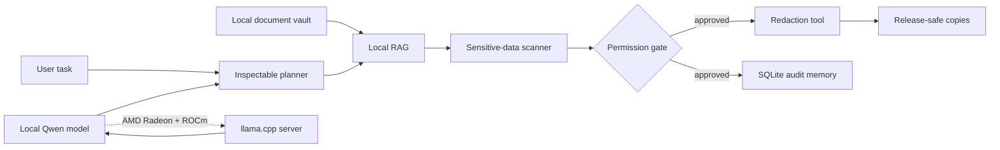

# RedactFlow AMD

RedactFlow AMD is a local-first document release agent for the **Agentic AI** track of the 2026 AMD AI DevMaster Hackathon. It retrieves evidence from a private document vault, detects sensitive values, prepares redacted release copies, and records an auditable decision memory without sending source content to a remote service.

The project demonstrates all five capabilities named in the track requirements:

1. **Local RAG** — lexical retrieval over locally chunked documents.
2. **Tool use** — evidence search, sensitive-data inspection, redaction, and audit-memory tools.
3. **Multi-step planning** — every task becomes a visible, inspectable execution plan.
4. **Local memory** — SQLite stores plan and decision metadata on-device.
5. **Permission control** — transformation and persistence tools cannot run until a human approves them.

## Why it matters

Teams routinely need to publish incident updates, vendor notices, research summaries, and customer-facing reports derived from private source material. A generic copilot can leak contacts, credentials, internal addresses, or unsupported claims. RedactFlow turns that risky prompt into a constrained local workflow: retrieve, inspect, pause, approve, transform, audit.

## Architecture



The core workflow works in deterministic demo mode for quick evaluation. Enabling `LOCAL_LLM_ENABLED=1` routes summarization to an OpenAI-compatible endpoint that is explicitly restricted to loopback/private addresses. The intended competition deployment uses a ROCm-enabled `llama.cpp` server on an AMD Radeon GPU.

## Quick start

```bash
python3 -m venv .venv
. .venv/bin/activate
pip install -r requirements.txt
chmod +x scripts/*.sh
./scripts/run_local.sh
```

Open [http://127.0.0.1:7860](http://127.0.0.1:7860), add `sample_data/vendor-release-note.txt`, build a plan, and approve both controlled actions.

## Run with AMD Radeon + ROCm

### 1. Build llama.cpp with HIP

On a supported ROCm machine:

```bash
git clone https://github.com/ggml-org/llama.cpp
cd llama.cpp
cmake -B build -DGGML_HIP=ON -DAMDGPU_TARGETS=gfx1100
cmake --build build --config Release -j
```

Replace `gfx1100` with the target reported by `rocminfo`. Use an instruction-tuned, permissively licensed GGUF model such as Qwen2.5-7B-Instruct.

### 2. Start the local model server

```bash
export LLAMA_SERVER=/path/to/llama.cpp/build/bin/llama-server
export MODEL_PATH=/models/qwen2.5-7b-instruct-q4_k_m.gguf
./scripts/run_rocm_llama.sh
```

### 3. Start RedactFlow with local inference

```bash
export LOCAL_LLM_ENABLED=1
export LOCAL_LLM_URL=http://127.0.0.1:8080/v1
export LOCAL_LLM_MODEL=qwen2.5-7b-instruct
./scripts/run_local.sh
```

No core function depends on a closed online API.

## AMD evidence and benchmarking

Capture the target environment:

```bash
python scripts/rocm_probe.py > artifacts/rocm-environment.json
```

Capture repeatable local inference latency:

```bash
python scripts/benchmark.py \
  --url http://127.0.0.1:8080/v1 \
  --model qwen2.5-7b-instruct \
  --runs 10 > artifacts/rocm-benchmark.json
```

The final demo should show the Radeon device in `rocm-smi`, the local server console, RedactFlow's permission pause, and the completed redacted release.

## API

| Method | Path | Purpose |
| --- | --- | --- |
| `GET` | `/health` | Local runtime and model-backend state |
| `POST` | `/api/documents` | Add a text document to the local vault |
| `GET` | `/api/documents` | List locally stored documents |
| `POST` | `/api/plans` | Create a visible multi-step plan |
| `POST` | `/api/execute` | Execute only explicitly approved tools |
| `GET` | `/api/memories` | Inspect local audit memories |

## Privacy and permission model

- Raw document content is stored only in the configured local data directory.
- The local LLM client rejects ordinary public HTTP endpoints.
- Read tools can inspect data without mutating it.
- `redact_documents` and `write_audit_memory` are separately gated.
- Audit memory stores document counts, finding counts, task text, and plan IDs—not raw detected secrets.
- Original documents are preserved; redaction produces separate release copies.

## Tests

```bash
pytest -q
```

Tests cover local retrieval, multi-pattern detection, non-destructive redaction, permission blocking, approved execution, memory behavior, and the end-to-end API.

## Submission materials

- Source and reproducibility instructions: this repository
- Project report source: `docs/project-report.md`
- Demo script: `docs/demo-script.md`
- Project specification PDF: `output/pdf/RedactFlow-AMD-Project-Report.pdf`
- Supplementary pitch deck: `output/presentation/RedactFlow-AMD-Pitch-Deck.pptx`
- Three-minute demo video: `artifacts/RedactFlow-AMD-Demo.mp4`
- ROCm environment and benchmark output: `artifacts/rocm-environment.json` and
  `artifacts/rocm-benchmark.json` after a Radeon Cloud run
- Submission checklist and PR copy: `docs/submission-checklist.md` and
  `docs/pr-body.md`

## Verification status

- Local deterministic workflow: verified end to end
- Automated tests: 7 passing
- Permission-denied path: verified to stop before transformation or persistent write
- Approved path: verified to redact four sensitive values and create audit memory
- AMD Radeon / ROCm benchmark: pending allocated Radeon Cloud access; no unmeasured
  performance number is claimed in this repository

## License

MIT. Source documents used during a demo must have appropriate rights and must not contain real secrets.
