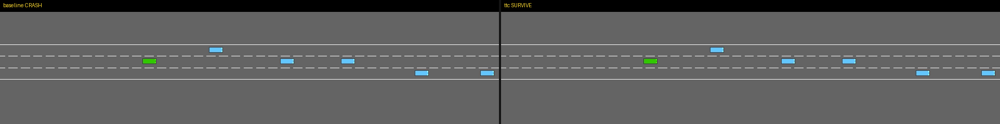

# SafeHighway-ROCm

[](LICENSE)
[](https://rocm.docs.amd.com/)
[](https://pytorch.org/)
[](https://www.python.org/)
[](https://github.com/AMD-DEV-CONTEST/Radeon-hackathon-2026-07)

**Safety-aware highway driving with DQN on AMD ROCm**  
AMD AI DevMaster Hackathon 2026 · Physical AI track

**Demo video:** [Bilibili BV18Aun6PE5E](https://www.bilibili.com/video/BV18Aun6PE5E/) · local copy: [`videos/SafeHighway_ROCm_demo_en_bilingual.mp4`](videos/SafeHighway_ROCm_demo_en_bilingual.mp4)



<p align="center"><i>Same traffic seed (102): baseline DQN crashes while speeding; TTC-shaped DQN brakes / yields and survives.</i></p>

## Table of Contents · 目录

**English**
1. [Project Overview](#1-project-overview)
2. [Development Process](#2-development-process)
3. [Code Provenance](#3-code-provenance)
4. [Team Contributions](#4-team-contributions)
5. [Installation & Running](#5-installation--running)

**中文**
1. [项目简介](#1-项目简介)
2. [开发过程](#2-开发过程)
3. [代码来源说明](#3-代码来源说明)
4. [团队分工](#4-团队分工)
5. [安装与运行](#5-安装与运行)

---

# English

## 1. Project Overview

### 1.1 Problem definition

**SafeHighway-ROCm** studies a Physical AI question that shows up as soon as you put a learned controller into traffic:

> Can a reinforcement-learning driver keep moving on a multi-lane highway **without** learning an unsafe “speed-only” policy — and can we run / analyse that loop honestly on **AMD ROCm**?

We use HighwayEnv’s `highway-fast-v0` as a lightweight closed-loop world:

| Component | Setting |
| --- | --- |
| Observation | Kinematic features of nearby vehicles, shape `(5, 5)` |
| Action space | Discrete(5): `LANE_LEFT`, `IDLE`, `LANE_RIGHT`, `FASTER`, `SLOWER` |
| Traffic | ~30 surrounding vehicles, episode duration 20 s |
| Policy | DQN MLP `[256, 256]` (Stable-Baselines3) |

The hard part is not “can DQN train”, but **what it optimises**. With the stock reward (`normalize_reward=True`), each step’s reward is mapped into `[0, 1]`. A collision therefore yields **0**, not a negative number — the only cost of crashing is the loss of future reward. At `policy_frequency=5` and `gamma=0.95`, the agent’s effective look-ahead is only a few seconds, so **maximising instantaneous speed dominates staying alive**. Empirically, an original-demo DQN still crashes most of the time and its action histogram shows **`SLOWER ≈ 0%`**: the brake action has been optimised away.

That failure mode is exactly what Physical AI cares about: a policy that looks competent on a reward meter can still be **behaviourally unsafe**.

### 1.2 Solution

We keep the same simulator, observation, action space and DQN architecture, and treat **reward design + evaluation protocol + ROCm measurement** as the product:

```text
HighwayEnv (CPU sim)
    → optional SafetyRewardWrapper (TTC / headway)
    → DQN update (PyTorch on ROCm or CPU)
    → canonical baseline re-evaluation
    → metrics + videos + ROCm benchmark
```

**Three reward profiles** (see `scripts/safety.py`):

| Profile | Training reward | Intent |
| --- | --- | --- |
| `baseline` | Stock HighwayEnv with normalisation (collision → 0) | Reproduce the original-demo failure mode |
| `penalty` | `normalize_reward=False`, `collision_reward=-5` | Make crashes truly costly, but still sparse |
| `ttc` | Same as `penalty`, **plus** dense TTC & time-headway shaping | Penalise closing the gap *before* impact |

**TTC / headway shaping (dense safety signal).**  
For the lead vehicle in the ego lane we compute bumper-to-bumper gap, closing speed, then:

- \(\mathrm{TTC} = \mathrm{gap} / \mathrm{closing\_speed}\) (∞ if not closing)
- \(\mathrm{time\_headway} = \mathrm{gap} / \mathrm{speed}\)

A penalty in \([-1, 0]\) is added when TTC &lt; 4.0 s or headway &lt; 1.2 s (weights 0.75 / 0.25). The same measurements are always logged in `info` even when shaping is off, so every policy can be scored on identical safety metrics.

**Fair comparison protocol.**  
Policies are trained under different profiles, then **all re-scored on the canonical `baseline` reward** (30 episodes × 3 seeds). That prevents “higher training reward” from being confused with “safer driving”.

**AMD ROCm track.**  
Separately, we benchmark optimiser-only throughput and end-to-end training steps/s on CPU vs ROCm, to answer when a Radeon GPU actually helps this workload (see §1.4).

### 1.3 Core metrics

Ablation: **3 seeds** `{42,43,44}` × **60k** steps × **8** parallel envs; evaluation **30** episodes on the canonical baseline reward. Full tables: `results/ablation/`.

| Policy | Collision rate ↓ | Survival rate ↑ | Mean speed | Step reward | Mean min TTC (s) ↑ | TTC violation ↓ | `SLOWER` share |
| --- | ---: | ---: | ---: | ---: | ---: | ---: | ---: |
| Random | 90.0% ± 0.0% | 10.0% | 25.1 | 0.807 | 0.58 | 13.6% | 19.6% |
| DQN `baseline` | 81.1% ± 12.9% | 18.9% | 26.4 | 0.860 | 0.92 | 12.8% | **0.0%** |
| DQN `penalty` | 100.0% ± 0.0% | 0.0% | 29.4 | 0.928 | 0.01 | 23.4% | **0.0%** |
| DQN **`ttc`** | **38.9% ± 7.9%** | **61.1%** | 25.5 | 0.844 | **1.63** | **4.5%** | **31.7%** |

**How to read the table**

- `baseline` improves reward over random but still almost never brakes — classic speed maximiser.
- `penalty` looks “better” on step reward / speed, yet **collapses to 100% crash**: a sparse terminal penalty is not enough teaching signal.
- `ttc` is the only profile that restores `SLOWER` (~32%), roughly **halves** collisions vs `baseline`, and raises mean min TTC.

Shipped checkpoint: `models/best_ttc_s42.zip` (TTC profile, seed 42).  
**Contrast videos (same env seed 102):** random & baseline **crash**, TTC **survives** — see `videos/` and `videos/contrast_seed.json`.

### 1.4 ROCm / systems metrics

Measured on AMD Radeon Graphics, PyTorch 2.9.1+ROCm 7.2.1 (HIP). Reports: `results/rocm_benchmark/`.

| Measurement | Result |
| --- | --- |
| Optimiser-only speedup (wide net / large batch) | up to **~41×** vs CPU |
| End-to-end DQN (default `[256,256]`, 8 envs) | **~1.05×** vs tuned CPU (`OMP_NUM_THREADS=1`) |
| GPU util during real training | **&lt;3%**, peak VRAM ~**110 MB** |
| 9 concurrent tiny GPU jobs | aggregate throughput collapses (~85 steps/s) vs CPU multi-job (~650 steps/s) |

Interpretation for Physical AI on AMD: **ROCm is highly effective on the neural update**, but this HighwayEnv loop is **simulation-bound**. The GPU becomes valuable as the policy grows (image observations, wider nets, larger batches) — the crossover is quantified in `results/rocm_benchmark/rocm_crossover.png`.

### 1.5 Tech stack

| Layer | Choice |
| --- | --- |
| Simulation | Gymnasium + HighwayEnv `highway-fast-v0` |
| Learning | Stable-Baselines3 DQN, MLP `[256, 256]`, γ=0.95, lr=5e-4 |
| Safety | `scripts/safety.py` — TTC / headway measurement + `SafetyRewardWrapper` |
| Experiment ops | Run layout `outputs/runs/<name>/`, ablation driver, EvalCallback best model |
| Compute | AMD Radeon GPU · ROCm 7.2.1 · PyTorch 2.9.1+ROCm · Triton 3.5.1 |
| Evidence | Collision / survival / TTC / action histograms, videos, ROCm JSON+plots |

---

## 2. Development Process

### 2.1 Starting point and goal

Work began from the AMD Physical AI quickstart Demo 1 (HighwayEnv + SB3 DQN on ROCm). Reproducing the original demo was easy; the resulting policy was not acceptable as a Physical AI submission: high collision rate and no braking. The project goal therefore shifted from “train a DQN on AMD” to:

1. Diagnose **why** the original-demo objective produces unsafe behaviour.
2. Design a **minimal** reward change that restores gap-keeping.
3. Prove the change with a **multi-seed ablation** under a fair eval protocol.
4. Document **honest** AMD ROCm performance for this workload (including when the GPU does *not* help end-to-end).

### 2.2 Key decisions (and why)

1. **Keep DQN + discrete meta-actions**  
   Switching to PPO/Rainbow would mix algorithm effects with reward effects. Holding the learner fixed makes the ablation about Physical AI behaviour, not “a stronger RL library”.

2. **Treat reward as the primary design surface**  
   After the first longish baseline runs still showed `SLOWER=0%`, it was clear the issue was not under-training. The objective itself removed the incentive to brake.

3. **Insert a sparse `penalty` stage before shaping**  
   We deliberately tested “just make collision negative” as its own profile. That negative result (100% crash) is part of the argument: sparse penalties fail; dense proximity cost is required.

4. **Canonical baseline re-evaluation**  
   Without it, `ttc` could look worse on its own shaped return while being safer on the road. All numbers in §1.3 use the same eval reward.

5. **Separate reward study from device study**  
   Ablation jobs run on CPU (`OMP_NUM_THREADS=1`) so concurrent seeds do not fight over a HIP context. ROCm claims come only from `07_rocm_benchmark.py` / `08_rocm_report.py`.

6. **Instrument safety even when not shaping**  
   `SafetyRewardWrapper(shaping=False)` still writes TTC / headway into `info`, so random / baseline / penalty / ttc share one metric vocabulary.

### 2.3 Iteration timeline

| Stage | What we did | Outcome |
| --- | --- | --- |
| A. Reproduce original demo | Smoke + ~20k–50k step DQN on ROCm | Reward up vs random; collisions still high; almost no `SLOWER` |
| B. Reward autopsy | Inspect normalisation + γ / policy frequency | Collision ≈ 0 after normalisation → speed dominates |
| C. Sparse penalty | Profile `penalty` | Faster cars, **worse** safety — validates need for dense signal |
| D. TTC shaping | Profile `ttc` + safety metrics in eval | Braking returns; collision ~39%; TTC improves |
| E. Multi-seed ablation | 3×3 grid @ 60k steps, aggregate scripts | Stable ranking: `ttc` ≫ `baseline` ≫ `penalty` on safety |
| F. ROCm systems study | Gradient vs end-to-end sweeps | Up to 41× on updates; ~1× end-to-end on default net |
| G. Submission packaging | Curate models / videos / results into this repo | Reproducible artifact for the hackathon PR |

### 2.4 Difficulties and how they were resolved

**Reward pathology masked by “good-looking” scores.**  
Step reward and mean speed can rise while safety collapses (`penalty`). Fix: always report collision, survival, min TTC, TTC-violation rate, and action shares together — never optimise a single scalar in isolation.

**Sparse collision cost is too late.**  
By the time a −5 is observed, the episode is already over; with short horizons the agent prefers risky speed. Fix: continuous TTC/headway penalty while the gap is closing.

**Action collapse is easy to miss.**  
Without action histograms, “higher reward” looks like success. Fix: log `LANE_*` / `FASTER` / `SLOWER` counts every eval.

**Parallel GPU ablations looked “ROCm-powered” but were slower.**  
Nine small DQN jobs on one GPU serialised on a single HIP context (~85 steps/s aggregate). Fix: run the reward ablation on CPU; publish ROCm numbers from a dedicated, controlled benchmark.

**End-to-end training barely uses the GPU.**  
Default policy peaks near 110 MB VRAM and &lt;3% util. Fix: do not claim wall-clock wins we did not measure; instead show the crossover as networks/batches grow, which is the useful guidance for later Physical AI workloads (vision, larger policies).

**Cloud persistence.**  
Experiments live on Radeon Cloud PVC (`/workspace/persistent`) so destroying a notebook instance does not erase runs; submission copies curated files into `models/`, `results/`, `videos/`.

### 2.5 If we continue

- Longer training, more seeds, and a small grid over TTC threshold / weights / headway target  
- Image (occupancy or RGB) observations and wider nets so end-to-end ROCm utilisation becomes the default, not the exception  
- Explicit safety layer: shielding / Lagrangian constraints on top of shaped rewards  
- Harder scenarios: higher density, cut-ins, merges, weather-style stochasticity in HighwayEnv  
- Algorithm ablation (PPO / Rainbow) **with the same reward profiles** to test transfer of the TTC idea  
- Export trajectories for imitation / VLA-style follow-ups if the track expands beyond classical RL  

---

## 3. Code Provenance

### Upstream / dependencies

| Project | Role | License (upstream) |
| --- | --- | --- |
| [PhysicalAI-ROCm-Quickstart](https://github.com/JasonZhw/PhysicalAI-ROCm-Quickstart) (Demo 1) | Starting point: HighwayEnv + SB3 DQN train/eval scripts on ROCm | See upstream repo |
| [HighwayEnv](https://github.com/Farama-Foundation/HighwayEnv) | Highway simulator | MIT |
| [Gymnasium](https://gymnasium.farama.org/) | RL API | MIT |
| [Stable-Baselines3](https://stable-baselines3.readthedocs.io/) | DQN implementation | MIT |
| [PyTorch + ROCm](https://rocm.docs.amd.com/) | Training backend on AMD GPU | BSD-style / AMD |

### Modified from the quickstart

- Refactored train/eval into run-centric layout (`outputs/runs/<name>/`)
- Added `--reward-profile`, parallel envs, `EvalCallback` best-model saving
- Evaluation extended with TTC / headway / action histograms and video export

### Original in this repository

| Path | Contribution |
| --- | --- |
| `scripts/safety.py` | TTC & time-headway measurement, `SafetyRewardWrapper`, reward profiles |
| `scripts/run_ablation.sh` | Multi-seed × multi-profile ablation driver |
| `scripts/06_aggregate_ablation.py` | Aggregate table + Pareto plot |
| `scripts/07_rocm_benchmark.py` | CPU vs ROCm gradient & end-to-end sweeps |
| `scripts/08_rocm_report.py` | Markdown/JSON ROCm report |
| `scripts/common.py` / `05_list_runs.py` / `04_plot_monitor.py` | Shared run IO, listing, learning curves |
| `results/` | Ablation & ROCm figures used in this README |

This submission is **not** an unmodified fork of the original demo.

---

## 4. Team Contributions

| Member | Role |
| --- | --- |
| weiyuxin | Solo: problem framing, TTC reward design, ablation & ROCm experiments, engineering, docs |

Collaboration: single-developer workflow on AMD Radeon Cloud (PVC under `/workspace/persistent`), with experiment artifacts versioned under `outputs/runs/` during development and curated into `results/` / `models/` / `videos/` for submission.

---

## 5. Installation & Running

### Environment

| Component | Tested version |
| --- | --- |
| OS | Ubuntu 24.04 (Radeon Cloud container) |
| Python | 3.12 |
| ROCm | 7.2.1 |
| PyTorch | 2.9.1 + ROCm 7.2.1 |
| Triton | 3.5.1 + ROCm 7.2.1 |
| HighwayEnv / SB3 | 1.12.0 / 2.9.0 |

Prefer the ROCm PyTorch wheels shipped on the cloud image (`/torch-*.whl`, `/triton-*.whl`). Do **not** install a CPU-only PyTorch by mistake.

### Install

```bash
cd /workspace/persistent/SafeHighway-ROCm   # or your clone path

python3 -m venv .venv
source .venv/bin/activate
python -m pip install --upgrade pip setuptools wheel

# Replace wheel names if the image differs
python -m pip install \
  /triton-3.5.1+rocm7.2.1.gita272dfa8-cp312-cp312-linux_x86_64.whl \
  /torch-2.9.1+rocm7.2.1.lw.gitff65f5bc-cp312-cp312-linux_x86_64.whl

python -m pip install -r requirements.txt
```

### Verify ROCm / PyTorch

```bash
rocm-smi   # or: amd-smi

python - <<'PY'
import torch
print("PyTorch:", torch.__version__)
print("HIP:", torch.version.hip)
print("GPU available:", torch.cuda.is_available())
if torch.cuda.is_available():
    print("GPU:", torch.cuda.get_device_name(0))
    x = torch.randn(1024, 1024, device="cuda")
    print("matmul OK:", (x @ x).shape)
PY
```

Expected: `torch.version.hip` is not `None`, `torch.cuda.is_available()` is `True` (API name is `cuda`; backend is ROCm/HIP).

### Quick evaluate (shipped TTC checkpoint)

```bash
python scripts/03_evaluate.py \
  --model models/best_ttc_s42.zip \
  --episodes 20 \
  --device cuda \
  --run-name eval_shipped_ttc
```

Artifacts land in `outputs/runs/eval_shipped_ttc/` (metrics JSON + videos).

### Train a TTC policy

```bash
python scripts/02_train_dqn.py \
  --run-name my_ttc \
  --reward-profile ttc \
  --timesteps 60000 \
  --n-envs 8 \
  --device cuda \
  --gamma 0.95
```

### Full ablation (as in the paper table)

```bash
bash scripts/run_ablation.sh
.venv/bin/python scripts/06_aggregate_ablation.py
```

### ROCm benchmark report

```bash
python scripts/07_rocm_benchmark.py
python scripts/08_rocm_report.py
```

Precomputed reports used for this submission: `results/ablation/`, `results/rocm_benchmark/`.

### Demo videos

Contrast clips below use **the same HighwayEnv seed (102)** so the traffic situation is comparable. Older evaluate.py defaults preferred high-reward survivors, which hid collisions — re-rendered with `scripts/09_render_contrast_videos.py`.

| File | What you should see |
| --- | --- |
| `videos/SafeHighway_ROCm_demo_en_bilingual.mp4` | Full demo (~3 min, English narration, bilingual on-screen text) |
| `videos/demo_ttc.gif` | Side-by-side: baseline **CRASH** vs ttc **SURVIVE** |
| `videos/random_crash.mp4` | Random policy collides (~54 steps) |
| `videos/baseline_crash.mp4` | Original-demo DQN speeds up (`SLOWER=0`) then crashes (~33 steps) |
| `videos/ttc_survive.mp4` | TTC DQN keeps gap / uses `SLOWER`, finishes episode |
| `videos/contrast_seed.json` | Seed + per-policy crash/action stats |

> Public demo: [https://www.bilibili.com/video/BV18Aun6PE5E/](https://www.bilibili.com/video/BV18Aun6PE5E/)

---

# 中文

## 1. 项目简介

### 1.1 问题定义

**SafeHighway-ROCm** 面向 Physical AI 里一个很具体的问题：

> 强化学习驾驶员能否在多车道高速上持续行驶，同时**避免**学成「只冲速度」的不安全策略？以及我们能否在 **AMD ROCm** 上诚实地跑通并分析这条闭环？

仿真环境采用 HighwayEnv 的 `highway-fast-v0`：

| 组件 | 设置 |
| --- | --- |
| 观测 | 邻近车辆运动学特征，形状 `(5, 5)` |
| 动作空间 | Discrete(5)：`LANE_LEFT` / `IDLE` / `LANE_RIGHT` / `FASTER` / `SLOWER` |
| 交通 | 约 30 辆周围车，回合时长 20 s |
| 策略 | DQN MLP `[256, 256]`（Stable-Baselines3） |

难点不在「DQN 能不能训」，而在**优化目标是什么**。默认奖励在 `normalize_reward=True` 时把逐步奖励压到 `[0, 1]`，碰撞因此变成 **0** 而不是负数——撞车的代价只是失去未来回报。在 `policy_frequency=5`、`gamma=0.95` 下，有效视野只有数秒，**瞬时提速的收益压过保命**。实验上，原版 demo 的 DQN 仍大量碰撞，动作直方图里 **`SLOWER ≈ 0%`**：刹车动作被优化掉了。

这正是 Physical AI 关心的失败模式：奖励曲线好看，行为仍然不安全。

### 1.2 解决方案

我们固定仿真器、观测、动作空间与 DQN 结构，把产品聚焦在**奖励设计 + 评估协议 + ROCm 测量**：

```text
HighwayEnv（CPU 仿真）
    → 可选 SafetyRewardWrapper（TTC / 车时距）
    → DQN 更新（PyTorch on ROCm 或 CPU）
    → 在 canonical baseline 奖励上再评估
    → 指标 + 视频 + ROCm benchmark
```

**三种奖励配置**（见 `scripts/safety.py`）：

| 配置 | 训练奖励 | 意图 |
| --- | --- | --- |
| `baseline` | 原版 HighwayEnv + 归一化（碰撞→0） | 复现原版 demo 失败模式 |
| `penalty` | `normalize_reward=False`，`collision_reward=-5` | 让碰撞真正昂贵，但仍是稀疏信号 |
| `ttc` | 同 `penalty`，**再加上**稠密 TTC / 车时距塑形 | 在撞击前就惩罚逼近前车 |

**TTC / 车时距塑形（稠密安全信号）。**  
对自车道前车计算保险杠间距与接近速度：

- \(\mathrm{TTC} = \mathrm{gap} / \mathrm{closing\_speed}\)（不接近时为 ∞）
- \(\mathrm{time\_headway} = \mathrm{gap} / \mathrm{speed}\)

当 TTC &lt; 4.0 s 或车时距 &lt; 1.2 s 时施加 \([-1, 0]\) 惩罚（权重 0.75 / 0.25）。即使关闭塑形，同样指标也会写入 `info`，保证所有策略共用一套安全度量。

**公平对比协议。**  
不同 profile 下训练，最终一律在 **canonical `baseline` 奖励**上打分（30 回合 × 3 种子），避免把「训练回报更高」误当成「开得更安全」。

**AMD ROCm 赛道叙事。**  
另做优化器吞吐与端到端 steps/s 的 CPU vs ROCm 对比，回答 Radeon GPU 何时真正帮到这条工作负载（见 §1.4）。

### 1.3 核心指标

消融设置：**3 个种子** `{42,43,44}` × **6 万**步 × **8** 并行环境；评估 **30** 回合，奖励为 canonical baseline。完整表见 `results/ablation/`。

| 策略 | 碰撞率 ↓ | 存活率 ↑ | 平均速度 | 逐步奖励 | 平均最小 TTC (s) ↑ | TTC 违规 ↓ | `SLOWER` 占比 |
| --- | ---: | ---: | ---: | ---: | ---: | ---: | ---: |
| 随机 | 90.0% ± 0.0% | 10.0% | 25.1 | 0.807 | 0.58 | 13.6% | 19.6% |
| DQN `baseline` | 81.1% ± 12.9% | 18.9% | 26.4 | 0.860 | 0.92 | 12.8% | **0.0%** |
| DQN `penalty` | 100.0% ± 0.0% | 0.0% | 29.4 | 0.928 | 0.01 | 23.4% | **0.0%** |
| DQN **`ttc`** | **38.9% ± 7.9%** | **61.1%** | 25.5 | 0.844 | **1.63** | **4.5%** | **31.7%** |

**读表要点**

- `baseline` 比随机回报更高，但仍几乎不刹车——典型速度最大化。
- `penalty` 在逐步奖励/车速上「更好」，却**塌成 100% 碰撞**：稀疏终局惩罚不够。
- 只有 `ttc` 恢复 `SLOWER`（约 32%），碰撞相对 `baseline` 约减半，最小 TTC 上升。

提交权重：`models/best_ttc_s42.zip`（TTC，seed 42）。  
**对比视频（同一环境种子 102）：** random / baseline **碰撞**，TTC **存活** — 见 `videos/` 与 `videos/contrast_seed.json`。

### 1.4 ROCm / 系统指标

平台：AMD Radeon Graphics，PyTorch 2.9.1+ROCm 7.2.1（HIP）。报告：`results/rocm_benchmark/`。

| 测量 | 结果 |
| --- | --- |
| 仅优化器加速（更宽网络 / 更大 batch） | 相对 CPU 最高约 **41×** |
| 端到端 DQN（默认 `[256,256]`，8 环境） | 相对调优 CPU（`OMP_NUM_THREADS=1`）约 **1.05×** |
| 真实训练时 GPU 利用率 | **&lt;3%**，峰值显存约 **110 MB** |
| 9 个小任务同时占一张 GPU | 合计吞吐崩到约 85 steps/s（CPU 多任务约 650） |

对 AMD Physical AI 的含义：**ROCm 对神经网络更新很强**，但本 HighwayEnv 闭环被 **CPU 仿真绑死**。策略变大（图像观测、更宽网络、更大 batch）后 GPU 才真正划算——交叉点见 `results/rocm_benchmark/rocm_crossover.png`。

### 1.5 技术栈

| 层级 | 选型 |
| --- | --- |
| 仿真 | Gymnasium + HighwayEnv `highway-fast-v0` |
| 学习 | Stable-Baselines3 DQN，MLP `[256, 256]`，γ=0.95，lr=5e-4 |
| 安全 | `scripts/safety.py`：TTC / 车时距测量 + `SafetyRewardWrapper` |
| 实验工程 | `outputs/runs/<name>/`、消融驱动、EvalCallback 保存 best |
| 算力 | AMD Radeon GPU · ROCm 7.2.1 · PyTorch 2.9.1+ROCm · Triton 3.5.1 |
| 证据 | 碰撞 / 存活 / TTC / 动作分布、视频、ROCm JSON 与曲线 |

---

## 2. 开发过程

### 2.1 起点与目标

项目从 PhysicalAI-ROCm-Quickstart 原版 Demo 1（HighwayEnv + SB3 DQN on ROCm）起步。复现原版 demo 并不难，但得到的策略不足以作为 Physical AI 作品：碰撞率高、几乎不刹车。目标因此从「在 AMD 上训一个 DQN」调整为：

1. 诊断原版 demo 目标为何会学出不安全行为；
2. 用**尽量小**的奖励改动恢复跟车间距；
3. 用**多种子消融 + 公平评估协议**证明有效；
4. **诚实**记录本负载下 AMD ROCm 的表现（包括端到端并不加速的情况）。

### 2.2 关键决策（及理由）

1. **继续使用 DQN + 离散高层动作**  
   若同时换 PPO/Rainbow，算法效应与奖励效应会缠在一起。固定学习器，消融才聚焦 Physical AI 行为。

2. **把奖励当作主设计面**  
   加长 baseline 训练后仍出现 `SLOWER=0%`，说明不是「步数不够」，而是目标函数本身不鼓励刹车。

3. **先单独做稀疏 `penalty`，再上塑形**  
   「只把碰撞改成负数」作为独立 profile。其负面结果（100% 碰撞）本身就是论据：稀疏惩罚失败，需要稠密接近代价。

4. **统一用 baseline 奖励再评估**  
   否则 `ttc` 可能在塑形回报上显得更差，却在路上更安全。§1.3 全部使用同一评估奖励。

5. **奖励研究与设备研究拆开**  
   消融任务跑在 CPU（`OMP_NUM_THREADS=1`），避免多种子抢同一个 HIP 上下文；ROCm 结论只来自专用 benchmark。

6. **即使不塑形也做安全仪表化**  
   `SafetyRewardWrapper(shaping=False)` 仍把 TTC / 车时距写入 `info`，随机 / baseline / penalty / ttc 共用一套指标语言。

### 2.3 迭代过程

| 阶段 | 做了什么 | 结果 |
| --- | --- | --- |
| A. 复现原版 demo | Smoke + 约 2–5 万步 ROCm DQN | 回报高于随机；碰撞仍高；几乎无 `SLOWER` |
| B. 奖励剖析 | 检查归一化与 γ / policy frequency | 归一化后碰撞≈0 → 速度主导 |
| C. 稀疏惩罚 | Profile `penalty` | 车更快、**更不安全** → 确认需要稠密信号 |
| D. TTC 塑形 | Profile `ttc` + 评估侧安全指标 | 刹车回来；碰撞约 39%；TTC 改善 |
| E. 多种子消融 | 3×3 @ 6 万步 + 汇总脚本 | 安全排序稳定：`ttc` ≫ `baseline` ≫ `penalty` |
| F. ROCm 系统研究 | 梯度 vs 端到端扫描 | 更新最高约 41×；默认网络端到端约 1× |
| G. 提交打包 | 整理模型 / 视频 / 结果进本仓库 | 可复现的参赛交付物 |

### 2.4 困难与解决

**「好看」的标量掩盖不安全。**  
逐步奖励和平均车速可以上升，同时安全性崩溃（`penalty`）。解决：始终联合报告碰撞、存活、最小 TTC、TTC 违规率与动作占比，不单盯一个标量。

**稀疏碰撞代价来得太晚。**  
−5 出现时回合已结束；短视野下智能体更爱冒险提速。解决：在间距收窄过程中持续施加 TTC/车时距惩罚。

**动作坍缩很容易被忽略。**  
没有动作直方图时，「回报变高」会被当成成功。解决：每次评估记录 `LANE_*` / `FASTER` / `SLOWER`。

**多任务并行「用了 GPU」反而更慢。**  
九个小 DQN 挤一张 GPU，在单一 HIP 上下文上串行，合计约 85 steps/s。解决：奖励消融改 CPU；ROCm 数据来自受控 benchmark。

**端到端训练几乎吃不满 GPU。**  
默认策略峰值约 110 MB 显存、利用率 &lt;3%。解决：不宣称未测到的墙钟优势；给出网络/batch 变大后的交叉点，供后续视觉/大策略 Physical AI 负载参考。

**云上持久化。**  
实验放在 Radeon Cloud PVC（`/workspace/persistent`），销毁实例不丢 run；提交时把精选文件拷入 `models/`、`results/`、`videos/`。

### 2.5 若继续优化

- 更长训练、更多种子，以及对 TTC 阈值 / 权重 / 车时距目标的小网格搜索  
- 图像（occupancy 或 RGB）观测与更宽网络，让端到端默认吃满 ROCm  
- 在塑形奖励之上加 shielding / 拉格朗日风险约束  
- 更难场景：更高密度、加塞、汇入、HighwayEnv 随机性增强  
- 在**同一套奖励 profile** 下做 PPO / Rainbow 算法消融，验证 TTC 思想可迁移  
- 若赛道延伸，可导出轨迹做模仿学习 / VLA 后续  

---

## 3. 代码来源说明

### 依赖与上游

| 项目 | 作用 | 协议 |
| --- | --- | --- |
| [PhysicalAI-ROCm-Quickstart](https://github.com/JasonZhw/PhysicalAI-ROCm-Quickstart)（Demo 1） | 起点：HighwayEnv + SB3 DQN 在 ROCm 上的训练/评估脚本 | 见上游仓库 |
| [HighwayEnv](https://github.com/Farama-Foundation/HighwayEnv) | 高速公路仿真 | MIT |
| [Gymnasium](https://gymnasium.farama.org/) | RL 接口 | MIT |
| [Stable-Baselines3](https://stable-baselines3.readthedocs.io/) | DQN 实现 | MIT |
| [PyTorch + ROCm](https://rocm.docs.amd.com/) | AMD GPU 训练后端 | BSD 系 / AMD |

### 相对原版 demo 的修改

- 训练/评估改为按 run 组织（`outputs/runs/<name>/`）
- 增加 `--reward-profile`、并行环境、`EvalCallback` 保存 best
- 评估补充 TTC / 车距 / 动作分布与视频导出

### 本仓库原创

| 路径 | 贡献 |
| --- | --- |
| `scripts/safety.py` | TTC / 车时距测量、`SafetyRewardWrapper`、奖励 profile |
| `scripts/run_ablation.sh` | 多种子 × 多 profile 消融驱动 |
| `scripts/06_aggregate_ablation.py` | 汇总表与 Pareto 图 |
| `scripts/07_rocm_benchmark.py` | CPU vs ROCm 梯度与端到端扫描 |
| `scripts/08_rocm_report.py` | ROCm Markdown/JSON 报告 |
| `scripts/common.py` 等 | 运行目录、列表、学习曲线工具 |
| `results/` | README 所用消融与 ROCm 结果 |

本作品**不是**未修改的原版 demo 直接提交。

---

## 4. 团队分工

| 成员 | 贡献 |
| --- | --- |
| weiyuxin | 独立完成：问题定义、TTC 奖励设计、消融与 ROCm 实验、工程实现与文档 |

协作方式：个人在 AMD Radeon Cloud（PVC：`/workspace/persistent`）开发；实验产物在 `outputs/runs/` 管理，提交时整理进 `results/`、`models/`、`videos/`。

---

## 5. 安装与运行

### 环境要求

| 组件 | 测试版本 |
| --- | --- |
| 系统 | Ubuntu 24.04（Radeon Cloud 容器） |
| Python | 3.12 |
| ROCm | 7.2.1 |
| PyTorch | 2.9.1 + ROCm 7.2.1 |
| Triton | 3.5.1 + ROCm 7.2.1 |
| HighwayEnv / SB3 | 1.12.0 / 2.9.0 |

请优先使用云镜像自带的 ROCm PyTorch wheel（`/torch-*.whl`、`/triton-*.whl`），**不要**误装 CPU 版 PyTorch。

### 安装步骤

```bash
cd /workspace/persistent/SafeHighway-ROCm   # 或你的克隆路径

python3 -m venv .venv
source .venv/bin/activate
python -m pip install --upgrade pip setuptools wheel

# 若镜像文件名不同，请先 ls /torch-*.whl /triton-*.whl 再替换
python -m pip install \
  /triton-3.5.1+rocm7.2.1.gita272dfa8-cp312-cp312-linux_x86_64.whl \
  /torch-2.9.1+rocm7.2.1.lw.gitff65f5bc-cp312-cp312-linux_x86_64.whl

python -m pip install -r requirements.txt
```

### 验证方式

```bash
rocm-smi   # 或 amd-smi

python - <<'PY'
import torch
print("PyTorch:", torch.__version__)
print("HIP:", torch.version.hip)
print("GPU available:", torch.cuda.is_available())
if torch.cuda.is_available():
    print("GPU:", torch.cuda.get_device_name(0))
    x = torch.randn(1024, 1024, device="cuda")
    print("matmul OK:", (x @ x).shape)
PY
```

正常时应有有效的 `torch.version.hip`，且 `torch.cuda.is_available()` 为 `True`（接口名仍是 `cuda`，底层为 ROCm/HIP）。

### 快速评估（自带 TTC 权重）

```bash
python scripts/03_evaluate.py \
  --model models/best_ttc_s42.zip \
  --episodes 20 \
  --device cuda \
  --run-name eval_shipped_ttc
```

结果写入 `outputs/runs/eval_shipped_ttc/`（指标 JSON + 视频）。

### 训练 TTC 策略

```bash
python scripts/02_train_dqn.py \
  --run-name my_ttc \
  --reward-profile ttc \
  --timesteps 60000 \
  --n-envs 8 \
  --device cuda \
  --gamma 0.95
```

### 完整消融（与结果表一致）

```bash
bash scripts/run_ablation.sh
.venv/bin/python scripts/06_aggregate_ablation.py
```

### ROCm 性能测试

```bash
python scripts/07_rocm_benchmark.py
python scripts/08_rocm_report.py
```

提交所用预计算结果见 `results/ablation/`、`results/rocm_benchmark/`。

### 演示视频

下列对照片段均使用**同一 HighwayEnv 种子（102）**，交通场景可比。旧版评估默认优先录「高分存活回合」，会把碰撞藏掉；已用 `scripts/09_render_contrast_videos.py` 重录。

| 文件 | 应看到的现象 |
| --- | --- |
| `videos/SafeHighway_ROCm_demo_en_bilingual.mp4` | 完整演示成片（约 3 分钟，英文旁白 + 双语画面） |
| `videos/demo_ttc.gif` | 左右对照：baseline **碰撞** vs ttc **存活** |
| `videos/random_crash.mp4` | 随机策略撞车（约 54 步） |
| `videos/baseline_crash.mp4` | 原版 demo DQN 猛加速（`SLOWER=0`）后撞车（约 33 步） |
| `videos/ttc_survive.mp4` | TTC DQN 保持间距 / 使用 `SLOWER`，跑完全程 |
| `videos/contrast_seed.json` | 种子与各策略碰撞/动作统计 |

> 公开演示：[https://www.bilibili.com/video/BV18Aun6PE5E/](https://www.bilibili.com/video/BV18Aun6PE5E/)

---

## License

MIT License © 2026 — see [LICENSE](LICENSE).
