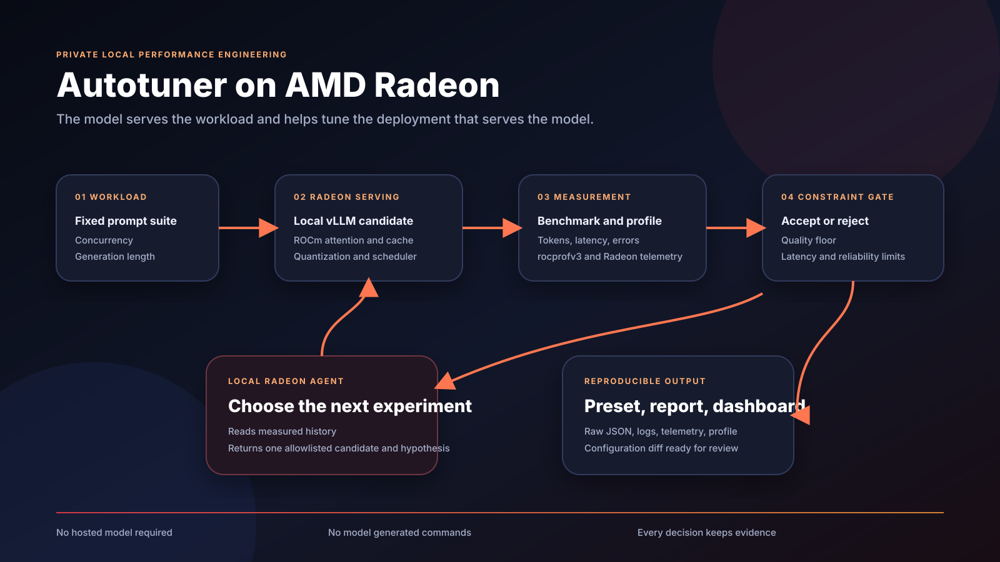

# Autotuner

Autotuner is a private local agent that makes language model serving faster on AMD Radeon GPUs. It runs controlled experiments on the same Radeon deployment that provides its reasoning, measures every candidate, protects quality and reliability limits, and exports a reusable serving preset with a human readable engineering report.

The core demo is recursive. The active model studies its own benchmark history, selects the next configuration, and watches its own output speed improve.



## Submission status

This folder is a Track 2 draft submission for the AMD AI DevMaster Hackathon.

| Deliverable | Status |
|:---|:---|
| Project specification | Complete |
| Source code and tests | Complete |
| Reproducibility instructions | Complete |
| Supplementary poster | Complete |
| Video script and shot plan | Complete |
| Measured Radeon benchmark artifact | Required before final submission |
| Demonstration video link | Required before final submission |

The checked in sample run is a deterministic simulation for interface review and continuous testing. It is clearly labeled as simulated. It must not be presented as Radeon performance evidence. Replace it with a recorded Radeon run before final submission.

## Why this matters

Local AI teams often have a working Radeon deployment but lack the time or specialist knowledge to tune the serving stack. Engine settings, attention backends, cache precision, batch capacity, memory reservation, quantized model variants, and speculative decoding can interact in ways that are specific to a model, GPU, ROCm release, and workload.

Autotuner turns that expert loop into a product:

1. Observe the local ROCm environment.
2. Establish a stock baseline.
3. Ask the model running on the active Radeon configuration to choose the next bounded experiment.
4. Launch and profile the candidate.
5. Measure throughput, latency, reliability, response validity, GPU use, power, and memory.
6. Reject candidates that violate declared limits.
7. Continue from the strongest accepted evidence.
8. Export the winning preset, raw evidence, dashboard, and engineering report.

## What is implemented

1. Local hardware inspection with `rocminfo`, `rocm-smi`, and tool version capture.
2. Managed vLLM process launch for each candidate.
3. Search across model variants, quantization, Radeon attention backends, KV cache dtype, sequence capacity, memory utilization, context length, and speculative decoding.
4. Optional `rocprofv3` tracing for selected trials.
5. Concurrent benchmark requests against the local OpenAI compatible endpoint.
6. Live Radeon telemetry sampling during each benchmark.
7. A local inference agent that can select only from an allowlisted candidate set.
8. A constraint gate for quality, error rate, and p95 latency.
9. Recovery from unsupported or failed candidates without losing the full run.
10. Reproducible JSON evidence, a Markdown report, a visual HTML dashboard, and a reusable preset.
11. A deterministic simulation mode for development without Radeon hardware.

## Quick demonstration on any computer

Python 3.9 or newer is sufficient for simulation mode.

```bash
cd Track2/Autotuner
python3 -m venv .venv
source .venv/bin/activate
python3 -m pip install .
autotuner demo artifacts/sample_run
```

Open `artifacts/sample_run/dashboard.html` in a browser.

The simulation exercises the full search, constraint, artifact, and report flow. It does not claim hardware performance.

## Run on AMD Radeon with ROCm

### Environment requirements

1. Linux on a supported AMD Radeon system.
2. A compatible AMD GPU driver and ROCm release.
3. Python 3.9 or newer for the controller.
4. vLLM with ROCm support for managed serving.
5. `rocprofv3` for kernel and HIP tracing.
6. `rocm-smi` for telemetry.
7. Enough storage and Radeon memory for the selected model variants.

AMD currently recommends its prebuilt ROCm vLLM container for a consistent environment. The current RDNA image in the official guide is:

```text
rocm/vllm:rocm7.14.0_rdna_ubuntu24.04_py3.14_pytorch_2.11.0_vllm_0.23.0
```

The configuration uses a long startup timeout because AMD documents longer warmup behavior for some Radeon workloads in vLLM versions 0.21 through 0.25.

### Radeon Cloud path

1. Follow the repository [Radeon Cloud User Guide](../../Radeon-Cloud-User%20Guide/README.md).
2. Create a persistent Notebook template with an appropriate ROCm image.
3. Open a terminal in the Notebook.
4. Clone your submission repository.
5. Enter this directory and install the controller.

```bash
python3 -m pip install --no-deps .
autotuner inspect artifacts/hardware.json
autotuner validate configs/radeon.json
```

Review `configs/radeon.json` before the real run. Confirm that each model identifier fits the available Radeon memory and is compatible with its declared quantization.

Start the experiment:

```bash
autotuner tune configs/radeon.json artifacts/radeon_run
```

The controller launches each vLLM candidate on port 8000, waits for readiness, performs warmup, runs the benchmark, asks the active local model for the next experiment, stops the server, and continues.

### Container path on a Radeon workstation

Build the project image:

```bash
docker build --tag radeon_autotuner .
```

Run an interactive shell with Radeon devices and profiling access:

```bash
docker run --rm -it \
  --device /dev/kfd \
  --device /dev/dri \
  --network host \
  --ipc host \
  --group-add video \
  --cap-add SYS_PTRACE \
  --security-opt seccomp=unconfined \
  --volume "$PWD:/workspace/autotuner" \
  --volume "$HOME/.cache/huggingface:/root/.cache/huggingface" \
  --entrypoint bash \
  radeon_autotuner
```

Inside the container:

```bash
cd /workspace/autotuner
python -m pip install --no-deps .
autotuner inspect artifacts/hardware.json
autotuner tune configs/radeon.json artifacts/radeon_run
```

## Configuration guide

`configs/radeon.json` is the reviewable experiment contract.

| Field | Purpose |
|:---|:---|
| `endpoint` | Local OpenAI compatible vLLM address |
| `manage_server` | Controls whether Autotuner starts and stops each server |
| `trials` | Maximum number of candidates to evaluate |
| `prompts` | Fixed workload shared by every candidate |
| `benchmark_requests` | Measured requests in each trial |
| `concurrency` | Number of parallel client workers |
| `quality_floor` | Minimum fraction of valid measured responses |
| `latency_limit_ms` | Maximum allowed p95 latency |
| `error_limit` | Maximum allowed request error rate |
| `use_local_agent` | Lets the active local model choose the next candidate |
| `profile_trials` | Trial numbers wrapped with `rocprofv3` |
| `engines` | Allowlisted server launch profiles |
| `search_space` | Bounded values available to the agent |

The default live configuration includes a conservative vLLM search. Add AITER attention choices or speculative model pairs only after confirming that the target ROCm image and Radeon architecture support them.

Additional engines can be registered as allowlisted profiles when they expose the same local OpenAI compatible API. An external adapter command can reference any candidate field by name. The checked in live contract uses vLLM so the default path stays aligned with the Radeon Cloud guide.

## Commands

Inspect the machine:

```bash
autotuner inspect
```

Validate a configuration:

```bash
autotuner validate configs/radeon.json
```

Run a real Radeon experiment:

```bash
autotuner tune configs/radeon.json artifacts/radeon_run
```

Rebuild reports from an existing record:

```bash
autotuner report artifacts/radeon_run/run.json
```

Run the test suite:

```bash
python3 -m unittest discover -s tests -v
```

## Output

Each completed run contains:

```text
artifacts/radeon_run/
  best_preset.json
  dashboard.html
  engineering_report.md
  run.json
  trial_01_<candidate>/
    profile/
    server.log
    telemetry.json
```

`run.json` is the machine record. `best_preset.json` is the portable configuration. `engineering_report.md` explains the result. `dashboard.html` presents the live demo story. Each trial directory preserves evidence that is available for that candidate.

## Safety and privacy

The local model cannot author or execute shell commands. It receives a bounded set of candidate identifiers and may return only one identifier with a hypothesis. The controller validates that identifier against the allowlist and constructs the server command without a shell.

Prompts, responses, benchmark history, and reports remain on the local machine unless the operator publishes them. The default endpoint is bound to `127.0.0.1`. No hosted model is required.

Autotuner terminates only the server process group that it started. Unsupported candidates become rejected trials and the search continues.

## Reproducibility procedure

1. Save `autotuner inspect artifacts/hardware.json`.
2. Commit the exact experiment configuration.
3. Record the model revision and local model cache state.
4. Use one fixed prompt set and one fixed request count for every candidate.
5. Run `autotuner tune` without unrelated workloads on the GPU.
6. Preserve `run.json`, all trial directories, the winning preset, and the report.
7. Repeat the winning candidate and baseline at least three times for final evidence.
8. Record the terminal, dashboard, and generated report in the demonstration video.
9. Replace `artifacts/sample_run` with the verified Radeon artifact or add a separate `artifacts/final_radeon_run` directory.

## Project materials

1. [Project specification](PROJECT_SPECIFICATION.md)
2. [Benchmark protocol](BENCHMARK_PROTOCOL.md)
3. [Demonstration script](DEMO_SCRIPT.md)
4. [Submission checklist](SUBMISSION_CHECKLIST.md)
5. [Supplementary poster](assets/poster.svg)
6. [Team and contributions](TEAM.md)
7. [Simulated sample report](artifacts/sample_run/engineering_report.md)

## Position relative to GEAK

AMD GEAK V4 demonstrates agent driven optimization for kernels and full serving workloads on AMD Instinct systems. Autotuner complements that work with a private Radeon focused product layer. Its scope is local inference, bounded deployment configuration search, consumer memory constraints, local agent reasoning, report generation, and reusable presets. It does not claim to replace GEAK or to generate kernels.

## Official technical references

1. [AMD vLLM inference and serving on ROCm](https://rocm.docs.amd.com/projects/ai-ecosystem/en/latest/inference/vllm.html)
2. [AMD rocprofv3 usage](https://rocm.docs.amd.com/projects/rocprofiler-sdk/en/develop/how-to/using-rocprofv3.html)
3. [vLLM attention backend guidance for ROCm](https://docs.vllm.ai/en/v0.11.1/getting_started/quickstart/)
4. [vLLM serving arguments](https://docs.vllm.ai/en/latest/cli/serve/)
5. [AMD GEAK V4](https://www.amd.com/en/developer/resources/technical-articles/2026/geak-v4.html)

## License

The project source is available under the MIT License. See [LICENSE](LICENSE).
