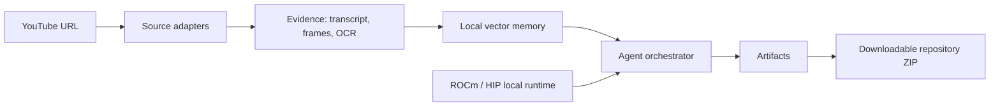

# System design

The FastAPI service owns job state and artifact packaging. The Next.js client polls one explicit project resource, rendering its agent, timeline, generated-file, GPU, and benchmark state. Model integrations are adapter boundaries: `vLLM ROCm` or `llama.cpp HIP` for code planning, Qwen2.5-VL for frames, BGE for embeddings, and PaddleOCR for text evidence.
