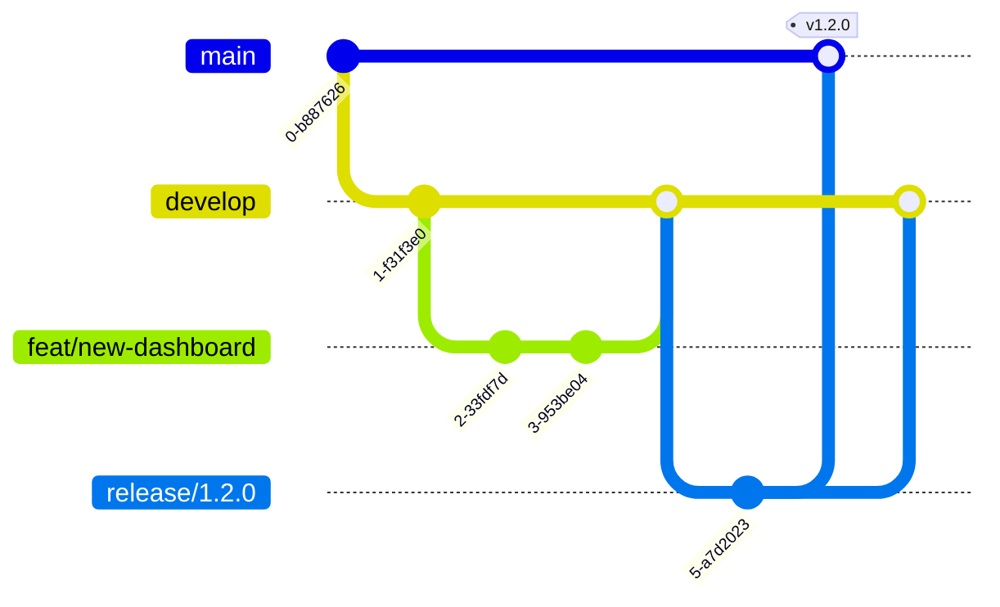

# XAI 软件开发流程

> 适用版本：v4.x · 最后更新：2026-07-25
> 本文定义了 XAI 项目的完整开发流程，涵盖本地开发、Git 协作、测试、CI/CD 和发布。

---

## 目录

1. [项目架构速览](#1-项目架构速览)
2. [环境搭建](#2-环境搭建)
3. [Git 分支策略](#3-git-分支策略)
4. [代码提交规范](#4-代码提交规范)
5. [本地开发循环](#5-本地开发循环)
6. [测试体系](#6-测试体系)
7. [代码审查](#7-代码审查)
8. [CI/CD 流水线](#8-cicd-流水线)
9. [版本管理与发布](#9-版本管理与发布)
10. [文档同步](#10-文档同步)
11. [附录：故障排查](#11-附录故障排查)

---

## 1. 项目架构速览

```
xai/
├── server_xai.py              # HTTP 后端入口 (端口 8000)
├── core/                      # Python 核心引擎
│   ├── engine_xai.py          # 编排引擎（对话/工作流/ControlLoop）
│   ├── control_loop.py        # 认知控制环（Reason→Meta→Guardian→Execute）
│   ├── grok_build_engine.py   # Grok Build 桥接
│   ├── memory_core.py         # 8 层记忆（SQLite 单一事实源）
│   ├── guardian.py            # P0/P1/P2 安全治理闸门
│   ├── intent_router.py       # 意图路由
│   ├── distill.py             # 自进化蒸馏
│   ├── model_registry.py      # 模型注册
│   ├── orchestrator.py        # 多 Agent 编排
│   ├── runner.py              # 长任务执行内核
│   ├── kb.py                  # 本地知识库 (RAG)
│   ├── planner.py             # 认知规划器
│   ├── app_store.py           # 任务/专家/自动化 CRUD
│   ├── substrate.py           # 执行网关抽象
│   └── adapters/              # 适配器（OpenClaw/Hermes/Memory）
├── frontend/                  # React + TypeScript 前端 (Vite)
│   └── src/
│       ├── App.tsx            # 主外壳
│       ├── Workspace.tsx      # 工作台
│       ├── ChatConsole.tsx    # 对话控制台
│       ├── TaskCanvas.tsx     # 工作流画布
│       ├── store.ts           # Zustand 状态管理
│       └── lib/api.ts         # API 封装
├── tests/                     # 测试套件（pytest）
│   ├── test_xai_core.py       # 核心引擎测试 (18)
│   ├── test_xai_v2.py         # v2 引擎测试 (15)
│   ├── test_xai_v3.py         # v3 引擎测试 (10)
│   ├── test_intent_router.py  # 意图路由测试 (8)
│   ├── test_openclaw_gateway.py # 网关测试 (6)
│   ├── test_grok_build_engine.py # 代码引擎测试 (8)
│   └── selftest_e2e.py        # 端到端冒烟
└── docs/                      # 架构/API/审计文档
```

**技术栈总结：**

| 层级     | 技术                           | 运行时要求          |
| -------- | ------------------------------ | ------------------- |
| 后端     | Python 3.13+ (标准库 HTTP 服务器) | 3.13+               |
| 前端     | React 19 + TypeScript + Vite   | Node 22+, npm       |
| 测试     | pytest + locust                | Python 3.13+        |
| 数据库   | SQLite（~/.xai/memory.db）     | 内置                |
| 可选集成 | Rust crate / Ollama / DeepSeek | 按需安装            |

---

## 2. 环境搭建

### 2.1 首次搭建（一次性）

```bash
# 1. 克隆仓库
git clone <repo-url> xai
cd xai

# 2. Python 环境（确保 3.13+）
python3 --version   # 需 ≥ 3.13.0
pip install -r requirements-dev.txt   # pytest 等开发工具

# 3. 前端依赖
cd frontend
npm install
cd ..

# 4. 验证环境
python3 -c "import sys; print(f'Python {sys.version}')"
cd frontend && npx vite --version && cd ..
```

### 2.2 日常启动

**方式 A：一键启动（推荐）**

```bash
bash start_xai.sh    # 后台启动后端，自动重启
```

然后**另开终端**：

```bash
cd frontend && npm run dev -- --port 5180 --host
# 浏览器打开 http://localhost:5180
```

**方式 B：分别启动（开发调试用）**

```bash
# 终端 1：后端（前台，日志实时看）
XAI_HOST=localhost XAI_PORT=8000 XAI_HOME="$HOME/.xai" python3 server_xai.py

# 终端 2：前端
cd frontend && npm run dev -- --port 5180 --host
```

### 2.3 环境变量

| 变量 | 默认值 | 说明 |
|------|--------|------|
| `XAI_HOST` | `localhost` | 后端监听地址 |
| `XAI_PORT` | `8000` | 后端端口 |
| `XAI_HOME` | `~/.xai` | 数据目录（记忆库、配置） |
| `XAI_COMMIT` | `git rev-parse --short HEAD` | 当前提交标识 |

> **注意**：`~/.xai/memory.db` 是核心记忆库，不要手动编辑。如需重置：`rm -f ~/.xai/memory.db`。

---

## 3. Git 分支策略

### 3.1 分支模型

```
main              ── 生产就绪，只合入经过完整测试+审查的代码
  │
  ├── develop     ── 开发主线，日常集成分支
  │     │
  │     ├── feat/xxx       ── 新功能（从 develop 切出，合回 develop）
  │     ├── fix/xxx        ── Bug 修复（从 develop 切出，合回 develop）
  │     ├── refactor/xxx   ── 重构（从 develop 切出，合回 develop）
  │     └── perf/xxx       ── 性能优化
  │
  ├── hotfix/xxx  ── 紧急修复（从 main 切出，合回 main + develop）
  │
  └── release/x.y.z ── 发布准备（从 develop 切出，合回 main + develop）
```

### 3.2 分支命名规范

```
feat/<简短描述>       # 新功能    例: feat/intent-router-v2
fix/<简短描述>        # 修复      例: fix/memory-double-write
refactor/<描述>       # 重构      例: refactor/engine-split
perf/<描述>           # 性能优化   例: perf/query-latency
hotfix/<描述>         # 紧急修复   例: hotfix/crash-on-empty
docs/<描述>           # 文档      例: docs/api-contract-v2
test/<描述>           # 测试      例: test/coverage-loop-safety
chore/<描述>          # 杂项      例: chore/upgrade-vite
```

### 3.3 工作流



**日常操作：**

```bash
# 开始一个新功能
git checkout develop
git pull origin develop
git checkout -b feat/my-feature

# 开发中… 频繁提交
# 完成后，发起 Pull Request → develop

# 发布
git checkout -b release/1.2.0
# 在 release 分支上只做 bugfix，不发新功能
# 测试通过后，合入 main + 打 tag
git checkout main && git merge release/1.2.0
git tag -a v1.2.0 -m "Release v1.2.0"
git push origin main --tags
git checkout develop && git merge release/1.2.0
```

---

## 4. 代码提交规范

### 4.1 提交信息格式（Conventional Commits）

```
<type>(<scope>): <简短描述>

<详细说明（可选）>

<脚注（可选，如 BREAKING CHANGE、Closes #123）>
```

**type 类型：**

| type | 用途 | 示例 |
|------|------|------|
| `feat` | 新功能 | `feat(engine): 添加 DeepSeek 模型后端` |
| `fix` | Bug 修复 | `fix(memory): 修复双写冲突导致数据不一致` |
| `refactor` | 重构 | `refactor(guardian): 拆分审批队列为独立模块` |
| `perf` | 性能优化 | `perf(kb): 缓存余弦相似度计算结果` |
| `test` | 测试相关 | `test(loop): 添加 ControlLoop 边界测试` |
| `docs` | 文档 | `docs: 更新 API_CONTRACT.md` |
| `chore` | 杂项 | `chore: 升级 vite 到 6.x` |
| `style` | 代码风格 | `style: 统一引号为双引号` |
| `ci` | CI 配置 | `ci: 添加 GitHub Actions 工作流` |

**scope 范围（本项目常用）：**

`engine`, `memory`, `guardian`, `intent`, `grok-build`, `openclaw`, `control-loop`, `frontend`, `canvas`, `chat`, `kb`, `distill`, `runner`, `api`, `docs`, `ci`

### 4.2 提交规范 checklist

提交前确认：

- [ ] 代码通过所有相关测试（`pytest tests/`）
- [ ] 无 `print()` 调试残留
- [ ] 无硬编码的密钥/密码
- [ ] 新功能有对应测试
- [ ] 公开接口有文档注释
- [ ] 提交信息符合 Conventional Commits 格式

### 4.3 一条好的提交示例

```
feat(guardian): 添加文件删除操作的 P0 安全审批

- 新增 RISK_RULES 中 delete_file 映射到 P0 级别
- 在 engine_xai 中添加 _guard_action 方法进行内容级识别
- 拦截后创建审批卡片，用户 /approve <id> 后重执行

Closes #142
```

---

## 5. 本地开发循环

### 5.1 标准开发循环

```
┌──────────────────────────────────────────────────┐
│  1. 更新分支 → git pull origin develop          │
│  2. 创建功能分支 → git checkout -b feat/xxx     │
│  3. 编码                                    │
│  4. 运行单元测试 → pytest tests/test_xxx.py -q  │
│  5. 运行冒烟测试 → python3 tests/smoke_api.py   │
│  6. 提交 → git commit -m "feat(xxx): ..."       │
│  7. 推送 → git push origin feat/xxx             │
│  8. 创建 Pull Request                           │
│  9. Code Review + 修改                          │
│  10. 合并 → develop                             │
└──────────────────────────────────────────────────┘
```

### 5.2 后端开发（修改 core/ 或 server_xai.py）

```bash
# 1. 启动后端（开发模式，前台运行，方便看日志）
XAI_HOST=localhost XAI_PORT=8000 XAI_HOME="$HOME/.xai" python3 server_xai.py

# 2. 修改代码 → 自动生效（ThreadingHTTPServer 无需重启）
# 注意：修改类定义等结构性代码时，建议重启后端

# 3. 测试 API
curl http://localhost:8000/api/health     # 健康检查
curl http://localhost:8000/api/memory     # 记忆查询

# 4. 运行测试
pytest tests/test_xxx.py -v               # 单文件测试
pytest tests/ -q                          # 全量测试
```

### 5.3 前端开发（修改 frontend/）

```bash
# 启动 dev server（热重载）
cd frontend && npm run dev -- --port 5180 --host

# Vite 自动代理 /api → localhost:8000
# 修改 .tsx/.css 文件 → 浏览器自动刷新

# 构建生产版本
cd frontend && npm run build              # 输出到 dist/
```

### 5.4 同时开发前后端

**推荐做法：两个终端窗口**

| 终端 | 运行内容 |
|------|----------|
| 终端 1 | `python3 server_xai.py`（后端） |
| 终端 2 | `cd frontend && npm run dev`（前端，热重载） |

浏览器打开 `http://localhost:5180`，前端通过 Vite proxy 转发 `/api` 到 `:8000`。

---

## 6. 测试体系

### 6.1 测试层级

```
L1: 单元测试 ── pytest 单模块测试，不依赖外部服务
  │   ├── tests/test_xai_core.py        # 核心引擎 18 测
  │   ├── tests/test_xai_v2.py          # v2 引擎 15 测
  │   ├── tests/test_xai_v3.py          # v3 引擎 10 测
  │   ├── tests/test_intent_router.py   # 意图路由 8 测
  │   ├── tests/test_openclaw_gateway.py # 网关 6 测
  │   ├── tests/test_grok_build_engine.py # 8 测
  │   ├── tests/test_memory_core.py     # 记忆核心
  │   ├── tests/test_guardian.py        # 安全审批
  │   └── ... 总计 73+ 测试
  │
L2: 集成测试 ── 多模块联动
  │   ├── tests/test_workflow_bridge.py  # 工作流桥接
  │   ├── tests/test_planner_verifier.py # 规划+验证
  │   └── tests/test_knowledge_pipeline.py
  │
L3: 端到端测试 ── 启动真实后端，验证完整流程
  │   ├── tests/selftest_e2e.py         # 端到端冒烟
  │   ├── tests/selftest_e2e_round2.py  # 第二轮冒烟
  │   ├── tests/smoke_api.py            # API 冒烟
  │   └── tests/selftest_workflow.py    # 工作流测试
  │
L4: 性能/负载测试
      └── tests/load/locustfile.py      # Locust 压测
```

### 6.2 运行测试

```bash
# ─── L1: 单元测试（日常开发必做）───
pytest tests/test_xai_core.py -v                  # 单文件
pytest tests/ --ignore=tests/load --ignore=tests/selftest_e2e.py -q  # 全量单元
pytest tests/test_xai_core.py::test_specific_fn   # 单个测试

# ─── L2: 集成测试 ───
pytest tests/test_workflow_bridge.py -v

# ─── L3: 端到端（需要后端运行中）───
# 先启动后端，再运行：
python3 tests/smoke_api.py
python3 tests/selftest_e2e.py

# ─── L4: 性能测试 ───
locust -f tests/load/locustfile.py --headless -u 10 -r 1 --run-time 30s

# ─── 全覆盖（合入 develop 前建议跑一次）───
pytest tests/ -q --ignore=tests/load
```

### 6.3 测试编写规范

```python
# tests/test_xxx.py 模板
"""测试 [模块名] 的 [功能描述]。"""

import pytest
from core.xxx import XxxModule

class TestXxxModule:
    """XXX 模块测试套件。"""

    def setup_method(self):
        """每个测试方法前执行：初始化测试对象。"""
        self.module = XxxModule()

    def test_basic_functionality(self):
        """测试基本功能正常运作。"""
        result = self.module.process("input")
        assert result is not None
        assert result.status == "success"

    def test_edge_empty_input(self):
        """测试空输入时的行为。"""
        result = self.module.process("")
        assert result.status == "error"

    def test_edge_error_recovery(self):
        """测试异常恢复机制。"""
        import unittest.mock as mock
        with mock.patch.object(self.module, '_inner_call', side_effect=ValueError):
            result = self.module.process("trigger")
            # 应优雅降级而非崩溃
            assert result is not None
```

**测试编写原则：**

1. **测试名即文档**：`test_feature_scenario` 格式，一看就知道测什么
2. **一个测试一个关注点**：不要在同一个 test 函数里测多件事
3. **覆盖边界**：空值、异常、超时、并发
4. **不依赖外部服务**：单元测试用 mock 替代真实 API 调用
5. **新代码必须有测试**：`feat`/`fix` 提交必须包含或更新测试

---

## 7. 代码审查

### 7.1 PR 模板

每次 Pull Request 应包含以下内容：

```markdown
## 描述

[用一两句话说明这个 PR 做什么]

## 关联 Issue

Closes #XXX

## 变更类型

- [ ] feat: 新功能
- [ ] fix: Bug 修复
- [ ] refactor: 重构
- [ ] perf: 性能优化
- [ ] test: 测试
- [ ] docs: 文档
- [ ] chore: 杂项

## 测试清单

- [ ] 单元测试已通过
- [ ] 端到端冒烟已通过
- [ ] 新增代码有对应测试
- [ ] 手动测试了关键场景

## 截图（UI 变更时必填）

[Before / After 截图]

## 检查项

- [ ] 无 `print()` 调试残留
- [ ] 无硬编码密钥
- [ ] 公开接口有文档注释
- [ ] 性能敏感代码有标注
```

### 7.2 Code Review Checklist

**Reviewer 逐项检查：**

| 类别 | 检查项 |
|------|--------|
| **正确性** | 逻辑是否正确？边界条件是否处理？ |
| **安全** | 是否有路径穿越风险？命令注入？P0/P1 操作是否经 Guardian？ |
| **性能** | 是否有不必要循环/频繁 I/O/内存泄漏？ |
| **可维护性** | 命名是否清晰？函数是否过长？是否需要拆分？ |
| **测试** | 新功能是否有测试？测试是否覆盖了失败路径？ |
| **兼容性** | 是否破坏现有 API？是否需要同步更新前端？ |
| **文档** | 是否需要更新 `API_CONTRACT.md` / `ARCHITECTURE_GUARDRAILS.md`？ |

### 7.3 审批规则

- **P0 安全相关变更**（Guardian、文件操作、命令执行）→ 需 2 人 +1
- **引擎核心变更**（engine_xai.py、control_loop.py）→ 需 1 人 +1
- **前端 UI 变更** → 需 review + 截图对比
- **纯文档/测试变更** → 1 人 review 或直接合入
- **紧急修复（hotfix）** → 可跳过 review，但事后需补审

---

## 8. CI/CD 流水线

### 8.1 GitHub Actions 工作流

项目根目录创建 `.github/workflows/ci.yml`：

```yaml
name: XAI CI

on:
  push:
    branches: [develop, main]
  pull_request:
    branches: [develop]

jobs:
  lint-and-test:
    runs-on: ubuntu-latest
    steps:
      - uses: actions/checkout@v4

      - name: Setup Python 3.13
        uses: actions/setup-python@v5
        with:
          python-version: "3.13"

      - name: Install Python dependencies
        run: pip install pytest

      - name: Run unit tests
        run: pytest tests/ -q --ignore=tests/load --ignore=tests/selftest_e2e.py

      - name: Setup Node 22
        uses: actions/setup-node@v4
        with:
          node-version: "22"

      - name: Build frontend
        run: |
          cd frontend
          npm ci
          npm run build

  e2e-smoke:
    needs: lint-and-test
    runs-on: ubuntu-latest
    steps:
      - uses: actions/checkout@v4

      - name: Setup Python 3.13
        uses: actions/setup-python@v5
        with:
          python-version: "3.13"

      - name: Install dependencies
        run: pip install pytest requests

      - name: Start server & run smoke tests
        run: |
          python3 server_xai.py &
          sleep 3
          python3 tests/smoke_api.py
```

### 8.2 流水线阶段说明

```
提交/PR → [Lint] → [单元测试] → [前端构建] → [E2E 冒烟] → [通过/失败]
```

| 阶段 | 触发条件 | 耗时 | 失败后果 |
|------|----------|------|----------|
| 单元测试 | 每次 push | ~2min | 阻止合并 |
| 前端构建 | 前端文件变更 | ~1min | 阻止合并 |
| E2E 冒烟 | PR 到 develop | ~3min | 阻止合并 |
| 性能测试 | main 合并后触发 | ~5min | 告警不阻止 |

### 8.3 本地 CI 模拟（合入前自检）

```bash
# 在本地模拟 CI 流程，合入前必跑
echo "=== 1. 单元测试 ==="
pytest tests/ -q --ignore=tests/load --ignore=tests/selftest_e2e.py || exit 1

echo "=== 2. 前端构建 ==="
cd frontend && npm run build && cd .. || exit 1

echo "=== 3. E2E 冒烟 ==="
python3 tests/smoke_api.py || exit 1

echo "✅ 所有检查通过"
```

---

## 9. 版本管理与发布

### 9.1 版本号规范

遵循 [SemVer 2.0](https://semver.org/)：

```
v<major>.<minor>.<patch>

major: 不兼容的 API 变更
minor: 向后兼容的新功能
patch: 向后兼容的 Bug 修复
```

当前基线：`v4.0.0`（基于 V4 架构）

### 9.2 发布流程

```
develop 分支稳定
    │
    ▼
创建 release/x.y.z 分支
    │
    ▼
在 release 分支上修复 bug（不增加新功能）
    │
    ▼
更新版本号 + CHANGELOG.md
    │
    ▼
合入 main → 打 tag vx.y.z
    │
    ▼
合入 develop（同步修复）
    │
    ▼
构建发布包（dist/ + 启动脚本）
```

### 9.3 CHANGELOG 维护

根目录 `CHANGELOG.md` 按 [Keep a Changelog](https://keepachangelog.com/) 格式：

```markdown
# Changelog

## [v4.1.0] - 2026-07-25

### Added
- feat(engine): DeepSeek 模型后端支持 (#85)
- feat(canvas): 条件分支节点类型 (#92)

### Fixed
- fix(memory): 修复记忆写入双写冲突 (#78)
- fix(guardian): 路径穿越检测增强 (#81)

### Changed
- refactor(engine): 拆分 engine_xai 为独立模块 (#88)

## [v4.0.0] - 2026-07-19

### Added
- 初始 V4 架构发布
- 双引擎并列（Hermes + Grok Build）
- 8 层记忆体系
- P0/P1/P2 安全治理闸门
- 意图路由自动分发
```

### 9.4 发布 checklist

- [ ] `CHANGELOG.md` 已更新
- [ ] 版本号已更新（server_xai.py 中的 `__version__`）
- [ ] 全量测试通过（`pytest tests/ -q`）
- [ ] E2E 冒烟通过
- [ ] 前端构建成功（`cd frontend && npm run build`）
- [ ] 文档已同步（API_CONTRACT.md 等）
- [ ] Tag 已创建并推送

---

## 10. 文档同步

### 10.1 文档与代码的关系

```
代码变更                  对应文档更新
────────────             ────────────
新增 API 端点            → 更新 API_CONTRACT.md
修改架构/模块结构         → 更新 ARCHITECTURE_GUARDRAILS.md
新增/修改配置项           → 更新 GETTING_STARTED.md / USER_GUIDE.md
修改启动方式              → 更新 start_xai.sh + GETTING_STARTED.md
修改数据库 schema         → 更新 docs/ 中相关架构文档
修复重要 bug              → 在 CHANGELOG.md 记录
```

### 10.2 核心文档索引

| 文档 | 位置 | 更新频率 | 维护者 |
|------|------|----------|--------|
| 项目总览 | `PROJECT_OVERVIEW.md` | 架构变更时 | 架构师 |
| API 合约 | `API_CONTRACT.md` | API 变更时 | 后端 |
| 架构护栏 | `ARCHITECTURE_GUARDRAILS.md` | 架构变更时 | 架构师 |
| 上手指南 | `GETTING_STARTED.md` | 流程变更时 | 全栈 |
| 用户手册 | `USER_GUIDE.md` | 功能发布时 | 前端 |
| 开发流程 | `DEVELOPMENT_WORKFLOW.md` | 流程变更时 | Tech Lead |
| 变更日志 | `CHANGELOG.md` | 每次发布 | 发布经理 |

### 10.3 文档规范

- 使用 Markdown 格式
- 代码块标注语言（\`\`\`bash, \`\`\`python, \`\`\`typescript）
- 重要步骤使用 checklist 格式（`- [ ]`）
- 路径使用绝对路径或相对于项目根路径
- 截图放在 `docs/screenshots/` 目录

---

## 11. 附录：故障排查

### 11.1 端口冲突

```bash
# 检查端口占用
lsof -i :8000   # 后端端口
lsof -i :5180   # 前端端口

# 杀掉占用进程
kill -9 <PID>
# 或清空残留
rm -f ~/.xai/server.pid && pkill -f server_xai.py
```

### 11.2 记忆库损坏

```bash
# 备份当前记忆库
cp ~/.xai/memory.db ~/.xai/memory.db.bak

# 重建（会丢失所有记忆）
rm -f ~/.xai/memory.db
# 重启后端后自动重建
```

### 11.3 测试失败

```bash
# 如果全量测试失败，先定位到具体失败的测试
pytest tests/ -q --tb=short

# 只跑失败的测试文件，加 -v 看详情
pytest tests/test_xxx.py -v --tb=long

# 清理缓存后重试
find . -name "__pycache__" -type d -exec rm -rf {} + 2>/dev/null
pytest tests/ -q
```

### 11.4 前端构建失败

```bash
cd frontend
rm -rf node_modules dist
npm install
npm run build
```

---

> **开发铁律**
>
> 1. **不改主分支**：`main` 和 `develop` 不直接 push，只通过 PR 合入
> 2. **不提交不跑的代码**：提交前至少跑一次相关测试
> 3. **不混合同一次 PR 做多件事**：一个 PR 一个关注点
> 4. **不留 TODO 不闭环**：`# TODO` 必须附带 Issue 编号
> 5. **不重复造轮子**：先查是否有现成工具/函数
