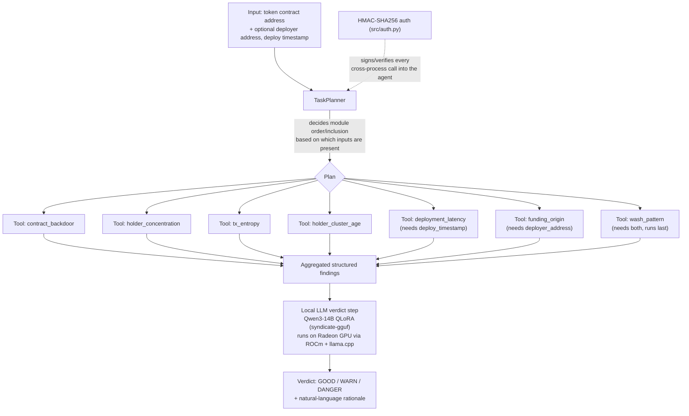

# Project Specification Document

**Project:** RugBuster CIA Intelligence Agent
**Track:** AMD AI DevMaster Hackathon — Track 2, Development & Local Deployment of Private AI Agents
**Deadline:** 2026-08-06 17:59 CEST

This document follows the Track 2 Project Specification Document requirements: application
scenario & target users, agent architecture diagram, core capabilities, model introduction &
local deployment plan, and inference-speed optimization on AMD Radeon GPU.

---

## 1. Application scenario & target users

Token fraud ("rug pulls") on DeFi chains follows recognizable behavioral patterns — sniper
bots, wash trading, wallet clustering, backdoored contracts, supply concentration — but
verifying them manually per token is slow and requires on-chain forensics expertise most
users don't have.

**Target users:**

- **Launchpads / DEX front-ends** that want an automated pre-listing or at-mint risk check
  before a token is surfaced to users.
- **Retail investors** who want a GOOD / WARN / DANGER verdict on a token before buying, with
  a plain-language explanation of *why*, not just a score.
- **Wallet providers / portfolio trackers** who want to flag already-held tokens that show
  emerging rug signals.

This agent packages RugBuster's existing (already deployed, already QA'd — 257 tokens tested,
zero false-safe) CIA Intelligence Engine as a locally-runnable, privately-deployable agent, so
any of the above can run fraud detection on their own infrastructure without sending token
data to a third-party SaaS API.

## 2. Agent architecture

Every tool call is a LangChain `StructuredTool` (`src/tools.py`) invoking one of the 7 CIA
modules (`src/cia_modules.py`), which themselves call a chain-agnostic explorer/RPC client
(`src/chain_client.py`). The planner (`src/planner.py`) and orchestrator (`src/orchestrator.py`)
are the only new code; the module detection logic is a direct, unmodified port.

## 3. Core capabilities (AMD Track 2 requirement: minimum 2 of 5 — this submission covers 3)

| # | Capability | Where |
|---|------------|-------|
| 1 | **Tool invocation** | 7 CIA modules exposed as LangChain `StructuredTool`s (`src/tools.py`), each wrapping a blockchain-data fetch (explorer API / RPC) + detection function (`src/cia_modules.py`). |
| 2 | **Multi-step task planning** | `src/planner.py` `TaskPlanner.plan()` explicitly decides which of the 7 modules to run and in what order, based on which inputs (contract, deployer, deploy timestamp) are actually available — see the rule-by-rule rationale in that file's docstring. This produces an inspectable `Plan` object *before* any tool runs. |
| 3 | **Permission control & privacy protection** | `src/auth.py`, HMAC-SHA256 request signing/verification with bounded clock skew and constant-time comparison, ported unchanged from the production scoring engine's worker-to-engine auth. Only callers holding the shared secret can invoke the agent; secret rotation is supported. |

**Why LangChain:** the existing CIA modules are plain Python functions with no framework
dependency, so the wrapping decision came down to "what has the thinnest adapter for existing
functions + first-class local GGUF LLM support." LangChain's `StructuredTool.from_function`
wraps an existing function with a typed schema in one call, and `langchain_community.llms.LlamaCpp`
is a direct, dependency-light path to a local llama.cpp-backed model — no extra agent-runtime
services to stand up, which matched the packaging-only scope of this task.

## 4. Model introduction & local deployment plan

**Model:** Qwen3-14B, QLoRA fine-tuned via Unsloth.
**Training data:** 358,712 historical multi-chain (primarily Solana, plus Avalanche) scan
records — CIA/V5/V6 structured evidence payloads, the same shape of data this agent's
orchestrator aggregates before the verdict step.
**Published weights:** GGUF at [`ffurduj/syndicate-gguf`](https://huggingface.co/ffurduj/syndicate-gguf)
on HuggingFace.
**Local deployment:**

- **Dev:** ASUS ROG Flow Z13 (AMD Ryzen AI Max 395, "Strix Halo", gfx1151, 32GB unified
  memory), Windows, ROCm nightly PyTorch build for training/fine-tuning experimentation.
- **Inference target for this submission:** the same GGUF file loaded via `llama-cpp-python`
  built with `GGML_HIPBLAS=on`, wrapped as a LangChain `LlamaCpp` LLM (`src/llm_client.py`).
  GPU/backend selection is fully runtime-resolved (`src/gpu_config.py`) — no gfx1151-specific
  assumption anywhere in the inference path, so the same code targets the Radeon Cloud
  instance's (likely different, discrete) GPU without modification.

The model is used as the **final classifier over structured findings**, not as a free-form
ReAct tool router. It was trained to predict a verdict from structured CIA/V5/V6 records, so
that is the exact task shape it sees here — see `src/orchestrator.py`'s docstring for the
reasoning behind not using it to drive tool selection instead.

## 5. Model status & roadmap

**Current status: early/trial checkpoint.** This Qwen3-14B QLoRA fine-tune (train loss
1.227, per `Syndicate-Protocol/README.md`) is a first proof-of-concept run, not a production
model — it is known to hallucinate on some inputs. We are not hiding that: this submission
treats the model's verdict as **advisory, not authoritative**, and cross-checks it against a
deterministic, LLM-free risk baseline computed directly from the 7 modules' raw findings
(`src/risk_baseline.py`). If the LLM's verdict disagrees with the baseline, the result is
flagged `agrees: false` with an explanatory note (`src/orchestrator.py` `scan_with_verdict()`)
instead of the LLM's answer being trusted silently. The deterministic CIA Intelligence Engine
itself is *not* affected by any of this — it is the already-QA'd, already-deployed part (257
tokens tested, zero false-safe) and remains the reliable core regardless of model quality.

**Why the model isn't production-ready yet, and what fixes that:** a fraud-verdict label
(GOOD vs. it-actually-rugged) is inherently retrospective — you only know a WARN/DANGER call
was correct once enough time has passed to see whether the token actually rugged. That means
building a trustworthy training set is not a one-shot data pull, it is a multi-phase process:

1. **Now — scan and log.** Keep running the CIA engine on new tokens as they launch and store
   the structured findings (already happening in production, independent of this hackathon
   submission).
2. **Wait — let outcomes mature.** Give scanned tokens enough real time (weeks to months) to
   actually reveal whether they rugged, so labels reflect ground truth instead of a same-day
   guess.
3. **Verify — audit label quality.** Check the matured outcomes against the original findings
   before trusting them as training data (this is the "evaluation harness (F1 score vs
   RugCheck baseline)" item already on the project roadmap in `Syndicate-Protocol/README.md`).
4. **Then — retrain.** Only once step 3 confirms the label set is solid do we run the next
   fine-tuning pass (the roadmap's "V2 fine-tuning run, target 500K+ records") and consider
   promoting the model's verdict from advisory to a primary signal.

This submission's guardrail (step above) is the practical stopgap for the time between now
and step 4: it lets the agent use the model today, honestly, without pretending the model is
further along than it is.

## 6. Inference speed optimization on AMD Radeon GPU

Already applied (inherited from the existing training/model work, read-only reference:
`Syndicate-Protocol/README.md`, `Trening/setup_unsloth_strixhalo.sh`):

- **QLoRA instead of full fine-tune** — 4-bit base weights + low-rank adapters, dramatically
  smaller memory footprint for both training and (via the merged GGUF export) inference.
- **GGUF quantized export** for inference (vs. running the bf16/fp16 checkpoint), trading a
  small quality margin for large latency/memory wins on a single GPU.
- **ROCm/HIPBLAS-built `llama-cpp-python`** so matrix ops actually run on the Radeon GPU
  instead of silently falling back to CPU (a real failure mode on Windows+ROCm — see
  `src/gpu_config.py` docstring and the carried-over notes in
  `Trening/setup_unsloth_strixhalo.sh` about bitsandbytes/torchao gaps on this stack).
- **Runtime-configurable GPU layer offload** (`CIA_LLM_GPU_LAYERS`, default: offload all
  layers) so a smaller Radeon Cloud card can offload fewer layers than the Z13 without a code
  change, trading some GPU acceleration for staying within VRAM.

Proposed if more time is available before the deadline:

- Batch/parallelize the independent contract-only tool calls (`contract_backdoor`,
  `holder_concentration`, `tx_entropy`, `holder_cluster_age`) — they don't depend on each
  other's output, so running them concurrently would shorten wall-clock time before the LLM
  verdict step, independent of the model itself.
- Persistent model server (llama.cpp `server` mode) instead of a fresh `LlamaCpp` load per
  CLI invocation, to amortize model load time across multiple token scans.
- Speculative decoding or a smaller draft model, if verdict latency (not just tool-call
  latency) turns out to be the bottleneck on the Radeon Cloud target — not yet measured, since
  local benchmarking against the actual cloud GPU hasn't happened (see `SUMMARY.md`).

## 7. Scope note

No CIA Intelligence Engine detection logic, threshold, or scoring math was changed as part of
this submission — this is a packaging/orchestration task over already-QA'd modules (257 tokens
tested, zero false-safe, per prior QA). See per-file docstrings in `src/` for exact provenance
of each ported piece.
