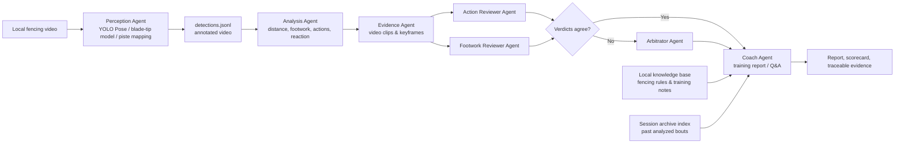

# SparkFencer — Project Specification Document

**Track**: Track 2 — Development & Local Deployment of Private AI Agents
**Project name**: SparkFencer — Local Private AI Fencing Training Video Analysis & Coaching Agent
**Version**: 1.1 (submission material)
**Date**: 2026-08-01

## Summary

SparkFencer turns a fencing training or bout video into a reviewable technical report. The system reads
video locally, uses vision models to identify the two fencers, blade tips, footwork, and piste position;
cuts candidate actions into evidence clips; and has a multi-agent pipeline — an action reviewer, a footwork
reviewer, an arbitrator, and a coach — cross-validate them and produce recommendations.

SparkFencer is designed for **fully local private deployment**: video, embeddings, session memory,
tool-call audit logs, and local models remain on the user's Radeon device/LAN. When an operator explicitly
chooses to enable it, the project can also use Radeon Cloud's OpenAI-compatible text and VLM endpoints for
selected event keyframes and review prompts; the raw video and local knowledge/session data remain local.

## 1. Application scenarios

1. **Personal training review** — Upload a fixed side-view training video and get distance, footwork, lunge,
   attack/defense, and reaction-time metrics with the exact evidence clip backing each finding.
2. **Post-session coach analysis** — A coach queries a local chat agent about one session, or compares
   several, to quickly locate the moments worth reviewing and get a training prescription.
3. **Club-private training archive** — Raw video, the knowledge-base index, and the agent tool-call audit
   trail stay on the local machine / LAN only, so training footage never has to be uploaded to a third-party
   cloud.
4. **Blade-tip model data flywheel** — Blade Studio lets a user extract frames from target-domain video,
   fine-tune a local YOLO-Pose blade-tip model, evaluate it on a held-out test set, and feed it back into the
   main pipeline.

## 2. Agent architecture diagram



**Boundaries and safety**: every agent tool may only read already-analyzed sessions, evidence, and the local
knowledge base under `outputs/`; all paths are validated against traversal; every tool call is written to
`outputs/.audit/agent_tools.jsonl`; the Claude cloud backend is refused whenever `privacy.local_only: true`
(the default).

## 3. Introduction to core capabilities

| Capability | Implementation | Output |
|---|---|---|
| Dual-fencer understanding | YOLO 17-keypoint pose, stable left/right identity tracking, piste-region filtering | Per-frame keypoints and piste coordinates |
| Blade-tip trajectory | Wrist-anchored CV baseline, or a fine-tuned YOLO-Pose model; Kalman smoothing with jump gating | Blade-tip position, confidence, colored trajectory |
| Technical events | Distance/speed time series, footwork segmentation, lunges, attack/defense candidates, reaction time, engagement phrases | `events.json`, charts, scorecard |
| Traceable evidence | ffmpeg per-event clipping, keyframe selection | `evidence/`, evidence manifest |
| Multi-agent cross-validation | Two independent reviewer roles; disagreements go to an arbitrator; anything that fails to parse is conservatively marked `uncertain` | `validated_events.json` |
| Private coach Q&A | Local OpenAI-compatible VLM + local knowledge-base RAG + session-memory / tool audit | Report and multi-turn Q&A |
| Bilingual output | UI chrome, scorecard, and AI-generated report all follow a single language toggle (Chinese / English) | Report and scorecard rendered in the selected language |

### 3.1 Dual-fencer pose recognition and identity tracking

YOLO Pose detects 17 body keypoints per person, including shoulders, elbows, wrists, hips, knees, and ankles.
Detections are mapped into piste coordinates and filtered to exclude referees, coaches, and spectators; left
and right fencer identity is then stabilized using piste position and nearest-neighbor continuity across
frames. This is the shared foundation for footwork, weapon-hand, distance, and action analysis; large
single-frame jumps are rejected during brief occlusions to reduce left/right identity swaps.

### 3.2 Piste calibration and metric coordinate mapping

The user marks the four piste corners on the first frame; a perspective transform converts pixel positions
into piste coordinates (x = position along the piste, y = lateral position). Default piste length is 14 m,
with support for specifying the actual visible length when only part of the piste is captured. Distance,
speed, stance, and lunge-spread metrics are therefore physically meaningful, not just pixel counts; the
calibration persists so re-analyzing the same video never requires re-marking corners.

### 3.3 Blade-tip detection and trajectory tracking

Two paths are supported. The CV baseline anchors on the weapon-hand wrist and combines forearm direction,
frame-difference motion regions, and line-segment geometry to locate the far end of the blade. The learned
path can load a locally fine-tuned YOLO blade-tip/guard model and associate the tip with a fencer via guard,
blade, and weapon-hand proximity. Trajectories are Kalman-smoothed with short-horizon prediction and
large-jump gating; when a tip is lost beyond the allowed window the point is left empty rather than
fabricated, reducing cross-blade mis-association and false lines from background clutter.

### 3.4 Footwork, lunges, and distance-management analysis

Ankle piste-coordinates give a forward-facing speed toward the opponent, which is thresholded into advance /
retreat / stationary segments with short-noise merging. Lunge detection requires a short-window forward
burst plus a clear increase in foot spread, with arm extension as corroborating evidence. The system also
tracks longitudinal distance continuously, producing mean/extreme values, a distance curve, and a position
heatmap to help locate premature/late initiation, chronic over-distancing, or insufficient closing distance.

### 3.5 Attack/defense candidates, reaction time, and phrase segmentation

Attack candidates are produced from arm extension combined with advance/lunge. A defense or counter
candidate is flagged when the opponent shows rapid wrist motion, retreat, or arm extension right after an
attack. Reaction time uses one side's transition from stationary to moving as the stimulus, and the other
side's first valid footwork or weapon response as the endpoint, bounded to physiologically plausible ranges.
The system also segments engagement phrases from both sides' activity. All of these outputs are explicitly
labeled "candidates" — interpretable evidence, not adjudicated final rulings.

### 3.6 Scene gating, evidence clipping, and visualization

For broadcast footage, scene gating uses a color/structure fingerprint of the piste region to identify the
main bout camera; coach close-ups, replays, and crowd shots are skipped, and tracking state resets on
re-entry to the bout camera to prevent phantom events from cross-cut "teleportation." For each high-value
candidate, the system automatically clips the surrounding window from the annotated video, exports
keyframes, and writes them to a manifest. Final outputs include a skeleton/trajectory/distance-HUD annotated
video, event JSON, charts, and an evidence directory — every conclusion traces back to the original footage.

### 3.7 Multi-agent cross-validation and local coaching report

An Action Reviewer agent and a Footwork Reviewer agent independently read candidate metadata and keyframes,
each returning a confirm/reject/uncertain verdict with confidence and reasoning. Matching verdicts are
adopted directly; conflicts go to an Arbitrator agent. Anything that fails to return a well-formed verdict is
conservatively marked `uncertain`. Validated events are summarized by the local Coach agent into a report and
scorecard with technical observations and prioritized training suggestions tied to the underlying data — and
the system falls back to a complete rule-based report even with no LLM/agent enabled at all.

### 3.8 Local knowledge Q&A, privacy controls, and the blade-tip data workshop

`agent_chat.py` supports multi-turn questions over already-analyzed sessions, e.g. comparing retreat
frequency across two sessions or locating the most-worth-reviewing lunge. The agent may only retrieve the
local fencing knowledge base and restricted already-analyzed data under `outputs/`; session memory, tool-call
audit, video, and model endpoints can all be confined to the local machine/LAN, and the `local_only` policy
blocks the cloud backend outright. Blade Studio supports extracting frames from a target video, manually
labeling guard/blade-tip keypoints, fine-tuning a local YOLO-Pose model, and evaluating it on a held-out test
set before feeding the improved model back into the main pipeline — a closed data/model iteration loop.

### 3.9 LLM/VLM agent inventory and call relationships

The agents in the current project that actually invoke an LLM/VLM fall into the following categories:

| Agent | Uses an LLM? | Role | Default model / backend |
|---|---|---|---|
| Action Reviewer Agent | Yes, vision-language model | Judges whether a candidate is an attack, parry, riposte/counter, lunge, etc. | Local `qwen3-vl:32b` |
| Footwork Reviewer Agent | Yes, vision-language model | Judges whether footwork, lunges, distance, and action timing are valid | Local `qwen3-vl:32b` |
| Arbitrator Agent | Yes, vision-language model | Issues the final verdict when the Action and Footwork reviewers disagree | Local `qwen3-vl:32b` |
| Coach Report Agent | Yes, vision/text model | Generates the training report, issue analysis, and training suggestions from statistics and review results | Local VLM; a Claude backend is also supported |
| CoachChat dialogue Agent | Yes, text LLM | Supports multi-turn Q&A, session lookup, session comparison, event retrieval, and training advice | Local `qwen3:32b`, or any configured OpenAI-compatible model |

The specific call relationships are as follows:

**`fencing_analysis/agents/validator.py`** — handles multi-agent event cross-validation:
- `action_reviewer`: the action/technique reviewer.
- `footwork_reviewer`: the footwork/timing reviewer.
- `arbiter`: the arbitrator invoked when the two reviewers disagree.

These three roles share the same vision-model backend but use different system prompts and review
objectives.

**`fencing_analysis/agents/coach.py`** — generates the final training report. It receives:
- the fencers' statistics;
- distance, footwork, and reaction-time data;
- candidate events;
- the agent verdicts recorded in `validated_events.json`.

It then has the LLM generate a Chinese- or English-language markdown report. If no LLM is available, it
falls back to a rule-based template report.

**`fencing_analysis/agents/orchestrator.py`** — runs the local coach chat agent. It uses `ChatOpenAI` to
connect to a local OpenAI-compatible endpoint, and accesses the following through tool calls:
- already-analyzed sessions;
- session statistics;
- the event list;
- evidence time windows;
- cross-session comparison;
- the local fencing knowledge base;
- cross-session semantic search.

It never reads the full video directly — it only reads structured analysis results and the evidence index
through tools.

## 4. Model introduction & local deployment plan

### Model stack

- **Pose**: Ultralytics YOLO11 Pose (default `yolo11s-pose.pt`).
- **Blade tip**: CV line-segment baseline by default; swappable for a locally fine-tuned YOLO model.
  In-domain validation: blade-tip mAP50 = 0.951, full 3-class detection mAP50 = 0.978.
- **Vision agent (VLM)**: any local OpenAI-compatible `/v1/chat/completions` endpoint. Two backends have been
  built, deployed, and verified end-to-end:
  - **Ollama** — e.g. `qwen3-vl:32b` at `http://127.0.0.1:11434/v1`.
  - **llama.cpp** (`llama-server`, built with multimodal/`mtmd` support) — verified with
    `MiniCPM-o-4.5` (F16 GGUF + vision projector) at `http://127.0.0.1:8090/v1`. Both backends are selectable
    from the WebUI's "VLM provider" dropdown, which fills in the matching default endpoint and model list;
    the underlying agent client is a single OpenAI-compatible implementation shared by both.
- **Text coach / RAG embeddings**: local model service plus a local `bge-m3` embedding index — two indexes
  are built and verified: a fencing-knowledge index (`knowledge/*.md` → `knowledge/.index/`, 45 chunks) and a
  cross-session archive index (`outputs/*/events.json` → `outputs/.session_index/`, auto-updated after every
  analysis run) so the coach agent can both cite technique documentation and recall prior sessions.

### AMD Radeon / ROCm deployment

Target environment: a ROCm-supported Radeon GPU, Linux, Python 3.11+. Run `bash scripts/setup_amd_rocm.sh` to
install ROCm PyTorch and project dependencies. Then:

```bash
python scripts/build_knowledge.py
python scripts/health_check.py
```

ROCm PyTorch uses the CUDA-compatible PyTorch interface. `health_check.py` verifies the project
configuration, local endpoint policy, and required runtime components before analysis is started.

The submitted package supports both **local-private model deployment** and **Radeon Cloud API deployment**.
In local-private mode, Ollama or llama.cpp serves the VLM/text models on the Radeon device or trusted LAN;
raw video, embeddings, session records, and model inference stay within that boundary. In explicit Radeon
Cloud API mode, the supplied launcher connects to the platform's OpenAI-compatible DeepSeek text endpoint
and Qwen VLM endpoint. This cloud mode sends only selected event keyframes and review prompts, never a raw
video stream; API credentials are supplied through a private environment file and are not stored in source
code or submission materials.

## 5. Optimization description for inference speed on AMD Radeon GPU

1. **GPU/CPU layering** — per-frame visual perception runs on GPU; time-series analysis, event statistics,
   and report assembly run offline on CPU, avoiding idle GPU time and redundant inference.
2. **Resolution on demand** — the blade tip is an extremely small target, so `blade.imgsz` can be set to
   1280 or near-native 1920; the resolution is raised only when blade recall requires it, instead of
   upscaling every model indiscriminately.
3. **Fewer VLM calls** — only 4 keyframes are exported per high-confidence candidate, and at most 12 events
   are reviewed by default; the VLM never runs frame-by-frame over the full video.
4. **Persistent frame-state reuse** — Kalman smoothing, left/right identity tracking, and scene gating all
   run continuously in memory and only reset on a camera cut, avoiding incorrect state propagation across
   cuts.
5. **Broadcast scene gating** — an HSV piste fingerprint filters out non-bout shots; on 180 s of broadcast
   footage this skips non-bout frames before visual inference, eliminating wasted detection work.

### Measured Radeon benchmark (single run)

The following measurements were collected on the Radeon Cloud Notebook Pod used for the demo. Runtime reported
PyTorch `2.12.1+rocm7.2`, HIP `7.2`, and an AMD Radeon `gfx1100` device. The visual-perception test used the
same 180-second, 1920×1080 (5,400-frame) fencing video and saved four-pointe piste calibration as the demo.

| Measurement | Result | Scope |
|---|---:|---|
| Local perception + annotated H.264 replay export | 295.207 s | YOLO pose (`yolo11s-pose.pt`) + CV blade tracker; includes browser-compatible replay encoding |
| End-to-end throughput | 18.292 FPS | 5,400 frames / 295.207 s; not a model-only FPS figure |
| Radeon Cloud VLM review | 7.640 s | `Qwen3.6-35B-A3B`, one request with four selected event keyframes |
| Radeon Cloud RAG answer | 1.504 s | `DeepSeek-V4-Flash`, one short coaching-answer request |

These are single-run demo measurements, not an average across repeated runs and not a cross-GPU comparison.
The two Cloud API timings include network and service latency; no raw video or API key was recorded in the
benchmark artifacts. Raw JSON results are retained on the demo Pod as `benchmark.json` and
`cloud_api_benchmark.json`.

### Radeon live-demo checklist (3–5 minutes)

1. Run `python scripts/health_check.py` in a terminal to show that the project environment is ready.
2. Start the local model service and show `VLM_BASE_URL=127.0.0.1`; no external API key is shown anywhere.
3. In the WebUI, upload a video, click the four piste corners, and start analysis.
4. Play the annotated video, showing trajectories, left/right identity, and the distance HUD; open the event
   charts, evidence clips, and the generated report.
