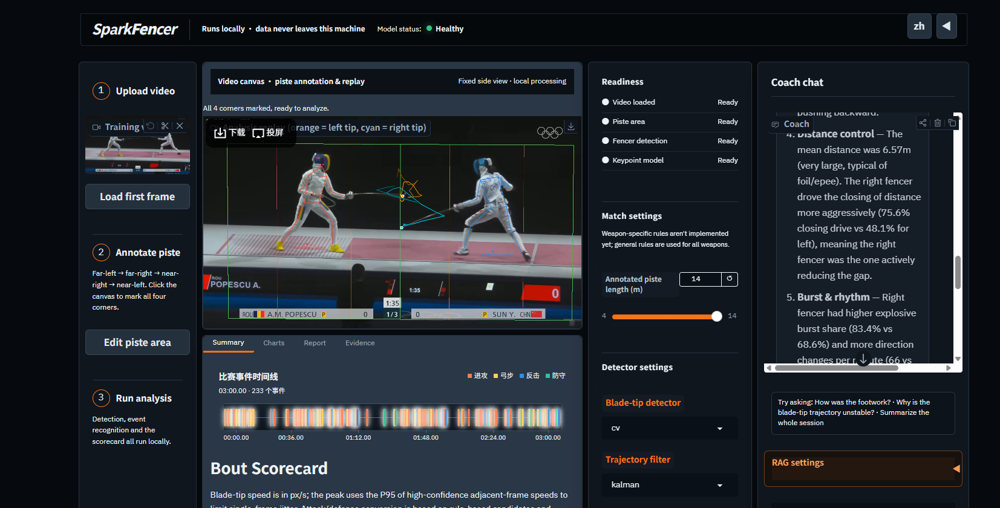

# SparkFencer — Project Source Code README



This README accompanies `source/SparkFencer/` and `source/SparkFencer_source.zip`, the complete source code delivered for
**Track 2 — Development & Local Deployment of Private AI Agents**. It covers environment configuration, the
startup guide, and the dependency list. For the full project write-up (application scenarios, agent
architecture, core capabilities, model/deployment plan, and Radeon inference optimizations), see
`Project_Specification_Document.md` in this same directory.

The `source/SparkFencer/README.md` inside the package is the day-to-day developer reference and is written
in Chinese; this file is an English-first summary aimed at reviewers, kept consistent with it.

## What SparkFencer does

SparkFencer turns a fencing training or bout video into a reviewable technical report: it locates the two
fencers and their blade tips, detects footwork/attack/defense/reaction events, cross-validates the
higher-value candidates with a multi-agent review pipeline, and produces a coaching report with clickable
evidence clips. It supports both local-private model deployment and an explicit Radeon Cloud API mode. In
the default local-private configuration, video, embeddings, session memory, tool-call audit, and model
inference stay on the local device/LAN and no external API is called.

## 1. Environment configuration

**Requirements**: Linux with a ROCm-supported AMD Radeon GPU, Python 3.10+, `ffmpeg` on
`PATH`, and a local OpenAI-compatible model server (Ollama or llama.cpp `llama-server`, both verified).

### Linux + AMD Radeon (ROCm)

```bash
# 1. Install the AMD/ROCm driver stack per AMD's official compatibility matrix for your GPU first.
# 2. From the repository root, install PyTorch (ROCm build), project dependencies, and verify GPU access:
export PYTORCH_ROCM_INDEX=https://download.pytorch.org/whl/rocm7.2   # match your installed ROCm version
bash scripts/setup_amd_rocm.sh
source .venv/bin/activate
```

`torch.cuda.is_available()` reports `True` on a correctly installed ROCm PyTorch (ROCm exposes the device
through the CUDA-compatible interface); `python scripts/health_check.py` additionally reports `hip_version`
and the GPU name for verification.

### Local model service

The default backend is any local OpenAI-compatible `/v1/chat/completions` endpoint, configured via
`config.yaml: agents.local.base_url` / `.model` (or the `VLM_BASE_URL` / `VLM_MODEL` environment variables).
Two backends have been verified:

- **Ollama** (`ollama serve`, then `ollama pull qwen3-vl:32b` and `ollama pull bge-m3` for the RAG embedding
  model) — default endpoint `http://127.0.0.1:11434/v1`.
- **llama.cpp** (`llama-server` built with multimodal/`mtmd` support, e.g. serving a MiniCPM-o-4.5 GGUF with
  its vision-projector `mmproj` file) — default endpoint `http://127.0.0.1:8090/v1`.

Both are selectable from the WebUI's "VLM provider" dropdown without touching config files.

`privacy.local_only: true` (the default in `config.yaml`) refuses the Claude cloud backend outright; the
competition/privacy configuration never depends on a remote API key.

### Optional Radeon Cloud API and authenticated WebUI

For the hosted Radeon Cloud demonstration, provide an API key only through the notebook's private environment
file, then start the supplied launcher:

```bash
source /root/.config/sparkfencer/radeon.env
export WEBUI_USER='<reviewer-login>'
export WEBUI_PASSWORD='<reviewer-password>'
bash scripts/start_radeon_cloud_webui.sh
```

This explicit opt-in mode enables the Radeon Cloud-compatible DeepSeek text model and Qwen VLM endpoint.
It sends only selected event keyframes and review prompts to that endpoint; it is not used by the default
local-only configuration. The WebUI is bound to `127.0.0.1` and requires credentials, so it can be safely
published through Radeon Cloud's `rc-tunnel` when a remote demonstration is required.

## 2. Startup guide

### One-time setup

```bash
python scripts/build_knowledge.py     # builds the local fencing-knowledge RAG index
python scripts/health_check.py        # verifies local policy, model endpoint, and accelerator
```

### Analyze a video (CLI)

```bash
# Step 1 — export the first frame to manually pick the 4 piste-corner pixel coordinates
python main.py --video-path videos/demo.mp4 --export-frame

# Step 2 — full run with the corners (order: far-left, far-right, near-right, near-left)
python main.py --video-path videos/demo.mp4 \
  --corners "120,650 1800,640 1850,720 80,730" \
  --piste-length 14 --skip-agents
```

Use the actual visible piste length in `--piste-length` if only part of the piste is captured. Drop
`--skip-agents` to enable the multi-agent VLM review pipeline (requires a reachable local model service, or
`ANTHROPIC_API_KEY` with `privacy.local_only: false` for development only).

Full CLI reference (`python main.py --help`):

| Flag | Meaning |
|---|---|
| `--video-path` (required) | Input video file path |
| `--corners` | 4 piste corners in image pixel coordinates: `"x1,y1 x2,y2 x3,y3 x4,y4"` |
| `--piste-length` | Annotated piste length in meters (default 14) |
| `--output-dir` | Output directory (default `outputs/<video-name>`) |
| `--config` | Path to the config file |
| `--stages` | Comma-separated stages to run: `perception,analysis,evidence,agents,report` |
| `--skip-agents` | Skip AI agent validation and produce a rule-based template report |
| `--agent-backend {claude,local}` | Override the agent backend |
| `--pose-device` | Pose inference device: `auto`/`cpu`/`0` |
| `--max-events` | Cap the number of events sent to agent review |
| `--blade-detector {cv,yolo}` | Blade-tip detector: CV line-segment baseline or a fine-tuned YOLO model |
| `--blade-filter {kalman,ema,none}` | Blade-tip trajectory smoothing method |
| `--export-frame` | Export only the first frame (for corner annotation), then exit |

### WebUI

```bash
python webui/app.py
# open http://localhost:7860 — upload a video, click the 4 piste corners, run analysis, read the report
```

The WebUI exposes independent VLM and RAG-answer provider/model/service-URL settings (including Radeon Cloud
presets); password-type API-key fields are session-only and may be left blank to use a server-side private
environment setting. It also provides blade detector/filter selection, a Chinese/English UI language toggle,
a coach-chat panel with local RAG retrieval, and a session archive browser for past analyses.

### Blade-tip data workshop (optional, for improving blade-tip detection)

```bash
python webui/blade_studio.py
# open http://localhost:7861 — extract frames, label guard/blade-tip, fine-tune, evaluate
```

### Benchmarking (for the Radeon inference-speed evidence)

```bash
python scripts/benchmark_runtime.py --video videos/demo.mp4 \
  --corners "120,650 1800,640 1850,720 80,730"
# writes outputs/benchmark_local/benchmark.json: GPU name, HIP version, frame count, elapsed time, FPS
```

## 3. Dependency list

Python 3.11+. Dependencies are split by portability: `requirements.txt` contains the platform-independent
project dependencies (including `numpy`); `requirements-rocm.txt` pins the AMD Radeon ROCm 7.2 PyTorch
runtime used for this submission: `torch==2.12.1+rocm7.2` and
`torchvision==0.27.1+rocm7.2`. `triton-rocm` is installed transitively by the matching PyTorch wheel and is
intentionally not pinned independently. `scripts/setup_amd_rocm.sh` installs the correct set.

**`requirements.txt`** (core pipeline, agents, and RAG):

```
opencv-python>=4.10
opencv-contrib-python>=4.10
numpy>=1.24,<3
ultralytics>=8.3
matplotlib>=3.8
scipy>=1.11
pyyaml>=6.0
anthropic>=0.50
requests>=2.31
langchain>=0.3
langchain-openai>=0.2
```

**`requirements-webui.txt`** (WebUI only):

```
gradio>=4.44
```

**`requirements-rocm.txt`** (AMD Radeon ROCm 7.2):

```
--index-url https://download.pytorch.org/whl/rocm7.2
torch==2.12.1+rocm7.2
torchvision==0.27.1+rocm7.2
```

**External runtime dependencies** (not pip packages): `ffmpeg` (evidence-clip extraction) and a local
OpenAI-compatible model server — Ollama or llama.cpp `llama-server`, either works with the same
`LocalVLMAgent` client.

## Output layout (`outputs/<video-name>/`)

| File | Contents |
|---|---|
| `annotated_<name>.mp4` | Skeleton, blade-tip trajectory, piste lines, distance HUD overlay (H.264) |
| `detections.jsonl` | Per-frame structured detections (keypoints / piste coordinates / blade tip / distance) |
| `events.json` | Footwork segments, lunges, attack/defense candidates, reaction time, phrases, stats, scorecard |
| `charts/` | Distance curve, footwork timeline, reaction-time distribution, position heatmap |
| `evidence/` | Per-event video clips + keyframes |
| `validated_events.json` | Multi-agent cross-validation results (verdict / confidence / reasoning) |
| `report.md` | Coaching analysis report (language follows `config.language`), citing evidence clips |
