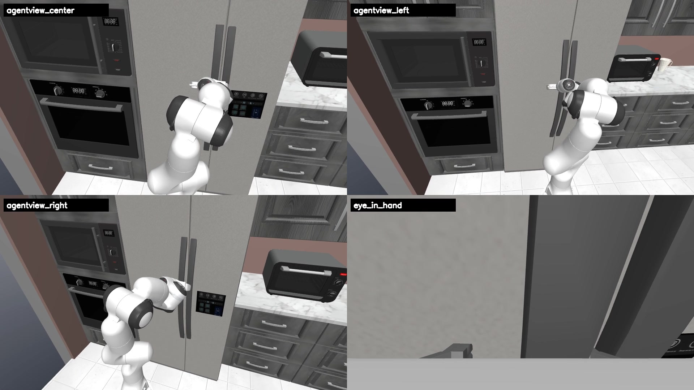
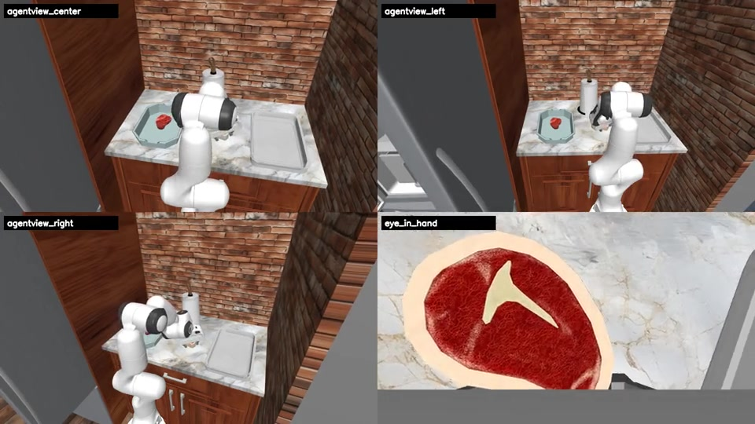
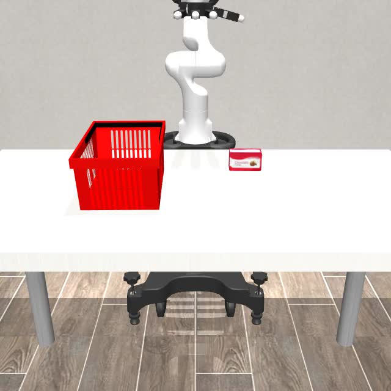
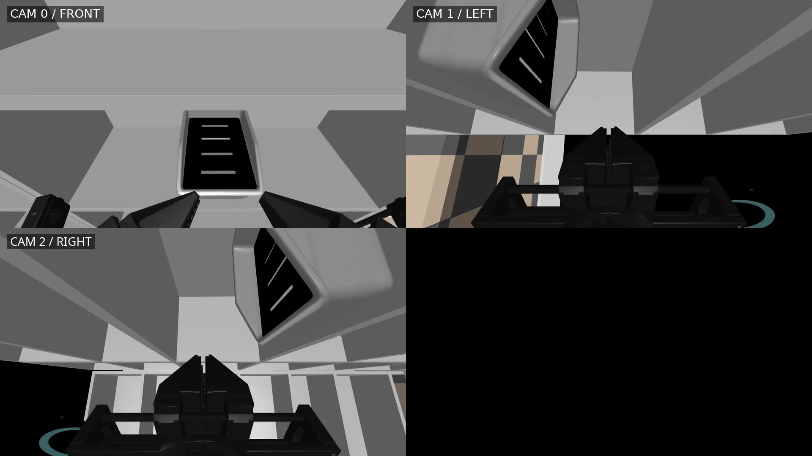
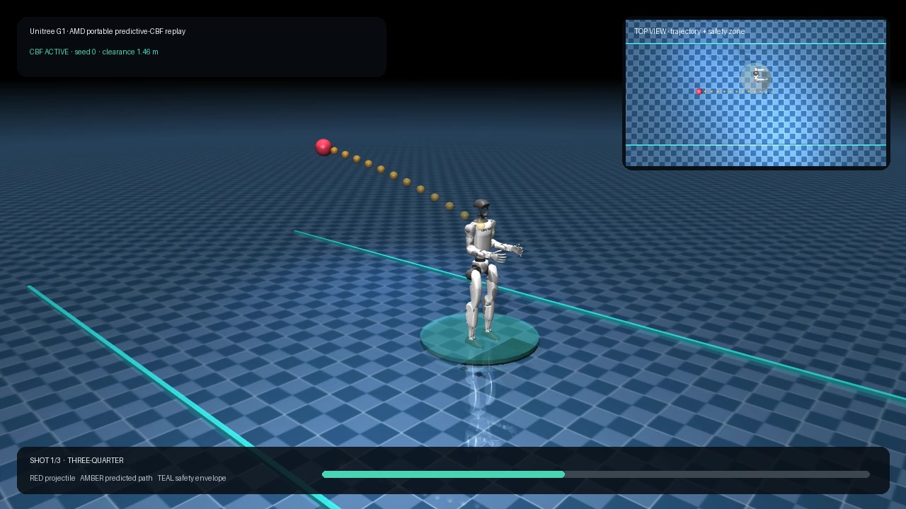

# Radeon Physical AI Evidence Suite

**Track 3: Physical AI**  
**Team: Datawhale-EAI**  
**Team members: Kewei Chen, Yayu Long**

**Project lead: Kewei Chen**

Radeon Physical AI Evidence Suite is an AMD-native robotics workflow spanning
policy training, closed-loop household and dexterous evaluation, simulator
migration, multi-view rendering, performance telemetry, and verifiable result
artifacts. It runs ROCm PyTorch and native ROCm JAX workloads on AMD Radeon PRO
W7900 and AMD Ryzen AI MAX+ 395 hardware.

<p align="center">
  
</p>

## Official Deliverables

| Requirement | Submission material |
|---|---|
| Technical report | [English PDF](datawhale-eai-radeon-physical-ai-technical-report.pdf) |
| Dedicated source repository | [Ethan-Chen-plus/radeon-physical-ai-evidence-suite](https://github.com/Ethan-Chen-plus/radeon-physical-ai-evidence-suite) |
| Frozen source release | [v1.0.2-amd-hackathon-final](https://github.com/Ethan-Chen-plus/radeon-physical-ai-evidence-suite/releases/tag/v1.0.2-amd-hackathon-final) |
| Reproducibility README | [Environment, dependencies, commands, and output contracts](https://github.com/Ethan-Chen-plus/radeon-physical-ai-evidence-suite/blob/v1.0.2-amd-hackathon-final/docs/REPRODUCIBILITY.md) |
| Demo video | [4:59 English 1080p film](https://ethan-chen-plus.github.io/amd-physical-ai-showcase/assets/videos/amd-physical-ai-demo-en.mp4) |
| Supplementary showcase | [English interactive project site](https://ethan-chen-plus.github.io/amd-physical-ai-showcase/) |
| Models | [SmolVLA](https://huggingface.co/Datawhale/every-embodied-smolvla-mujoco-pnp), [Pi0](https://huggingface.co/Datawhale/every-embodied-pi0-mujoco-pnp), [ACT](https://huggingface.co/Datawhale/every-embodied-act-mujoco-pnp), [RoboWits ACT](https://huggingface.co/Datawhale/robowits-act-amd-rocm) |
| Integrity and evidence | [Result JSON and validator](https://github.com/Ethan-Chen-plus/radeon-physical-ai-evidence-suite/tree/v1.0.2-amd-hackathon-final/evidence), [SHA manifest](SHA256SUMS) |

## Selected Results

| Workstream | Frozen result |
|---|---:|
| Every Embodied SmolVLA | **57/60** strict physical successes |
| RoboCasa365 GR00T | **230/800** over 16 tasks x 50 episodes |
| RoboCasa365 Pi0.5 | **142/800** over the same protocol |
| DexJoCo Pi0.5 | **5/11** at official seed 0; success examples archived for 10/11 tasks |
| DISCOVERSE | AIRBOT **12/12**, MMK2 **8/8**, and four three-view HD task replays |
| Unitree G1 predictive CBF | **8/8** fixed-seed replays, 0.422 m minimum clearance |

## Visual Evidence

<table>
  <tr>
    <td width="50%"><br /><b>RoboCasa365 household manipulation</b></td>
    <td width="50%"><br /><b>DexJoCo Pi0.5 dexterity</b></td>
  </tr>
  <tr>
    <td width="50%"><br /><b>DISCOVERSE multi-view simulation</b></td>
    <td width="50%"><br /><b>Unitree G1 whole-body safety control</b></td>
  </tr>
</table>

## AMD Radeon and ROCm Execution

- **AMD Radeon PRO W7900:** SmolVLA and ACT training.
- **AMD Ryzen AI MAX+ 395:** ROCm PyTorch/JAX inference, closed-loop
  evaluation, RoboCasa, DexJoCo, DISCOVERSE, MuJoCo/EGL, 3DGS, and profiling.
- **Measured SmolVLA full-forward latency:** 438.332 ms mean and 440.883 ms p95.
- **Measured simulator throughput:** 518.736 simulation steps/s.

## Reproduction Quick Path

```bash
git clone https://github.com/Ethan-Chen-plus/radeon-physical-ai-evidence-suite.git
cd radeon-physical-ai-evidence-suite
git checkout v1.0.2-amd-hackathon-final
python3 scripts/validate_public_bundle.py
```

Expected output: `PUBLIC_BUNDLE_OK`.

## Team Contribution

**Kewei Chen, project lead and primary maintainer:** system architecture,
ROCm/JAX migration, simulator integration, model training and evaluation,
evidence validation, technical report, demonstration film, and public website.

**Yayu Long, evaluation and learning experience contributor:** learner-facing
AMD environment and notebook validation, evaluation record and representative
video review, reproduction documentation, and final submission quality
assurance.
