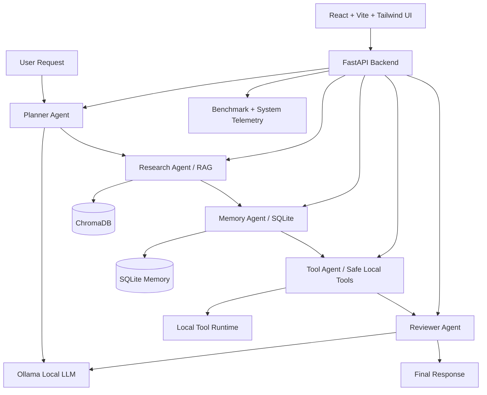

# AgentFlow AI Architecture Diagram

## Components

### Frontend
- **React + Vite + TailwindCSS**
- Dark modern UI with:
  - Chat interface
  - Agent status panel
  - Execution timeline
  - Benchmark dashboard
  - Document upload + selection
  - Conversation history

### Backend
- **FastAPI** for local REST APIs
- **SQLite** for conversations, persistent memory, and benchmark runs
- **ChromaDB** for offline vector retrieval
- **Ollama** for fully local LLM execution and model fallback

### Agent Pipeline
1. **Planner Agent** converts the user goal into a multi-step workflow.
2. **Research Agent** retrieves relevant chunks from local files via ChromaDB.
3. **Memory Agent** recalls recent turns and persistent SQLite memory.
4. **Tool Agent** runs safe local utilities like calculator, clock, and document inventory.
5. **Reviewer Agent** polishes the draft into a final answer.

### Fallback Behavior
- If **Ollama is offline**, AgentFlow AI does not crash.
- It returns a helpful error banner and falls back to deterministic planning/synthesis where possible.
- If a preferred model is missing, the app automatically tries the next model in this priority order:
  1. `qwen2.5:7b`
  2. `llama3.2:3b`
  3. `mistral:7b`
  4. First installed Ollama model if none of the above are present
