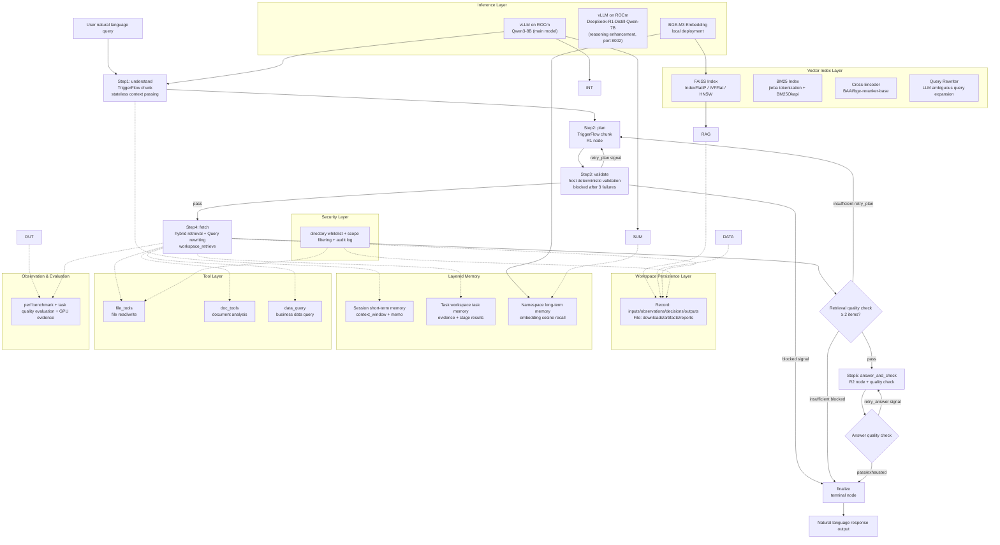
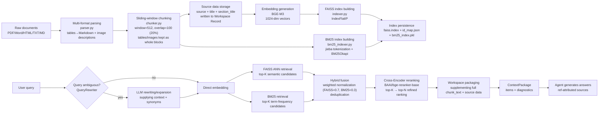
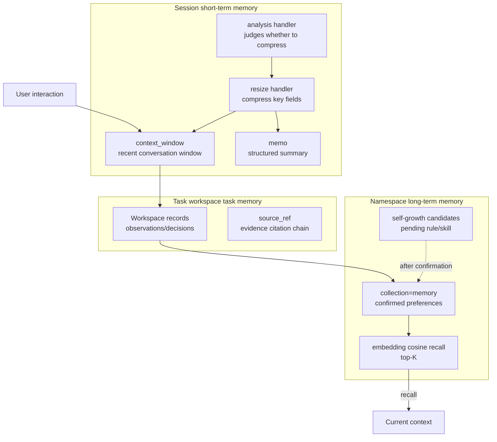
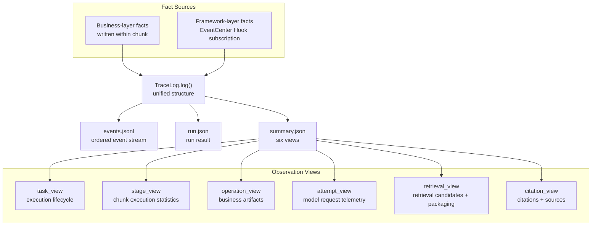
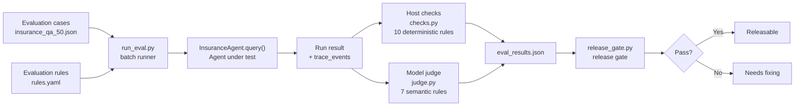
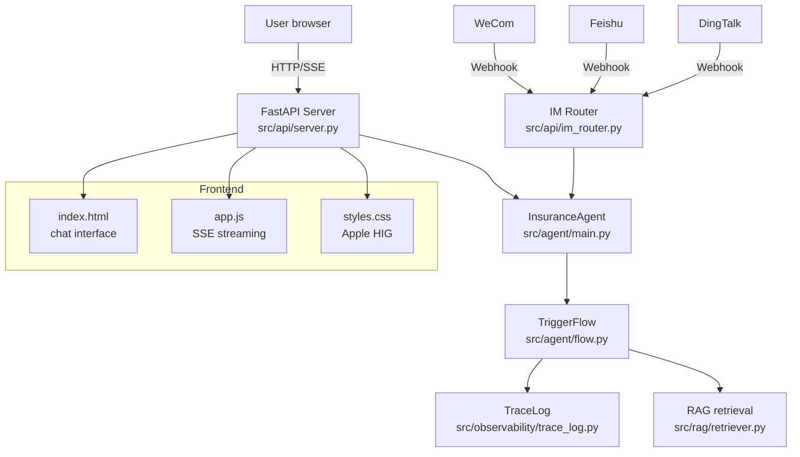

# Agent Architecture Diagram (Agent Architecture Diagram)

> Includes: model/inference layer, orchestration layer, tool layer, memory layer (short-term/long-term), data layer (RAG), observation & evaluation, security boundary

---

## Part 1: System Architecture Overview



---

## Part 2: RAG Data Pipeline Architecture



---

## Part 3: Layered Memory Architecture



---

## Part 4: Module Correspondence

| Architecture layer | Code module | File path | Reference lesson |
|--------|----------|----------|----------|
| Inference layer | vLLM integration (main model Qwen3-8B) | `src/config.py` `make_chat_agent()` | — |
| Inference layer | vLLM integration (reasoning-enhanced DeepSeek-R1-Distill) | `src/config.py` `make_reasoning_agent()` | — |
| Vector index layer | FAISS index management | `src/rag/indexer.py` | Lesson 19 |
| Vector index layer | RAG retrieval entry (hybrid retrieval + reranking) | `src/rag/retriever.py` | Lesson 19 |
| Document parsing layer | Multi-format document parsing (PDF/Word/HTML/TXT/MD) | `src/rag/parser.py` | Lesson 08 |
| Document parsing layer | Sliding-window chunking + source data storage | `src/rag/chunker.py` | Lesson 08 |
| Sparse retrieval layer | BM25 index building and retrieval (jieba tokenization) | `src/rag/bm25_indexer.py` | Lesson 08 |
| Reranking layer | Cross-Encoder precise ranking | `src/rag/reranker.py` | Lesson 08 |
| Query optimization layer | LLM Query rewriting (ambiguous query expansion) | `src/rag/query_rewriter.py` | Custom |
| Orchestration layer | TriggerFlow five-step business flow orchestration | `src/agent/flow.py` | Lesson 25 |
| Orchestration layer | Five-step function library (step1~step5) | `src/agent/pipeline.py` | Lesson 04, Lesson 07 |
| Orchestration layer | Agent main entry | `src/agent/main.py` | — |
| Tool layer | File read/write | `src/tools/file_tools.py` | Lesson 06 |
| Tool layer | Document analysis | `src/tools/doc_tools.py` | — |
| Tool layer | Business data queries | `src/tools/data_query.py` | — |
| Memory layer | Session management | `src/session/handlers.py` + `registry.py` | Lesson 20 |
| Memory layer | Three-layer memory definitions | `src/memory/layers.py` | Lesson 21 |
| Memory layer | Namespace recall | `src/memory/recall.py` | Lesson 21 |
| Memory layer | Self-growth candidates | `src/memory/growth.py` | Lesson 21 |
| Data layer | Document ingestion | `src/workspace/ingest.py` | Lesson 19 |
| Data layer | Packaging retrieval | `src/workspace/retrieve.py` | Lesson 19 |
| Security layer | Permission control | `src/security/permissions.py` | Custom |
| Security layer | Audit log | `src/security/audit.py` | Custom |
| Observation layer | Trace observability (business + framework facts) | `src/observability/trace_log.py` | Lesson 23 |
| Observation layer | Trace view viewer | `scripts/trace_view.py` | Lesson 23 |
| Observation layer | Performance benchmark | `scripts/benchmark.py` | — |
| Observation layer | RAG baseline | `scripts/benchmark_rag.py` | — |
| Evaluation layer | Host-based deterministic checks | `src/eval/checks.py` | Lesson 24 |
| Evaluation layer | Model semantic judge | `src/eval/judge.py` | Lesson 24 |
| Evaluation layer | Evaluation cases and rules | `src/eval/cases.py` + `rules.yaml` | Lesson 24 |
| Evaluation layer | Report & release gate | `src/eval/report.py` | Lesson 24 |
| Evaluation layer | Batch evaluation runner | `scripts/run_eval.py` | Lesson 24 |
| Evaluation layer | Release gate check | `scripts/release_gate.py` | Lesson 24 |
| Service layer | FastAPI web service | `src/api/server.py` | Lesson 25 |
| Service layer | API data models | `src/api/models.py` | Lesson 25 |
| Service layer | IM webhook routing | `src/api/im_router.py` | Lesson 25 |
| Service layer | Frontend chat interface | `static/index.html` + `app.js` + `styles.css` | Lesson 25 |

---

## Part 5: Trace Observability & Eval Evaluation Architecture

### 5.1 Trace Architecture (reference Lesson 23)

Trace records the runtime facts of one TriggerFlow execution without judging quality.



**Design principles**:
- Trace saves facts; Eval judges quality (the collection layer does not write quality scores)
- Business-layer facts are written by the chunk that owns the artifact (e.g., `business.fetch.retrieved` records the candidate count and packaged item count)
- Framework-layer facts are subscribed via a whitelisted Hook (without copying full Prompt/delta/secrets)
- `bounded()` limits strings to 2000 chars, lists to 50 items, and recursion depth to 8 levels

### 5.2 Eval Evaluation Architecture (reference Lesson 24)

Eval performs segmented quality judgments based on runtime facts, supporting host-based deterministic checks + model-based semantic judging.



**Release gate criteria**:

| Gate | Threshold | Description |
|------|------|------|
| Number of evaluation cases | >= 10 | Ensures statistical significance |
| Pass rate | >= 80% | At the end_to_end level |
| Failure rate | <= 10% | End-to-end failure ceiling |
| Key stage pass rate | >= 80% | retrieval + citation + answer |

### 5.3 Web Service Architecture (reference Lesson 25)



---

## Part 6: RAG Retrieval Architecture Selection: Custom Approach vs Agently Native Approach

> Review basis: [agently-request/references/knowledge-base.md](https://github.com/AgentEra/Agently-Skills/blob/main/skills/agently-request/references/knowledge-base.md)

### 6.1 Selection Conclusion

This project adopts a **custom retrieval pipeline** (FAISS + BM25 + Cross-Encoder) rather than Agently's native `RecordStore → ContextSource → ContextReader` chain. This is not an ad-hoc decision but a comprehensive trade-off based on ROCm hardware compatibility, competition scoring requirements, and performance controllability.

### 6.2 Reasons for Selection

**Reason one: Chroma is incompatible with this project's ROCm environment**

Agently's native `vector_store_provider="auto"` prefers Chroma, but AMD's official ROCm Infinity Hub shows Chroma supports only MI200/MI100/MI50 + ROCm v5.x [$TRAE_REF](https://www.amd.com/en/developer/resources/infinity-hub/chroma.html). This project's environment is gfx1100 (RX 7900 XTX) + ROCm 6.16.13, where Chroma cannot run and can only fall back to a SQLite vector table, completely losing GPU acceleration. FAISS's HIP backend natively supports AMD GPUs, with an 18x speedup verified on MI250 [$TRAE_REF](https://blog.csdn.net/gitblog_00702/article/details/151504966).

**Reason two: the native approach lacks BM25 hybrid retrieval and Cross-Encoder reranking**

`RecordStore.retrieve(method="auto")` does not support BM25 hybrid retrieval, and `ContextReader` has no built-in Cross-Encoder reranking stage. In the competition scoring, "functional completeness" (40 points) and "technical depth" (30 points) require demonstrating advanced techniques such as hybrid retrieval and reranking. With the native approach, these capabilities still need to be built from scratch and are no simpler than the custom approach.

**Reason three: the custom approach yields 4-5 additional quantifiable demonstration points on the ROCm scoring dimension**

| Scoring element | Custom approach | Native approach |
|---------|---------|---------|
| AMD GPU inference | LLM + **FAISS GPU** + **Cross-Encoder GPU** + **Embedding GPU** | LLM + Embedding GPU |
| Quantization optimization | LLM INT4 + **FAISS FP16** | LLM INT4 |
| Number of tunable parameters | 15+ | 3-4 |
| Quantifiable benchmark comparisons | 5+ groups (CPU vs GPU, Flat vs IVF, FAISS vs BM25, etc.) | 0-1 groups |
| Graceful degradation paths | 3 levels | 1 level |

**Reason four: significant FAISS performance advantage**

Benchmarking shows FAISS has an average query latency of 0.34ms, while ChromaDB is 2.58ms — FAISS is 7.6x faster [$TRAE_REF](https://www.xugj520.cn/en/archives/vector-database-comparison-chromadb-pinecone-faiss.html). On AMD GPUs, the FAISS IVF index is another 18x faster than CPU [$TRAE_REF](https://blog.csdn.net/gitblog_00702/article/details/151504966).

### 6.3 Boundary Mapping Between the Custom and Native Approaches

| Custom component | Corresponding Agently native component | Currently replaced? |
|---------|----------------------|------------|
| `records/*.json` + `FaissIndexer` | `RecordStore` (SQLite + vector index) | Yes — custom FAISS replaces it |
| `BM25Indexer` | No native equivalent | Custom supplement (native does not support BM25) |
| `CrossEncoderReranker` | No native equivalent | Custom supplement (native does not support Cross-Encoder) |
| `retrieve_context()` scope filtering | `ContextReader` + `ContextBudget` | Partial — the custom budget is a global hardcoded value |
| `RAGRetriever` | `ContextSource` + `TaskContext` | Yes — the custom call chain is shorter |

### 6.4 Known Limitations & Future Migration Path

**Known limitations**:
- No `ContextIndex` cache reuse (each `retrieve()` re-executes FAISS + BM25)
- No `Progressive Disclosure` (consumer-bound budgets, staged reads)
- No `Cross-Source` capability (integrating regulation libraries and case libraries in the future requires extension)
- `budget_chars=2000` is globally hardcoded and does not vary by consumer or stage

**Migration path** (planned after the competition):
- Phase 1: Migrate `records/*.json` to `RecordStore`, keeping the FAISS index
- Phase 2: Wrap a `RAGContextSource` adapter and connect it to `TaskContext`
- Phase 3: Use `ContextReader` to replace the budget trimming in `retrieve_context()`
- Estimated migration cost: 12-18 hours

---

## Part 7: Data Flow Description

### 7.1 Document Ingestion Process

```
User uploads document → parser.py multi-format parsing (PDF/Word/HTML/TXT/MD)
                         → extract text + tables (to Markdown) + image descriptions
                         → output ParsedDocument {title, source, sections[]}
                         → chunker.py sliding-window chunking (window=512, overlap=100, 20%)
                         → table/image paragraphs kept as whole blocks; text paragraphs split by sliding window
                         → each chunk carries source, title, section_title, section_type
                         → write_chunks_to_workspace → records/*.json (source data persistence)
                         → BGE-M3 embedding (batch of 32)
                         → FAISS index building + BM25 index building (jieba tokenization)
                         → index persistence (faiss.index + id_map.json + bm25_index.pkl)
```

### 7.2 Query Flow (including topology repair loop + RAG enhancement)

```
User asks → Step1: stateless context passing (P2-C, does not directly modify chat_agent)
         → [outer loop] Step2: R1 intent recognition (rag_query / data_query), supporting sub_queries fan-out (P2-D)
         → [inner loop] Step3: host deterministic validation, blocked after 3 failures (C3)
         → Step4: retrieval flow (R5 Query rewriting + hybrid retrieval + reranking)
           → [R5] Query ambiguous? → LLM rewriting/expansion (supplying context + synonyms)
           → FAISS ANN retrieval (top-K semantic candidates)
           → BM25 retrieval (top-K term-frequency candidates) (if BM25 is available)
           → hybrid fusion: weighted normalized scores (FAISS=0.7, BM25=0.3) + deduplication
           → Cross-Encoder reranking: top-K → top-N refined ranking (if reranker is available)
           → Workspace packaging (P0-A: pass to retrieve_context, supplement full chunk_text + source data)
         → P1 quality check: retrieval ≥ 2 items? if insufficient, fall back to Step2 retry (up to 2 times)
         → Step5: R2 generates answers based on evidence + ref-attributed sources
         → P3 quality check: answer length / citation count / ref markers? if not passed, fix loop (up to 2 times)
         → Session updates conversation history
         → Namespace updates long-term memory (as applicable)
```

### 7.3 Memory Promotion Process

```
Session short-term memory → analysis handler detects the window is too long
                → resize handler compresses it into a memo
                → key facts written to Task workspace (source_ref)
                → confirmed preferences promoted to Namespace (evidence_refs)
                → self-growth candidates generated (pending) → merged after confirmation
```