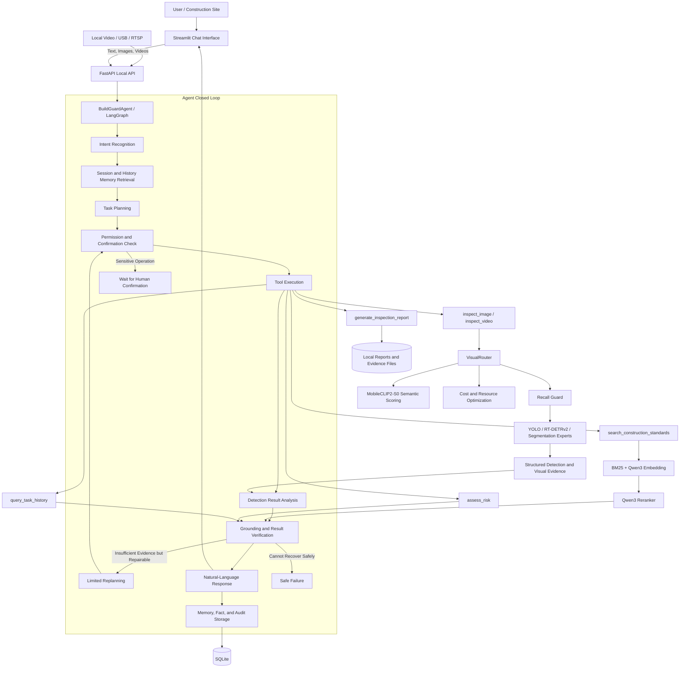
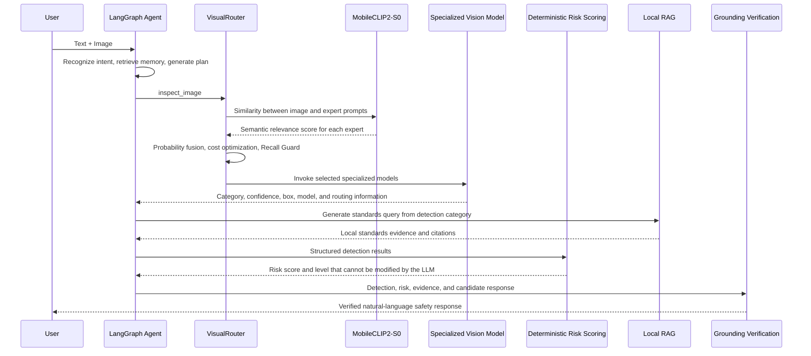
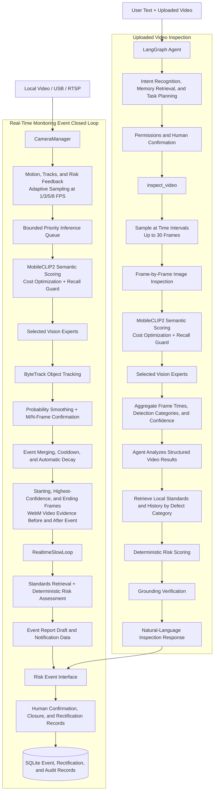

# BuildGuard-Radeon Project Overview

> Document version: 2026-08-05  
> Corresponding branch: `agent/mobileclip2-semantic-router`  
> Project positioning: A fully local, multimodal safety inspection and risk decision-making agent for construction sites

## 1. Project Overview

BuildGuard-Radeon combines a local large language model, specialized construction vision models, real-time video event detection, a construction standards knowledge base, deterministic risk scoring, and auditing mechanisms into a complete safety inspection agent. The system allows users to upload images and submit inspection requests in natural language. The code also provides a video attachment inspection tool and supports local video files, USB cameras, and RTSP surveillance streams.

Unlike traditional workflows that execute a fixed sequence of models after an image is uploaded, image and text requests enter the Agent through a unified path; video attachments enter the same main graph after the `inspect_video` tool is registered. The Agent identifies intent, plans tools, analyzes structured detection results, organizes knowledge retrieval by defect category, and ultimately generates a natural-language response with supporting evidence. The specific selection of specialized vision models is not delegated to the LLM. Instead, it is jointly performed by MobileCLIP2-S0 semantic scoring, the cost optimizer, and Recall Guard, preventing the LLM from guessing models or missing high-risk targets to reduce computation.

The system follows a local-first design. Model weights, images, videos, vector indexes, the SQLite database, reports, and audit logs all remain on the deployment host or within an explicitly permitted intranet environment, without relying on a cloud LLM.

## 2. Application Scenarios

### 2.1 Intelligent Construction Image Inspection

On-site personnel upload JPG/PNG images and submit inspection requirements in natural language. The Agent invokes vision inspection tools to identify:

- PPE issues such as missing hard hats and reflective vests;
- Concrete cracks, spalling, exposed reinforcement, and severe structural damage;
- Corrosion of reinforcement bars, steel plates, pipes, and metal components;
- Extended categories such as edge protection and honeycombing.

Instead of returning only a model label, the system returns the detection category, confidence, bounding box, source model, routing rationale, risk level, standards evidence, and manual review recommendations.

### 2.2 Surveillance Video and Real-Time Risk Events

The system can process uploaded videos, video files, USB cameras, and permission-constrained RTSP streams. Video processing includes adaptive sampling, object tracking, temporal smoothing, M/N-frame confirmation, event merging, and preservation of key evidence, reducing single-frame false positives.

Risk events retain the starting frame, highest-confidence frame, ending frame, and short video clips from before and after the event. Video evidence uses browser-compatible VP8/WebM; historical `mp4v` clips are automatically converted and cached during playback.

### 2.3 Construction Standards-Assisted Decision-Making

The Agent generates retrieval queries based on verified detection categories and performs BM25, vector retrieval, RRF fusion, and reranking in the local knowledge base. Advanced RAG can perform retrieval gating, conservative query rewriting, one corrective retrieval, and sentence-level grounding. When evidence is insufficient, the system explicitly refuses to provide a regulatory conclusion and does not fabricate standard names, clauses, or page numbers.

### 2.4 Risk Handling and Rectification Loop

The system uses deterministic rules to calculate risk scores and levels. It supports event confirmation, closure, corrective measures, assignee, rectification status, and evidence records. Report generation and sensitive status changes must pass permission checks; operations configured to require confirmation can be executed only after explicit user confirmation.

### 2.5 Historical Traceability, Auditing, and Performance Analysis

SQLite stores sessions, tasks, detection facts, risk events, tool calls, reports, and audit records. The performance page displays actually collected CPU, GPU, VRAM, temperature, power, video FPS, queue length, and processing-stage latency data; it also displays the model list registered in the configuration. Configuration registration does not mean that a model is actually resident in VRAM. When a collector is unavailable, the value remains empty and the reason is stated; random performance data is not generated.

## 3. Agent Architecture Diagrams

### 3.1 Overall System Architecture



### 3.2 Image Inspection Closed Loop



### 3.3 Video Inspection Closed Loop



### 3.4 Responsibility Boundaries

The LLM is responsible for intent understanding, tool planning, query organization, information synthesis, and natural-language expression, but it is not responsible for:

- Modifying vision confidence scores, bounding boxes, or deterministic risk scores;
- Fabricating objects that do not exist in an image;
- Directly specifying a particular specialized vision model;
- Fabricating regulations when no local evidence exists;
- Bypassing human confirmation to write reports, control cameras, or change event states.

VisualRouter is responsible for selecting combinations of experts. MobileCLIP2-S0 is its semantic scorer, not a second independent workflow: it enhances the relevance probabilities of candidate experts, after which the existing cost optimization and Recall Guard continue to be reused.

## 4. Core Capabilities

### 4.1 Agent Planning, Execution, and Verification

The main LangGraph graph contains nodes for intent recognition, memory retrieval, planning, permission checks, tool execution, inspection analysis, risk planning, result verification, limited replanning, response generation, memory storage, safe failure, and waiting for confirmation. A single task executes no more than the configured number of plan steps and limits the number of replans to prevent unbounded tool loops.

### 4.2 MobileCLIP2-Enhanced Vision Expert Routing

The routing process has four layers:

1. Extract features such as image quality, texture, motion, ROI type, and device load;
2. MobileCLIP2-S0 calculates similarity between the image and each expert's positive and negative prompts, then fuses it with priors and heuristic features;
3. The cost optimizer selects an expert subset based on semantic benefit, coverage, latency, VRAM, fixed invocation cost, and the number of models;
4. Recall Guard adds experts for high-risk, low-confidence, small-target, low-quality, and close Top1/Top2 scenarios.

When there are few model candidates, feasible subsets are enumerated; when there are many candidates, a deterministic greedy method is used. Video tracks use exponential smoothing to reduce frame-by-frame routing jitter. The router does not enable models configured as disabled or unsuitable for the current ROI.

### 4.3 Structured Vision Inspection

The vision service supports single-image, bounded-batch, and video-frame detection, and emits a unified structure: detection category, confidence, bounding box, source model, routing decision, manual review flag, and visual evidence. A corrupt image or a single expert failure is isolated and does not terminate the entire batch.

### 4.4 Real-Time Video Event Algorithms

The video pipeline consists of: video decoding → adaptive FPS sampling → bounded queue → expert inference → ByteTrack tracking → probability smoothing → M/N-frame temporal confirmation → spatial/track event merging → cooldown and automatic decay → storage of evidence frames and clips from before and after the event. Ordinary expired frames may be discarded, while risk-critical frames are retained with priority.

### 4.5 Deterministic Risk Scoring

The risk service calculates risk based on the category's base severity, location, evidence strength, duration, and occurrence frequency. The LLM can only explain the scoring result and cannot rewrite the score. This ensures that identical inputs produce reproducible risk levels.

### 4.6 Hybrid RAG and Safe Grounding

The knowledge base supports structure-aware chunking, BM25, Qwen3 Embedding, RRF fusion, and Qwen3 Reranker. The advanced pipeline adds retrieval gating, query rewriting, evidence quality evaluation, and one corrective retrieval. Final verification checks detection conclusions, risk levels, citation support, and unsupported inferences, returning a conservative refusal when evidence is insufficient.

### 4.7 Security, Permissions, and Traceability

- `PathGuard` restricts file access roots and prevents symbolic-link escape;
- `NetworkGuard` denies public model and tool endpoints by default;
- Pydantic validates API boundaries, Agent state, tool inputs and outputs, and report boundaries;
- Sensitive tools require explicit confirmation, and external documents and OCR content cannot modify the frozen control plan;
- SQLite and audit logs preserve sessions, facts, tool calls, events, and report chains.

## 5. Model Overview

The following information is based on the current `configs/competition` configuration. Model files are prepared offline by the deployer; the project does not automatically download weights. Production deployments should record the model revision, SHA-256, source, and license.

| Module | Current Model | Primary Responsibility | Current Status/Deployment Notes |
|---|---|---|---|
| Local LLM | Qwen3-14B-Q8_0 GGUF | Intent, planning, result analysis, responses, and query rewriting | Local llama.cpp service with an OpenAI-compatible interface |
| Semantic routing | MobileCLIP2-S0 | Calculate semantic relevance for PPE, crack, damage, and corrosion experts | Preloaded at API startup; GPU inference uses FP16 autocast; configured as ROCm `cuda` |
| PPE expert | `yolo11m_safety.pt` | `nohat`, `novest`, `person` | Enabled |
| Crack expert | YOLOv8 Crack-Seg `best.pt` | Road, wall, and concrete cracks | Enabled |
| Concrete damage expert | Kapuni YOLOv8s-Seg `best.pt` | Cracks, spalling, exposed reinforcement, and severe damage | Enabled |
| Corrosion expert | Deployment weight corresponding to `Basic_YOLO11_v1.pt` | Metal surface corrosion and corrosion levels | Enabled |
| RT-DETRv2 expert group | Crack, concrete surface, corrosion, and edge models | Detection extensions trained on specialized data | Enabled |
| Embedding | Qwen3-Embedding-0.6B | Vector retrieval of construction standards | Local Transformers, configured as ROCm `cuda` |
| Reranker | Qwen3-Reranker-0.6B | Reranking hybrid retrieval results | Local Transformers, configured as ROCm `cuda` |
| Open vocabulary | Grounding DINO-family Adapter | Conditional open-vocabulary localization for allowlisted categories | Disabled by default |
| Fine segmentation | SAM 2-family Adapter | Fine segmentation of area-based defects or localization results | Disabled by default |

## 6. Local Deployment

### 6.1 Recommended Deployment Topology

```text
Browser
  └─ Streamlit :8501
       └─ FastAPI :8000
            ├─ LangGraph Agent
            ├─ Vision / RAG / Risk / Video Services
            ├─ SQLite and Local Workspace
            └─ llama.cpp or vLLM ROCm :8080

AMD Radeon GPU
  ├─ Qwen3-14B Inference
  ├─ MobileCLIP2-S0
  ├─ Qwen3 Embedding / Reranker
  └─ Vision Experts Switched to a ROCm Device
```

Linux with a validated ROCm/PyTorch combination is recommended. ROCm PyTorch continues to use the `torch.cuda` compatibility API, so `device: cuda` in the configuration means an AMD GPU in a ROCm environment, not an NVIDIA GPU.

### 6.2 Model and Persistent Storage Directories

The competition configuration uses `/persistent/BuildGuard-Radeon-backup` by default. The main directories are:

```text
models/
  llm/qwen3-14b-q8/
  vision/mobileclip2-s0/
  vision/yolo11-ppe/
  vision/yolov8-crack-seg/
  vision/kompon-damage-severity/
  vision/yolov-corrosion/
  embedding/qwen3-embedding-0.6b/
  reranker/qwen3-reranker-0.6b/
workspace/
  uploads/  cameras/  knowledge/  indexes/
  events/images/  events/clips/
  database/  reports/  logs/  runtime/
```

### 6.3 AMD Host Preflight Checks

```bash
rocminfo
amd-smi metric --json
python -c "import torch; print(torch.cuda.is_available()); print(torch.cuda.get_device_name(0))"
buildguard probe-environment --config configs/competition/app.yaml
buildguard validate-config --config configs/competition/app.yaml
```

GPU performance acceptance may proceed only if PyTorch reports that the device is available and the device name is confirmed to be the target Radeon GPU.

### 6.4 Native Process Startup

The project provides environment and startup scripts:

```bash
source scripts/server_env_local.sh
source "$BG_VENV/bin/activate"
scripts/start_server.sh
```

The startup script validates the configuration, initializes the workspace and database, and starts local llama.cpp, FastAPI, and Streamlit in sequence. The default addresses are:

- LLM: `http://127.0.0.1:8080`
- API: `http://127.0.0.1:8000`
- UI: `http://127.0.0.1:8501`

### 6.5 ROCm Container Deployment

The base image must already contain mutually compatible ROCm, PyTorch, torchvision, and Triton versions. The project image does not install host drivers or download models. Before startup, set the validated image and persistent storage paths:

```bash
export ROCM_PYTORCH_IMAGE=<validated-ROCm-PyTorch-image>
export BUILDGUARD_PERSISTENT_ROOT=/persistent/BuildGuard-Radeon-backup
export BUILDGUARD_MODEL_DIR=/persistent/BuildGuard-Radeon-backup/models
export LLAMA_CPP_MODEL_FILE=llm/qwen3-14b-q8/Qwen3-14B-Q8_0.gguf
export LLAMA_CPP_IMAGE=<locally-built-llama.cpp-rocm-image>

docker compose --profile rocm-app up --build
```

The container must map `/dev/kfd` and `/dev/dri` and join the host's `render` and `video` groups. The Compose network remains internally isolated, and the API and UI ports are published only to the host loopback address.

### 6.6 Validation After First Startup

```bash
curl http://127.0.0.1:8000/health
buildguard db-check --config configs/competition/app.yaml
buildguard smoke-test --config configs/competition/app.yaml
python -m pytest -q
```

Then run a text conversation, image inspection, real-time event, standards retrieval, and report confirmation once each; after registering `inspect_video` with the Agent, also validate a chat video attachment. The performance page should confirm that GPU utilization and VRAM change during actual GPU inference.

## 7. AMD Radeon GPU Inference Speed Optimization

### 7.1 Optimization Principles

AMD Radeon GPU inference optimization follows these principles:

1. **Safety recall first**: Performance optimization must not come at the cost of missing high-risk targets. Vision routing first reduces low-value expert calls, and Recall Guard then adds detection capabilities for high-risk, low-confidence, small-target, and low-quality scenarios.
2. **Optimize actual bottlenecks**: Measure model loading, preprocessing, inference, postprocessing, data transfer, LLM time to first token, and total task latency separately. Optimize only real bottlenecks; do not substitute estimated latency from configuration for runtime measurements.
3. **Reduce ineffective computation**: Select only necessary vision experts through semantic routing, reduce repeated-frame inference through adaptive video sampling, and cache text features for stable prompts and semantic routing results for identical inputs.
4. **Improve throughput within the VRAM budget**: Control task admission based on available VRAM, concurrency, and safety headroom. When choosing batch sizes, consider throughput, per-request latency, and OOM risk together instead of blindly increasing the batch.
5. **Layered optimization with clear boundaries**: Apply workload-appropriate optimization methods separately to the LLM service, vision models, Embedding, Reranker, and video pipeline. Avoid treating one module's configuration label as whole-system GPU optimization.

### 7.2 LLM Inference Optimization

The provided `scripts/start_server.sh` uses the following llama.cpp parameters:

```text
-ngl 99       Offload as many network layers as possible to the GPU
-c 8192       Fix the context window to avoid unbounded context usage
-fa on        Enable Flash Attention when supported by the build
--jinja       Enable template processing when supported by the build
```

`-fa on` and `--jinja` are added only when the current llama.cpp build declares support for them in its help output. API requests pass `cache_prompt: true`; regular conversations and structured planning are configured as non-thinking, while complex replanning is configured as thinking.

### 7.3 Reducing Expert Calls Through Vision Routing

When `resident: true`, the API lifespan loads MobileCLIP2-S0 during startup and releases it during shutdown. Inference uses the configured FP16 computation through autocast on the ROCm `cuda` device; the model is still initially created in FP32, and the code does not perform offline FP16 weight quantization. Text features are cached within the process, and semantic routing results for identical images/ROIs use a bounded LRU cache.

VisualRouter fuses MobileCLIP2 semantic probabilities with heuristic probabilities, then selects an expert subset based on ROI, model reliability, and the estimated latency, estimated VRAM, and fixed invocation costs specified in the configuration. These costs are not real-time measurements. Recall Guard adds experts for empty routing, high-risk, low-confidence, small-ROI, low-quality, and close candidate-probability cases.

This implementation can reduce the number of experts invoked.

### 7.4 Mixed Precision, Batching, and Input Size

- MobileCLIP2-S0 uses FP16 during GPU inference;
- Image experts use a default input size of 640×640 to avoid uncontrolled inference on extremely large resolutions;
- YOLO, RT-DETRv2, Embedding, and Reranker all support bounded batches;
- YOLO, RT-DETRv2, Embedding, and Reranker reduce the batch size in their respective adapters when an OOM occurs;
- A single-image failure in a batch is isolated, allowing the remaining images to continue.

For non-OOM batch execution errors, the vision adapters also degrade to batch size 1, after which the vision service can isolate failures image by image.

### 7.5 Video Pipeline Optimization

Video inference is not performed on every frame. `AdaptiveMotionSampler` switches among the 1, 3, 5, and 8 FPS levels in the competition configuration based on inter-frame motion, active tracks, risk scores, and uncertainty, and uses hysteresis and hold times to avoid frequent oscillation. The inference queue and event queue have fixed limits; expired ordinary frames may be dropped, while key frames and high-priority frames are protected. ByteTrack, probability smoothing, and M/N-frame confirmation reduce single-frame false positives.

## 8. Summary

BuildGuard-Radeon's core value is the combination of Agent decision-making with deterministic safety boundaries: the LLM is responsible for understanding, planning, and expression; vision experts perform verifiable detection; MobileCLIP2-S0, cost optimization, and Recall Guard jointly select experts; the rule service supplies risk scores; local RAG provides standards evidence; and grounding and human confirmation prevent unsupported conclusions and sensitive erroneous operations.
