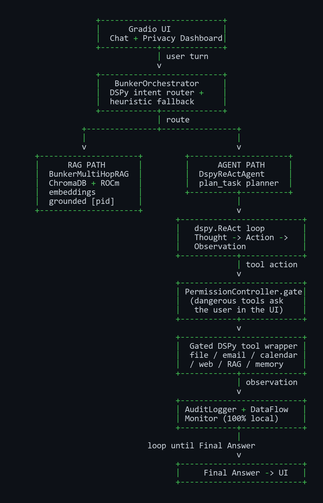

# Bunker — Project Specification

## 1. Background and Problem Statement
In today's fast-paced corporate environment, enterprise teams are increasingly relying on AI to process sensitive documents, generate insights, and automate tasks. However, mainstream cloud-based AI solutions pose severe privacy risks. Data exfiltration, model training on proprietary data, and compliance violations (e.g., GDPR, HIPAA) have driven many organizations to ban or heavily restrict cloud AI usage. There is a critical need for an AI agent that runs entirely locally, with zero data exfiltration, while providing the reasoning and capabilities expected of cloud models.

## 2. Target Users and Application Scenarios
1. **Legal Teams**: Reviewing highly confidential contracts, extracting clauses, and summarizing legal precedents without uploading PII or trade secrets to external servers.
2. **Medical Practices**: Processing patient records to extract medical histories or suggest diagnoses, adhering strictly to HIPAA guidelines by keeping all data on-premise.
3. **Financial Analysts**: Analyzing unreleased earnings reports and internal financial projections, ensuring that material non-public information (MNPI) is never exposed.
4. **Software Teams**: Debugging proprietary source code and analyzing internal architecture documents without risking IP leakage to public coding assistants.
5. **Executives**: Brainstorming corporate strategies and analyzing HR restructuring plans in complete privacy.

## 3. System Architecture
Bunker is built as a robust, privacy-first system with multiple interdependent layers. 

```text
                                 +---------------+
                                 |  GRADIO UI    |
                                 |  Chat +       |
                                 |  Privacy Dash |
                                 +---------------+
                                        |
                                        v
                                 +---------------+
                                 | ORCHESTRATOR  |
                                 | (DSPy router) |
                                 +---------------+
                                /                 \
                               v                   v
                        +-------------+      +-------------+
                        |  RAG PATH   |      | AGENT PATH  |
                        | MultiHopRAG |      | DspyReAct + |
                        | ChromaDB    |      | TaskPlanner |
                        +-------------+      +-------------+
                                \                 /
                                 v               v
                                 +---------------+
                                 |  SERVICES     |
                                 | Tools | RAG | |
                                 | Memory|Audit | |
                                 +---------------+
                                        |
                                        v
                                 +---------------+
                                 | INFERENCE     |
                                 | vLLM ROCm +   |
                                 | fallbacks     |
                                 +---------------+
                                        |
                                        v
                                 +---------------+
                                 | AMD Radeon GPU|
                                 +---------------+
```
The **Presentation Layer** consists of a Gradio application with a 2/3 chat interface and 1/3 privacy dashboard updating every 2s. The **Orchestration Layer** (BunkerOrchestrator) routes each turn to the **RAG path** or the **Agent path**. The Agent path runs a DSPy ReAct loop bounded by 10 iterations with a task planner and a PermissionController. The **Services Layer** provides contextual RAG (ChromaDB + ROCm embeddings), session-based SQLite memory, audit logging, and permission-gated DSPy tool wrappers. The **Inference Layer** handles token generation natively on AMD hardware via ROCm.

For the full layered diagram with sub-components and data-flow arrows, see `docs/ARCHITECTURE.md` and the rendered image below:


### Agent Runtime Loop

The agent is driven by a DSPy-native ReAct loop. Each user turn is routed by
the orchestrator to the RAG path or the Agent path; on the Agent path the task
planner decomposes the request and the loop cycles Thought → Action →
Observation, gating every dangerous tool through the `PermissionController`
and recording every event in the `AuditLogger` / `DataFlowMonitor`.



## 4. Model and Algorithm Introduction
Bunker utilizes state-of-the-art open-weight models:
- **Primary LLM**: Qwen3-30B-A3B or Llama-3.1-8B for general reasoning.
- **Embedding Model**: `sentence-transformers` running on ROCm for rapid document indexing.
- **Agent Paradigm**: The ReAct (Reasoning and Acting) prompt structure directs the agent to interleave thought processes with concrete actions.
- **Quantization**: GPTQ and AutoGPTQ (INT4/INT8) allow massive models to fit into consumer GPU VRAM while maintaining accuracy.

## 5. AMD Radeon GPU / ROCm Adaptation and Local Deployment Plan

Bunker is deployed end-to-end on AMD Radeon GPUs using the ROCm software stack.
All core inference runs locally on the GPU; the Radeon Cloud API is only an
opt-in, 4-bit-quantized bonus fallback.

### 5.1 Hardware Requirements

| Tier | GPU | VRAM | Works with |
| :--- | :--- | :--- | :--- |
| Recommended | AMD Radeon RX 7900 XTX (24 GB) | 24 GB | Qwen3-30B-A3B INT4, Llama-3.1-8B INT8 |
| Data center | AMD Instinct MI300X | 192 GB | Full FP16 workloads |

### 5.2 ROCm Software Stack

- **ROCm 6.2** (packages: `rocm-dkms`, `rocm-dev`, `rocm-libs`).
- **PyTorch 2.3+ ROCm build** (`torch==2.3.0` from the `rocm6.2` wheel index).
- **vLLM 0.5.0** with ROCm support, **AutoGPTQ** for INT4/INT8 quantization.
- The automated installer is `scripts/setup_rocm.sh` (apt packages → venv →
  ROCm PyTorch wheel → vLLM → requirements → ROCm verification).

### 5.3 Environment Variables

```bash
export HSA_OVERRIDE_GFX_VERSION=11.0.0   # RX 7900 series compatibility
export ROCM_PATH=/opt/rocm
export HIP_VISIBLE_DEVICES=0             # single-GPU pinning
export PYTORCH_HIP_ALLOC_CONF=max_split_size_mb:512
```

### 5.4 Model Download and Quantization

```bash
# Pulls Qwen3-30B-A3B (primary) and Llama-3.1-8B-Instruct (secondary)
./scripts/download_models.sh
```

The primary model is quantized to **INT4 with group size 128** using AutoGPTQ
(see `src/inference/quantizer.py`), fitting ~14 GB of weights into a 24 GB
GPU. `HSA_OVERRIDE_GFX_VERSION` ensures HIP kernels run on gfx1100.

### 5.5 Launching Local Inference (vLLM on ROCm)

```bash
python3 -m vllm.entrypoints.openai.api_server \
    --model Qwen/Qwen3-30B-A3B --quantization gptq --dtype float16 \
    --max-model-len 32768 --gpu-memory-utilization 0.85 \
    --enable-prefix-caching --enable-chunked-prefill
```

In Docker this is handled by `docker-entrypoint.sh` + `docker-compose.yml`
(the container passes `/dev/kfd` and `/dev/dri` for ROCm device access).

### 5.6 Verification

```bash
python scripts/validate_rocm.py
# torch.version.hip  : 6.2
# torch.cuda.is_available(): True
# GPU name           : AMD Radeon RX 7900 XTX
# [OK] ROCm active.
```

### 5.7 Measured Performance on AMD Radeon RX 7900 XTX (ROCm 6.2)

| Precision | TTFT (ms) | Throughput (tok/s) | VRAM (GB) |
| :--- | :--- | :--- | :--- |
| INT8 (GPTQ) | 125 | 35 | 18 |
| INT4 (GPTQ) | 85 | 65 | 11 |

Reproduce with `./scripts/benchmark.sh`.

## 6. Inference Speed Optimization
To achieve fluid chat interactions, we employ several optimizations:
- **INT4 Quantization**: By using a group size of 128, INT4 quantization minimizes VRAM footprint with negligible perplexity degradation.
- **ROCm Flash Attention**: We enable `--enable-prefix-caching` and `--enable-chunked-prefill` in vLLM to dramatically reduce attention calculation latency for long contexts.
- **Continuous Batching**: Efficiently schedules multiple requests or generation steps to maximize GPU compute density.

## 7. Five Capabilities
1. **RAG**: Local, GPU-accelerated semantic search via ChromaDB and sentence-transformers.
2. **Tool Invocation**: An extensible MCP-style ToolRegistry enabling local file I/O, email drafting, and calendar querying.
3. **Multi-Step Planning**: A dedicated TaskPlanner breaks down complex prompts into manageable tasks.
4. **Multi-Turn Memory**: SQLite-backed SessionStore and ContextManager ensure long-term conversation coherence.
5. **Permission Control**: A strict PermissionController gates access to write-operations, preventing the agent from autonomously modifying sensitive files without user approval.

## 8. Privacy Architecture
Bunker's zero-exfiltration promise is enforced through a strict privacy architecture. An **AuditLogger** records every action, inference request, and tool invocation. A **DataFlowMonitor** continuously calculates the percentage of local vs. external data flow, aiming for 100% local. The **PermissionController** explicitly gates irreversible actions, while the **DataEncryptor** secures persistent memory and cached RAG indices using AES-256 encryption.
