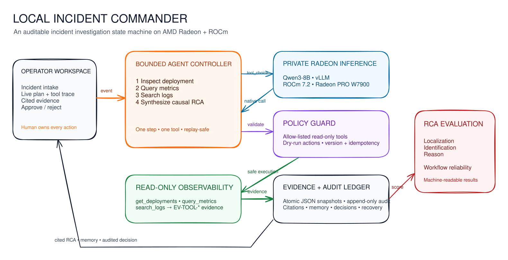

# Project Specification

## 1. Product summary

**Application:** Local Incident Commander  
**Competition:** AMD AI DevMaster Hackathon, Track 2: Agentic AI  
**Primary user:** An SRE or incident commander investigating a production outage  
**Reference scenario:** Checkout latency and elevated HTTP 5xx errors after a canary release

Local Incident Commander is a private SRE investigation agent that converts
heterogeneous operational evidence into a bounded plan, an auditable tool trace,
cited root-cause hypotheses, and simulation-only response decisions. Its core
competition deployment runs Qwen3-8B-AWQ locally through vLLM on AMD Radeon and
ROCm.

The application is intentionally narrow. It demonstrates how an agent can reason
over sensitive incident data without becoming a general-purpose command runner.

## 2. User problem

During an outage, operators must correlate deployments, metrics, logs, traces, and
service context under time pressure. The data can contain internal service names,
customer-impact details, infrastructure topology, and security-sensitive errors.
Sending it to an external model increases privacy and availability risk, while an
unbounded autonomous agent creates operational risk.

The product therefore optimizes for five properties:

1. local core inference;
2. a small, explicit investigation budget;
3. observable tools and evidence provenance;
4. graceful failure with partial results; and
5. human control over every proposed response.

## 3. Goals and non-goals

### Goals

- Complete one realistic incident investigation through genuine model tool calls.
- Show the plan, every tool request, every result, and every trusted citation.
- Keep incident evidence away from remote model endpoints on the Agent path.
- Preserve the session across browser reloads and server restarts.
- Produce safe, reversible response proposals without executing them.
- Remain useful when the model or a local demo adapter fails.
- Provide reproducible, machine-readable Radeon model-performance evidence.

### Non-goals

- Connecting to a production Prometheus, Loki, Kubernetes, or cloud account
- Running arbitrary shell commands or model-defined tools
- Automatically rolling back, scaling, restarting, or editing infrastructure
- Multi-user authentication, RBAC, tenancy, or collaborative incident rooms
- General-purpose planning beyond the fixed four-step SRE workflow
- Training or fine-tuning a model
- Redistributing or claiming results on AgenticOpsEval/RCA100

## 4. End-to-end workflow

1. The operator submits a validated incident with initial evidence.
2. The server creates a persisted session and a four-step plan.
3. The local model receives only the current goal, the fixed tool schemas, the
   incident, and evidence already in the session.
4. The server validates the selected tool and arguments, runs one read-only local
   adapter, and assigns trusted evidence IDs.
5. Deterministic retrieval refreshes the ranked hypotheses after each tool result.
6. After three tool steps, the fourth step synthesizes a concise commander brief
   and two simulation-only actions.
7. The operator approves or rejects each action. Decisions are immutable audit
   events; no command is executed.
8. The operator may ask follow-up questions. Answers use session memory and cite
   only known evidence IDs.

### Fixed plan

| Step | Goal | Tool/control |
| --- | --- | --- |
| 1 | Correlate impact with recent changes | `get_deployments` |
| 2 | Inspect golden signals and resource pressure | `query_metrics` |
| 3 | Inspect concrete error signatures | `search_logs` |
| 4 | Synthesize root cause and safe actions | Local model plus deterministic evidence controls |

The server, not the model, owns this order and the four-step budget.

## 5. Architecture



The editable Excalidraw source is [architecture.excalidraw](architecture.excalidraw).

```text
Operator workspace
       |
       v
Investigation HTTP API ---------> Atomic JSON session store
       |                                |
       |                                +--> append-only audit.jsonl
       v
Bounded orchestrator
       |
       +--> loopback OpenAI-compatible vLLM --> Qwen3-8B-AWQ on Radeon/ROCm
       |
       +--> validated read-only tool registry --> local demo adapters
       |                                            |
       +<---------------- server-owned evidence IDs-+
       |
       +--> deterministic retrieval and cited hypotheses
       |
       +--> simulation-only approval queue and session memory
```

### Component responsibilities

| Component | Responsibility |
| --- | --- |
| `agent.py` | State machine, step budget, fallback, citations, approvals, and idempotency |
| `tools.py` | Fixed JSON schemas, argument validation, and read-only checkout adapters |
| `store.py` | Atomic snapshots, corrupt-file quarantine, and audit append |
| `llm.py` | OpenAI-compatible completion, streaming, and native tool-call parsing |
| `analyzer.py` | Deterministic evidence retrieval, hypotheses, actions, and safe fallback |
| `server.py` | HTTP routes, payload limits, runtime verification, and static UI |
| `web/` | Three-column operator workspace and evidence navigation |

## 6. Agent controls

### Tool invocation

Only three tools are registered. Their schemas declare types and required fields;
server-side validation rejects unexpected or missing fields, non-object arguments,
the wrong service, unsupported enumerations, and out-of-range result limits. The
included adapters are read-only and labeled `local-demo-adapter` in every generated
evidence record.

The model cannot introduce a new tool. Selecting a tool outside the current step,
returning malformed arguments, timing out, or returning no tool call activates the
deterministic mapping for that step.

### Evidence ledger and citations

The server assigns IDs in the form `EV-TOOL-<session>-<sequence>`. Model output
cannot create a trusted evidence ID. Tool trace events, hypotheses, and follow-up
answers reference IDs from the persisted ledger. The original incident evidence
remains visible alongside collected tool evidence.

### Persistence and concurrency

Sessions are stored below `LIC_DATA_DIR` as atomic JSON snapshots. Each successful
mutation increments `version`. Clients provide `expected_version`, and stale or
concurrent mutations receive HTTP `409`. A printable ASCII `request_id` identifies
each mutation; replaying the same ID and payload returns the original result, while
reusing an ID with different content is rejected.

The threaded demo server uses a per-session in-process lock. A snapshot left with a
`running` step after interruption is recovered and retried on the next request. A
malformed snapshot is moved to quarantine without affecting other sessions.

### Human approval

Synthesis creates a low-risk canary rollback simulation and a deliberately riskier
database-pool change. Each has a reason, risk, safety note, approval status, and
dry-run command preview. Approve/reject decisions are immutable and appended to
the trace and audit log. There is no infrastructure command executor.

### Failure behavior

- Model failure: run the deterministic tool mapping or synthesis and mark runtime degraded.
- Invalid or repeated model tool call: reject it and use the bounded fallback where possible.
- Tool failure after fallback: preserve partial evidence and end the session as `degraded`.
- Interrupted step: retry it after restart and record the degraded recovery reason.
- Remote model configuration on Agent routes: block the model request and use local deterministic fallback.

## 7. Public API

### Request rules

- Request body limit: 1 MB
- `request_id`: 1-64 printable ASCII characters
- Follow-up content: 1-4,000 characters
- Session evidence limit: 100 records
- Mutations require `expected_version`, except creation

### Routes

| Method | Route | Request body |
| --- | --- | --- |
| `POST` | `/api/investigations` | `{request_id, incident}` |
| `GET` | `/api/investigations/{id}` | None |
| `POST` | `/api/investigations/{id}/next` | `{request_id, expected_version}` |
| `POST` | `/api/investigations/{id}/messages` | `{request_id, expected_version, content}` |
| `POST` | `/api/investigations/{id}/actions/{action_id}/decision` | `{request_id, expected_version, decision, comment?}` |
| `GET` | `/api/health` | None |

Successful investigation responses contain `schema_version: 1` and the complete
investigation snapshot. Errors contain a stable `code` and a user-readable `error`.

## 8. Local Radeon deployment

The competition launcher uses:

- Model: `Qwen/Qwen3-8B-AWQ`
- Runtime: vLLM with an OpenAI-compatible loopback endpoint
- Tool parser: Hermes
- Context length: 8,192 tokens
- Maximum concurrent sequences: 8
- GPU memory utilization target: 85 percent
- Execution mode: `--enforce-eager`

`/api/health` reports `local-radeon` only when all of the following are true:

- the configured model endpoint is loopback;
- the runtime-evidence model matches `LIC_LLM_MODEL`;
- ROCm version, GPU architecture, VRAM, compute units, and vLLM version are present;
- the evidence timestamp is valid and no more than 24 hours old.

Otherwise the runtime is labeled `local-unverified`, `remote-api`, or
`offline-safe`. The shared Radeon API is not the core competition path.

## 9. Radeon optimization evidence

The committed model microbenchmarks were recorded on 2026-07-30 on a Radeon PRO
W7900 with ROCm 7.2.1 and vLLM 0.16.1.dev. They compare the same model, prompt,
context length, generation length, and five-iteration protocol.

| Configuration | TTFT p50 | End-to-end p50 | Mean output rate |
| --- | ---: | ---: | ---: |
| Default compiled | 76.54 ms | 10.31 s | 15.64 tokens/s |
| Eager | 56.50 ms | 4.13 s | 39.35 tokens/s |

Eager mode was selected because it delivered about 2.5 times the output throughput
for this short, interactive incident workload and avoided expensive first-start
graph compilation.

This is verified model-level evidence. The repository does not yet contain a final
Radeon measurement of the complete current four-step workflow, so it makes no
claim about current Agent workflow p50 or p95 latency.

## 10. Competition scoring alignment

| Judging area | Implemented evidence |
| --- | --- |
| Functionality and application value (60 points) | Concrete SRE scenario; four-step workflow; three tool calls; cited evidence ledger; ranked hypotheses; persistent session memory; approval/rejection; visible fallback; operator UI |
| Radeon/ROCm local inference and optimization (40 points) | Local vLLM deployment; Qwen3-8B-AWQ; sanitized runtime attestation; measured Radeon PRO W7900 microbenchmarks; eager versus compiled comparison; machine-readable benchmark artifacts |

The project visibly implements four of the Track 2 capability categories: tool
invocation, multi-step planning, local multi-turn memory, and permission/privacy
controls. It also performs deterministic evidence retrieval, but does not rely on
a vector database or claim a separate vector-RAG implementation.

The scoring table maps implementation evidence to the published 60/40 judging
areas; it does not predict or claim a competition score.

## 11. Evaluation status

Automated tests cover validation, cited hypotheses, tool parsing, the four-step
loop, idempotency, concurrency, persistence, restart recovery, remote-core
blocking, approval immutability, fallback, runtime verification, and the HTTP API.

The implemented workflow benchmark runs two warmups followed by ten measured
four-step investigations. Its gate checks completion, all three tools, unknown
citations, remote core requests, and p95 latency. No result from the current Agent
on the competition Radeon runtime has yet been committed.

The included incident is synthetic. A lightweight evaluator supports
AgenticOpsEval-inspired `Localization`, `Identification`, and `Reason` fields. It
uses normalized exact-set F1 for the first two dimensions and evidence-checkpoint
recall for `Reason`, and always identifies its output as unofficial. No RCA100 data
is bundled and no RCA100 run or score is claimed. Dataset details and license
boundaries are documented in [agenticopseval.md](agenticopseval.md).

## 12. Acceptance criteria

- Three distinct tool events appear before synthesis.
- Every generated tool record has a server-owned evidence ID.
- Every displayed hypothesis cites known session evidence.
- A follow-up answer cites only known session evidence.
- Approval and rejection remain simulation-only and cannot be changed.
- Restart preserves the session without duplicating a completed tool call.
- Model failure remains visible and preserves partial evidence.
- A remote Agent runtime records zero remote core model requests.
- `local-radeon` requires fresh, matching sanitized runtime evidence.
- The final demo shows the real workflow on the competition Radeon instance.

Security assumptions and operational limitations are documented in
[SECURITY.md](SECURITY.md).
