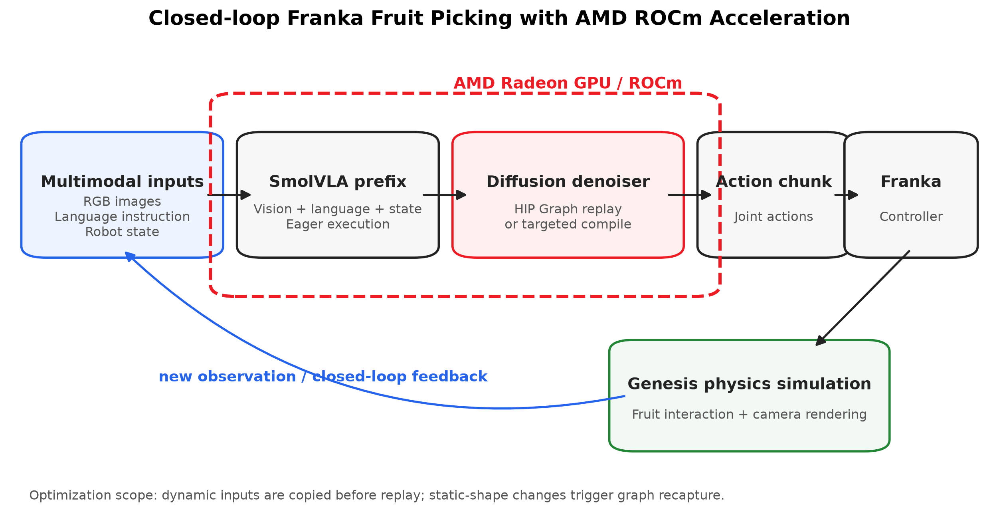
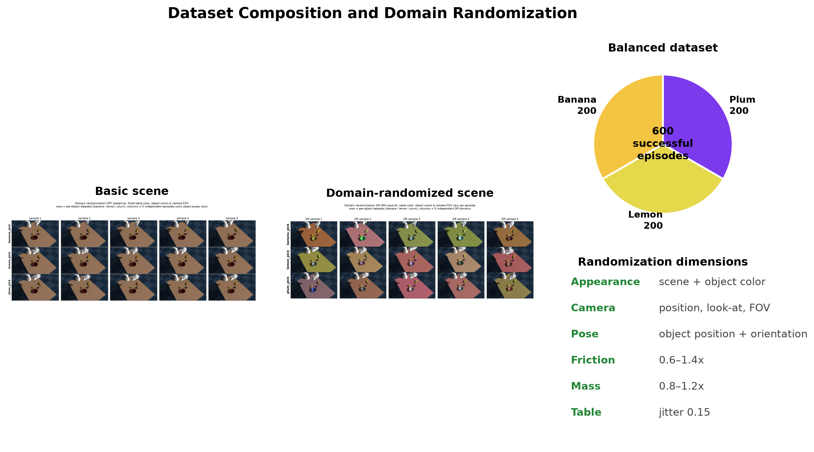
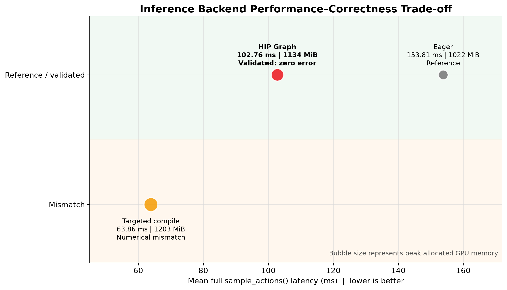
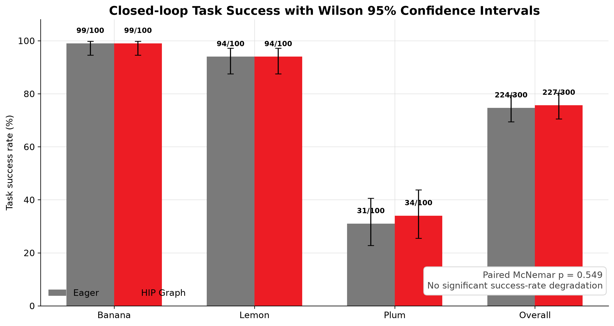
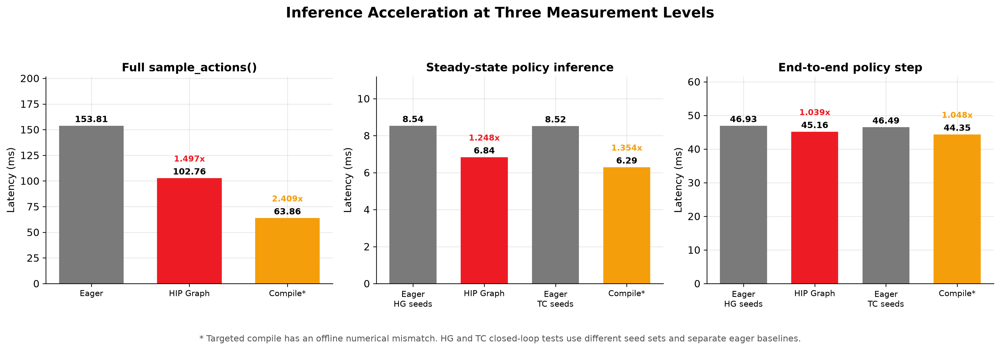
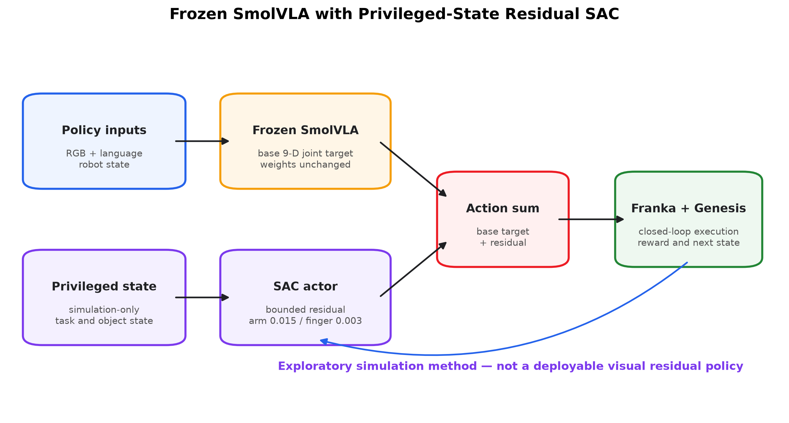
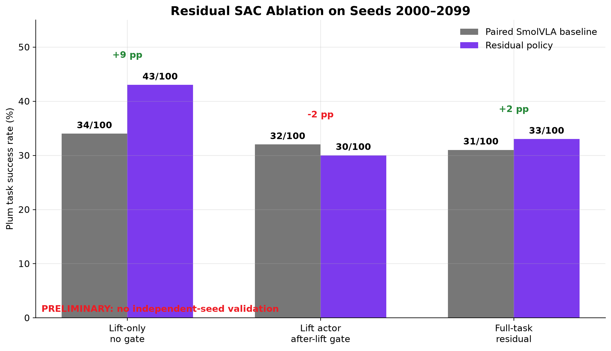
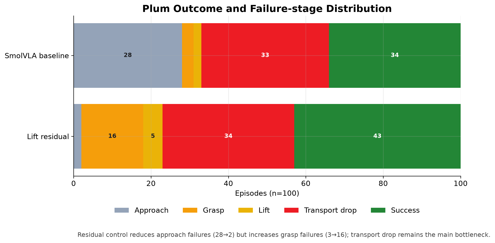

# 基于 AMD Radeon GPU 与 ROCm 的 Franka 多模态水果抓取系统

[English version](TECHNICAL_REPORT.md) | 中文版

## 技术报告

> 项目状态：比赛提交稿（基于截至 2026-08-05 已完成的实验）  
> 重要说明：本文只报告已经完成并保存结果的实验。未执行的工作统一列入第 12 节“后续实验计划”，不作为当前成果声明。

## 摘要

本项目面向非结构化水果分拣任务，在 Genesis 物理仿真环境中构建了由 Franka Panda 机械臂执行的视觉—语言—动作闭环系统。项目使用脚本专家生成 600 个成功操作回合，其中香蕉、柠檬和李子各 200 个；数据生成同时随机化外观、物体颜色、桌面、相机、物体位置姿态、摩擦系数和质量，以增强策略对环境变化的适应能力。在该数据集上对开源 SmolVLA 模型微调 20,000 步，batch size 为 128，并完成三类水果各 100 回合的闭环评估。

项目的主要工程贡献是面向 AMD Radeon GPU 与 ROCm 的 SmolVLA 推理优化。HIP Graph 后端将完整 `sample_actions()` 平均延迟由 153.81 ms 降至 102.76 ms，获得 1.497 倍加速，并在固定输入和变化输入上实现相对于 eager 基线的零数值误差。在 300 个闭环回合中，HIP Graph 将加权稳态策略推理延迟由 8.536 ms 降至 6.838 ms，获得 1.248 倍加速；任务成功数由 224/300 变为 227/300，精确 McNemar 检验 `p=0.549`，未观察到显著成功率下降。

项目还实现了 Targeted compile 实验后端。它将完整推理平均延迟降至 63.86 ms，获得 2.409 倍加速；在另一组 300 回合闭环实验中，将稳态推理延迟由 8.521 ms 降至 6.295 ms，获得 1.354 倍加速，成功数由 218/300 变为 222/300。由于严格离线验证发现最大绝对误差，Targeted compile 被定义为高性能实验后端，而不是当前默认部署后端。

针对李子抓取成功率较低的问题，项目进一步实现冻结 SmolVLA 加特权状态残差 SAC。当前 lift-only、无门控残差在 seeds 2000–2099 上将成功率由 34% 提高到 43%；该结果尚未在独立种子上验证，因此本文将其作为探索性结果，而非最终泛化结论。


## 1. 目标应用定义

### 1.1 应用场景

目标应用是面向水果、食品及其他易损不规则物体的柔性分拣系统。机器人需要根据视觉观测和语言任务指令，将桌面上的指定水果抓取并放入目标容器。

项目选择三种具有不同几何和物理特性的 YCB 物体：

- `011_banana`：香蕉，形状细长且姿态变化明显；
- `014_lemon`：柠檬，外形较规则但接触位置会变化；
- `018_plum`：李子，尺寸较小，抓取、抬升和运输阶段更容易失败。

### 1.2 输入、输出与闭环

系统输入包括 RGB 相机图像、语言指令和机器人状态。SmolVLA 生成动作块，控制 Franka 关节与夹爪；Genesis 完成接触、重力、碰撞、相机渲染和物体运动仿真，并返回下一时刻观测，形成感知—决策—控制闭环。

```text
RGB 图像 + 语言指令 + 机器人状态
                  ↓
              SmolVLA
                  ↓
              动作块
                  ↓
        Franka 控制与 Genesis 仿真
                  ↓
              新观测反馈
```

### 1.3 任务成功与评估

正式评估以每个 episode 的最终成功状态为核心指标，并记录终止步数、发散状态、首次及稳态推理延迟、推理调用次数和回合墙钟时间。报告同时使用配对成功一致性、精确 McNemar 检验和 Wilson 95% 置信区间描述后端切换是否改变任务能力。

## 2. 整体系统架构与解决方案

项目形成了从仿真数据生成到学习策略部署的完整流水线：

```text
Genesis 物理场景
      ↓
脚本专家 + Domain Randomization
      ↓
LeRobot 格式的 600 回合成功数据集
      ↓
SmolVLA 微调（20,000 步）
      ↓
Eager / HIP Graph / Targeted compile
      ↓
Franka 三水果闭环抓取评估
      ↓
冻结 SmolVLA + 残差 SAC（李子困难任务探索）
```




系统代码按功能分为：

- `franka_fruit_pick/`：场景、随机化、专家演示、数据记录、训练和闭环评估；
- `franka_fruit_pick/residual_rl/`：冻结 SmolVLA 上的残差 SAC；
- `optimization/amd/`：独立 AMD/ROCm 优化实验；
- `optimization/runtime/`：真实 `sample_actions()` 推理后端、正确性验证与闭环脚本；
- `docker/`：ROCm 7.2.1 开发和运行环境。

## 3. 仿真、专家策略与领域随机化

项目使用 Genesis 构建 Franka Panda、桌面、目标容器、三类水果和相机场景。脚本专家通过逆运动学和预定义操作阶段生成抓取、抬升、运输和释放动作，只将成功 episode 写入训练数据集。

数据生成启用了以下随机化：

| 类别 | 设置 |
|---|---|
| 外观 | 场景外观与物体颜色随机化 |
| 桌面 | `--dr-table-jitter 0.15` |
| 相机视场角 | `--dr-fov-jitter 2.0` |
| 相机位置 | `--dr-cam-pos 0.01` |
| 相机视线 | `--dr-cam-lookat 0.02` |
| 物体状态 | 初始位置和姿态随机化 |
| 摩擦系数 | 相对范围 `0.6–1.4` |
| 质量 | 相对范围 `0.8–1.2` |
| 场景重建 | 每 5 个回合重建一次外观随机化场景 |

随机化同时覆盖观测变化和物理变化，其目标不是让专家动作更复杂，而是减少策略对固定纹理、固定相机和单一接触参数的依赖。



## 4. 数据集

训练数据集位于 `artifacts/datasets/fruit_pick_dr_600ep`，repo-id 为 `demo/fruit_pick_dr_600ep`。

| 物体 | 成功 episode 数 | 占比 |
|---|---:|---:|
| 香蕉 | 200 | 33.3% |
| 柠檬 | 200 | 33.3% |
| 李子 | 200 | 33.3% |
| 合计 | 600 | 100% |

数据使用 LeRobot 格式保存机器人观测、相机帧、动作、episode 元数据及任务标识。完整数据体积较大，比赛发布时应通过外部制品存储或 Git LFS 提供，并附版本、大小、SHA256、许可证及下载脚本。仓库中不应复制多份相同数据。

数据和资产的合规边界如下：

- Franka 模型来自 Genesis 相关资产；
- 水果和容器模型来自 YCB/ManiSkill 资产链；
- 训练模型基于开源 SmolVLA/LeRobot；
- 正式提交应补充 `THIRD_PARTY_NOTICES.md`，逐项记录许可证和引用要求。

## 5. SmolVLA 微调

训练入口为`scripts/train_smolvla_fruit_pick.sh`，底层调用
`franka_fruit_pick/train_policy.py`和LeRobot 0.6.0训练器。最终checkpoint为：

```text
artifacts/models/smolvla_fruit_pick_dr_600ep
```

主要配置如下：

| 配置项 | 数值 |
|---|---:|
| 模型 | SmolVLA |
| 训练数据 | `fruit_pick_dr_600ep` |
| 训练步数 | 20,000 |
| Batch size | 128 |
| 保存间隔 | 2,000 步 |
| 训练接口 | LeRobot |
| 设备参数 | `--device cuda` |

原始checkpoint元数据确认最终状态为step 20,000、单进程、batch size 128。训练seed为1000，optimizer学习率为1e-4，scheduler warmup为1,000步、decay为30,000步；vision encoder冻结，仅训练expert和state projection。每2,000步保存一次，共保留`002000`至`020000`十个周期checkpoint。最终`model.safetensors`为906,712,520 bytes，SHA256为`a0e735af8bc127d103ba89b7c9a1fa1e94d025a4170403712cd6bf689038d99d`。

原始训练目录没有保留逐步loss日志，因此本文不提供无法由证据复原的loss曲线。模型质量由后续三类水果的闭环成功率评价，而不是用训练loss代替任务指标。

在 ROCm 版 PyTorch 中，HIP GPU 沿用 PyTorch 的 `cuda` 设备接口，因此脚本中的 `--device cuda` 指向 AMD GPU 后端，而不是证明系统使用了 NVIDIA CUDA。正式发布环境还应记录 `torch.version.hip`、GPU 型号和 ROCm 版本，以建立完整证据链。

## 6. SmolVLA 闭环任务能力与失败分析

本章只回答“微调后的SmolVLA学会了什么、在哪里失败”，使用Eager推理作为模型行为基线。GPU后端的性能、正确性和闭环行为保持统一放在第7章讨论。

### 6.1 评估设置

评估使用20,000步SmolVLA最终checkpoint，在Genesis中由模型直接闭环控制Franka。三类水果分别运行100回合，使用seeds 2000–2099；每回合根据目标物体是否被成功抓取、运输并放入碗中判定成功。Eager后端不改变模型执行路径，是后续所有加速后端的行为参考。

### 6.2 Eager模型基线

| 水果 | 成功数 | 成功率 | 任务判断 |
|---|---:|---:|---|
| 香蕉 | 99/100 | 99% | 高稳定性 |
| 柠檬 | 94/100 | 94% | 高稳定性 |
| 李子 | 31/100 | 31% | 当前困难任务 |
| 总体 | 224/300 | 74.7% | 三类差异显著 |

结果表明，同一个SmolVLA checkpoint已经学会香蕉、柠檬和李子的完整接近、夹取、抬升、运输与放置流程，但不同物体的鲁棒性差异明显。香蕉和柠檬具有较高容错空间；李子尺寸较小、可用接触面积有限，对末端位置、夹爪闭合时机和运输稳定性更加敏感。

### 6.3 成功与失败视频证据

[英文旁白成功与失败分析视频](video/smolvla_success_failure_demo.mp4)包含三类水果成功闭环、柠檬与李子失败录像、成功率以及失败原因说明。三个独立成功回合也可直接核验：

- [香蕉成功夹取与放置](video/success_examples/banana_success.mp4)
- [柠檬成功夹取与放置](video/success_examples/lemon_success.mp4)
- [李子成功夹取与放置](video/success_examples/plum_success.mp4)

所有成功视频均来自微调后SmolVLA的闭环评估，而不是脚本专家回放。当前保存的十个香蕉可视化回合全部成功，因此没有使用旧模型的香蕉失败录像代替；正式评估中的99%仍表明100回合内存在一次未保存为视频的失败。

英文视频同时介绍了部署评估，因此其中使用99%、94%和34%；这里的纯模型Eager基线是99%、94%和31%。两组数字来自同一seed范围的配对运行，后端归属、配对统计和差异解释统一见第7.5节，不能把3次成功差异解释为模型能力提升。

### 6.4 主要失败原因

已保存的柠檬和李子失败录像显示，高总体成功率并不排除个别接近、夹持或放置失败。对李子而言，主要风险可以按闭环阶段分为：

1. **接近偏差**：小目标使末端位置误差更容易造成错过或碰撞；
2. **抓取不稳定**：有限接触面积使夹爪可能未夹住或只形成弱夹持；
3. **抬升失败**：物体在离开桌面前滑脱，或没有达到有效抬升高度；
4. **运输掉落**：已经抓起的物体在移动到碗的过程中脱落；
5. **放置与判定边界**：物体接近碗但没有稳定落入成功区域。

因此，第6章的结论不是“展示了三个成功视频”，而是：SmolVLA已经具备三水果闭环操作能力，香蕉和柠檬较稳定，李子的抓取与运输鲁棒性仍是主要模型短板。这一问题直接引出第8章的Residual SAC探索。

## 7. AMD Radeon GPU 与 ROCm 应用

### 7.1 环境与优化范围

项目 Docker 环境以 ROCm 7.2.1、Python 3.12、ROCm 版 PyTorch 2.9.1、Triton 3.5.1、LeRobot 0.6.0 和 Genesis 为基础，并注明在 AMD Radeon AI PRO R9700 上验证。正式提交前仍需完成一次干净镜像构建和容器内 smoke test；这属于交付验证，不改变实验结论。

项目评测过混合精度、SDPA/Flash Attention、`torch.compile`、TunableOp/hipBLASLt、HIP Graph、Triton、BLAS 路由和图像内存布局。为了避免将微基准错误解释为端到端收益，正式结果重点报告真实 `sample_actions()` 和机器人闭环口径。

### 7.2 HIP Graph 后端

HIP Graph 只捕获 `sample_actions()` 内形状较稳定的 diffusion denoiser。图像、语言、状态 prefix 保持 eager；每次 replay 前复制动态 mask、KV cache 和 diffusion noise，静态形状发生变化时重新捕获。

严格验证使用相同输入、相同噪声和相同模型权重比较 eager 输出，覆盖固定输入及变化的图像/状态输入。修复 timestep frequency dtype 问题后，两类输入的最大绝对误差和 RMSE 均为 0。

### 7.3 Targeted compile 后端

Targeted compile 只编译 `model.sample_actions()` 内的 `model.denoise_step()`，配置为：

```text
backend = inductor
mode = max-autotune-no-cudagraphs
fullgraph = false
matmul_precision = high
```

已有完整推理测速和严格验证结果使用 `matmul_precision=high`。该后端获得最高稳态性能，但严格离线验证存在数值偏差：固定输入最大绝对误差 0.067798、RMSE 0.002732；变化输入最大绝对误差 0.023839、RMSE 0.001462。因此它被保留为实验后端，并在所有表格中明确标注，不与通过零误差验证的 HIP Graph 等同。

### 7.4 完整 `sample_actions()` 测速

| 后端 | Mean | P50 | P95 | Samples/s | 加速 | 首次调用 | 峰值显存 | 正确性 |
|---|---:|---:|---:|---:|---:|---:|---:|---|
| Eager | 153.81 ms | 151.94 ms | 154.93 ms | 6.50 | 1.000× | 1224.62 ms | 1022 MiB | 基准 |
| HIP Graph | 102.76 ms | 102.70 ms | 103.47 ms | 9.73 | 1.497× | 1558.50 ms | 1134 MiB | 固定/变化输入零误差 |
| Targeted compile | 63.86 ms | 63.30 ms | 66.14 ms | 15.66 | 2.409× | 23357.21 ms | 1203 MiB | 存在数值误差 |

Targeted compile 曾在独立冷缓存实验中观察到更长的首次编译时间，因此表中首次调用不能被解释为不同机器上的统一冷启动指标。正式部署应区分冷编译、磁盘缓存复用和稳态推理。



### 7.5 HIP Graph闭环A/B与任务行为保持

HIP Graph A/B使用与第6章相同的seeds 2000–2099，每种水果100回合。这里的重点不是重新评价SmolVLA学会了什么，而是验证推理加速后任务行为和成功率是否保持。

| 水果 | Eager 稳态 | HIP Graph 稳态 | 加速 | Eager成功 | Graph成功 |
|---|---:|---:|---:|---:|---:|
| 香蕉 | 8.623 ms | 6.778 ms | 1.272× | 99/100 | 99/100 |
| 柠檬 | 8.430 ms | 6.892 ms | 1.223× | 94/100 | 94/100 |
| 李子 | 8.546 ms | 6.842 ms | 1.249× | 31/100 | 34/100 |
| 加权总体 | 8.536 ms | 6.838 ms | 1.248× | 224/300 | 227/300 |



成功状态配对一致为289/300，精确终止步数一致为178/300。Eager失败而HIP Graph成功7次，Eager成功而HIP Graph失败4次；精确McNemar `p=0.549`。因此合理结论是“切换到HIP Graph后未观察到显著任务成功率下降”，而不是“HIP Graph提高了SmolVLA成功率”。

每策略步闭环墙钟耗时由 46.93 ms 降至 45.16 ms，约 1.039 倍。这说明模型推理收益被相机渲染、预处理、动作队列和物理仿真开销稀释。

### 7.6 300 回合闭环性能：Targeted compile

Targeted compile 使用 seeds 1000–1099，与 HIP Graph 的 seeds 2000–2099 不同；它只能与同组 eager 基线配对比较，不能使用成功总数直接和 HIP Graph 排名。

| 水果 | Eager 稳态 | Compile 稳态 | 加速 | Eager成功 | Compile成功 |
|---|---:|---:|---:|---:|---:|
| 香蕉 | 8.658 ms | 6.313 ms | 1.371× | 99/100 | 99/100 |
| 柠檬 | 8.654 ms | 6.397 ms | 1.353× | 95/100 | 94/100 |
| 李子 | 8.373 ms | 6.227 ms | 1.345× | 24/100 | 29/100 |
| 加权总体 | 8.521 ms | 6.295 ms | 1.354× | 218/300 | 222/300 |

成功状态配对一致 286/300，终止步数完全一致 159/300；eager 失败而 compile 成功 9 次，eager 成功而 compile 失败 5 次，精确 McNemar `p=0.424`。未观察到显著成功率下降，但该闭环统计不能消除严格离线数值偏差，因此 Targeted compile 仍属于实验后端。

每策略步闭环墙钟耗时由 46.49 ms 降至 44.35 ms，约 1.048 倍。



### 7.7 部署选择

| 场景 | 推荐后端 | 原因 |
|---|---|---|
| 默认演示与稳定复现 | HIP Graph | 零误差验证通过，闭环性能稳定 |
| 高性能研究 | Targeted compile | 速度更高，但存在数值偏差和编译开销 |
| 调试与参考 | Eager | 行为基准，便于定位问题 |

## 8. 残差强化学习

### 8.1 动机与方法

李子在三水果基线中只有 31%–34% 的成功率。为验证是否可以在不重新训练 SmolVLA 的情况下改进困难阶段，项目实现了特权状态残差 SAC：冻结 SmolVLA，根据仿真状态输出一个有界 9 维关节目标修正。

主要训练配置：

| 配置 | 数值 |
|---|---:|
| Task mode | lift |
| 训练步数 | 100,000 |
| Warmup | 10,000 |
| Batch size | 256 |
| Replay buffer | 500,000 |
| Gamma | 0.99 |
| Tau | 0.005 |
| Learning rate | 0.0003 |
| Arm residual scale | 0.015 |
| Finger residual scale | 0.003 |
| 训练 seeds | 3000–4999 |

最佳 checkpoint：

```text
artifacts/models/plum_residual_sac_lift/last.pt
```

最终checkpoint元数据确认为step 100,000、特权状态62维、残差动作9维。训练每10,000步保存一次，共有十个周期checkpoint及`last.pt`。训练日志包含361个完成episode，其中169个成功（46.8%），最后100个训练episode成功45次。由于这些episode产生于策略持续更新的在线训练过程，它们只用于监控优化状态，不能解释为held-out成功率；正式效果仍以seeds 2000–2099上的配对闭环评估34/100→43/100为准。



### 8.2 已完成的探索性结果

| 方案 | Baseline | Residual | 结果解释 |
|---|---:|---:|---|
| Lift-only，无门控，seeds 2000–2099 | 34/100 | 43/100 | 当前最好；尚未独立验证 |
| Lift checkpoint，抬升后硬关闭残差 | 32/100 | 30/100 | 硬门控无效 |
| Full residual | 31/100 | 33/100 | 运输掉落明显，未超过当前最好方案 |

无门控 lift 实验中，双方成功 26 回合，仅 baseline 成功 8 回合，仅 residual 成功 17 回合，双方失败 49 回合。它说明残差策略具有改善部分轨迹的可能，但尚不足以证明在独立环境分布上稳定提升。



进一步分析无门控 lift 实验的失败阶段：baseline 的接近失败、抓取失败、抬升失败、运输掉落和成功分别为 28、3、2、33、34 回合；Residual SAC 对应为 2、16、5、34、43 回合。残差控制明显减少了接近失败，但增加了抓取失败，且运输掉落几乎没有改善。这解释了为什么单纯扩大残差作用范围或使用硬门控没有稳定解决完整放置任务。



### 8.3 结果边界

- 当前残差策略依赖仿真特权状态，不是直接可部署的纯视觉策略；
- seeds 5000–5099 的独立验证尚未执行；
- Genesis AMD GPU 物理仿真跨进程不逐位确定；
- 43% 不写入摘要的正式性能主张，也不替代 SmolVLA 三水果基线；
- Full 和硬门控的负结果保留，用于说明阶段耦合和运输稳定性问题。

## 9. 创新点与关键技术贡献

1. **完整 Physical AI 流水线**：完成从 Genesis 物理仿真、专家数据、LeRobot 数据集、SmolVLA 微调到闭环控制的完整系统。
2. **多层领域随机化**：同时改变视觉外观、相机、初始状态和接触物理参数，而非只做图像增强。
3. **面向 VLA 扩散去噪器的模块级 HIP Graph**：保留动态 prefix，仅捕获适合静态图的 denoiser，并在 replay 前安全更新动态输入。
4. **性能与任务能力联合验证**：同时报告离线数值误差、完整模型延迟、闭环推理延迟、端到端墙钟和 300 回合成功率。
5. **高性能实验后端的诚实边界**：Targeted compile 达到 2.409 倍完整推理加速，但由于数值偏差不被包装成稳定部署结论。
6. **冻结 VLA 的残差 RL 探索**：在不修改基础模型的前提下，研究困难物体的动作修正，并保留失败消融作为后续设计依据。

## 10. 应用价值、优势与限制

### 10.1 应用价值

该方案适合扩展到食品分拣、农业采摘后处理、仓储柔性操作和小批量制造。其价值不只在于单次演示，而在于使用开源仿真、开源模型和 AMD GPU 建立可重复训练、可量化评估、可逐步优化的低门槛机器人学习路径。

### 10.2 项目优势

- 数据、训练、推理、闭环评估和优化链路完整；
- 不是仅展示成功视频，而是进行了每种水果 100 回合的统计评估；
- AMD/ROCm 应用进入真实模型和闭环控制路径；
- 同时呈现稳定后端与实验后端，避免单一性能数字误导；
- 对困难任务增加残差 RL 研究，而非掩盖李子低成功率。

### 10.3 已知限制

- 李子基线成功率较低；
- 当前结果全部来自仿真，尚未在真实 Franka 上验证；
- 模型侧 1.25–1.35 倍闭环稳态加速只带来约 1.04–1.05 倍端到端提升；
- Targeted compile 存在数值误差和显著冷编译成本；
- 残差 SAC 依赖特权状态且缺少独立种子验证；
- Genesis 跨进程物理轨迹不是逐位确定的。

## 11. 最终交付成果

| 交付物 | 形式/位置 |
|---|---|
| 项目源代码 | 本专用代码仓库 |
| Genesis 仿真与数据生成 | `franka_fruit_pick/`核心源码 |
| SmolVLA 训练 | `franka_fruit_pick/train_policy.py`、训练配置与外部checkpoint |
| ROCm 优化 | `optimization/runtime/`核心实现及`scripts/*rocm*`、闭环A/B入口 |
| 残差强化学习 | `franka_fruit_pick/residual_rl/`、配置与外部checkpoint |
| 历史训练记录 | `results/training/README_ZH.md`，基于checkpoint元数据与训练日志 |
| 正式实验数据 | JSON、CSV、Markdown 汇总及报告图表 |
| Docker环境 | `docker/Dockerfile` |
| 可复现说明 | `docs/REPRODUCIBILITY_ZH.md`及根目录中文README |
| 技术报告 | 本文档及计划导出的 PDF |
| 任务演示视频 | `docs/video/smolvla_success_failure_demo.mp4`，3分20秒、英文旁白；包含三水果成功、柠檬/李子失败、成功率及失败原因 |
| 独立成功视频 | `docs/video/success_examples/`中的香蕉、柠檬和李子三个闭环成功回合 |
| 视频预览 | `docs/video/preview.gif`，连续预览三类水果的成功回合 |

大型数据集和模型权重应作为版本化外部制品发布，并通过manifest提供下载地址与SHA256；三个精简成功视频随代码仓库提交，便于评委直接查看。

三个演示均来自微调后SmolVLA的闭环评估输出，而不是脚本专家的数据生成录像：

- [香蕉成功夹取与放置](video/success_examples/banana_success.mp4)
- [柠檬成功夹取与放置](video/success_examples/lemon_success.mp4)
- [李子成功夹取与放置](video/success_examples/plum_success.mp4)

视频提供三路同步视角，包括世界相机、腕部相机和第三人称视角，完整覆盖接近、夹取、抬升、运输与放置阶段。成功示例用于直观展示策略行为，模型能力结论仍以每类水果100回合的统计评估为准。

英文旁白合成视频进一步加入了正式保存的柠檬和李子失败录像，并解释三类水果99%、94%和34%的闭环成功率。当前保存的十个香蕉可视化回合全部成功，因此没有使用旧模型的香蕉失败录像替代。失败原因结合阶段统计说明：小物体对准误差会导致接近或抓取失败，有限接触面积会造成夹持不稳定，而运输掉落是李子任务的主要瓶颈。

## 12. 后续实验计划（未执行）

以下内容不属于当前实验结果，也不是本次文档生成过程的一部分：

1. 在 seeds 5000–5099 上独立验证无门控 lift residual；
2. 研究相同 seed 下 Genesis 跨进程非确定性；
3. 测试软门控、机械臂/夹爪残差分离和阶段式双 Actor；
4. 将特权状态残差蒸馏或替换为视觉残差策略；
5. 对 eager、HIP Graph、Targeted compile 使用完全相同 seed 做 A/B/C；
6. 增加端到端耗时分解、P99、峰值显存及冷/热缓存启动测试；
7. 定位 Targeted compile 的 BF16 累积、Inductor 融合和多步去噪误差；
8. 分析李子失败视频：未抓住、滑落、碰撞、运输掉落、放置失败和判定边界；
9. 完成真实 Franka 的控制频率、安全停止、异常回退和 sim-to-real 验证；
10. 将 ROCm 兼容性修复、测试或文档整理为上游开源贡献。

## 13. 团队成员与贡献

正式提交前请将以下占位内容替换为真实信息：

| 成员 | 角色 | 主要贡献 |
|---|---|---|
| Thomas Yang | 项目负责人 | 系统设计、任务定义与项目协调 |
| Thomas Yang | 仿真与数据 | Genesis场景、专家策略、领域随机化和数据集 |
| Yang Jing | 模型与评估 | SmolVLA训练、闭环评估和结果分析 |
| Thomas Yang | AMD优化 | ROCm、HIP Graph、Targeted compile和正确性验证 |
| Thomas Yang | 强化学习 | Residual SAC、奖励设计和消融实验 |

## 14. 复现入口与结果来源

- 中文项目入口：[`README_ZH.md`](../README_ZH.md)
- 英文项目入口：[`README.md`](../README.md)
- 中文复现入口：[`REPRODUCIBILITY_ZH.md`](REPRODUCIBILITY_ZH.md)
- 英文复现入口：[`REPRODUCIBILITY.md`](REPRODUCIBILITY.md)
- 完整推理后端：[`optimization/runtime/README.md`](../optimization/runtime/README.md)
- 残差强化学习：[`franka_fruit_pick/residual_rl/README.md`](../franka_fruit_pick/residual_rl/README.md)
- HIP Graph闭环汇总：`results/closed_loop/hip_graph/summary_100ep.md`
- Targeted compile闭环汇总：`results/closed_loop/targeted_compile/summary_100ep.md`
- 完整推理汇总：`results/runtime/summary.md`
- 残差SAC结果：`results/residual_rl/lift_no_gate_100ep.json`
- 香蕉成功视频：[`banana_success.mp4`](video/success_examples/banana_success.mp4)
- 柠檬成功视频：[`lemon_success.mp4`](video/success_examples/lemon_success.mp4)
- 李子成功视频：[`plum_success.mp4`](video/success_examples/plum_success.mp4)
- 英文旁白成功与失败分析：[`smolvla_success_failure_demo.mp4`](video/smolvla_success_failure_demo.mp4)
- 英文旁白稿与重建说明：[`NARRATION_EN.md`](video/NARRATION_EN.md)
- 三水果动态预览：[`preview.gif`](video/preview.gif)
- 新增比赛图表：[`figures/README.md`](figures/README.md)

报告依赖的精简汇总结果已复制到受版本控制的`results/`。训练数据和权重不进入Git，其下载URL、大小和SHA256由`artifacts/manifest.json`管理；URL尚未发布是当前发布阻塞项。

## 15. 参考文献

### 15.1 模型、机器人学习与数据集

[1] J. Shukor et al., “SmolVLA: A Vision-Language-Action Model for Affordable and Efficient Robotics,” 2025. [Online]. Available: [https://arxiv.org/abs/2506.01844](https://arxiv.org/abs/2506.01844)

[2] Hugging Face, “SmolVLA: Efficient Vision-Language-Action Model Trained on LeRobot Community Data,” 2025. [Online]. Available: [https://huggingface.co/blog/smolvla](https://huggingface.co/blog/smolvla)

[3] Hugging Face, “LeRobot: An Open-Source Library for End-to-End Robot Learning,” 2026. [Online]. Available: [https://arxiv.org/abs/2602.22818](https://arxiv.org/abs/2602.22818)

[4] B. Calli et al., “Benchmarking in Manipulation Research: The YCB Object and Model Set and Benchmarking Protocols,” *IEEE Robotics & Automation Magazine*, vol. 22, no. 3, pp. 36–52, 2015. [Online]. Available: [https://publications.ri.cmu.edu/benchmarking-in-manipulation-research-the-ycb-object-and-model-setand-benchmarking-protocols](https://publications.ri.cmu.edu/benchmarking-in-manipulation-research-the-ycb-object-and-model-setand-benchmarking-protocols)

### 15.2 仿真与领域随机化

[5] Genesis Embodied AI, “Genesis: A Generative and Universal Physics Engine for Robotics and Beyond.” [Online]. Available: [https://genesis-embodied-ai.github.io/](https://genesis-embodied-ai.github.io/)

[6] J. Tobin, R. Fong, A. Ray, J. Schneider, W. Zaremba, and P. Abbeel, “Domain Randomization for Transferring Deep Neural Networks from Simulation to the Real World,” 2017. [Online]. Available: [https://arxiv.org/abs/1703.06907](https://arxiv.org/abs/1703.06907)

[7] X. B. Peng, M. Andrychowicz, W. Zaremba, and P. Abbeel, “Sim-to-Real Transfer of Robotic Control with Dynamics Randomization,” 2017. [Online]. Available: [https://arxiv.org/abs/1710.06537](https://arxiv.org/abs/1710.06537)

### 15.3 强化学习

[8] T. Haarnoja, A. Zhou, P. Abbeel, and S. Levine, “Soft Actor-Critic: Off-Policy Maximum Entropy Deep Reinforcement Learning with a Stochastic Actor,” in *Proceedings of the 35th International Conference on Machine Learning*, 2018, pp. 1861–1870. [Online]. Available: [https://proceedings.mlr.press/v80/haarnoja18b.html](https://proceedings.mlr.press/v80/haarnoja18b.html)

[9] T. Johannink et al., “Residual Reinforcement Learning for Robot Control,” in *2019 International Conference on Robotics and Automation (ICRA)*, 2019. [Online]. Available: [https://arxiv.org/abs/1812.03201](https://arxiv.org/abs/1812.03201)

### 15.4 AMD GPU、ROCm 与推理编译

[10] AMD, “Using Graphs in HIP,” *ROCm Documentation*. [Online]. Available: [https://rocm.docs.amd.com/projects/HIP/en/latest/how-to/hip_runtime_api/hipgraph.html](https://rocm.docs.amd.com/projects/HIP/en/latest/how-to/hip_runtime_api/hipgraph.html)

[11] AMD, “HIP Graph API Tutorial,” *ROCm Documentation*. [Online]. Available: [https://rocm.docs.amd.com/projects/HIP/en/develop/tutorial/graph_api.html](https://rocm.docs.amd.com/projects/HIP/en/develop/tutorial/graph_api.html)

[12] AMD, *AMD ROCm Programming Guide*. [Online]. Available: [https://rocm-handbook.amd.com/_/downloads/amd-rocm-programming-guide/en/latest/pdf/](https://rocm-handbook.amd.com/_/downloads/amd-rocm-programming-guide/en/latest/pdf/)

[13] PyTorch, “torch.compile,” *PyTorch Documentation*. [Online]. Available: [https://docs.pytorch.org/docs/stable/generated/torch.compile.html](https://docs.pytorch.org/docs/stable/generated/torch.compile.html)

[14] AMD, *Getting Started with PyTorch on AMD Radeon AI PRO R9700 Series*. [Online]. Available: [https://www.amd.com/content/dam/amd/en/documents/products/graphics/workstation/radeon-ai-pro-rocm-pytorch-guide.pdf](https://www.amd.com/content/dam/amd/en/documents/products/graphics/workstation/radeon-ai-pro-rocm-pytorch-guide.pdf)
