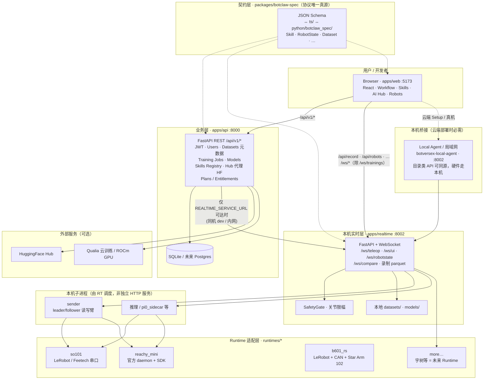
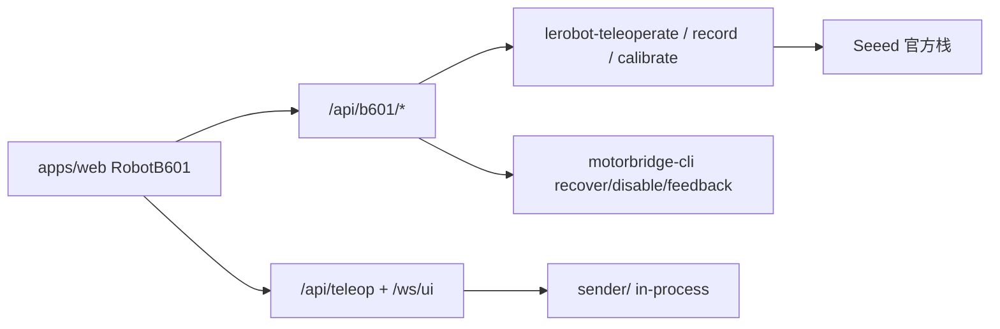

# BotverseX 系统架构

桌面机器人平台的逻辑分层：**Web 控制台**、**业务 API**、**本机实时层**、**Runtime 适配**与 **BotClaw 契约**。下图描述目标架构及云端/本机边界。

## 架构总览

## 分层说明

| 层 | 目录 / 进程 | 职责 |
| --- | --- | --- |
| Web | `apps/web` | 工作流、训练向导、Skills、遥操作 UI；经代理或 Local Agent 访问后端 |
| 业务 API | `apps/api` | 账号、权限、训练任务元数据、Skills 注册表、HF/Qualia 代理、`/api/v1/*` |
| 本机实时 | `apps/realtime` | 低延迟 WebSocket、录制、推理 compare、机器人状态、SafetyGate |
| Local Agent | 独立仓库 `botversex-local-agent` | 云端访问时，浏览器无法直连用户本机 `:8002` 时的 HTTPS 桥 |
| Runtime | `runtimes/*` | 硬件差异封装（SO-101、Reachy Mini、B601-RS 等） |
| 子进程 | sender、推理 sidecar | 由 realtime 拉起/调度，不对外暴露独立 HTTP；UI 不直连串口 |
| 契约 | `packages/botclaw-spec` | JSON Schema 为真源，同步 TS 与 Python Pydantic，避免三端字段漂移 |

## 请求路由与代理优先级

`/api/v1/*` 属于 `/api/*` 前缀。代理必须**先匹配更具体的路径**，再兜底。

### 本地开发（Vite，`apps/web/vite.config.ts`）

| 路径前缀 | 目标 |
| --- | --- |
| `/api/v1` | `apps/api` :8000 |
| `/api/urdf`, `/api/record`, `/api/status`, `/api/datasets`, `/api/playback`, `/api/inference`, `/api/runtimes`, `/api/robots`, `/api/hf`, `/api/camera`, `/api/vision_inference`, `/api/setup`, `/api/calibrate`, `/api/reachy`, `/api/teleop`, `/api/b601` | `apps/realtime` :8002 |
| `/api`（其余） | `apps/api` :8000 |
| `/ws/trainings` | API WebSocket |
| `/ws`（其余） | Realtime WebSocket |

可通过 `VITE_REALTIME_PROXY` 将 realtime 指到本机 Agent 的 HTTPS 地址。

### 生产（nginx，`infra/docker/nginx.conf`）

| 路径 | 目标 |
| --- | --- |
| `/api/v1/` | API |
| `/api/urdf/` | Realtime |
| `/api/`（其余，含未在 Vite 单列的路径） | Realtime |
| `/ws/trainings` | API |
| `/ws/` | Realtime |

生产环境与本地 Vite 的「未匹配 `/api` 兜底」策略略有不同：开发时未列出的 `/api/*` 仍可能落到 API；生产 nginx 将除 `/api/v1` 与 `/api/urdf` 外的 `/api/*` 默认交给 realtime。新增业务 API 路径时，两处配置需同步检查。

### 云端 + 真机（`apps/web/src/lib/localAgent.ts`）

- 目录类路径（如 `/api/robots`、`/api/runtimes`、`/api/urdf`）可走同源云端 realtime。
- 硬件控制、遥操作、录制等，在 Setup 检测到 Local Agent 后，改为请求用户本机 `https://localhost:8002`（或局域网地址）。

## API → Realtime 透传

`apps/api` 通过环境变量 `REALTIME_SERVICE_URL`（默认 `http://127.0.0.1:8002`）调用 realtime，例如录制、setup health、skills 与 runtime 元数据。

**仅当 API 进程能访问该 URL 时成立**（本机联调、内网同机部署）。若 API 部署在公网云端，不能直接访问用户家里的 `:8002`；应由浏览器 + Local Agent，或专用边缘代理完成桥接，而不是在云端 API 里写死 `127.0.0.1:8002`。

## BotClaw 契约（`packages/botclaw-spec`）

三端共享的协议源头：

1. **JSON Schema**（`schemas/`）— 变更时优先修改
2. **TypeScript**（`ts/`）— `apps/web` 消费
3. **Python Pydantic**（`python/botclaw_spec/`）— `apps/api`、`apps/realtime` 消费

原则见 `packages/botclaw-spec/README.md`：Schema 优先、小版本只增可选字段、`BOTCLAW_SPEC_VERSION` 双端对齐。

## B601-RS vs SO-101（M27）

| 维度 | SO-101 | B601-RS |
| --- | --- | --- |
| 硬件抽象 | `sender/` 进程内 Reader/Writer | 薄包装：spawn 官方 CLI（`/api/b601/*`） |
| 实时 3D | `/ws/ui` 关节流 | 遥操时 `GET /api/b601/joints` motorbridge 只读轮询 |
| 停止遥操 | SIGTERM sender | SIGINT→SIGTERM + `POST /api/b601/disable` 卸力 |
| 校准 | `/api/calibrate` 交互 | `POST /api/b601/calibrate/start` + Web 喂 ENTER |
| URDF | `so101.urdf` + assets | `static/urdf/b601_rs/` 官方 Seeed mesh |

## 相关文档

- [AGENT_HANDOFF.md](../AGENT_HANDOFF.md) — 里程碑、sender/串口排障
- [docs/strategy/README.md](./strategy/README.md) — 平台叙事与路线原则
- [apps/web/vite.config.ts](../apps/web/vite.config.ts) — 开发代理表
- [infra/docker/nginx.conf](../infra/docker/nginx.conf) — 生产反向代理
