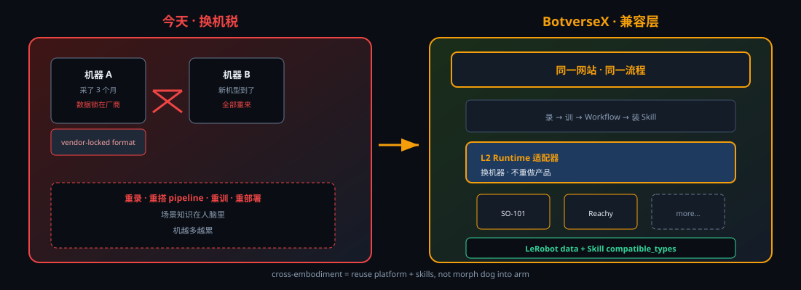

# 故事 Deck · 可选 AI 生成图清单

**当前状态：** 核心叙事图已用 **内嵌 SVG**（`assets/diagrams/*.svg`）实现，**不依赖 AI 也能投屏**。下面是你让人生成图时的 **加分项**，按优先级排序。

## 已有（不必重做）

| 文件 | 用途 |
|------|------|
| `diagrams/robot-swap-tax.svg` | 换机税 vs BotverseX |
| `diagrams/compatibility-layer-stack.svg` | 五层兼容层架构 |
| `diagrams/data-skill-pipeline.svg` | 场景→Skill→多机分发 |
| `botversex-dataset/training/workflow/skill.png` | 产品实拍大图 |

## 可选 AI 图（生成后放进 `assets/diagrams/`）

### P0 · 一张顶用（若只生成一张）

**文件名建议：** `hero-platform-hub.png`  
**尺寸：** 3840×2160（16:9）或 1920×1080  
**Prompt 要点：**

- 深色科技背景 `#0a0e14`，主色琥珀橙 `#f59e0b`
- 中央：发光「BotverseX」平台 hub（浏览器 + 云图标）
- 下方三台机器人剪影/示意：机械臂、小型人形、四足，用细线连到 hub
- 中间一层高亮标签：**「兼容层 Runtime」**
- 风格：等距 3D 或扁平矢量，**不要**写实照片、不要水印、不要虚构 logo
- 中文可选小字：「换机器人 · 只换适配器」

### P1 · 讲故事更直观

| 文件 | 内容 | Prompt 关键词 |
|------|------|----------------|
| `swap-tax-illustration.png` | 左：两台不同机器人中间打红叉「重来做」；右：同一平台接多台 | split screen, robotics infographic, dark UI |
| `skill-as-app.png` | 手机 App 图标网格 ↔ 机器人 Skill 卡片网格类比 | app store metaphor, orange accent |

### P2 · 会场背景墙 / 印刷

| 文件 | 内容 |
|------|------|
| `ecosystem-poster.png` | 产业链：场景→数据→Skill→多 Runtime，横版海报 |

## 生成后接入 Deck

在 `story-vision-2026.html` 对应 slide 把：

```html

```

换成或并列：

```html

```

SVG 保留作导出 PPT 的清晰矢量备选。

## 不要生成的（避免踩坑）

- 假 Unitree/华为/特斯拉 **合作** 标识  
- 带水印的网图  
- 「已支持所有机器人」类夸张实景  
- 与现有产品截图 **风格割裂** 的 3D 炫光机器人（除非整份 Deck 统一换视觉）
