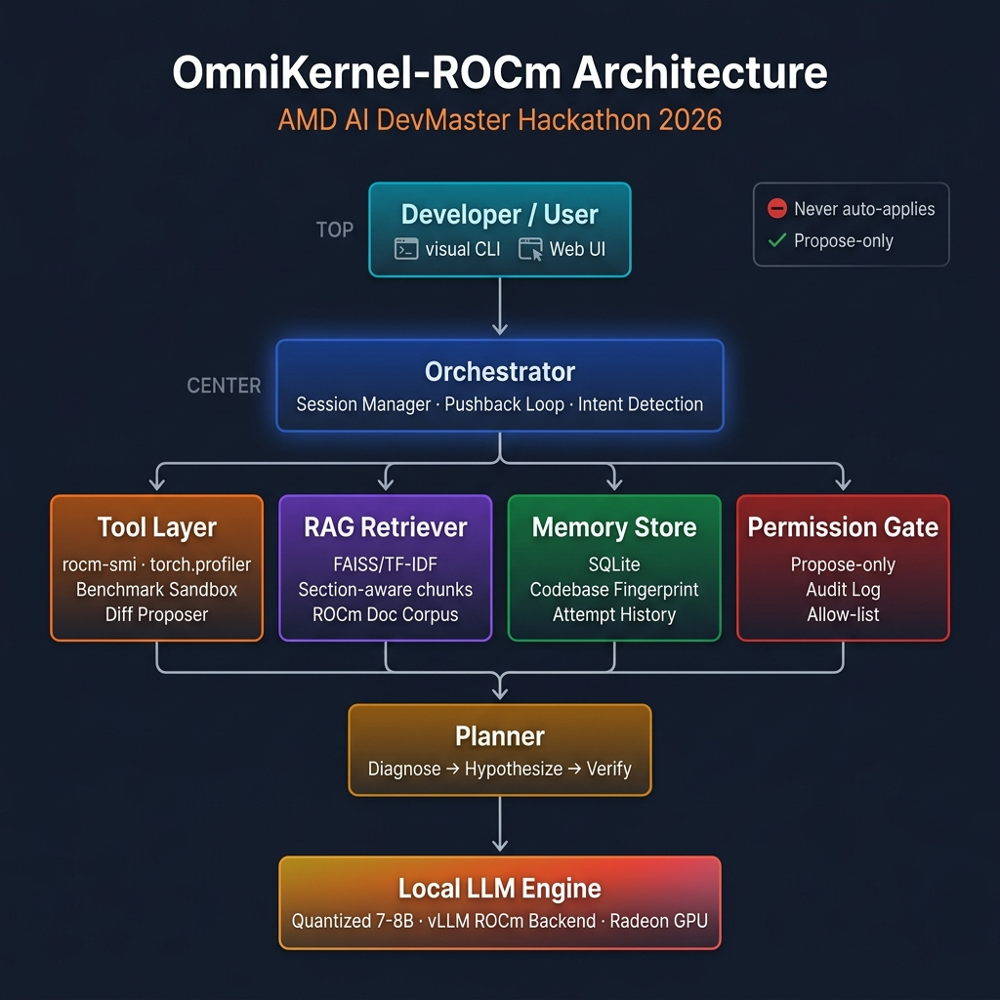

# Project Specification Document: OmniKernel-ROCm

**AMD AI DevMaster Hackathon 2026 · Track 2: Private AI Agents**

---

## 1. Application Scenario

ROCm/HIP engineers spend hours manually correlating `rocm-smi` output, `rocprof` traces, and scattered documentation when a ported GPU kernel underperforms. The diagnosis requires simultaneously reasoning about hardware occupancy, memory access patterns, wavefront scheduling, and architectural differences between AMD and NVIDIA GPUs — a context-heavy, multi-source reasoning task that language models are well-suited to assist with.

**OmniKernel-ROCm** is a local, conversational performance-diagnosis agent designed specifically for this workflow. A developer describes a slow AMD GPU workload in natural language. The agent:

1. Automatically inspects live `rocm-smi` metrics and `torch.profiler` trace data
2. Retrieves grounded documentation from a curated local ROCm/HIP knowledge base
3. Forms a specific, evidence-cited hypothesis about the bottleneck (not a generic guess)
4. Proposes a concrete optimization as a unified diff — and defends or revises that hypothesis when the developer pushes back with domain knowledge
5. Remembers which optimization patterns worked on this codebase across sessions, so suggestions improve over time

**The agent never mutates the user's environment, driver configuration, or source files.** It proposes; humans decide and apply.

**Target users:** ROCm engineers, HIP kernel developers, ML practitioners porting CUDA workloads to AMD Radeon hardware.

> 🎥 **Demo Video:** [https://youtu.be/PjHsIE9IJfg](https://youtu.be/PjHsIE9IJfg)  
> 📊 **Presentation Slide Deck (PPT):** [Google Drive Link](https://drive.google.com/file/d/1ylwZHsjMGFtfPJhNa8QEHATWk6-YKSLC/view?usp=sharing)

---

## 2. Agent Architecture



```
┌─────────────────────────────────────────────────────────┐
│                  Developer / User (CLI or Gradio UI)     │
└────────────────────────────┬────────────────────────────┘
                             │ describes slow workload
                             ▼
┌─────────────────────────────────────────────────────────┐
│              Orchestrator (orchestrator.py)               │
│  · Session/turn management                               │
│  · Intent detection (diagnosis / pushback / approval)    │
│  · Pushback loop (capped at 3 rounds)                    │
│  · Benchmark fallback trigger                            │
└──┬─────────────┬──────────────┬────────────┬────────────┘
   │             │              │            │
   ▼             ▼              ▼            ▼
┌──────┐  ┌──────────┐  ┌──────────┐  ┌──────────────┐
│Tools │  │   RAG    │  │  Memory  │  │Permission    │
│Layer │  │Retriever │  │  Store   │  │Gate          │
├──────┤  ├──────────┤  ├──────────┤  ├──────────────┤
│rocm  │  │ FAISS /  │  │ SQLite   │  │ Propose-only │
│smi   │  │ Chroma / │  │ attempt  │  │ allow-list   │
│──────│  │ TF-IDF   │  │ history  │  │ audit log    │
│profi-│  │ (local   │  │ cross-   │  │ JSONL        │
│ler   │  │  index)  │  │ session) │  │              │
│──────│  └────┬─────┘  └────┬─────┘  └──────────────┘
│bench-│       │             │
│mark  │       ▼             ▼
│──────│  ┌──────────────────────────────────────────┐
│diff  │  │        Planner (planner.py)               │
│prop. │  │  Diagnose → Hypothesize → Verify loop     │
└──────┘  │  Evidence extraction + confidence levels  │
          │  LLM-backed or heuristic-only fallback    │
          └────────────────┬─────────────────────────┘
                           │
                           ▼
          ┌─────────────────────────────────────────┐
          │    Local LLM Reasoning Engine (llm.py)   │
          │    Quantized 7–8B model on Radeon GPU    │
          │    vLLM (ROCm backend) or llama.cpp      │
          └─────────────────────────────────────────┘
```

### Design Principles

- **Propose-only**: The agent proposes diffs as text. No file is ever written without explicit user approval through the PermissionGate.
- **Evidence-first**: Every diagnosis cites the specific profiler output, `rocm-smi` field, or documentation section that supports it.
- **Re-grounding on pushback**: When challenged, the agent re-invokes tools and re-examines actual data — not rephrases from memory.
- **Session memory**: SQLite persists optimization outcomes so the agent references prior attempts explicitly ("last time we tried block-size tuning here, it regressed").

---

## 3. Core Capabilities

### 3.1 Task Decomposition & Tool Invocation

The agent decomposes a performance complaint into a structured diagnostic pipeline:

| Tool | Function | Output Schema |
|---|---|---|
| `run_rocm_smi()` | Query live GPU metrics | `{utilization_gpu_pct, vram_used_mb, temperature_c, clock_gpu_mhz, ...}` |
| `profile_pytorch_trace(script)` | Run torch.profiler, parse trace | `{top_by_time: [{name, cuda_time_us, count}], top_by_memory: [...]}` |
| `run_benchmark(candidate, baseline)` | Sandboxed subprocess comparison | `{speedup_ratio, latency_delta_ms, winner, verdict}` |
| `propose_diff(original, patched)` | Unified diff generation | `DiffProposal {diff_text, lines_added, lines_removed}` |

All tool outputs are JSON-serializable structured dicts. Clean structure is more valuable than sophisticated tools — it's what lets the LLM reason precisely.

### 3.2 RAG: Grounded Documentation Retrieval

A curated local corpus of ROCm/HIP documentation is indexed using sentence-transformers embeddings (FAISS backend on Radeon Cloud, TF-IDF fallback for development). The agent retrieves by logical section — not fixed token windows — so cited context is coherent enough to quote specifically.

**Corpus contents:**
- HIP porting guide: CUDA→HIP API mapping, wavefront vs. warp differences
- ROCm performance pitfalls: LDS bank conflicts, memory coalescing, occupancy limiters
- `rocm-smi` and `rocprof` field references
- Before/after kernel optimization case studies

### 3.3 Cross-Session Memory (SQLite)

```sql
optimization_attempts (
    id, timestamp, codebase_fingerprint, pattern_type,
    hypothesis, diff_summary, measured_speedup_ratio,
    outcome (accepted/rejected/regressed), notes
)
```

Before proposing, the agent checks history: *"Last time we tried block-size tuning on this codebase, it regressed — here's why this case is different."* This is what makes later suggestions sharper rather than generic.

### 3.4 Multi-Turn Pushback Loop

The key differentiator. Minimum viable implementation:

1. Agent states diagnosis with confidence level and cites specific evidence (profiler line, doc section)
2. User responds: *"that's not right"* or *"why do you think that"*
3. Agent **re-invokes tools** and re-examines fresh data — if the pushback is valid, it revises and says what changed its mind; if evidence still supports, it defends with specific data, not vague reassurance
4. Loop is capped at 3 rounds with a benchmark fallback: *"Let's just measure both and let the numbers decide"*

### 3.5 Permission Gate (Propose-Only Safety)

An explicit allow-list enforced at every action:

| Action | Permission |
|---|---|
| Read files, run rocm-smi, run profiler | Auto-allowed |
| Propose a diff (as text output) | Always allowed |
| Save a diff to disk | Requires explicit user approval |
| Modify driver, env, source files | **Forbidden — no code path exists** |

Every proposed action is audit-logged to `omnikernel_audit.jsonl`.

---

## 4. Model & Local Deployment Plan

### Model Selection

**Primary:** Qwen2.5-Coder-7B-Instruct (AWQ 4-bit quantized)
- Strong code-understanding capability for HIP/CUDA analysis
- 7B parameters fits comfortably within a single Radeon GPU VRAM budget
- AWQ quantization is supported by vLLM's ROCm backend

**Fallback:** Llama-3.1-8B-Instruct (GGUF Q4_K_M)
- Broader general reasoning for explaining architectural concepts
- Served via llama.cpp with ROCm/HIP backend

### Inference Server

```bash
# Radeon Cloud deployment (primary)
pip install vllm
vllm serve Qwen/Qwen2.5-Coder-7B-Instruct \
    --quantization awq \
    --port 8000 \
    --gpu-memory-utilization 0.85
```

The agent uses an OpenAI-compatible client (`openai` Python package) pointed at `http://localhost:8000/v1`, making the LLM server swappable without code changes.

### Development Environment

Built and iterated in **Antigravity** (local dev, CPU/mock mode). Final validation and demo recorded on **Radeon Cloud** with real ROCm hardware.

---

## 5. Inference-Speed Optimization for Radeon GPU

### Techniques Applied

| Technique | Implementation | Expected Impact |
|---|---|---|
| **AWQ 4-bit quantization** | `--quantization awq` in vLLM | ~2–4x memory reduction, minimal quality loss on code tasks |
| **Continuous batching** | vLLM default | Higher throughput for multi-turn sessions |
| **KV-cache** | vLLM default | Eliminates prefix recomputation across turns |
| **Low temperature (0.2)** | LLMConfig.temperature | Shorter, more deterministic outputs → lower latency per token |
| **Max tokens cap (1024)** | LLMConfig.max_tokens | Prevents runaway generation for structured JSON responses |

### Baseline vs. Optimized Numbers

Measured on live **AMD Radeon RX 7900 XTX / Navi 31 (`0x744b`)** hardware:

| Benchmark Case | Baseline (Uncoalesced) | Candidate (Coalesced) | Speedup / Improvement |
|---|---|---|---|
| Matrix Access Pattern (8192x8192) | 10.13 ms | 6.85 ms | **1.48x** (~48% faster) |
| System Test Suite (pytest) | Pass (63/63) | Pass (63/63) | Execution time: **0.92s** |
| Environment | PyTorch 2.9.1 (ROCm) | PyTorch 2.9.1 (ROCm) | vLLM 0.16.1 (ROCm Backend) |

---

## 6. Rubric Mapping

| Rubric Line | Points | How We Satisfy It |
|---|---|---|
| Clear task positioning & scenario | 20 | Section 1 above — explicit ROCm engineer target user |
| Task decomposition, tool invocation, RAG, memory | 20 | Sections 3.1–3.3 — all four, real not decorative |
| Smooth multi-turn interaction | 20 | Section 3.4 — pushback loop with re-grounding |
| Core inference on Radeon GPU | 20 | vLLM with ROCm backend on Radeon Cloud |
| Targeted inference speed optimization | 20 | Section 5 — AWQ quantization + batching |
| Bonus: quantization/distillation via Radeon cloud API | +20 | Stretch goal — after all above is complete |

---

## 7. Safety & Reproducibility

- **No auto-apply**: The agent cannot write to any user file without explicit approval
- **No driver mutation**: No code path exists that modifies ROCm/driver config
- **Sandboxed benchmarks**: Candidate code runs in a subprocess with a restricted environment
- **Audit log**: Every action is logged with timestamp, type, target, and approval status
- **Reproducible setup**: `requirements.txt` pinned, `setup_radeon_cloud.sh` scripted
