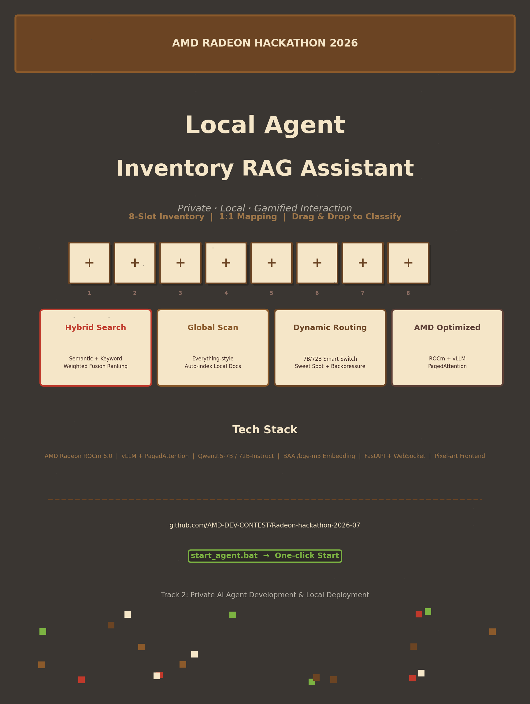

# "Inventory Backpack" — Local RAG Knowledge Agent Assistant

> A privatized knowledge management assistant powered by AMD Radeon GPU + local vLLM. Data never leaves your machine — drag & drop files to index, query in natural language.

---



## Table of Contents

- [Project Overview](#project-overview)
- [Core Features](#core-features)
- [Launch Options](#launch-options)
- [Inference Optimization](#inference-optimization)
- [Project Structure](#project-structure)
- [Dependencies](#dependencies)
- [License](#license)

---

## Project Overview

### UI Layout（*Let you get started as quickly as a game's inventory!*）

- **Left Panel**: File inventory management area
  - **Top — File Slots**: 8 dark-gray slots showing `+`, click or drag-and-drop to upload files
  
  - **Bottom — Folder Columns**: 8 light-gray columns, one-to-one mapped to the slots above. Files stack as light-yellow blocks from bottom to top
  
  - On the left is the “***inventory”*** bar with small file squares. 
  
    You can drag them to different category bars.
  
    You can also create a new file bar
  
    You can easily upload your files in the inventory
- **Right Panel**: Chat area
  
  - Message list on top, input box and send button below

### File Slot Interaction Mechanism

**Upload & Classification**: Click any file slot (or drag a file onto it), and the file automatically drops into the corresponding folder column below. Each vertical folder column is a local category directory; users can freely rename the top label for custom classification.

**Supported File Formats**:
- Plain text: `.txt` `.md` `.csv` `.rtf` `.odt`
- Code files: `.py` `.js` `.java` `.c` `.cpp` `.h`
- Office documents: `.pdf` `.docx` `.doc` `.xlsx` `.pptx`

**Default Retrieval Mode**: When no file is selected, the Agent automatically searches all indexed files (historical file database) and叠加 (if enabled) web search to ensure globally comprehensive answers.

**Precision Retrieval Mode**: Click a file block in a folder column; the block highlights in light white, indicating it is selected. The Agent then generates answers based solely on the vector context of the selected file(s), eliminating irrelevant information and achieving file-level precise RAG.

**Global File Discovery**: For queries like "find my notes about machine learning", the Agent automatically invokes the MCP-Local-RAG tool to scan local disks (Desktop/Documents/Downloads), index new files, and place them in the 8th column "New Discoveries" by default.

---

## Core Features

| Feature | Description |
|---------|-------------|
| **File Slot Mapping** | 8 top slots ↔ 8 bottom folder columns, drag-and-drop for instant classification |
| **Precision Retrieval** | Select specific files; the Agent answers based only on selected content |
| **Web Augmentation** | With "Web Search" enabled, simultaneously queries local knowledge base + real-time web info |
| **Hybrid Search** | Semantic vector retrieval (bge-m3) + keyword token overlap scoring, weighted fusion ranking |
| **Global Scanning** | Auto-traverses Desktop/Documents/Downloads, locates PDF/DOCX/MD/TXT/DOC/RTF/ODT |
| **Auto Indexing** | Newly discovered files are automatically copied to the knowledge base directory and indexed, placed in Column 8 "Auto-Discovery" |
| **Dynamic Routing** | Automatically switches between 7B / 72B models based on query complexity, balancing speed and accuracy |
| **Fully Private** | Frontend + backend + models all deployed locally, zero data leakage |

---

## Launch Options

### Option 1: Pure Docker (Milvus + Agent, Remote API)

```bash
docker compose -f docker/docker-compose.yml up -d --build
```

- Starts etcd + minio + milvus(CPU) + agent
- Auto-sets `MILVUS_URI=http://milvus:19530`
- Update `.env` to set `MODEL_SMALL_URL` / `MODEL_LARGE_URL` to available remote API endpoints
- Stop: `docker compose -f docker/docker-compose.yml down`

---

### Option 2: Docker for Milvus Only + Local Agent (Recommended for Windows)

```bash
# Start Milvus database
docker compose -f docker/docker-compose.yml up -d etcd minio milvus

# Then set in .env
MILVUS_URI=http://localhost:19530

# Run local Agent
start_agent.bat          # Windows
./start_agent.sh         # Linux
```

---

### Option 3: Docker + Local GPU Inference (Linux only)

**AMD GPU:**

```bash
docker compose -f docker/docker-compose.yml --profile amd up -d
```

**NVIDIA GPU:**

```bash
docker compose -f docker/docker-compose.yml --profile nvidia up -d
```

- vLLM listens on `localhost:9999`
- Set `.env` `MODEL_SMALL_URL` to `http://localhost:9999/v1` (host access) or `http://vllm-amd:8000/v1` (inter-container access)

---

### Option 4: No Docker, Pure Local (Minimal)

No Milvus; auto pickle persistence instead.

```bash
# Leave MILVUS_URI= empty in .env
start_agent.bat          # Windows
./start_agent.sh         # Linux
```

- Auto-creates venv and installs dependencies
- Empty `MILVUS_URI` triggers local pickle persistence
- Update `.env` to set `MODEL_SMALL_URL` / `MODEL_LARGE_URL` to available remote API endpoints
- Access http://localhost:8000

**Shutdown:**

```bat
stop_agent.bat        # Windows
./stop_agent.sh       # Linux
```

---

## Inference Optimization

Powered by **Orchestrator: Self-developed planning reasoning engine v2**.

### Benchmark Results

| Percentile | 1st Run | 2nd Run | Δ | Δ% |
|------------|---------|---------|---|----|
| Min | 85.2 | 86.2 | +1.0 | +1.2% |
| Mean | 186.7 | 153.0 | −33.7 | −18.1% 🟢 |
| P50 | 123.4 | 115.7 | −7.7 | −6.2% 🟢 |
| P90 | 295.0 | 228.7 | −66.3 | −22.5% 🟢 |
| P95 | 415.3 | 258.2 | −157.1 | −37.8% 🟢 |
| P99 | 1,191.6 | 445.5 | −746.1 | −62.6% 🟢 |
| Max | 4,160.6 | 3,337.5 | −823.1 | −19.8% 🟢 |
| StdDev | 221.98 | 133.38 | −88.6 | −39.9% 🟢 |
| CV | 1.189 | 0.872 | −0.317 | −26.7% 🟢 |
| Winsor-CV | 0.839 | 0.431 | −0.408 | −48.6% 🟢 |

| Metric | Unoptimized | Optimized | Δ | Trend |
|--------|-------------|-----------|---|-------|
| Total Requests | 10,000 | 10,000 | — | — |
| Valid Responses | 9,492 (94.9%) | 9,499 (95.0%) | +7 (+0.1%) | 🟢 Slight up |
| Errors | 8 (0.08%) | 2 (0.02%) | −6 (−75%) | 🟢 Significant improvement |
| Timeouts | 8 | 2 | −6 (−75%) | 🟢 Significant improvement |
| Total Time | 2,028.18s | 1,995.78s | −32.4s (−1.6%) | 🟢 Slightly faster |
| RPS | 4.93 | 5.01 | +0.08 (+1.6%) | 🟢 Slight up |
| Retries | 42 | 20 | −22 (−52.4%) | 🟢 Major improvement |
| Retry Recovery | 37 | 17 | −20 | 🟢 More stable |

### Optimization Strategies

**Hardware Layer**:
- ROCm 6.0+ replaces CUDA; vLLM natively supports ROCm backend
- FP16 inference reduces VRAM usage by 50%

**Engine Layer**:
- **PagedAttention**: KV Cache paged management reduces VRAM fragmentation
- **Continuous Batching**: Dynamic request batching maximizes GPU utilization
- **Tensor Parallelism**: 72B model spans multiple cards in parallel

**Application Layer — Orchestrator v2 Engine Design**:

| Design Point | Implementation | Effect |
|--------------|----------------|--------|
| **Bounded LRU Cache** | Fixed capacity + large-object skip (>1MB auto-evict) + async lock protection | OOM prevention, observable hit stats |
| **Global Connection Pool Reuse** | `httpx.AsyncClient` singleton lazy init, `max_keepalive=100` | Eliminates TCP handshake latency, prevents connection leaks |
| **Flat Context Object** | `InferenceContext` with `slots=True` reduces memory, single state carrier | Replaces nested layers, execution trace without truncation |
| **Stateless Routing** | `TaskRouter.classify()` pure function, rule priority: tool count > complex keywords > simple keywords > length heuristic | Predictable, testable, no side effects |
| **Unified Inference Entry** | `InferenceEngine.infer()` unifies sync/streaming, exceptions pass through unwrapped | Caller decides autonomously, responses fully preserved |
| **Concurrency Control & Backpressure** | `asyncio.Semaphore` + `execute_batch()` layered throttling | Prevents request avalanches, batch execution controllable |
| **Cache Key Design** | Hash based on full message content (first 200 chars), balancing precision and performance | Avoids large-key issues, cache hits traceable |
| **Lifecycle Management** | `asynccontextmanager` + `__aenter__/__aexit__` | Resources correctly released, supports both context and non-context modes |
| **Production-Grade Orchestrator** | Triple defense: sweet-spot probing (auto benchmark optimal concurrency) + adaptive throttling (reject if P99 exceeds threshold) + dynamic scheduling (real-time vLLM parameter tuning) | Continuous monitoring auto-drift, service stability guarantee |
| **Code Simplicity** | Removed all deprecated factory functions, redundant wrappers, duplicate exception layers | Single entry `execute()`, single exit `close()` |
| **Domain Routing** | `AgentOrchestrator` routes by keyword to knowledge/code/creative/research specialist | Extensible; new specialist registers only |

### Benchmark

```bash
# 1. Single-concurrency test (verify basic functionality)
python benchmark.py load --url "https://radeon-global.anruicloud.com/spaces/u-14452-18f2b17f/8000/v1" --api-key EMPTY -c 1 -n 10

# 2. 10 concurrency, 100 requests
python benchmark.py load --url "https://radeon-global.anruicloud.com/spaces/u-14452-18f2b17f/8000/v1" --api-key EMPTY -c 10 -n 100

# 3. 50 concurrency, 500 requests
python benchmark.py load --url "https://radeon-global.anruicloud.com/spaces/u-14452-18f2b17f/8000/v1" --api-key EMPTY -c 50 -n 500

# 4. 10 concurrency, 10,000 requests (10k stress test)
python benchmark.py load --url "https://radeon-global.anruicloud.com/spaces/u-14452-18f2b17f/8000/v1" --api-key EMPTY -c 10 -n 10000
```

---

## Project Structure

```
rag-agent/
├── main.py                          # Entry: Lifespan + dynamic routing
├── start_agent.bat                  # Windows one-click start
├── start_agent.sh                   # Linux one-click start
├── stop_agent.bat                   # Windows one-click stop
├── stop_agent.sh                    # Linux one-click stop
├── .env                             # Deployment config (4 modes with comments)
├── .env.example                     # Config template
├── docker/
│   ├── docker-compose.yml           # Docker Compose (optional GPU profiles)
│   └── Dockerfile                   # Lightweight python:3.11-slim
├── config/                          # Configuration files
├── data/
│   ├── hf_cache/hub/models--BAAI--bge-m3/   # Embedding model
│   ├── knowledge_base/              # Raw document storage
│   ├── uploaded/                    # Temporary uploaded files
│   └── vector_store/                # Vector database (or pickle)
├── prompts/                         # Prompt templates
├── scripts/                         # Utility scripts
├── src/
│   ├── agent/
│   │   ├── orchestrator.py          # Inference execution layer
│   │   └── specialists/
│   │       ├── knowledge_assistant.py   # Knowledge base query (RAG)
│   │       ├── code.py              # Code generation & diagnosis
│   │       ├── creative.py          # Creative writing
│   │       └── research.py          # Research analysis
│   ├── api/
│   │   └── server.py                # FastAPI routes
│   ├── mcp/
│   │   ├── server.py                # MCP service registry
│   │   └── tools.py                 # search_web / local_rag / get_weather
│   ├── rag/
│   │   ├── retriever.py             # Hybrid retrieval & context injection
│   │   ├── local_indexer.py         # Local file scanning & auto indexing
│   │   └── hybrid_rank.py           # Semantic + keyword fusion ranking
│   ├── scheduler/
│   │   ├── sweet_spot_finder.py     # Sweet-spot probing
│   │   ├── backpressure_controller.py # Adaptive throttling
│   │   └── vllm_scheduler.py        # vLLM dynamic parameter scheduling
│   ├── models/                      # Model definitions
│   ├── middleware/                  # Request interception
│   ├── plugins/                     # Extension plugins
│   ├── sidecars/                    # Auxiliary processes
│   ├── tuner/                       # Performance tuning
│   ├── utils/                       # Common utilities
│   └── wrappers/                    # External service wrappers
├── frontend/
│   └── index.html                   # Single-page frontend (file slots + chat)
├── benchmark.py                     # Benchmark script
├── requirements.txt                 # Python dependencies
└── README.md                        # This file
```

---

## Dependencies

```
aiofiles==24.1.0
aiohappyeyeballs==2.7.1
aiohttp==3.14.3
aiosignal==1.4.0
annotated-doc==0.0.4
annotated-types==0.7.0
antlr4-python3-runtime==4.9.3
anyio==4.13.0
attrs==26.1.0
autogen==0.14.1
av==16.0.0
brotli==1.2.0
certifi==2026.7.22
cffi==2.1.0
charset-normalizer==3.4.9
click==8.4.2
colorama==0.4.6
cryptography==49.0.0
dill==0.3.8
distro==1.9.0
docstring_parser==0.18.0
einops==0.8.2
fast-depends==3.0.8
faiss-cpu>=1.7.4
fastapi==0.140.0
ffmpy==1.0.0
filelock==3.32.0
fire==0.7.1
frozenlist==1.8.0
fsspec==2026.6.0
gradio==5.50.0
gradio_client==1.14.0
greenlet==3.5.4
groovy==0.1.2
h11==0.16.0
hf-xet==1.5.2
hf_transfer==0.1.9
httpcore==1.0.9
httpx==0.28.1
httpx-sse==0.4.3
huggingface_hub==1.25.1
idna==3.18
jieba==0.42.1
Jinja2==3.1.6
jiter==0.16.0
joblib==1.5.3
jsonpatch==1.33
jsonpointer==3.1.1
jsonschema==4.26.0
jsonschema-specifications==2025.9.1
langchain==1.3.14
langchain-classic==1.0.8
langchain-community==0.4.2
langchain-core==1.5.1
langchain-openai==1.4.1
langchain-protocol==0.0.18
langchain-text-splitters==1.1.2
langgraph==1.2.9
langgraph-checkpoint==4.1.1
langgraph-prebuilt==1.1.0
langgraph-sdk==0.4.2
langsmith==0.10.10
markdown-it-py==4.2.0
MarkupSafe==3.0.3
mcp==1.28.1
mdurl==0.1.2
multidict==6.7.1
multiprocess==0.70.16
nltk==3.9.4
numpy==2.4.6
omegaconf==2.3.0
openai==2.48.0
orjson==3.11.9
onnxruntime-directml>=1.15.0
ormsgpack==1.12.2
packaging==26.0
pandas==2.3.3
pillow==11.3.0
propcache==0.5.2
protobuf==7.34.1
pyarrow==24.0.0
pycparser==3.0
pydantic==2.12.3
pydantic-settings==2.14.2
pydantic_core==2.41.4
pydub==0.25.1
Pygments==2.20.0
PyJWT==2.13.0
pyserial==3.5
python-dateutil==2.9.0.post0
python-dotenv==1.2.2
python-multipart==0.0.32
python-docx>=0.8.11
pytz==2026.3.post1
pywin32==312
PyYAML==6.0.3
pypdf>=3.0.0
referencing==0.37.0
regex==2026.5.9
requests==2.34.2
requests-toolbelt==1.0.0
rich==15.0.0
rouge-chinese==1.0.3
rpds-py==2026.6.3
ruff==0.15.13
safehttpx==0.1.7
safetensors==0.7.0
semantic-version==2.10.0
sentencepiece==0.2.1
shellingham==1.5.4
shtab==1.8.0
six==1.17.0
sniffio==1.3.1
scikit-learn>=1.3.0
SQLAlchemy==2.0.51
sse-starlette==3.4.4
sentence-transformers>=2.2.0
starlette==0.52.1
tenacity==9.1.4
termcolor==3.3.0
tiktoken==0.13.0
tomlkit==0.13.3
torchdata==0.11.0
tqdm==4.69.1
typer==0.25.1
typing-inspection==0.4.2
typing_extensions==4.16.0
tyro==0.8.14
tzdata==2026.2
urllib3==2.7.0
uuid_utils==0.17.0
uvicorn==0.51.0
websockets==15.0.1
xxhash==3.7.0
yarl==1.24.5
zstandard==0.25.0
```

---

## License

MIT License

---

> RAG Knowledge Inventory Assistant — AMD Radeon Hackathon 2026
> Local Deployment · Private & Secure · Dynamic Routing · Hybrid Search
