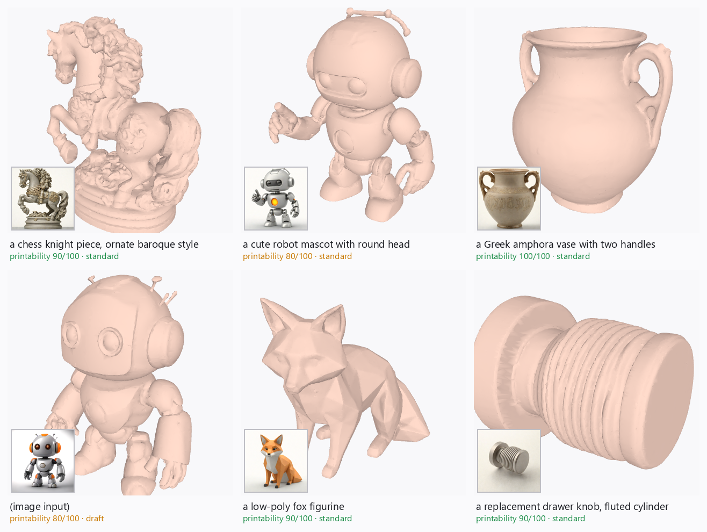

# MeshSmith — Project Profile

**Track 1 · Multimodal Content Creation · AMD AI DevMaster Hackathon 2026**

## 1. Project background

Image-to-3D generation crossed a quality threshold in the last year — models like
Hunyuan3D-2 produce genuinely good geometry from a single image. But almost nobody who
*needs* 3D assets can use the raw output. Generated meshes are not watertight, carry no
UVs and no physical scale, contain floating debris, and arrive in orientations that make
FDM printing waste more plastic on support than on the part. The gap between "generated a
mesh" and "shipped an asset" is manual work in Blender and a slicer — exactly the skills
the people using these tools don't have.

MeshSmith closes that gap. It is a single local tool that goes from a text prompt or a
photo to two finished artifacts: a **game-ready GLB** (decimated, UV-unwrapped, PBR
material) and a **print-ready STL** (real millimeters, auto-oriented to minimize support,
wall-thickness checked), plus a printability report that tells the user *before* they
print whether the part will survive.

**Everything runs locally.** Three open models are chained on one GPU — no cloud API is
involved in any core function.

## 2. Target users & application scenarios

| User | Scenario |
|---|---|
| 3D-printing hobbyists | "I need a drawer knob / figurine / bracket" → STL in minutes, no CAD or Blender skills |
| Indie game developers | Concept → placeholder or production props with sane topology, UVs and materials |
| Educators & makerspaces | Students design printable objects with natural language; the report teaches printability |
| Product designers | Rapid physical form studies from prompt sketches, at real scale |
| AR/VR creators | Fast GLB assets with correct materials for prototyping |

**Social value:** MeshSmith removes the two gatekeeping skills of personal fabrication —
CAD modeling and mesh repair. A one-line prompt becomes a physical object; the printability
report replaces failed prints (and wasted plastic) with feedback before slicing. Running
local means schools and makerspaces pay no per-generation API fees and keep student data
on-device.

## 3. System architecture

```
        ┌────────────────────────── MeshSmith (single process, one GPU) ─────────────────────────┐
        │                                                                                        │
 text ──┼─► SDXL-Turbo (fp16) ─► concept.png ─► u2net cutout ─► Hunyuan3D-2 DiT (fp16)           │
        │      text→image           │             RGBA           flow matching → SDF → mesh      │
 image ─┼───────────────────────────┘                                   │                        │
        │                                                               ▼                        │
        │                                       trimesh repair: dedupe · de-floater · fill holes │
        │                                                               │                        │
        │                        ┌──────────────────────────────────────┴───────────────┐        │
        │                        ▼                                                      ▼        │
        │        game path: fast-simplification decimate                print path: scale to mm  │
        │        → xatlas UV unwrap → PBR preset → GLB/OBJ              → 26-orientation support │
        │                                                               search → wall-thickness  │
        │                                                               ray sampling → STL       │
        │                        └──────────────► report.json / report.md ◄─────────────┘        │
        │                                   (score, stats, per-stage GPU timings)                │
        └────────────────────────────────────────────────────────────────────────────────────────┘
   Front-ends: Gradio web UI (interactive 3D viewer) · CLI (`python -m meshsmith.cli`) · benchmark script
```

Models load lazily and unload after their stage when VRAM < 30 GB, so the pipeline fits
16 GB cards; on larger GPUs both models stay resident for speed.

## 4. Models & algorithms

| Stage | Model / algorithm | Notes |
|---|---|---|
| Text → image | **SDXL-Turbo** (adversarial-distilled SDXL, fp16) | 1–4 steps, guidance 0; prompt auto-styled toward single-object product shots (what image→3D wants) |
| Subject cutout | **u2net** via rembg (ONNX, CPU) | vendor-neutral; skipped if input already has alpha |
| Image → 3D | **Hunyuan3D-2** flow-matching DiT + ShapeVAE (fp16); **mini-turbo** distilled variant for draft mode | *shape-only*: pure PyTorch, no custom CUDA rasterizer → portable across ROCm/CUDA |
| Repair | trimesh: merge/dedupe, largest-component filter, hole fill, normal fix | watertight verified before/after |
| Decimation | fast-simplification (quadric error metric) | to preset face budget |
| UV unwrap | xatlas | on the decimated mesh |
| Print orientation | 26-direction support-volume search (overhang faces ≥45° × height prism) | rotation only — the part's physical size is preserved, so candidates are compared fairly; reports % support saved |
| Wall thickness | surface sampling + inward ray casting | min / 5th-percentile / % under limit |

Measured effect of the orientation search **on the AMD Radeon runs** (`draft`, seed 7):
support volume cut by **78.3%** (robot mascot), **47.5%** (chess knight), **33.9%** (fox
figurine), **13.9%** (drawer knob) and **6.6%** (amphora). The amphora is the
interesting one — the generator already produced the vase nearly upright, so almost no
rotation improves on it and the search correctly declines to invent one. Every figure is
reproduced in that run's `report.json` under `print.orientation.support_saved_pct`.

## 5. AMD Radeon GPU / ROCm adaptation

> **Verified on AMD hardware.** Everything in this section was confirmed on an AMD
> Radeon Cloud instance — Radeon Graphics `gfx1100` (Navi 31), 48 GB, ROCm 7.2.53211,
> torch 2.9.1 — on 6 August 2026. MeshSmith ran there with **no source changes of any
> kind**: the same commit that runs on CUDA produced watertight, print-ready assets on
> ROCm at 90/100 printability, averaging 48.7 s per asset. The demo video is a live
> recording of that machine.
>
> ```
> Device: {'backend': 'AMD ROCm 7.2.53211-e1a6bc5663', 'torch': '2.9.1+gitff65f5b',
>          'device': 'cuda:0', 'gpu': 'AMD Radeon Graphics', 'vram_gb': 48.0}
> SMOKE TEST PASSED
> ```

- **Zero vendor-specific code — now proven, not asserted.** Both GPU stages run through
  the standard `torch.cuda` API, which ROCm PyTorch maps to HIP. Backend detection
  (`torch.version.hip`) is used only to *display* the platform banner and timings.
  The same commit ran on CUDA and on ROCm with no edits; peak VRAM on Radeon was
  10.8 GB, so the pipeline also fits 16 GB Radeon cards.
- **Shape-only Hunyuan3D by design.** The texture-paint stage of Hunyuan3D-2 needs a
  custom CUDA rasterizer extension; MeshSmith deliberately excludes it and keeps the whole
  pipeline installable with `pip install -r requirements.txt` inside any `rocm/pytorch`
  container — no compilation step, no HIP porting.
- **fp16 everywhere** (SDXL-Turbo and Hunyuan3D DiT/VAE), sequential model
  residency with explicit unload + `torch.cuda.empty_cache()` on <30 GB cards.
- **Dockerfile for ROCm** (`docker/Dockerfile.rocm`) on the official `rocm/pytorch` base;
  runs on Radeon Cloud instances as-is.
- **Observable performance**: every run reports per-stage wall time and peak VRAM; the
  benchmark script reproduces the numbers below on any machine.

### Benchmark (reproduce with `python scripts/benchmark.py`)

<!-- BENCHMARK_TABLE -->

## 6. Output diversity



Every asset above came out of the same pipeline with no manual mesh work: organic
figures (knight, fox), a mechanical character, a vessel, and a functional hard-surface
part — plus, bottom-left, the image-input path taking a photo straight to 3D. Inset
thumbnails are the generated concept images. Regenerate with `scripts/build_gallery.py`.

## 7. Deliverables

- Source repository (MIT): pipeline package, Gradio UI, CLI, benchmark + smoke tests,
  ROCm Dockerfile
- This profile document, demo video (3–5 min), poster
- Example outputs: GLB/STL/report bundles for the benchmark prompt set
