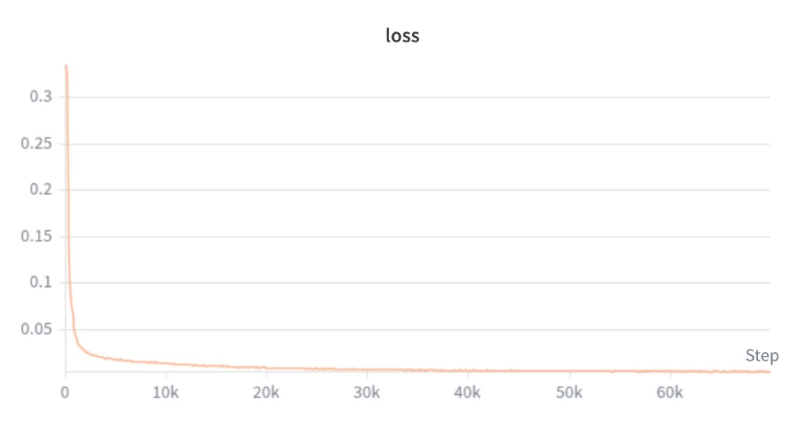
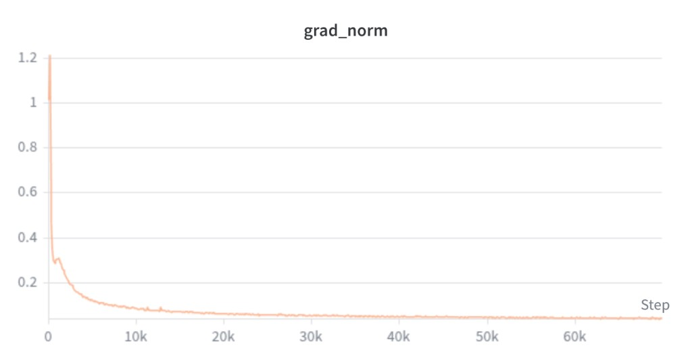
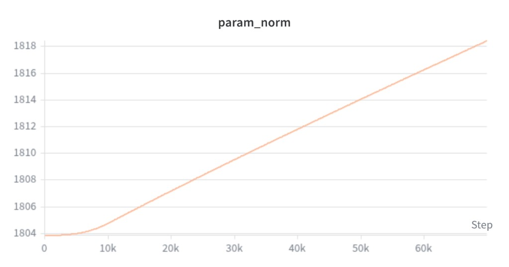

# G1-D Desktop Organization — AMD Cloud VLA Inference

[](LICENSE)
[](https://www.amd.com/en/products/software/rocm.html)
[](https://pytorch.org/)

> **AMD AI DevMaster Hackathon 2026 · Physical AI Track**
>
> **提交 / Submission:** Fork → 新建团队文件夹 / create team folder → PR 至 [Radeon-hackathon-2026-07](https://github.com/AMD-DEV-CONTEST/Radeon-hackathon-2026-07)
>
> PR 标题 / PR title: `[Physical AI] mailonghua - G1D-Organize-Table`
>
> **演示视频 / Demo video:** [Bilibili BV14r376tEjA](https://www.bilibili.com/video/BV14r376tEjA/) · 详见 [`videos/README.md`](videos/README.md)
>
> 截止 / Deadline: 2026-08-06 23:59（北京时间 / Beijing time） · 须注册 / Register: [AMD AI 开发者计划](https://www.amd.com/zh-cn/developer.html) · [AMD AI Developer Program (EN)](https://www.amd.com/en/developer.html)
>
> **本文档包含全部 5 个强制章节（中英双语）· This document includes all 5 mandatory sections (Chinese & English).**

<a id="repo-layout"></a>

## 仓库结构 · Repository Layout

```text
organize_and_tidy/
├── README.md
├── LICENSE                 # Apache-2.0 (OpenPI base)
├── NOTICE                  # Third-party notices (Gemma, etc.)
├── requirements.txt
├── .imgs/                  # TensorBoard screenshots (training evidence)
├── logs/                   # Training logs (text)
├── configs/                # Task & serve configuration
├── data/                   # Data notes (no large datasets)
├── docs/                   # Supplementary docs
├── videos/                 # Demo video link (no large files)
└── src/                    # Full OpenPI source + self_scripts
    ├── train.py            # Training entry (wrapper)
    ├── eval.py             # Smoke-test entry (wrapper)
    ├── inference.py        # Serve / Client launcher
    └── self_scripts/infer/ # AMD serve & G1-D client scripts
```

## 目录 · Table of Contents

**语言 / Language:** [中文版](#zh) · [English Version](#en)

| # | 中文 | English |
| --- | --- | --- |
| — | [仓库结构](#repo-layout) | [Repository Layout](#repo-layout) |
| 1 | [项目简介](#一项目简介) | [Project Overview](#1-project-overview) |
| 2 | [开发过程](#二开发过程) | [Development Process](#2-development-process) |
| 2+ | [训练日志与 TensorBoard](#zh-train-tb) | [Training Logs & TensorBoard](#en-train-tb) |
| 3 | [代码来源说明](#三代码来源说明) | [Code Provenance](#3-code-provenance) |
| 4 | [团队分工](#四团队分工) | [Team Contributions](#4-team-contributions) |
| 5 | [安装与运行](#五安装与运行) | [Installation & Usage](#5-installation--usage) |
| 5.1 | [环境要求](#zh-51-req) | [Requirements](#en-51-req) |
| 5.2 | [云端安装](#zh-52-setup) | [Cloud Setup](#en-52-setup) |
| 5.3 | [云端启动](#zh-53-serve) | [Cloud Start/Stop](#en-53-serve) |
| 5.4 | [本地 Client](#zh-54-client) | [Local Client](#en-54-client) |
| — | [参考链接](#references) | [References](#references) |

---

<a id="zh"></a>

# 中文版


## 一、项目简介

### 问题定义

家庭/服务场景中，桌面常散落 **餐盒、卫生纸、盘子** 等物品，需要机器人按语义指令完成整理。本项目针对 **Unitree G1-D 双臂人形机器人**，实现：

- 将 **餐盒**、**卫生纸** 扔进 **垃圾桶**
- 将 **盘子** 归位、摆放在一起

自然语言指令：

```text
Organize and tidy the items on the table.
```


### 解决方案

采用 **Client–Server 分离架构**，满足比赛「AMD Radeon GPU + ROCm 推理」要求：

- **云端（AMD Radeon Notebook）**：运行 OpenPI π0.5 Policy Server（PyTorch + ROCm），通过 **rc-tunnel** 暴露公网 WebSocket
- **本地 PC**：连接真机，采集 3 路相机 + 关节状态，经 **JPEG 压缩** 上传观测，接收 action chunk 后通过 DDS 控臂

```text
┌─────────────┐   wss + JPEG    ┌──────────────────────┐
│ 本地 PC      │ ──────────────► │ AMD 云 Notebook       │
│ Client      │ ◄────────────── │ Policy Server (ROCm)  │
│ + G1-D 真机  │   action chunk  │ π0.5 full + rc-tunnel │
└──────┬──────┘                 └──────────────────────┘
       │ DDS / ZMQ
       ▼
  Jetson 相机 + G1-D 机器人
```


### 核心指标


| 指标               | 数值 / 说明                                              |
| ---------------- | ---------------------------------------------------- |
| 模型               | π0.5 full fine-tune，`pi05_g1d_joint_full`，step 29999 |
| 动作空间             | 16-dim 关节（双臂 14 + 夹爪 2），action horizon 10            |
| 本地同机推理（RTX 4090） | 稳态 ~**93 ms**/次（Server + Client 同机）                  |
| 云端推理（AMD GPU）    | policy 推理 ~**100–500 ms**；含公网 RTT 视网络而定              |
| 图像传输             | JPEG + 224 缩放，payload ~**65 KB**/帧（原 ~2.7 MB）        |
| 控制频率             | 30 Hz（Client 端）                                      |


### 技术栈


| 层级     | 技术                                                             |
| ------ | -------------------------------------------------------------- |
| VLA 模型 | [OpenPI](https://github.com/Physical-Intelligence/openpi) π0.5 |
| 云端推理   | PyTorch 2.9.1 + **ROCm 7.2.1**，`transformers_replace` 补丁       |
| 通信     | WebSocket（msgpack）、Radeon Cloud **rc-tunnel**                  |
| 机器人    | Unitree G1-D、unitree_lerobot、unitree_sdk2py（DDS + ZMQ）         |
| 训练数据   | LeRobot v2.1，`G1D/G1D_Dex1_Organize_table_normal_start`        |


---


## 二、开发过程


### 关键决策


| 决策 | 原因 |
| --- | --- |
| **C/S 架构：云端推理 + 本地控臂** | 比赛要求 AMD Radeon GPU 参与推理；真机与相机必须在本地 |
| **π0.5 全量微调（非 LoRA / X-VLA）** | 全量微调在桌面整理任务上泛化更好、幻觉更少；训练完成的 PyTorch checkpoint 可直接在 AMD 上 serve |
| **关节空间直接控制** | 与训练数据一致（16-dim joint），避免额外 IK 误差 |
| **采集初始位姿与 G1-D lock 对齐** | 双臂平放于桌面，与部署时的锁定初始状态一致：腕部相机可观测目标，且推理启动时无大阶跃 |
| **正向放置 +「观察—抓取」时序** | 放置阶段保持腕部相机朝向工作区；示范中先观察再抓取，与推理时的视觉—动作链路一致 |
| **VR 摇操「留白—平移—闭合」抓取** | 叠盘时降低对绝对位姿精度的依赖，避免夹爪落入盘内后被卡住 |
| **多时段光照混合训练** | 覆盖上午 / 下午 / 晚间等光照条件，减轻模型对单一光照分布的过拟合 |
| **rc-tunnel 公网暴露** | Notebook 无固定公网 IP，官方提供 tunnel 方案 |
| **Client 端 JPEG 压缩** | 3 路 480×640 RGB 原图 ~2.7 MB/帧，公网上行成为瓶颈；压缩后 ~65 KB |
| **手动** `uv pip` **装依赖** | 云端 `uv sync` 因 lerobot SSL、mujoco 等失败；改用预置 ROCm wheel + 分步安装 |


### 数据采集与模型训练：困难与解决


| 困难 | 现象 / 根因 | 解决方案 |
| --- | --- | --- |
| **空闲位姿导致腕部相机失效** | 采集开始时双臂上举、视野为空；腕部相机仅能看到天花板，无法观测桌面目标，策略几乎只能依赖全局相机 | 将采集初始位姿与空闲位姿调整为**双手平放桌面**，与 G1-D **lock 初始锁定状态**一致：腕部相机可直接看到操作区域，且与推理启动位姿对齐，避免大阶跃 |
| **腕部朝下放置时视野丢失** | 部分示范采用腕部向下放置；放置过程中腕部相机无法看到垃圾桶入口，模型难以学习「对准—入桶」的视觉线索，投放精度显著下降 | 数据采集统一采用**正向放置**；并在每条轨迹中录制**「先观察、再抓取/放置」**的操作时序，使模型学会在动作前利用视觉确认目标位置 |
| **叠盘时夹爪陷入盘内** | VR 摇操直接下压抓取时，夹爪偶发落入盘子内部；后续平行移动时夹爪与盘壁干涉，无法脱离 | 调整摇操策略：抓取前先**预留安全间隙**，夹爪在盘子上方悬停，再**平行平移**至抓取位后闭合，降低对绝对定位精度的依赖 |
| **模型幻觉（X-VLA / π0.5-LoRA）** | 早期在 X-VLA 与 π0.5-LoRA 上均出现「无对应观测却执行动作」的幻觉行为 | 通过**随机化场景与多样化示范**逐步缓解；最终采用 **π0.5 全量微调**后，幻觉现象大幅下降 |
| **光照条件域偏移** | 仅用单一时段数据训练时，上午成功率较高，下午与晚间明显下降 | 在**不同时间段**分别采集数据并**混合训练**，提升模型对自然光照变化的鲁棒性 |


<a id="zh-train-tb"></a>

### 训练日志与 TensorBoard 截图

> 对应官方提交清单可选项：**训练日志与 TensorBoard 截图：证明模型确实训练过**

| 项目 | 说明 |
| --- | --- |
| 配置 | `pi05_g1d_joint_full`，数据集 `G1D/G1D_Dex1_Organize_table_normal_start` |
| 训练步数 | **30,000 steps**（最终 checkpoint：**step 29999**） |
| 训练时长 | 约 **28 h 18 min**（2026-07-10 → 2026-07-11） |
| 训练入口 | `cd src && python train.py --config pi05_g1d_joint_full` |
| 完整文本日志 | [`logs/Organize_and_table训练日志.txt`](logs/Organize_and_table训练日志.txt) |

TensorBoard 标量曲线（OpenPI 训练 run）：

**loss** — 前 ~3k step 快速下降（~0.34 → <0.05），之后缓慢收敛至 ~0.01



**grad_norm** — 由 ~1.2 降至 ~0.05 并趋于稳定，优化过程健康



**param_norm** — 由 ~1804 缓慢上升至 ~1818，符合全量微调权重持续更新的预期




### 云端部署与推理：困难与解决


| 困难 | 解决 |
| --- | --- |
| 云端无 torch / `uv sync` 失败 | 使用云镜像 `/` 下 cp312 ROCm wheel；`uv pip install -e . --no-deps` |
| `transformers_replace` 未打补丁 | `cp -r` 覆盖 site-packages 中 transformers |
| norm_stats 路径 `_bhw` 不匹配 | 从 checkpoint 内非 `_bhw` 路径复制到 config 期望路径 |
| WSS URL 被错误拼接 `:8000` | 修改 `websocket_client_policy.py`：完整 `wss://` URI 不再追加 port |
| 首次推理 WebSocket ping 超时 | Client `ping_timeout=600`；Server `asyncio.to_thread` 异步推理 |
| 直接跑 Client 缺 cyclonedds | 新增 `run_g1d_client.sh`：DDS 绑定 + PYTHONPATH + 工作目录 |
| Notebook Ctrl+C 无法停 Server | 文档说明：`pkill -f serve_g1d_policy_amd.sh` |


### 若继续优化

- 扩充场景随机化（桌面布局、杂物种类、垃圾桶位置）以进一步抑制幻觉
- 按光照 / 时段统计成功率，指导增量数据采集
- 进一步降低云端 RTT（专线 / 边缘节点 / 更小图像或 H.264）
- Server 端 Docker 镜像一键部署
- 增加任务成功率统计与自动复位逻辑
- 探索在 AMD GPU 上完成训练或 LoRA 微调

---


## 三、代码来源说明

本项目基于多个开源项目构建。其中 **Unitree 相关组件**来自 [Unitree Robotics](https://github.com/unitreerobotics) 官方仓库：真机推理侧使用 [unitree_lerobot](https://github.com/unitreerobotics/unitree_lerobot) 与 [unitree_sdk2_python](https://github.com/unitreerobotics/unitree_sdk2_python)；**训练数据采集**使用 [xr_teleoperate](https://github.com/unitreerobotics/xr_teleoperate) 进行 XR 遥操作录制，再经 unitree_lerobot 转为 LeRobot 格式。

### 基于的开源项目及修改


| 开源项目                                                                                        | 用途               | 本仓库修改点                                                                                                                                                                                    |
| ------------------------------------------------------------------------------------------- | ---------------- | ----------------------------------------------------------------------------------------------------------------------------------------------------------------------------------------- |
| [Physical-Intelligence/openpi](https://github.com/Physical-Intelligence/openpi)             | VLA 训练/推理框架      | `src/openpi/policies/g1d_policy.py`：G1D 相机映射 + **JPEG 解码**；`src/openpi/serving/websocket_policy_server.py`：异步 infer、ping 超时、日志过滤；`src/openpi/training/config.py`：`pi05_g1d_joint_full` 配置 |
| openpi `packages/openpi-client`                                                             | WebSocket Client | `websocket_client_policy.py`：WSS URI、超时、断线重连                                                                                                                                              |
| [huggingface/lerobot](https://github.com/huggingface/lerobot)                               | 数据集格式 / 依赖       | 无 fork，仅作依赖                                                                                                                                                                               |
| [unitreerobotics/unitree_lerobot](https://github.com/unitreerobotics/unitree_lerobot)       | G1 相机、DDS 控臂、LeRobot 数据转换 | 无修改，Client 侧调用                                                                                                                                                                            |
| [unitreerobotics/unitree_sdk2_python](https://github.com/unitreerobotics/unitree_sdk2_python) | DDS 通信（`unitree_sdk2py`） | 无修改                                                                                                                                                                                       |
| [unitreerobotics/xr_teleoperate](https://github.com/unitreerobotics/xr_teleoperate)           | 真机 XR 遥操作数据采集     | 无修改，采集原始 episode 后经 unitree_lerobot 转换                                                                                                                                                  |
| AMD [Radeon-hackathon-2026-07](https://github.com/AMD-DEV-CONTEST/Radeon-hackathon-2026-07) | rc-tunnel 使用说明   | 无修改                                                                                                                                                                                       |


### 本仓库原创部分


| 路径                                             | 说明                                                         |
| ---------------------------------------------- | ---------------------------------------------------------- |
| `src/self_scripts/infer/serve_g1d_policy_amd.sh`   | AMD 云 Server 启动、healthz 等待、rc-tunnel 暴露                    |
| `src/self_scripts/infer/run_g1d_client.sh`         | 真机 Client 环境封装（DDS / PYTHONPATH / URDF 路径）                 |
| `src/self_scripts/infer/client_g1d_joint.py`       | G1-D 真机推理 Client：观测组装、JPEG 传输、控臂主循环                        |
| `src/self_scripts/infer/test_amd_policy_client.py` | 无机器人虚拟 Client，用于云端联调                                       |
| 桌面整理 **训练数据收集与 full 微调**                       | [xr_teleoperate](https://github.com/unitreerobotics/xr_teleoperate) 遥操作采集 → [unitree_lerobot](https://github.com/unitreerobotics/unitree_lerobot) 格式转换 + OpenPI 训练 pipeline（checkpoint 含于 `checkpoints/`） |


> OpenPI 基座权重来自 `gs://openpi-assets/checkpoints/pi05_base/params`，在其上微调得到本项目 checkpoint。

---


## 四、团队分工

**个人开发**，全部工作由一人完成：


| 模块        | 内容                                |
| --------- | --------------------------------- |
| 数据采集与训练   | G1-D 桌面整理数据采集、π0.5 full 微调        |
| AMD 云端部署  | ROCm 环境搭建、Policy Server、rc-tunnel |
| Client 开发 | 真机推理 Client、JPEG 传输、DDS 控臂        |
| 联调与文档     | 云端/本地端到端联调、本 README               |


协作方式：不适用（单人项目）。

---


## 五、安装与运行


<a id="zh-51-req"></a>

### 5.1 环境要求


| 端         | 要求                                                   |
| --------- | ---------------------------------------------------- |
| **云端**    | Radeon Cloud 新版 Notebook Pod（支持 rc-tunnel）           |
| **本地 PC** | Ubuntu 22.04，Python 3.11 venv，NVIDIA GPU（仅训练/可选本地调试） |
| **机器人**   | Unitree G1-D + Jetson 图像服务（`python image_server.py`） |
| **网络**    | 本地 PC 可访问公网；机器人网段 `192.168.123.x`                    |


**关键路径（按实际修改）**

```text
项目根目录 PROJECT_ROOT = /workspace/organize_and_tidy
OpenPI 源码 OPENPI_ROOT  = /workspace/organize_and_tidy/src
本地 UNITREE_ROOT         = ~/ws/vla/unitree_lerobot
Checkpoint（需单独下载）   = checkpoints/pi05_g1d_joint_full_pytorch/Organize_table_normal_start/29999
```

**推理脚本**

```text
src/self_scripts/infer/
├── serve_g1d_policy_amd.sh   # 云端 Server + rc-tunnel
├── run_g1d_client.sh         # 本地 Client 入口
├── client_g1d_joint.py       # Client 主程序
└── test_amd_policy_client.py # 无机器人联调（可选）

# 比赛模板入口（wrapper）:
src/train.py | src/eval.py | src/inference.py
```

---

<a id="zh-52-setup"></a>

### 5.2 云端 — 一次性安装

> 云镜像 `/` 预置 Python 3.12 + ROCm PyTorch wheel；**勿用** `uv sync` **默认 CUDA torch**。

```bash
cd /workspace/organize_and_tidy/src

curl -LsSf https://astral.sh/uv/install.sh | sh
export PATH="$HOME/.local/bin:$PATH"

rm -rf .venv && uv venv --python 3.12 && source .venv/bin/activate

uv pip install \
  /torch-2.9.1+rocm7.2.1.lw.gitff65f5bc-cp312-cp312-linux_x86_64.whl \
  /triton-3.5.1+rocm7.2.1.gita272dfa8-cp312-cp312-linux_x86_64.whl \
  /torchvision-0.24.0+rocm7.2.1.gitb919bd0c-cp312-cp312-linux_x86_64.whl \
  /torchaudio-2.9.0+rocm7.2.1.gite3c6ee2b-cp312-cp312-linux_x86_64.whl

python -c "import torch; print(torch.__version__, torch.cuda.is_available(), torch.cuda.get_device_name(0))"

GIT_SSL_NO_VERIFY=1 uv pip install -e ./packages/openpi-client
GIT_SSL_NO_VERIFY=1 uv pip install "lerobot @ git+https://github.com/huggingface/lerobot@0cf864870cf29f4738d3ade893e6fd13fbd7cdb5"

uv pip install \
  "augmax>=0.3.4" "einops>=0.8.0" "equinox>=0.11.8" "flatbuffers>=24.3.25" \
  "flax==0.10.2" "fsspec[gcs]>=2024.6.0" "imageio>=2.36.1" "jaxtyping==0.2.36" \
  "ml_collections==1.0.0" "numpydantic>=1.6.6" "opencv-python>=4.10.0.84" \
  "orbax-checkpoint==0.11.13" "sentencepiece>=0.2.0" "tqdm-loggable>=0.2" \
  "tyro>=0.9.5" "beartype==0.19.0" "chex==0.1.90" "treescope>=0.1.7" \
  "transformers==4.53.2" "rich>=14.0.0" "polars>=1.30.0" "etils[epath]" \
  "jax==0.5.3" "jaxlib" "safetensors"

GIT_LFS_SKIP_SMUDGE=1 uv pip install -e . --no-deps

uv pip install \
  /torch-2.9.1+rocm7.2.1.lw.gitff65f5bc-cp312-cp312-linux_x86_64.whl \
  /triton-3.5.1+rocm7.2.1.gita272dfa8-cp312-cp312-linux_x86_64.whl \
  /torchvision-0.24.0+rocm7.2.1.gitb919bd0c-cp312-cp312-linux_x86_64.whl

cp -r ./src/openpi/models_pytorch/transformers_replace/* \
      .venv/lib/python3.12/site-packages/transformers/
python -c "from transformers.models.siglip import check; print('patch ok:', check.check_whether_transformers_replace_is_installed_correctly())"
```

**norm_stats 路径修复：**

```bash
CKPT=/workspace/organize_and_tidy/src/checkpoints/pi05_g1d_joint_full_pytorch/Organize_table_normal_start/29999
mkdir -p "${CKPT}/assets/G1D/G1D_Dex1_Organize_table_normal_start_bhw"
cp "${CKPT}/assets/G1D/G1D_Dex1_Organize_table_normal_start/norm_stats.json" \
   "${CKPT}/assets/G1D/G1D_Dex1_Organize_table_normal_start_bhw/norm_stats.json"
```

---

<a id="zh-53-serve"></a>

### 5.3 云端 — 启动 / 验证 / 关闭

**启动：**

```bash
cd /workspace/organize_and_tidy/src && source .venv/bin/activate
RC_TUNNEL=1 bash self_scripts/infer/serve_g1d_policy_amd.sh
```

记录输出（每次 Notebook 重启 URL 会变）：

```text
HTTPS healthz : https://rc-xxxx.radeon.firstdg.ai/healthz
WebSocket     : wss://rc-xxxx.radeon.firstdg.ai
```

**验证：**

```bash
curl https://rc-xxxx.radeon.firstdg.ai/healthz   # 期望 OK

python self_scripts/infer/test_amd_policy_client.py \
  --wss-url wss://rc-xxxx.radeon.firstdg.ai \
  --skip-gpu-check --num-infer 3
```

**关闭 Server**（Notebook Ctrl+C 可能无效，请另开终端）：

```bash
pkill -f serve_g1d_policy_amd.sh
# 若端口仍占用：
pkill -f "scripts/serve_policy.py.*--port=8000"
~/.local/bin/rc-tunnel stop
```

日志：`logs/openpi_server_amd.log`、`logs/rc_tunnel_url.txt`

---

<a id="zh-54-client"></a>

### 5.4 本地 PC — 启动 Client（真机）

**前置：** `unitree_lerobot`、`unitree_sdk2py`、pinocchio/cyclonedds 路径（`run_g1d_client.sh` 自动配置）。

```bash
cd ~/ws/vla/organize_and_tidy/src && source ../.venv/bin/activate

bash self_scripts/infer/run_g1d_client.sh \
  --server_host wss://rc-xxxx.radeon.firstdg.ai \
  --image_host 192.168.123.164 \
  --instruction "Organize and tidy the items on the table." \
  --frequency 30
```

按提示输入 `s` 开始推理。

可选环境变量：`DDS_INTERFACE=enp3s0f1`、`JPEG_QUALITY=90`、`IMAGE_TRANSPORT=jpeg`

---


### 5.5 验证方式（复现清单）

```text
1. [云端] 5.2 环境安装 + norm_stats 修复（一次性）
2. [云端] RC_TUNNEL=1 bash self_scripts/infer/serve_g1d_policy_amd.sh
3. [云端] curl https://rc-xxxx.radeon.firstdg.ai/healthz → OK
4. [本地] Jetson 启 image_server，G1-D 上电
5. [本地] bash self_scripts/infer/run_g1d_client.sh --server_host wss://rc-xxxx...
6. [本地] 输入 s，观察餐盒/卫生纸入桶、盘子归位
7. [结束] pkill -f serve_g1d_policy_amd.sh
```

**演示视频（约 3 分钟）：** [Accelerating Vision-Language-Action Models on AMD GPUs](https://www.bilibili.com/video/BV14r376tEjA/)（链接亦见 [`videos/README.md`](videos/README.md)）

建议内容：Server 启动 + healthz、Client 连真机、整理任务特写、终端 `policy=` 日志。

---


### 5.6 故障排查


| 现象                  | 处理                                          |
| ------------------- | ------------------------------------------- |
| Ctrl+C 无法停止 Server  | `pkill -f serve_g1d_policy_amd.sh`          |
| healthz 非 OK        | 查 `logs/openpi_server_amd.log`              |
| WSS 连 `...:8000` 失败 | URL 不带端口                                    |
| `cyclonedds` 缺失     | 用 `run_g1d_client.sh` 启动                    |
| ping timeout        | 首次推理等 30–120s                               |
| payload 为 MB 级      | 确认 JPEG 生效，sync Client + 云端 `g1d_policy.py` |
| rc-tunnel 失败        | 重建 Notebook Pod                             |
| transformers 报错     | 重做 5.2 节 `transformers_replace` 补丁          |


---

<a id="en"></a>

# English Version

## 1. Project Overview

### Problem Statement

In household and service scenarios, tables are often cluttered with items such as **meal boxes, tissues, and plates**. A robot must follow semantic instructions to tidy the workspace. This project targets the **Unitree G1-D dual-arm humanoid** to:

- Throw **meal boxes** and **tissues** into a **trash bin**
- Group and arrange **plates** together

Natural-language instruction:

```text
Organize and tidy the items on the table.
```

### Solution

We use a **Client–Server architecture** to meet the competition requirement of **AMD Radeon GPU + ROCm inference**:

- **Cloud (AMD Radeon Notebook)**: runs the OpenPI π0.5 Policy Server (PyTorch + ROCm), exposed over the public internet via **rc-tunnel** (WebSocket)
- **Local PC**: connects to the real robot, captures 3 camera streams + joint states, uploads observations with **JPEG compression**, receives action chunks, and controls the arms via DDS

```text
┌─────────────┐   wss + JPEG    ┌──────────────────────┐
│ Local PC    │ ──────────────► │ AMD Cloud Notebook    │
│ Client      │ ◄────────────── │ Policy Server (ROCm)  │
│ + G1-D robot│   action chunk  │ π0.5 full + rc-tunnel │
└──────┬──────┘                 └──────────────────────┘
       │ DDS / ZMQ
       ▼
  Jetson cameras + G1-D robot
```

### Key Metrics

| Metric | Value / Notes |
| --- | --- |
| Model | π0.5 full fine-tune, `pi05_g1d_joint_full`, step 29999 |
| Action space | 16-dim joints (14 arm + 2 gripper), action horizon 10 |
| Local co-located inference (RTX 4090) | Steady-state ~**93 ms**/step (Server + Client on same machine) |
| Cloud inference (AMD GPU) | Policy inference ~**100–500 ms**; total RTT depends on network |
| Image transport | JPEG + 224 resize, payload ~**65 KB**/frame (raw ~2.7 MB) |
| Control frequency | 30 Hz (Client side) |

### Tech Stack

| Layer | Technology |
| --- | --- |
| VLA model | [OpenPI](https://github.com/Physical-Intelligence/openpi) π0.5 |
| Cloud inference | PyTorch 2.9.1 + **ROCm 7.2.1**, `transformers_replace` patch |
| Communication | WebSocket (msgpack), Radeon Cloud **rc-tunnel** |
| Robot | Unitree G1-D, unitree_lerobot, unitree_sdk2py (DDS + ZMQ) |
| Training data | LeRobot v2.1, `G1D/G1D_Dex1_Organize_table_normal_start` |

---

## 2. Development Process

### Key Design Decisions

| Decision | Rationale |
| --- | --- |
| **C/S architecture: cloud inference + local control** | Competition requires AMD Radeon GPU for inference; robot and cameras must stay on-premises |
| **π0.5 full fine-tuning (not LoRA / X-VLA)** | Full fine-tuning generalizes better on desktop organization with fewer hallucinations; PyTorch checkpoint can be served directly on AMD |
| **Direct joint-space control** | Matches training data (16-dim joints), avoiding extra IK error |
| **Initial pose aligned with G1-D lock state** | Both arms flat on the table, matching the locked deployment pose: wrist cameras see targets; no large jump at inference start |
| **Top-down placement + “observe-then-grasp” timing** | Wrist cameras stay oriented toward the workspace during placement; demonstrations observe before grasping, matching the inference visuomotor chain |
| **VR teleop “gap–translate–close” grasping** | Reduces dependence on absolute pose accuracy when stacking plates; avoids gripper getting stuck inside a plate |
| **Multi-time-of-day mixed training** | Covers morning / afternoon / evening lighting to reduce overfitting to a single illumination distribution |
| **rc-tunnel for public exposure** | Notebook has no fixed public IP; official tunnel solution provided |
| **Client-side JPEG compression** | 3× 480×640 RGB raw ~2.7 MB/frame; uplink becomes bottleneck; compressed ~65 KB |
| **Manual** `uv pip` **dependency install** | Cloud `uv sync` fails on lerobot SSL, mujoco, etc.; use pre-installed ROCm wheels + step-by-step install |

### Data Collection & Model Training: Challenges & Solutions

| Challenge | Symptom / Root Cause | Solution |
| --- | --- | --- |
| **Idle pose disables wrist cameras** | At collection start, arms raised with empty view; wrist cameras only see the ceiling, not table targets; policy relies almost entirely on the global camera | Set initial and idle poses to **both hands flat on the table**, matching G1-D **lock initial state**: wrist cameras see the workspace; aligned with inference start pose, avoiding large jumps |
| **Wrist-down placement loses field of view** | Some demos used wrist-down placement; wrist camera cannot see the trash bin opening during placement; model fails to learn “align-and-drop” visual cues; drop accuracy drops sharply | Standardize on **top-down placement**; record **“observe first, then grasp/place”** timing in every trajectory so the model learns to visually confirm targets before acting |
| **Gripper trapped inside plate when stacking** | VR teleop direct downward grasp sometimes places the gripper inside the plate; parallel motion then collides with plate walls | Adjust teleop: **leave a safety gap** above the plate, **translate horizontally** to grasp pose, then close—reducing dependence on absolute positioning |
| **Model hallucination (X-VLA / π0.5-LoRA)** | Early experiments on X-VLA and π0.5-LoRA showed actions without matching observations | Mitigated gradually via **randomized scenes and diverse demos**; **π0.5 full fine-tuning** reduced hallucinations substantially |
| **Lighting domain shift** | Training on single time-of-day data: high success in the morning, much lower in afternoon/evening | Collect data at **different times of day** and **mix for training** to improve robustness to natural lighting |

<a id="en-train-tb"></a>

### Training Logs & TensorBoard Screenshots

> Optional submission item per official checklist: **Training logs & TensorBoard screenshots — evidence that the model was actually trained**

| Item | Details |
| --- | --- |
| Config | `pi05_g1d_joint_full`, dataset `G1D/G1D_Dex1_Organize_table_normal_start` |
| Training steps | **30,000 steps** (final checkpoint: **step 29999**) |
| Duration | ~**28 h 18 min** (2026-07-10 → 2026-07-11) |
| Entry point | `cd src && python train.py --config pi05_g1d_joint_full` |
| Full text log | [`logs/Organize_and_table训练日志.txt`](logs/Organize_and_table训练日志.txt) |

TensorBoard scalar curves (OpenPI training run):

**loss** — sharp drop in the first ~3k steps (~0.34 → <0.05), then gradual convergence to ~0.01


**grad_norm** — decreases from ~1.2 to ~0.05 and stabilizes — healthy optimization


**param_norm** — slowly rises from ~1804 to ~1818, consistent with ongoing full fine-tuning updates


### Cloud Deployment & Inference: Challenges & Solutions

| Challenge | Solution |
| --- | --- |
| No torch on cloud / `uv sync` fails | Use cp312 ROCm wheels under cloud image `/`; `uv pip install -e . --no-deps` |
| `transformers_replace` patch missing | `cp -r` into site-packages transformers |
| norm_stats `_bhw` path mismatch | Copy from non-`_bhw` path inside checkpoint to config-expected path |
| WSS URL incorrectly appends `:8000` | Fix `websocket_client_policy.py`: full `wss://` URI no longer gets port appended |
| First inference WebSocket ping timeout | Client `ping_timeout=600`; Server `asyncio.to_thread` for async inference |
| Running Client directly missing cyclonedds | Add `run_g1d_client.sh`: DDS binding + PYTHONPATH + working directory |
| Notebook Ctrl+C cannot stop Server | Documented workaround: `pkill -f serve_g1d_policy_amd.sh` |

### Future Improvements

- Expand scene randomization (table layout, clutter types, bin position) to further reduce hallucinations
- Track success rate by lighting / time of day to guide incremental data collection
- Further reduce cloud RTT (dedicated line / edge node / smaller images or H.264)
- One-click Server deployment via Docker image
- Add task success metrics and automatic reset logic
- Explore training or LoRA fine-tuning on AMD GPU

---

## 3. Code Provenance

This project builds on several open-source bases. **Unitree components** come from the official [Unitree Robotics](https://github.com/unitreerobotics) organization: [unitree_lerobot](https://github.com/unitreerobotics/unitree_lerobot) and [unitree_sdk2_python](https://github.com/unitreerobotics/unitree_sdk2_python) for real-robot inference; **training data collection** uses [xr_teleoperate](https://github.com/unitreerobotics/xr_teleoperate) for XR teleop recording, then unitree_lerobot for LeRobot format conversion.

### Open-Source Bases & Modifications

| Project | Purpose | Modifications in This Repo |
| --- | --- | --- |
| [Physical-Intelligence/openpi](https://github.com/Physical-Intelligence/openpi) | VLA train/infer framework | `src/openpi/policies/g1d_policy.py`: G1D camera mapping + **JPEG decode**; `src/openpi/serving/websocket_policy_server.py`: async infer, ping timeout, log filtering; `src/openpi/training/config.py`: `pi05_g1d_joint_full` config |
| openpi `packages/openpi-client` | WebSocket Client | `websocket_client_policy.py`: WSS URI, timeout, reconnect |
| [huggingface/lerobot](https://github.com/huggingface/lerobot) | Dataset format / dependency | No fork; dependency only |
| [unitreerobotics/unitree_lerobot](https://github.com/unitreerobotics/unitree_lerobot) | G1 cameras, DDS control, LeRobot data conversion | No modification; called from Client |
| [unitreerobotics/unitree_sdk2_python](https://github.com/unitreerobotics/unitree_sdk2_python) | DDS communication (`unitree_sdk2py`) | No modification |
| [unitreerobotics/xr_teleoperate](https://github.com/unitreerobotics/xr_teleoperate) | Real-robot XR teleop data collection | No modification; raw episodes converted via unitree_lerobot |
| AMD [Radeon-hackathon-2026-07](https://github.com/AMD-DEV-CONTEST/Radeon-hackathon-2026-07) | rc-tunnel usage | No modification |

### Original Work in This Repository

| Path | Description |
| --- | --- |
| `src/self_scripts/infer/serve_g1d_policy_amd.sh` | AMD cloud Server startup, healthz wait, rc-tunnel exposure |
| `src/self_scripts/infer/run_g1d_client.sh` | Real-robot Client environment wrapper (DDS / PYTHONPATH / URDF paths) |
| `src/self_scripts/infer/client_g1d_joint.py` | G1-D inference Client: observation assembly, JPEG transport, control loop |
| `src/self_scripts/infer/test_amd_policy_client.py` | Virtual Client without robot for cloud integration testing |
| **Desktop organization data collection & full fine-tuning** | [xr_teleoperate](https://github.com/unitreerobotics/xr_teleoperate) teleop collection → [unitree_lerobot](https://github.com/unitreerobotics/unitree_lerobot) format conversion + OpenPI training pipeline (checkpoint under `checkpoints/`) |

> OpenPI base weights from `gs://openpi-assets/checkpoints/pi05_base/params`, fine-tuned to produce this project's checkpoint.

---

## 4. Team Contributions

**Solo development** — all work completed by one person:

| Module | Scope |
| --- | --- |
| Data collection & training | G1-D desktop organization teleop data, π0.5 full fine-tuning |
| AMD cloud deployment | ROCm environment, Policy Server, rc-tunnel |
| Client development | Real-robot inference Client, JPEG transport, DDS control |
| Integration & documentation | End-to-end cloud/local integration, this README |

Collaboration model: N/A (individual project).

---

## 5. Installation & Usage

<a id="en-51-req"></a>

### 5.1 Requirements

| Side | Requirements |
| --- | --- |
| **Cloud** | Radeon Cloud Notebook Pod (new version, rc-tunnel supported) |
| **Local PC** | Ubuntu 22.04, Python 3.11 venv, NVIDIA GPU (training / optional local debug only) |
| **Robot** | Unitree G1-D + Jetson image service (`python image_server.py`) |
| **Network** | Local PC can reach public internet; robot subnet `192.168.123.x` |

**Key paths (adjust to your setup)**

```text
Project root PROJECT_ROOT = /workspace/organize_and_tidy
OpenPI source OPENPI_ROOT = /workspace/organize_and_tidy/src
Local UNITREE_ROOT        = ~/ws/vla/unitree_lerobot
Checkpoint (download separately) = checkpoints/pi05_g1d_joint_full_pytorch/Organize_table_normal_start/29999
```

**Inference scripts**

```text
src/self_scripts/infer/
├── serve_g1d_policy_amd.sh   # Cloud Server + rc-tunnel
├── run_g1d_client.sh         # Local Client entry
├── client_g1d_joint.py       # Client main program
└── test_amd_policy_client.py # Robot-free integration test (optional)

# Competition entry wrappers:
src/train.py | src/eval.py | src/inference.py
```

---

<a id="en-52-setup"></a>

### 5.2 Cloud — One-Time Setup

> Cloud image `/` includes Python 3.12 + ROCm PyTorch wheels. **Do not** use default `uv sync` **CUDA torch**.

```bash
cd /workspace/organize_and_tidy/src

curl -LsSf https://astral.sh/uv/install.sh | sh
export PATH="$HOME/.local/bin:$PATH"

rm -rf .venv && uv venv --python 3.12 && source .venv/bin/activate

uv pip install \
  /torch-2.9.1+rocm7.2.1.lw.gitff65f5bc-cp312-cp312-linux_x86_64.whl \
  /triton-3.5.1+rocm7.2.1.gita272dfa8-cp312-cp312-linux_x86_64.whl \
  /torchvision-0.24.0+rocm7.2.1.gitb919bd0c-cp312-cp312-linux_x86_64.whl \
  /torchaudio-2.9.0+rocm7.2.1.gite3c6ee2b-cp312-cp312-linux_x86_64.whl

python -c "import torch; print(torch.__version__, torch.cuda.is_available(), torch.cuda.get_device_name(0))"

GIT_SSL_NO_VERIFY=1 uv pip install -e ./packages/openpi-client
GIT_SSL_NO_VERIFY=1 uv pip install "lerobot @ git+https://github.com/huggingface/lerobot@0cf864870cf29f4738d3ade893e6fd13fbd7cdb5"

uv pip install \
  "augmax>=0.3.4" "einops>=0.8.0" "equinox>=0.11.8" "flatbuffers>=24.3.25" \
  "flax==0.10.2" "fsspec[gcs]>=2024.6.0" "imageio>=2.36.1" "jaxtyping==0.2.36" \
  "ml_collections==1.0.0" "numpydantic>=1.6.6" "opencv-python>=4.10.0.84" \
  "orbax-checkpoint==0.11.13" "sentencepiece>=0.2.0" "tqdm-loggable>=0.2" \
  "tyro>=0.9.5" "beartype==0.19.0" "chex==0.1.90" "treescope>=0.1.7" \
  "transformers==4.53.2" "rich>=14.0.0" "polars>=1.30.0" "etils[epath]" \
  "jax==0.5.3" "jaxlib" "safetensors"

GIT_LFS_SKIP_SMUDGE=1 uv pip install -e . --no-deps

uv pip install \
  /torch-2.9.1+rocm7.2.1.lw.gitff65f5bc-cp312-cp312-linux_x86_64.whl \
  /triton-3.5.1+rocm7.2.1.gita272dfa8-cp312-cp312-linux_x86_64.whl \
  /torchvision-0.24.0+rocm7.2.1.gitb919bd0c-cp312-cp312-linux_x86_64.whl

cp -r ./src/openpi/models_pytorch/transformers_replace/* \
      .venv/lib/python3.12/site-packages/transformers/
python -c "from transformers.models.siglip import check; print('patch ok:', check.check_whether_transformers_replace_is_installed_correctly())"
```

**norm_stats path fix:**

```bash
CKPT=/workspace/organize_and_tidy/src/checkpoints/pi05_g1d_joint_full_pytorch/Organize_table_normal_start/29999
mkdir -p "${CKPT}/assets/G1D/G1D_Dex1_Organize_table_normal_start_bhw"
cp "${CKPT}/assets/G1D/G1D_Dex1_Organize_table_normal_start/norm_stats.json" \
   "${CKPT}/assets/G1D/G1D_Dex1_Organize_table_normal_start_bhw/norm_stats.json"
```

---

<a id="en-53-serve"></a>

### 5.3 Cloud — Start / Verify / Stop

**Start:**

```bash
cd /workspace/organize_and_tidy/src && source .venv/bin/activate
RC_TUNNEL=1 bash self_scripts/infer/serve_g1d_policy_amd.sh
```

Note the output (URL changes after each Notebook restart):

```text
HTTPS healthz : https://rc-xxxx.radeon.firstdg.ai/healthz
WebSocket     : wss://rc-xxxx.radeon.firstdg.ai
```

**Verify:**

```bash
curl https://rc-xxxx.radeon.firstdg.ai/healthz   # expect OK

python self_scripts/infer/test_amd_policy_client.py \
  --wss-url wss://rc-xxxx.radeon.firstdg.ai \
  --skip-gpu-check --num-infer 3
```

**Stop Server** (Ctrl+C may not work in Notebook; use another terminal):

```bash
pkill -f serve_g1d_policy_amd.sh
# if port still in use:
pkill -f "scripts/serve_policy.py.*--port=8000"
~/.local/bin/rc-tunnel stop
```

Logs: `logs/openpi_server_amd.log`, `logs/rc_tunnel_url.txt`

---

<a id="en-54-client"></a>

### 5.4 Local PC — Start Client (Real Robot)

**Prerequisites:** `unitree_lerobot`, `unitree_sdk2py`, pinocchio/cyclonedds paths (configured automatically by `run_g1d_client.sh`).

```bash
cd ~/ws/vla/organize_and_tidy/src && source ../.venv/bin/activate

bash self_scripts/infer/run_g1d_client.sh \
  --server_host wss://rc-xxxx.radeon.firstdg.ai \
  --image_host 192.168.123.164 \
  --instruction "Organize and tidy the items on the table." \
  --frequency 30
```

Press `s` when prompted to start inference.

Optional env vars: `DDS_INTERFACE=enp3s0f1`, `JPEG_QUALITY=90`, `IMAGE_TRANSPORT=jpeg`

---

### 5.5 Verification Checklist

```text
1. [Cloud] Section 5.2 setup + norm_stats fix (one-time)
2. [Cloud] RC_TUNNEL=1 bash self_scripts/infer/serve_g1d_policy_amd.sh
3. [Cloud] curl https://rc-xxxx.radeon.firstdg.ai/healthz → OK
4. [Local] Start Jetson image_server, power on G1-D
5. [Local] bash self_scripts/infer/run_g1d_client.sh --server_host wss://rc-xxxx...
6. [Local] Press s; observe meal boxes/tissues into bin, plates grouped
7. [Cleanup] pkill -f serve_g1d_policy_amd.sh
```

**Demo video (~3 min):** [Accelerating Vision-Language-Action Models on AMD GPUs](https://www.bilibili.com/video/BV14r376tEjA/) (also in [`videos/README.md`](videos/README.md))

Recommended content: Server startup + healthz, Client on real robot, close-ups of organization task, terminal `policy=` logs.

---

### 5.6 Troubleshooting

| Symptom | Fix |
| --- | --- |
| Ctrl+C cannot stop Server | `pkill -f serve_g1d_policy_amd.sh` |
| healthz not OK | Check `logs/openpi_server_amd.log` |
| WSS connect to `...:8000` fails | URL must not include port |
| Missing `cyclonedds` | Launch via `run_g1d_client.sh` |
| ping timeout | Wait 30–120s on first inference |
| payload in MB range | Confirm JPEG enabled; sync Client + cloud `g1d_policy.py` |
| rc-tunnel failure | Recreate Notebook Pod |
| transformers errors | Re-apply Section 5.2 `transformers_replace` patch |

---

<a id="references"></a>

## 参考链接 · References

- [作品提交指南 / Submission Guide (Feishu)](https://xcnm8tq2cqpm.feishu.cn/wiki/FjxHwO03CiM0dBkwOfUcA1tNnNf)
- [官方 Hackathon 仓库 / Official Hackathon Repository](https://github.com/AMD-DEV-CONTEST/Radeon-hackathon-2026-07)
- [Radeon Cloud User Guide](https://github.com/AMD-DEV-CONTEST/Radeon-hackathon-2026-07/tree/main/Radeon-Cloud-User%20Guide)
- [OpenPI 官方仓库 / OpenPI Official Repository](https://github.com/Physical-Intelligence/openpi)
