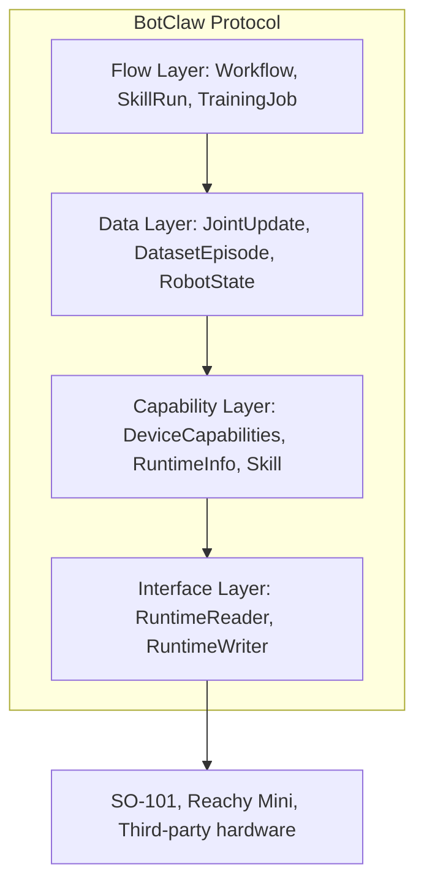

# BotClaw v0.9 Draft

BotClaw v0.9 is an internal field-freeze draft for BotverseX. It documents what
is already implementable in the current codebase and marks what must wait for
v1.0. It is not a public standard release.

## 1. Purpose

BotClaw exists to make robot capabilities portable across runtimes:

- Unified hardware control interfaces (`RuntimeReader`, `RuntimeWriter`)
- Unified data contracts (`JointUpdate`, `RobotState`, `DatasetEpisode`)
- Unified skill registry entries (`Skill`)
- Unified workflow vocabulary (Qualia-aligned node categories)
- Safety contracts inspired by TidyBot (`Lease`, `SafetyEnvelope`, run events)

## 2. Protocol Layers



v0.9 freezes layers 1-3 enough for internal use. The flow layer remains a
taxonomy plus existing API behavior, not a full DAG scheduler contract.

## 3. Ratified Schemas

| Schema | File | Status |
| --- | --- | --- |
| Skill | `schemas/skill.schema.json` | Aligned with `apps/api/app/data/skills_seed.json` |
| DeviceCapabilities | `schemas/device_capabilities.schema.json` | Aligned with realtime `RuntimeInfo` |
| JointUpdate | `schemas/joint_update.schema.json` | Existing realtime frame contract |
| RobotState | `schemas/robot_state.schema.json` | Existing UI state snapshot contract |
| DatasetEpisode | `schemas/dataset_episode.schema.json` | Existing dataset metadata contract |
| TrainingJob | `schemas/training_job.schema.json` | Existing training status contract |
| SafetyEnvelope | `schemas/safety_envelope.schema.json` | Placeholder |
| RuntimeLease | `schemas/runtime_lease.schema.json` | Placeholder |
| SkillRunEvent | `schemas/skill_run_event.schema.json` | Placeholder |

## 4. Skill Contract

The current registry lives at `apps/api/app/data/skills_seed.json`. v0.9 makes
that file a first-class BotClaw consumer.

Required fields:

- `skill_id`
- `verb`
- `robot_type`
- `compatible_types`
- `params_schema`

Important optional fields:

- `joint_count`
- `train_backend`
- `min_episodes`
- `episode_duration_s`
- `hf_model_id`
- `hf_dataset_id`
- `compatibility`

The registry is validated by:

```bash
python3 packages/botclaw-spec/scripts/validate_skills_seed.py
```

## 5. Runtime Capability Contract

v0.9 aligns `DeviceCapabilities` with `apps/realtime/runtimes/_protocol.py`:

- `robot_model`
- `display_name`
- `joint_count`
- `joint_names`
- `control_modes`
- `max_fps`
- `urdf_url`
- `supports_telemetry`
- `camera_sources`

Current ratified runtimes:

| Runtime | Status | Notes |
| --- | --- | --- |
| `so101` | Implemented | 6 joints, telemetry path, USB camera source |
| `reachy_mini` | Implemented | 9 joints, URDF path, dry runtime |

## 6. Safety Primitives

v0.9 borrows TidyBot's safety vocabulary but only freezes schemas:

| Primitive | v0.9 Contract | v1.0 Work |
| --- | --- | --- |
| Rewind | Event log design via `SkillRunEvent` | Full trajectory replay/rollback |
| Lease System | `RuntimeLease` schema | Runtime-level lease enforcement |
| Safety Envelope | `SafetyEnvelope` schema | Clamp/estop enforcement in adapters |
| Auto-hold | Failure phase/status in `SkillRunEvent` | Motor hold/home behavior on errors |

## 7. Verb Taxonomy

See `docs/verb_taxonomy.md`.

v0.9 ratifies these implemented verbs:

- `teleop`
- `record`
- `inference`
- `wave`

It reserves the following vocabulary for v1.0 skill authoring:

- `pick`
- `place`
- `grasp`
- `release`
- `push`
- `pull`
- `pour`
- `scan`
- `navigate`
- `home`

## 8. Workflow Node Taxonomy

See `docs/workflow_node_taxonomy.md`.

BotverseX aligns workflow nodes with Qualia Studio buckets:

| Category | Current Nodes |
| --- | --- |
| SOURCES | `dataset_load`, legacy `robot_connect` |
| TRANSFORMS | `camera_map` |
| VLAS | `finetune_job`, legacy `train` |
| OUTPUTS | `job_monitor`, legacy `visualize` |
| SKILLS | `skill_invoke`, legacy `record`, legacy `deploy` |

GENERATIVE and RL are reserved for future Qualia-compatible nodes.

## 9. How to Add a New Runtime

1. Create `apps/realtime/runtimes/<runtime_id>/`.
2. Implement a runtime class with `get_info()`.
3. Implement `create_reader()` if the runtime can stream state.
4. Implement `create_writer()` if the runtime can accept commands.
5. Return `RuntimeInfo` with `joint_names`, `urdf_url`, telemetry, and cameras.
6. Call `register_runtime("<runtime_id>", RuntimeClass)`.
7. Import the runtime from `apps/realtime/runtimes/__init__.py` `_auto_register()`.
8. Add or update `compatible_types` in `skills_seed.json` and run the validator.

## 10. v0.9 Boundaries

v0.9 does not claim:

- 100% cross-hardware Skill portability
- Full TidyBot safety implementation
- Public BotClaw certification / trademark rules
- Complete Qualia Studio parity
- Full DAG scheduler semantics

v0.9 is a practical internal agreement: enough to stop field drift and let the
platform build toward BotClaw 1.0 without rewriting the current API, Web, and
Realtime layers.
