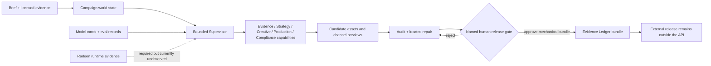

# ProofLaunch Cortex-X V10 architecture

This architecture is a modular, local-first control plane for an evidence-grounded multimodal GTM employee. It separates deterministic control mechanics from model, Radeon, human-evaluation, and business-outcome evidence.

## Component and interface map

| Boundary | Implementation | Contract |
|---|---|---|
| Browser workspace | `web/index.html`, `web/app.js` | 15 source-ordered control surfaces; no invented media |
| Single-port control plane | `v10_submission_api.py` | `/v1/health`, runs, status, SSE, approval, bundle, model cards, leaderboard |
| Run state | `AgencyRunStore` | Idempotent content-addressed run; approval changes bundle eligibility only |
| Organization | Supervisor + typed capabilities | One authoritative state owner; bounded permissions and budgets |
| Evidence | Deterministic ZIP + ledger | Request, status, observable events, approval hashes; release remains false |
| Training/runtime | Model/Radeon contracts | Planned versus observed states never collapse into one claim |
| Final locks | `v10_final_lock.py` | Exact source, model, and data byte identities with drift detection |

## Non-functional decisions

- **Security:** loopback binding, same-origin API allowlist, environment-only credentials, no automatic publish or spend.
- **Reliability:** idempotent run IDs, deterministic archives, bounded repair, explicit recovery and fail-closed unknown states.
- **Auditability:** content hashes, named approval, observable events, evidence classes, and source-ordered TODO locators.
- **Maintainability:** typed contracts and modular-monolith boundaries; external model providers remain replaceable evaluation adapters.
- **Performance truth:** latency, VRAM, GPU utilization, and quality fields remain unobserved until a real Radeon run supplies them.

## Primary execution sequence

`Brief/Evidence → World State → Supervisor/Capabilities → Candidate Assets → Audit/Repair → Human Gate → Evidence Bundle`

This diagram does not claim that real model generation, multi-GPU training, independent 4A review, publishing, or causal business uplift has occurred.
