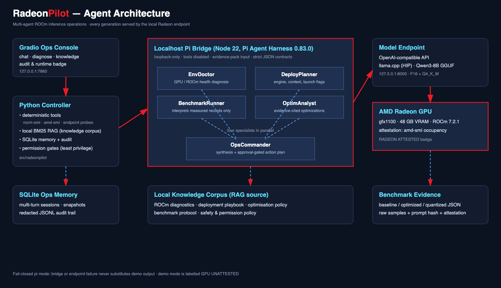

# RadeonPilot Architecture



*Source: `assets/architecture.svg` (regenerated by `scripts/render_pdfs.sh`).*

## System layers

```
+--------------------------------------------------------------+
| Gradio Ops Console  (app.py, 127.0.0.1:7860)                 |
|   chat | diagnose | knowledge search | audit & runtime       |
+--------------------------------------------------------------+
                       |
+--------------------------------------------------------------+
| Python controller  (src/radeonpilot)                         |
|   tools.py     deterministic rocm-smi/amd-smi/endpoint tools |
|   rag.py       BM25 retrieval over data/knowledge            |
|   memory.py    SQLite turns, snapshots, audit                |
|   orchestrator.py  evidence pack assembly, mode routing      |
|   pi_bridge.py loopback HTTP client to the Pi bridge         |
+--------------------------------------------------------------+
                       |
+--------------------------------------------------------------+
| Pi bridge  (pi-bridge, Node 22, 127.0.0.1:8787)              |
|   server.mjs      HTTP /health + /v1/orchestrate             |
|   validation.mjs  strict request schema                      |
|   sessions.mjs    pooled Pi Agent Harness sessions           |
|   orchestrator.mjs  4 specialists parallel + commander       |
|   runtime.mjs     Radeon attestation (amd-smi + rocm-smi)    |
+--------------------------------------------------------------+
                       |
+--------------------------------------------------------------+
| Model endpoint  (127.0.0.1:8000, OpenAI-compatible)          |
|   vLLM BF16 (Qwen3-8B)  or  llama.cpp GGUF (Q4_K_M)          |
|   running on AMD Radeon gfx1100, ROCm 7.2.1                  |
+--------------------------------------------------------------+
```

## Agent roster

| Role | Responsibility | Output contract |
| --- | --- | --- |
| EnvDoctor | Interpret GPU/ROCm telemetry; flag configuration risks | JSON: findings, evidence_used, confidence |
| DeployPlanner | Propose engine, parallelism, memory budget, launch flags | JSON with cited constraints |
| BenchmarkRunner | Interpret measured records only; never invent numbers | JSON grounded in input samples |
| OptimAnalyst | Locate bottlenecks; propose evidence-cited optimizations | JSON recommended_actions |
| OpsCommander | Synthesize, resolve conflicts, emit gated action plan | JSON: summary + action_plan |

Specialists run concurrently; OpsCommander runs after all specialists complete. Any
specialist failure fails the whole run closed.

## Radeon attestation model

A "RADEON ATTESTED" badge requires all of:

1. The model endpoint URL is loopback.
2. `VLLM_PID` identifies a process whose `/proc/<pid>/cmdline` matches vLLM or
   llama-server.
3. `rocm-smi` output identifies an AMD/Radeon device.
4. `amd-smi process --pid <pid>` lists that same PID.

Any missing link reports `GPU UNATTESTED` instead of guessing.

## Security posture

- Bridge and endpoint bind loopback; non-loopback configuration is refused at load.
- Pi SDK is pinned to 0.83.0; transitive `brace-expansion`/`undici` are pinned above
  security floors and re-verified after install.
- Requests are size-limited, schema-validated, and CORS-whitelisted.
- Audit log stores hashed summaries, not raw free text or secrets.
