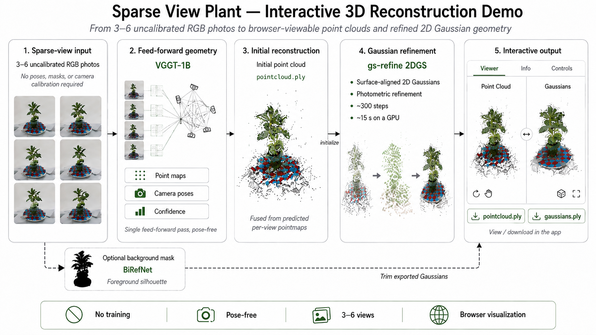
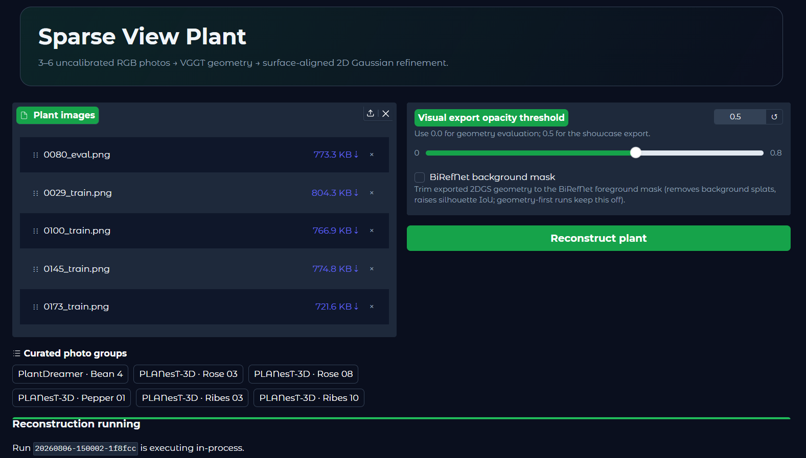

# Sparse View Plant

Upload **3–6 uncalibrated RGB photos** of a plant and get back a 3D point
cloud and refined 2D Gaussian geometry, viewable in the browser. No camera
calibration, poses, or masks are required.

## Pipeline



- **Point-cloud stage** – [VGGT](https://github.com/facebookresearch/vggt)
  predicts per-view pointmaps and camera poses from the raw photos.
- **Gaussian stage** – the cloud initializes surface-aligned 2D Gaussians,
  refined photometrically with gsplat (`refine_2dgs`).
- **Optional background mask** – a BiRefNet toggle trims exported Gaussians
  to the foreground silhouette in the app.
- No training is required; all model weights are downloaded from Hugging Face
  Hub on first use.

## Installation

Requires Python 3.12 and [uv](https://docs.astral.sh/uv/).

```bash
uv sync --extra gpu   # torch + CUDA/ROCm stack (a GPU is expected)
```

## ROCm (AMD GPUs)

Upstream `gsplat` is CUDA-only. On AMD GPUs, install AMD's HIP port
(`amd_gsplat`, which still provides `import gsplat`) and the ROCm builds of
PyTorch from AMD's wheel indices; no code changes are needed.

For an AMD Radeon Pro W7900D (`gfx1100`), for example:

```bash
uv pip install --index-url https://repo.amd.com/rocm/whl-multi-arch/ \
    "torch[device-gfx1100]==2.12.0+rocm7.14.0" \
    "torchvision[device-gfx1100]==0.27.0+rocm7.14.0" \
    "torchaudio==2.11.0+rocm7.14.0"
```

Then sync the rest of the project, skipping the packages installed above
(the `gpu` extra pins CUDA wheels that must not replace the ROCm ones):

```bash
uv sync --extra gpu \
    --no-install-package torch \
    --no-install-package torchvision \
    --no-install-package gsplat
uv pip install --index-url https://pypi.amd.com/rocm-7.0.0/simple/ \
    --no-deps amd_gsplat
```

Run the demo without re-syncing (which would reinstall the CUDA wheels):

```bash
uv run --no-sync python scripts/gradio_app.py
```

Notes:

- Check your GPU architecture first with `rocminfo | grep gfx` and adjust the
  `device-gfxXXXX` extra (`gfx1100` = Radeon Pro W7900D, `gfx942` = Instinct
  MI300X). AMD officially validates Instinct datacenter GPUs; consumer
  Radeon cards are not in the supported matrix.
- `amd_gsplat` is published on AMD's own PyPI (`pypi.amd.com`, ROCm 6.4.3 /
  7.0.0 indexes) and installs the `gsplat` module, so `pyproject.toml` and
  the source do not change.
- A MIGraphX graph-optimized VGGT was prepared for extra AMD acceleration
  but was not uploaded to Hugging Face; the pipeline runs the original PyTorch
  VGGT on both CUDA and ROCm.
- The API surface used here — `gsplat.rasterization`, `rasterization_2dgs`
  (2DGS + distloss) and `strategy.ops` (`duplicate`/`remove`/`split`/
  `reset_opa`) — is covered by the AMD port. Unsupported upstream features
  (packed distributed training, PNG-compressed splat parameters, fused
  SSIM/Bilagrid) are not used by this project.

## Run the demo

Point the app at your VGGT clone and checkpoint, then launch:

```bash
export VGGT_SRC=/path/to/vggt            # clone of facebookresearch/vggt
export VGGT_CKPT=/path/to/vggt-weights   # e.g. VGGT-1B model directory
uv run --extra gpu python scripts/gradio_app.py
```

Then open http://127.0.0.1:7860. In the **Live** tab, upload 3–6 photos (or
pick a bundled example), optionally enable **BiRefNet background mask**, and
click **Reconstruct plant**. Results appear in the 3D viewers; the
`pointcloud.ply` and `gaussians.ply` files are downloadable from the same tab.



The Gradio app contains only the Live Reconstruction workflow. The project
page (`docs/index.html`) shows the method, the Bean 4 baseline comparison,
and the evaluation metrics. A project profile document is available at
`docs/project-profile.pdf` (generated from `docs/project-profile.typ`).

## CLI

The same pipeline is exposed as a CLI:

```bash
uv run --extra gpu python scripts/run_pipeline.py --help
```

## Outputs

Runs are stored under `outputs/gradio_runs/<run_id>/` (or the directory passed
with `--outputs-dir`): `pointcloud.ply`, `gaussians.ply`, `pipeline.json`, and
a log.

## License

Code: MIT (see `LICENSE`). Third-party model weights (VGGT, BiRefNet)
keep their own licenses — check each model card before commercial use.
