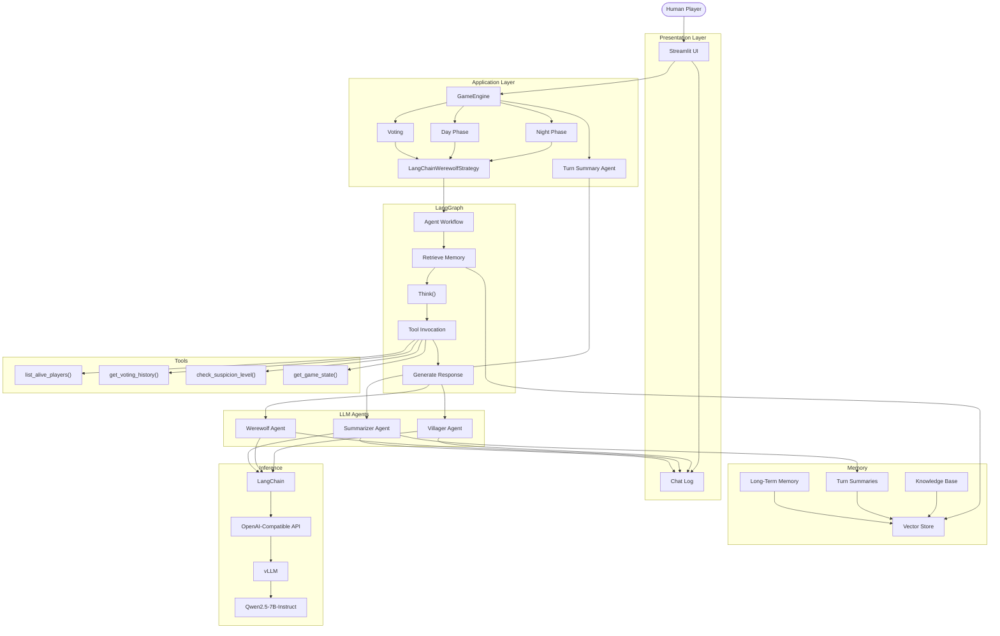

# Werewolf Game

## Application Scenarios

This project implements an AI-powered Werewolf social game in which multiple LLM agents simulate villagers and werewolves. The game supports multi-agent discussion, role-based reasoning, voting, night actions, and human participation through a Streamlit interface.

The project can be applied to:

- **AI agent demonstrations:** Demonstrate multi-agent communication, collaboration, competition, and decision-making in a dynamic social environment.
- **LLM behavior research:** Evaluate how language models perform role-playing, deception, reasoning, voting, and social inference.
- **Agent architecture experiments:** Explore RAG, long-term memory, tool invocation, multi-step planning, and permission control in a practical application.
- **Human–AI interaction:** Allow human players to participate in discussions and interact with AI-controlled players in real time.
- **Local AI deployment demonstrations:** Demonstrate how LLM applications can be deployed using local inference services and AMD GPU acceleration.

## Agent architecture diagram



## Introduction to Core Capabilities

The Werewolf game integrates multiple AI-agent capabilities into a complete interactive application.

- **Multi-agent communication:** Villager and werewolf agents communicate during the discussion phase and respond according to their assigned personalities and roles.

- **Role-based reasoning:** Each agent receives only the information permitted by its role. Villagers attempt to identify werewolves, while werewolves hide their identities and cooperate during the night phase.

- **Human–AI interaction:** Human players can submit messages through the Streamlit interface. Human messages are synchronized with AI-agent messages in the game chat log.

- **Voting and decision-making:** During the daytime phase, living players analyze the discussion and vote for a suspected werewolf. During the night phase, werewolf agents select a target.

- **RAG-based knowledge retrieval:** Agents retrieve relevant background knowledge and selected historical information instead of receiving the entire game history in every prompt.

- **Long-term game memory:** An LLM-based summarization agent generates a summary after each game turn. The summary is stored and retrieved as long-term memory for future reasoning.

- **Tool invocation:** Agents can access structured game information through tools, such as checking living players, reviewing voting history, and obtaining game-state information.

- **Multi-step planning:** Werewolf agents can evaluate possible targets, consider strategic risks, and select a victim through a structured planning process.

- **Permission and privacy control:** A role-based context access policy prevents hidden information from being included in prompts for unauthorized agents.

## Model Introduction and Local Deployment Plan

The project uses **Qwen2.5-7B-Instruct** as the primary language model for agent discussion, voting, game-turn summarization, and werewolf strategy generation.

Qwen2.5-7B-Instruct was selected because it provides a balance between instruction-following capability, response quality, inference cost, and GPU memory requirements. A single model service is used for multiple game tasks, while different temperatures and output limits are configured according to each task.

The model is deployed locally using **vLLM** with an OpenAI-compatible API. The Streamlit application communicates with the vLLM server through LangChain's `ChatOpenAI` interface.

The deployment architecture is:

```text
Streamlit User Interface
          │
          ▼
Game Engine and LangGraph Workflow
          │
          ▼
LangChain LLM Clients
          │
          ▼
vLLM OpenAI-Compatible API
          │
          ▼
Qwen2.5-7B-Instruct
          │
          ▼
AMD Radeon GPU
```

The recommended vLLM startup configuration is:

```bash
VLLM_ROCM_USE_AITER=1 \
vllm serve Qwen/Qwen2.5-7B-Instruct \
    --port 8000 \
    --dtype bfloat16 \
    --max-model-len 4096 \
    --max-num-seqs 16 \
    --gpu-memory-utilization 0.75
```

The embedding model is deployed separately and is used for RAG-based knowledge retrieval and long-term memory. The embedding service provides vector representations for game knowledge, player background information, and turn summaries.

## Optimization Description for Inference Speed on AMD Radeon GPU

The project uses vLLM and ROCm to accelerate LLM inference on AMD Radeon GPU hardware. Several optimization methods are applied to balance inference speed, GPU memory usage, and application stability.

- **BF16 inference:** The Qwen2.5-7B-Instruct model is executed using the BF16 data type. Compared with FP32 inference, BF16 reduces model memory requirements while maintaining suitable response quality for game interactions.

- **Limited context length:** The maximum model context is limited to 4096 tokens. The game uses RAG retrieval and turn summaries to provide relevant historical information without sending the complete game history to the model.

- **Controlled request concurrency:** `--max-num-seqs 16` limits the number of sequences processed simultaneously. This is sufficient for a game with 5–8 players and reduces unnecessary GPU memory consumption.

- **GPU memory utilization control:** `--gpu-memory-utilization 0.75` reserves part of the GPU memory for the operating environment and prevents memory allocation failures.

- **RAG-based selective memory:** Only relevant knowledge and historical summaries are retrieved for each agent. This reduces prompt length and improves inference efficiency.

- **Short response generation:** Agent discussion messages are limited to short outputs. Voting results and structured game decisions use small output-token limits to reduce generation latency.

- **Asynchronous agent execution:** Independent agent requests can be processed asynchronously, reducing the total waiting time during the discussion and decision phases.

- **Single-model deployment:** One Qwen model server supports discussion, voting, summarization, and werewolf strategy generation. This avoids loading multiple large models into GPU memory.

The optimization goal is to prioritize low response latency and stable interaction for a small group of agents rather than maximize large-scale request throughput.
