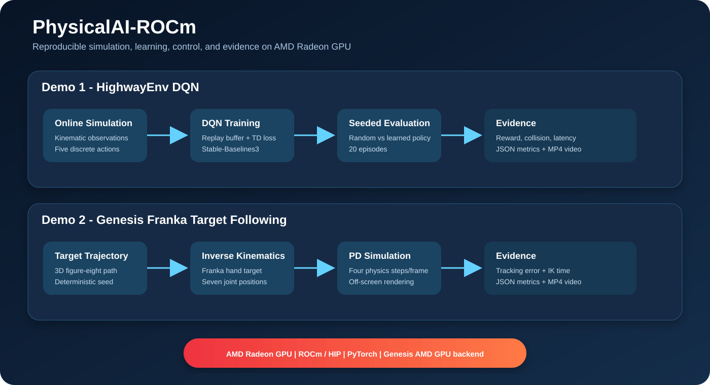
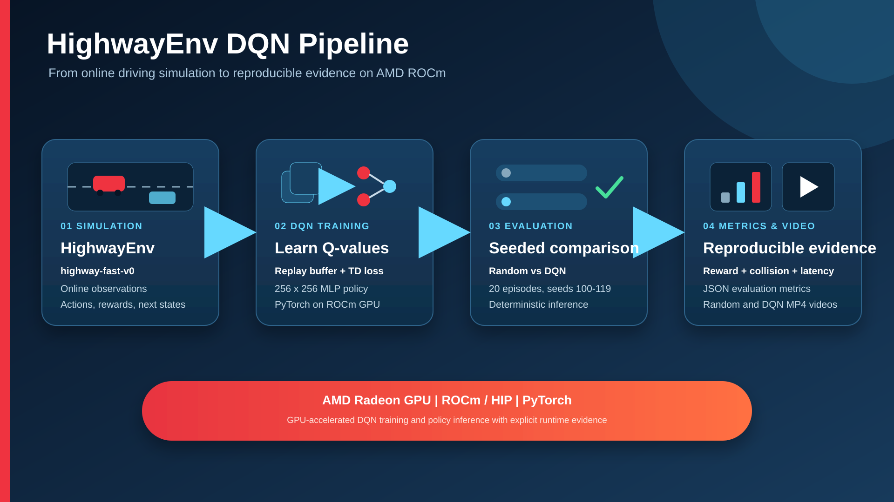
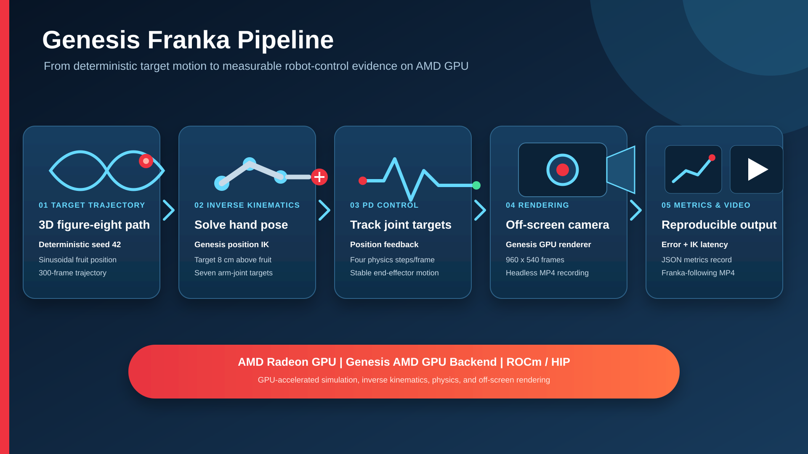

# PhysicalAI-ROCm

Two reproducible Physical AI demonstrations accelerated by AMD Radeon GPU and ROCm:

1. **HighwayEnv DQN** - an autonomous-driving reinforcement-learning baseline that compares a trained DQN policy with a random policy.
2. **Genesis Franka Fruit Following** - a Franka Panda manipulator that follows a moving three-dimensional target using inverse kinematics and joint PD control.

This repository is prepared for **Track 3: Physical AI Challenge - Robotics Simulation and Application Design based on AMD Radeon GPUs and ROCm**.

**Registered participant name:** daotianyi  
**GitHub:** [daotianyi](https://github.com/daotianyi)  
**Submission type:** Individual

**Required contest location:** `submission/PhysicalAI_daotianyi/`

## Highlights

- End-to-end training, inference, simulation, rendering, evaluation, and video generation.
- Explicit AMD ROCm checks in every GPU-dependent entry point.
- Quantitative JSON outputs committed under each demo's `results/` directory.
- Headless execution suitable for Radeon Cloud, SSH, and container workflows.
- Reproducible seeds and documented evaluation settings.

## System Architecture



The HighwayEnv pipeline generates online simulation transitions, trains a DQN policy with Stable-Baselines3 on the ROCm PyTorch device, and compares the learned policy against an identically seeded random baseline. The Genesis pipeline generates a deterministic target trajectory, solves inverse kinematics on the AMD GPU backend, applies joint PD control, renders off-screen frames, and records tracking metrics.

## Repository Layout

```text
PhysicalAI-ROCm/
|-- README.md
|-- Dockerfile
|-- requirements.txt
|-- requirements-lock.txt
|-- assets/videos/
|   `-- PhysicalAI_Demo1_Demo2_video.mp4
|-- docs/
|   |-- genesis_franka_pipeline.png
|   |-- genesis_franka_pipeline.svg
|   |-- highwayenv_dqn_pipeline.png
|   |-- highwayenv_dqn_pipeline.svg
|   `-- system_architecture.svg
|-- output/pdf/
|   `-- PhysicalAI_ROCm_Technical_Report.pdf
|-- demo1_highway_dqn/
|   |-- requirements.txt
|   |-- scripts/
|   `-- results/eval_final.json
`-- demo2_franka_genesis/
    |-- requirements.txt
    |-- scripts/
    `-- results/franka_fruit_follow.json
```

Generated models and raw run videos are ignored by Git because they can be large. The curated final demonstration video is included and linked below.

## Tested Environment

The committed Genesis result was produced with:

- AMD Radeon Graphics
- ROCm/HIP 7.2.53211
- PyTorch 2.9.1+rocm7.2.1
- Genesis 1.3.1

The Dockerfile uses AMD's matching ROCm 7.2.1 / PyTorch 2.9.1 image. A Linux host with a supported AMD Radeon GPU, the ROCm kernel driver, and access to `/dev/kfd` and `/dev/dri` is required for GPU execution.

## Installation

### Option A: Radeon Cloud or an existing ROCm PyTorch environment

```bash
git clone https://github.com/daotianyi/Radeon-hackathon-2026-07.git
cd Radeon-hackathon-2026-07/submission/PhysicalAI_daotianyi

python3 -m venv .venv --system-site-packages
source .venv/bin/activate
python -m pip install --upgrade pip setuptools wheel
python -m pip install -r requirements-lock.txt
```

`--system-site-packages` preserves access to the ROCm PyTorch installation supplied by the host image. Do not replace it with a CUDA-only PyTorch wheel.

### Option B: Docker

```bash
docker build -t physicalai-rocm:7.2.1 .

docker run --rm -it \
  --device=/dev/kfd \
  --device=/dev/dri \
  --group-add video \
  --ipc=host \
  --shm-size 8G \
  -v "$PWD:/workspace/PhysicalAI-ROCm" \
  physicalai-rocm:7.2.1
```

## Verify AMD GPU and ROCm

```bash
rocm-smi
amd-smi version

python - <<'PY'
import torch
print("PyTorch:", torch.__version__)
print("HIP:", torch.version.hip)
print("GPU available:", torch.cuda.is_available())
print("GPU:", torch.cuda.get_device_name(0) if torch.cuda.is_available() else "N/A")
PY
```

PyTorch retains the `torch.cuda` API name on ROCm. A reported `cuda` device in PyTorch therefore refers to the HIP/ROCm execution backend in this environment.

## Demo 1: HighwayEnv DQN



### Task

The ego vehicle observes a compact kinematic state and chooses one of five discrete high-level actions: lane left, idle, lane right, faster, or slower. Training data are generated online by interaction with `highway-fast-v0`; there is no fixed offline dataset.

### Run

```bash
cd demo1_highway_dqn

# Optional random-policy sanity check
python scripts/01_random_policy.py

# Reproduce the submitted 20,000-step training configuration
python scripts/02_train_dqn.py \
  --timesteps 20000 \
  --seed 42 \
  --model outputs/models/dqn_highway \
  --summary outputs/metrics/train_summary.json

# Compare random and DQN policies over seeds 100-119
python scripts/03_evaluate.py \
  --model outputs/models/dqn_highway.zip \
  --episodes 20 \
  --seed 100 \
  --metrics outputs/metrics/eval_final.json \
  --random-video outputs/videos/random_policy_final.mp4 \
  --dqn-video outputs/videos/dqn_policy_final.mp4
```

### Submitted Result

| Metric | Random policy | DQN policy |
|---|---:|---:|
| Mean total reward | 38.31 | 61.15 |
| Mean episode steps | 47.30 | 64.35 |
| Collision rate | 85% | 65% |
| Mean action inference | N/A | 0.927 ms |

The DQN increased mean reward by 22.84 and reduced collision rate by 20 percentage points. These values come from 20 evaluation episodes with seeds 100-119. The baseline is an entry-level demonstration and is not a production autonomous-driving system.

Committed metrics: [`demo1_highway_dqn/results/eval_final.json`](demo1_highway_dqn/results/eval_final.json)

## Demo 2: Genesis Franka Fruit Following



### Task

A red fruit target follows a deterministic three-dimensional figure-eight trajectory. The Franka hand link tracks a point 8 cm above the fruit. Genesis inverse kinematics produces seven arm-joint targets, and a PD controller advances four physics steps per rendered frame.

This is **dynamic target following, not physical grasping**. Gravity and collision are disabled, the target is moved directly, and the gripper does not use contact feedback.

### Run

```bash
cd demo2_franka_genesis

# Quick smoke test
python scripts/franka_fruit_follow.py --frames 60 \
  --video outputs/videos/franka_fruit_follow_smoke.mp4

# Reproduce the submitted 300-frame run
python scripts/franka_fruit_follow.py --frames 300 --fps 30 \
  --seed 42 \
  --video outputs/videos/franka_fruit_follow_final.mp4
```

### Submitted Result

| Metric | Value |
|---|---:|
| Mean tracking error | 7.446 mm |
| P95 tracking error | 10.750 mm |
| Maximum tracking error | 10.990 mm |
| Mean IK time | 2.243 ms |
| P95 IK time | 2.341 ms |
| 300-frame execution time | 6.861 s |

Committed metrics: [`demo2_franka_genesis/results/franka_fruit_follow.json`](demo2_franka_genesis/results/franka_fruit_follow.json)

## Demonstration Video

- Repository video: [PhysicalAI Demo 1 & Demo 2](assets/videos/PhysicalAI_Demo1_Demo2_video.mp4)
- Baidu Netdisk mirror: [Open shared video](https://pan.baidu.com/s/1wm_9XHLtiEBs8LYltYmDRQ?pwd=8o62), extraction code `8o62`

The video presents the HighwayEnv DQN and Genesis Franka workflows, ROCm execution evidence, quantitative results, and rendered demonstrations.

## Expected Outputs

```text
demo1_highway_dqn/outputs/
|-- models/dqn_highway.zip
|-- metrics/train_summary.json
|-- metrics/eval_final.json
`-- videos/{random_policy_final,dqn_policy_final}.mp4

demo2_franka_genesis/outputs/
|-- metrics/franka_fruit_follow.json
`-- videos/franka_fruit_follow_final.mp4
```

## Reproduction Time

- Environment installation: approximately 10-30 minutes after the ROCm base image is available.
- HighwayEnv training and evaluation: hardware-dependent; allow approximately 10-30 minutes for the documented baseline.
- Genesis 300-frame run: the submitted run recorded 6.861 seconds of execution after scene initialization; first-run shader/kernel setup may add time.

## Known Limitations

- The DQN baseline still has a 65% collision rate over the submitted 20-episode evaluation.
- The HighwayEnv result is simulation-only and does not claim real-vehicle transfer.
- The Genesis demo uses position-level inverse kinematics, not differential IK.
- Genesis gravity, collision, contact, and physical grasping are outside the current scope.
- Exact timing varies with GPU model, driver, kernel caches, and background load.
- Generated models and raw run videos are not committed; the curated final demonstration video is included under `assets/videos/`.

## Deliverables

- Technical report: [`output/pdf/PhysicalAI_ROCm_Technical_Report.pdf`](output/pdf/PhysicalAI_ROCm_Technical_Report.pdf)
- Demonstration video: [`assets/videos/PhysicalAI_Demo1_Demo2_video.mp4`](assets/videos/PhysicalAI_Demo1_Demo2_video.mp4)
- Video mirror: [Baidu Netdisk](https://pan.baidu.com/s/1wm_9XHLtiEBs8LYltYmDRQ?pwd=8o62), extraction code `8o62`
- Architecture diagram: [`docs/system_architecture.svg`](docs/system_architecture.svg)
- HighwayEnv DQN pipeline: [`docs/highwayenv_dqn_pipeline.png`](docs/highwayenv_dqn_pipeline.png)
- Genesis Franka pipeline: [`docs/genesis_franka_pipeline.png`](docs/genesis_franka_pipeline.png)

## Team Contributions

This is an individual submission by **daotianyi**. The participant implemented the simulation environments, GPU execution paths, training and control logic, evaluation, visualization, technical report, demonstration videos, and reproducibility package.

## License

Project source and documentation are provided under the [MIT License](LICENSE). Third-party packages retain their own licenses.
