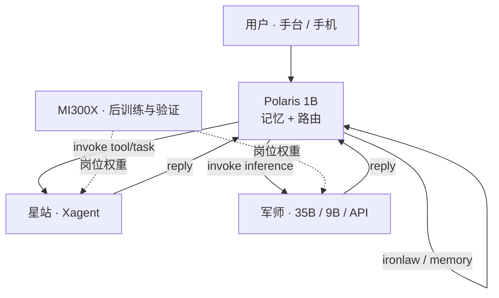

# omima × AMD：端侧与星罗棋布的模型编制

> **思想收敛（全产品）**：`core-thesis.md` — 六大类需求 → 三要素 → Harness / Loop / 硬件  
> **本文角色**：效率工程中 **要素二（模型内化设置）** 与 **硬件切面** 的可复核专章，不替代协议与工作方法全文。

**个人算力网上的 Agent 运行模式——模型按岗位分层，执行按星站铺开，推理在需要的地方被叫醒。**

本地推理 · 分档后训练 · 协议路由 · 可复制星站 · ROCm 主链已上岗

---

## 这是什么

在 omima 的效率工程里，协议与五拍工作方法（创意→审查）由 `core-thesis` / 主文承载；**本文写模型岗位如何内化、如何在 AMD 硬件上上岗**。

端侧守记忆与路由，星站无状态可复制，1B / 9B / 35B 按岗出现。训练、量化、测速在 **AMD MI300X（ROCm）** 上发生——不是为了证明「我们会微调」，而是因为**内化设置必须可加载、可服务、可 tool-call**。卡上的时间给编制表生产零件。

它不是：

- 又一个「单卡刷高 TPS」的 benchmark 作品  
- 只有云端 API、没有本地编制的聊天壳  
- 只画异构示意图、没有执行内核与权重的概念稿  
- 把所有任务塞进一个 70B 单体的替代方案  
- 用 ROCm 数字替代「协议 + 工作方法 + Harness/Loop」整包叙事  

一句话：

**编制先于调参：需求驱动岗位；分层模型与 harness 把分布变成可运行的网；MI300X 账是上岗切片。**

---

## 要点

1. **模式，不是技巧清单**  
   端侧 + 星罗棋布决定了要哪些模型、落在哪类硬件、何时本地推理、何时外呼。FP8、LoRA、GGUF 都是填编制的手段。

2. **三档模型是三岗，不是购物车**  
   1B 阵眼（记忆与路由）、9B 操作台/星站 Worker（工具循环）、35B 军师（深推理与隐私任务）。缺一档，时间尺度就断一截。

3. **闭环四层，不只画一张图**  
   硬件落位假设 · 应用层编程工具（Xagent / Gateway）· 路由模型后训练 · 各档位小模型后训练——四层咬合才叫可行。

4. **执行面可见、可复制**  
   星站是无状态进程：登记能力、领任务、回传、遗忘。入网、事件回放、铁律预检写在 harness 与中枢里，不靠模型自觉。

5. **主链在 Instinct 上已上岗**  
   MI300X 完成军师向 FP8 服务点、双岗位 LoRA、tool-call 验收、9B CPU GGUF 闭环；权重与数据在魔搭可拉。

6. **优化目标函数写的是「可上岗」**  
   量化对照、框架选型、微调、导出服务串成一条链，服务的是星网岗位，不是散落的技巧表演。

---

## 能力图（模式一张表）

| 层 | 做什么 | 当前形态 |
|----|--------|----------|
| **端侧主权** | 记忆只在阵眼；外发是无隐私任务描述 | 1B Polaris 定位；手机端控制面（omima-phone）与桌面手台 |
| **路由** | 任务派给哪类星站 / 哪路推理 / 是否求助外部 API | 路由模型岗位 + 编排层规则；置信度阈值思路（~0.72） |
| **军师推理** | 复杂拆解、长上下文、隐私敏感尽量本地 | 35B 级 MoE；MI300X 上 FP8 **~195 TPS**（C=3）相对 BF16 **+65%**；omima-35B LoRA 可服务 |
| **Worker 推理** | 工具循环、跟手延迟、可 CPU/笔记本 | omima-9B LoRA；GGUF Q8 在 CPU 上 **~13 t/s** tool-call 通过 |
| **星站执行** | 无状态工具与职能（语音/存储/斥候/军械库…） | Xagent headless + 工具箱；Gateway 注册/事件/回放 |
| **后训练供弹** | 协议 · 会话 · 知识 → 岗位权重 | 首轮数百条级已训通；更大规模分片在数据集侧就绪 |
| **训练与重验证实验室** | 养模型、找服务工作点 | AMD × 魔搭 **MI300X** Notebook · ROCm · vLLM |

---

## 架构

```text
                    ┌─────────────────────────────┐
                    │  端侧 · Polaris 阵眼 (1B)     │
                    │  唯一记忆 · 路由 · 任务提炼     │
                    └──────────────┬──────────────┘
                                   │ 协议信道（登记 / 调用 / 记忆 / 铁律 / 回传 / 移交）
           ┌───────────────────────┼───────────────────────┐
           ▼                       ▼                       ▼
    ┌────────────┐          ┌────────────┐          ┌────────────┐
    │ 军械库星站  │          │ 军师星站    │          │ 其它星站…  │
    │ 工具执行    │          │ 9B / 35B   │          │ 语音/斥候/  │
    │ Xagent     │          │ 或按需 API  │          │ 存储/监控   │
    │ ECS 1C1G+  │          │ MAX 类主机  │          │ 低配可复制  │
    └────────────┘          └────────────┘          └────────────┘
           │                       │
           └───────────┬───────────┘
                       ▼
              遗忘（星站无用户记忆）
```



### 一次任务怎么走（主数据流）

1. 用户在端侧手台或手机发出意图。  
2. **1B 阵眼**检索记忆，把意图压成不含隐私上下文的任务描述。  
3. 路由决定：本地工具星站、本地 9B/35B、或脱敏后的云端 API。  
4. **Gateway** 投递；星站经 poll/事件通道领取（任务通道与聊天通道分工）。  
5. **Xagent** 在执行前过铁律；工具与中间结果可打 Tag 回流记忆。  
6. 军师侧若走本地模型：vLLM（GPU）或 llama.cpp（CPU/端侧形态）出 token；若走 API，只见任务不见记忆。  
7. 结果回传阵眼，由阵眼写回记忆并答复用户；星站侧不保留用户记忆。

这与「单窗口多轮 chat」不同：模型是岗位，机器是星站，记忆有唯一归属。

---

## 为什么是 1B、9B、35B

模式要求三条时间尺度同时成立：**永远在线、日常执行、深度思考**。一个尺寸做不到三件事。

| 编制 | 体量 | 工作 | 为什么存在 |
|------|------|------|------------|
| 阵眼 | **1B** | 常驻、持记忆、路由与提炼 | 必须塞进手机级与最低功耗常驻；边界是调度，不是写长文 |
| Worker | **9B** | 工具循环、跟手推理 | Dense 易部署；GGUF 可上 2C4G / 无影 / 笔记本；LoRA 教协议与工具即可 |
| 军师 | **35B 级 MoE** | 难任务、隐私向深推理 | 激活量约 3B 级，质量与吞吐可折中；产品落点对齐统一内存大主机；服务形态在 MI300X 上验证 |

云端强模型仍在路由表里：按需、不持记忆。它补的是能力尖峰，不替代端侧编制。

---

## 模式不单薄：四层各自长什么样

### 1. 对 AMD 硬件的预期与落位

| 硬件 | 模式中的岗位 |
|------|----------------|
| **MI300X / Instinct** | 训练实验室 + 重推理验证；本赛主链实测所在 |
| **Ryzen AI 笔记本（产品预期）** | 9B 操作台；人随身的界面与轻推理 |
| **MAX 395+/400 类统一内存主机（产品预期）** | 35B 私人军师；隐私推理不出门 |
| **EPYC / 通用 CPU 云主机** | 星罗棋布的土壤；1B～9B GGUF 与无头 Xagent |
| **ROCm · vLLM · llama.cpp · peft** | 从养模型到上岗同一生态 |

消费级落点是**模式咬合**，不是本赛已逐台刷完的成绩单；Instinct 上的小时数，用来证明编制表上的零件造得出来。

### 2. 应用层编程工具：设计与验真

星站上的活不是裸 `chat.completions`。

| 组件 | 技术形态 |
|------|----------|
| **Xagent** | 星站 harness：工具前铁律、记忆 Tag、五步工序、工具箱（**DEMO 构建**） |
| **Gateway** | 注册、WS/事件、回放、能力与在线状态；任务领取与聊天通道分离 |
| **手台 / 手机 client** | 人在回路：线程、派发、弱网回放；与「星站 agent 身份」分阶段（**DEMO 构建**） |
| **入网路径** | 低配 Linux 八步拉起、身份复用、能力登记——「再铺一颗棋子」的动作 |

验真原则很简单：协议有、客户端有、线上是否部署、是否实测——分开说，不混成一句「已完成」。模式声称可复制，工程上就要复制**可管的进程**。

### 3. 路由模型的后训练与调优

1B 不是缩小版聊天模型，而是**路由与记忆防火墙**：什么留下、什么外发、派给谁。训练目标是协议行为与路由策略。没有这一层，星罗棋布会退化成许多互不知晓的聊天窗口。

### 4. 各层级工作模型的后训练与调优

9B、35B（以及更低配 ECS 上的 GGUF）按岗位数据微调：sys-hooks 协议、工具轨迹、领域知识。MI300X 上的首轮，是为岗位产出**可加载权重**，并用 tool-call 与服务吞吐确认仍能当 Agent 零件用。

---

## 主链试验记录（MI300X · ROCm）

试验路径中规中矩：选型 → 精度对照 → 框架锁定 → 岗位 LoRA → 目标运行时复测。数字说明编制可工程化。

### 推理服务

| 项 | 结果 |
|----|------|
| 框架 | **vLLM + ROCm**（Leader 侧；tool parser 可用） |
| 军师基座 | Qwen3.6-35B-A3B；tool-call **8/9** |
| FP8 vs BF16 | **~195 vs ~118 TPS**（C=3 聚合），约 **+65%**，tool-call 未见退化 |
| AITER | 环境打开过相关开关；未做隔离消融，不作独立贡献叙述 |
| omima-35B LoRA 服务 | 短上下文约 **59–65 TPS**（挂 adapter） |
| omima-9B | 裸基座 vLLM 约 **152 TPS**；首轮 LoRA 服务约 **75 TPS**（目标层曾误配，日志有记录） |
| 9B CPU | GGUF Q8 约 **13 t/s**，tool-call 闭环通过（Pocket Worker） |

### 岗位后训练（权重已上魔搭）

| 模型 | 基座 | 摘要 |
|------|------|------|
| **omima-9B** | Ornith-1.0-9B | LoRA；Loss ~1.82→**0.79**；约 **57 min** @ MI300X；HF + GGUF |
| **omima-35B** | Ornith-1.0-35B | LoRA；Loss ~1.88→**0.96**；约 **1h11m** @ MI300X；adapter 可挂 vLLM |
| 置信度 | omima-35B | 协议样本标定，统一阈值约 **0.72**（本地无把握则求助的思路） |

数据：协议 / 会话蒸馏 / 知识切块三路供弹；首轮以高质量小样本跑通管线，更大规模分片在数据集仓就绪，供后续把各档星站继续往岗位分布推。

### 推理优化在这条链里的位置

同一块 MI300X 上完成的事可以压成一句：

**为军师岗位找到 FP8 可服务点，为 Worker 岗位找到可 CPU/端侧化的 9B 形态，并用 tool-call 证明它们仍是 Agent 零件。**

基线 → 量化对照 → 框架 → LoRA → 服务复测，串在「上岗」这一目标函数下，而不是散落的技巧。

---

## 资产与复现入口

| 类型 | 位置 |
|------|------|
| 试验 / 施工日志 | Gitea `omima-hackathon` · `logs/` |
| 岗位权重 | 魔搭 `kooooon/omima-35B`、`kooooon/omima-9B` |
| 数据 | 魔搭 `kooooon/omima-distilled`、`kooooon/omima-training-data` |
| 脚本 | `scripts/finetune_35b_lora.sh`、CPU worker、联调故事板 |
| 架构与提交叙事 | `submission/main-paper.md`、协议与编排 Spec |

复现路径：ROCm Notebook → 拉基座与数据 → LoRA → vLLM 或 llama.cpp 上岗 → 协议场景看 tool-call。

---

## 当前边界

与代码和试验对齐，避免预期错位：

- **消费级 AMD 整机**（Ryzen AI / MAX 395+）上的 9B/35B 长时实测，是产品落点，**本赛未逐台交付**；主链验证在 MI300X。  
- **1B 阵眼**产品能力按阶段开放；路由与记忆防火墙是模式定义，与展示完成度分开读。  
- **MTP / FP8 KV Cache / AITER 消融**未作为已完成优化写入成绩。  
- **万级样本全量二轮 LoRA** 数据侧已备，全量训进 35B 的长跑按算力窗口推进，首轮是岗位管线通证。  
- 演示主路径仍可能混用 ECS 与云 API；**AMD GPU 证据以 MI300X 日志与权重为准**，不与 API 延迟混写。  
- 星网能力按层陈述：协议、客户端、部署、实测——未实测的不升级成「全域已完成」。

---

## 给 AMD 的参考点

AMD 的图谱里同时有 NPU、统一内存客户端、Instinct、以及海量 x86 云实例。多数 Agent 演示只用到其中一截。

omima 想回答的是更贴产品的问题：

**当用户的生活天然摊在口袋、背包、桌面和一排云主机上时，模型与运行时如何编制，才能让这些硅片各干最合适的活？**

回答不是又一张 TPS 海报，而是一张可运行的编制表：端侧主权、星站复制、三档模型、工具层验真、Instinct 上老实跑通的主链。微调与测速保持中规中矩；**模式完整、自洽、主链可行——这是我们愿意被对照、被挑错、也被借鉴的部分。**
