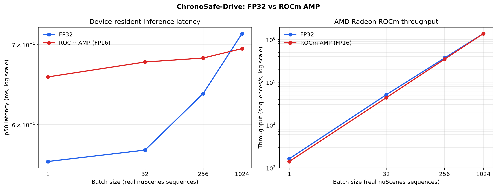
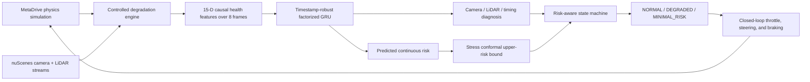

# ChronoSafe-Drive

**Self-Diagnosis, Risk Calibration, and Minimal-Risk Maneuvers under Multi-Sensor Perception Degradation**

[](https://github.com/AMD-DEV-CONTEST/Radeon-hackathon-2026-07)
[](https://rocm.docs.amd.com/)
[](LICENSE)

## Project Overview

ChronoSafe-Drive is an end-to-end Physical AI safety pipeline for autonomous
driving on **AMD Radeon GPUs and ROCm**. It diagnoses persistent camera, LiDAR,
and timing degradation; predicts a calibrated upper bound on driving risk; and
closes the loop with a three-state controller that safely reaches a
minimal-risk condition.

The final system combines physics-based MetaDrive simulation with public
nuScenes sensor streams, causal temporal learning, stress-aware conformal risk
calibration, and a validated-camera-path closed-loop evaluation under Xvfb.

## Team Contributions and Collaboration

- **Wang Zhenyu — Team Lead and Primary Developer:** project direction, system
  architecture, data pipeline, model and controller implementation, AMD ROCm
  training and benchmarking, experiments, evaluation, and technical delivery.
- **Wang Guanyu — Demo Video Producer:** demo planning, screen recording,
  editing, English subtitles, and final video production.
- **Han Liuxuan — Research Materials Coordinator:** collection, organization,
  and verification of competition, technical, and reference materials.

Except for the demo-video production and research-material coordination roles
listed above, the remaining project work was completed by Wang Zhenyu.
The team coordinated through a shared frozen experiment protocol: Wang Zhenyu
provided validated numerical and visual evidence, Wang Guanyu produced the
demo from those frozen artifacts, and Han Liuxuan checked the competition,
technical, and reference materials used in the final submission.



## Why this project matters

Most autonomous-driving robustness demonstrations test one isolated sensor
fault at a time. Real failures are often persistent, compound, and temporally
misleading: frames may freeze, packets may disappear, clocks may jitter, or
metadata may falsely claim that stale data are current. A controller also needs
to know when uncertainty is high enough to stop, not merely which fault class
is most likely.

ChronoSafe-Drive addresses the complete chain:

1. generate controlled single and compound degradation in a physical simulator
   and on real multimodal sensor streams;
2. diagnose camera, LiDAR, and timing health from causal temporal evidence;
3. calibrate a conservative upper risk bound on held-out domains;
4. convert risk into `NORMAL`, `DEGRADED`, and latched `MINIMAL_RISK` control;
5. verify the closed loop on unseen MetaDrive seeds; and
6. benchmark real-data inference on an AMD Radeon `gfx1100` GPU with ROCm 7.2.

## Core innovations

### 1. Factorized temporal self-diagnosis

A shared GRU encodes an eight-frame causal history, while independent camera,
LiDAR, and delay heads preserve the structure of compound degradation. This
supports combinations that are poorly represented by a flat seven-class
classifier and makes each diagnosis interpretable.

### 2. Timestamp-authenticity robustness and calibrated risk

Training injects missing timestamps, two-frame jitter, camera/LiDAR timestamp
swaps, and metadata forged to appear normal. Stress conformal calibration then
selects the worst held-out-domain residual radius, turning the risk prediction
into an empirical upper bound instead of an uncalibrated confidence score.

### 3. Frozen-threshold minimal-risk control

The controller uses a threshold selected only on MetaDrive calibration seeds
`113` and `127`. The selected MRM threshold (`0.62`) is then frozen before the
20 external closed-loop test seeds are evaluated. Hysteresis, temporal warm-up,
and a latched stop state prevent oscillation and premature emergency braking.

## Development Process

### Key technical decisions

- **Factorized temporal diagnosis instead of a flat fault classifier.** Camera,
  LiDAR, and timing heads preserve the compositional structure of compound
  degradation and make each diagnosis interpretable.
- **Causal health features instead of a large end-to-end visual backbone.** The
  compact 15-dimensional representation supports reproducible sub-millisecond
  ROCm inference while retaining the temporal evidence required by the safety
  supervisor.
- **Stress conformal calibration instead of raw model confidence.** The
  deployed upper-risk radius is selected from the worst held-out timestamp
  stress condition rather than from test results.
- **MetaDrive plus nuScenes instead of simulation alone.** Physics-based control
  is evaluated in MetaDrive, while public real sensor streams test whether the
  diagnosis generalizes beyond synthetic observations.

### Difficulties and resolutions

- Timestamp metadata can itself be stale or forged, so training explicitly
  corrupts missing, drifting, jittered, swapped, and spoofed timestamp inputs.
- Adjacent nuScenes scenes can leak information across splits, so all scenes
  sharing one complete `log_token` remain in the same partition.
- Bypassing MetaDrive camera effects in a display-less environment produced a
  measurable feature-domain shift. Formal closed-loop evaluation therefore
  uses Xvfb with the validated, unmodified camera path.
- ROCm experiments reject silent CPU fallback and record the GPU, HIP, PyTorch,
  latency, memory, and FP32-versus-AMP numerical evidence.

### Future improvements

Future work will extend the monitor to richer learned perception embeddings,
more weather and traffic domains, hardware-in-the-loop sensor faults, online
calibration under gradual domain shift, and real-vehicle safety integration
under an independently certified control architecture.

## System architecture



## Verified headline results

All headline claims use frozen splits and thresholds. No test seed was selected
or removed based on its outcome. Run `python scripts/verify_submission_claims.py`
to check the public numbers directly against the submitted JSON evidence.

### Timestamp robustness on held-out nuScenes trainval scenes

Each condition contains 21,973 temporal sequences from the same leakage-controlled
95-scene test subset. The reported standard and robust values are three-seed
means; robust uncertainty is the standard deviation across seeds.

| Timestamp condition | Standard v3 accuracy | Robust v3 accuracy, mean +/- SD | Absolute change |
|---|---:|---:|---:|
| Intact metadata | 99.8271% | 99.3446% +/- 0.1093% | -0.4825 pp |
| 50% timestamps missing | 84.7828% | 97.7715% +/- 0.0730% | +12.9887 pp |
| Two-frame timestamp jitter | 85.3047% | 96.6868% +/- 0.4945% | +11.3821 pp |
| Camera/LiDAR timestamps swapped | 72.0202% | 99.3446% +/- 0.1093% | +27.3244 pp |
| Stale metadata forged as normal | 67.9637% | 95.0818% +/- 0.0682% | +27.1181 pp |

The robust model retains near-ceiling intact performance while improving the
most severe timestamp conditions by 11.38 to 27.32 percentage points. Every
stress condition achieved more than 97.6% empirical upper-risk coverage.

### Fair held-out nuScenes evaluation

The fair comparison uses 95 scenes grouped into 8 independent `log_token`
units, with every log containing a nuScenes-mini scene excluded. Adjacent scenes
from the same collection drive cannot cross train, calibration, and test
partitions.

| Metric | Locked v2 | Timestamp-robust v3, three-seed mean | Change |
|---|---:|---:|---:|
| Scenario accuracy | 80.5762% | 99.3446% | +18.7684 pp |
| Camera factor accuracy | 94.9438% | 99.7816% | +4.8378 pp |
| LiDAR factor accuracy | 85.7097% | 99.9985% | +14.2888 pp |
| Risk MAE | 0.060401 | 0.012068 | -80.02% |
| Stress conformal radius | 0.251078 | 0.058434 | -76.73% |

Compared with the non-augmented standard v3 model, the robust model trades
`0.4825` percentage points of intact scenario accuracy and a larger conformal
radius (`0.058434` versus `0.042621`) for substantially stronger timestamp
robustness. This is reported as a robustness-conservatism trade-off, not as a
uniform improvement.

### Closed-loop safety on 20 unseen MetaDrive seeds

The official closed-loop result uses MetaDrive's validated camera path under
Xvfb, with the global render pipeline disabled consistently and without the
raw-headless effect bypass. Bypass results are excluded because they introduce
a measurable camera-domain shift.

| Metric | Result |
|---|---:|
| MRM success / reached rate | 100% / 100% |
| Premature MRM rate | 0% |
| Scenario diagnosis accuracy | 97.0714% +/- 2.8541% |
| 95% bootstrap CI for accuracy | [95.7857%, 98.2143%] |
| Risk MAE | 0.020637 +/- 0.003302 |
| Upper-risk coverage | 99.8333% +/- 0.2796% |
| MRM trigger delay after compound onset | 14.05 +/- 2.11 steps |
| Braking time after MRM trigger | 8.55 +/- 3.15 steps |
| Final speed | 0.013786 +/- 0.002101 km/h |

### AMD Radeon and ROCm evidence

The frozen 56,968-parameter model was benchmarked on 30,142 real held-out
nuScenes sequences from 130 scenes. Timings use ROCm GPU events and cover the
device-resident model forward pass.

| Precision | Batch | p50 / p95 / p99 latency | Throughput | Peak allocated VRAM |
|---|---:|---:|---:|---:|
| FP32 | 1 | 0.559 / 0.955 / 1.019 ms | 1,632.89 seq/s | 77.31 MiB |
| FP32 | 1024 | 0.715 / 1.004 / 1.065 ms | 1,371,235.75 seq/s | 98.60 MiB |
| ROCm AMP FP16 | 1024 | 0.695 / 1.086 / 1.202 ms | 1,364,850.70 seq/s | 88.60 MiB |

- GPU: AMD Radeon Graphics (`gfx1100`), 47.984 GiB VRAM
- Software: PyTorch `2.9.1+rocm7.2.1`, HIP `7.2.53211`
- FP32 batching scales throughput by approximately `840x` from batch 1 to 1024
  while p50 latency increases by only `1.28x`.
- At batch 1024, AMP improves p50 latency by `1.029x` and reduces peak allocated
  memory by about `10.0 MiB`.
- Across 8,192 real sequences, FP32 and AMP produce 100% identical camera,
  LiDAR, and timing classifications. Risk MAE is `0.00008262`, with maximum
  absolute error `0.00064528`.
- AMP is not claimed to accelerate every batch size: this compact GRU is
  kernel-launch-bound at small batches. The full benchmark is preserved in
  [`evidence/rocm_inference_benchmark_seed2026`](evidence/rocm_inference_benchmark_seed2026).

## Data and frozen evaluation protocol

### Public real-world data

- **nuScenes v1.0-trainval:** 850 scenes, 34,149 aligned camera/LiDAR pairs,
  239,043 degraded samples, and 5,950 temporal tracks.
- Split unit: complete nuScenes `log_token`.
- Train/calibration/test scenes: 592 / 128 / 130.
- Raw nuScenes images and point clouds are never redistributed.

### Physics-based simulation data

- MetaDrive with RGB camera, 64-ray LiDAR, vehicle motion, and control state.
- Training/calibration/internal-test seeds are disjoint.
- The 20 final closed-loop seeds are external to training, normalization,
  conformal calibration, and MRM threshold selection.

See [`DATASET_CARD.md`](DATASET_CARD.md) and
[`docs/EXPERIMENT_PROTOCOL.md`](docs/EXPERIMENT_PROTOCOL.md) for provenance,
licensing constraints, and the pre-registered protocol.

## Installation and Running

For the complete reviewer workflow, dependency specification, artifact layout,
expected outputs, and troubleshooting, see
[`docs/REPRODUCIBILITY.md`](docs/REPRODUCIBILITY.md).

### 1. Activate the supplied ROCm environment

```bash
source /workspace/rdna/bin/activate
cd /workspace/persistent/ChronoSafe-Drive
python -m pip install -e .
```

### 2. Verify the submitted headline claims

```bash
python scripts/verify_submission_claims.py
```

Expected final line:

```text
SUBMISSION CLAIMS PASS: 118 frozen evidence checks
```

### 3. Train the timestamp-robust model

Training is not required when the supplied frozen checkpoint is available.

```bash
python scripts/train_hybrid_nuscenes_gru.py \
  --simulation-data data/chronosafe_metadrive_timing_32seeds.npz \
  --real-data data/chronosafe_nuscenes_trainval_timing_v3.npz \
  --real-split-file configs/nuscenes_trainval_v3_split.json \
  --output artifacts/hybrid_timing_gru_v3_timestamp_robust_seed2026 \
  --epochs 100 \
  --hidden-size 128 \
  --batch-size 512 \
  --sequences-per-source 60000 \
  --scenario-loss-weight 0 \
  --timestamp-augmentation-probability 0.6 \
  --timestamp-calibration-mode stress \
  --seed 2026 \
  --deterministic
```

Repeat with seeds `2027` and `2028` for the reported three-seed aggregate.

### 4. Run the frozen 20-seed closed-loop protocol

Xvfb is mandatory for the official result because it preserves the validated,
unmodified camera-effect path in a display-less cloud instance.

```bash
xvfb-run -a python scripts/run_multiseed_closed_loop.py \
  --protocol configs/paper_protocol.json \
  --model artifacts/hybrid_timing_gru_v3_timestamp_robust_seed2026/model.pt \
  --output results/closed_loop_xvfb_timestamp_robust_seed2026 \
  --log-dir evidence/closed_loop_xvfb_timestamp_robust_seed2026 \
  --resume
```

### 5. Run the AMD ROCm inference benchmark

```bash
python scripts/benchmark_rocm_inference.py \
  --data data/chronosafe_nuscenes_trainval_timing_v3.npz \
  --split-file configs/nuscenes_trainval_v3_split.json \
  --model artifacts/hybrid_timing_gru_v3_timestamp_robust_seed2026/model.pt \
  --output results/rocm_inference_benchmark_seed2026 \
  --batch-sizes 1,32,256,1024 \
  --warmup-iterations 50 \
  --iterations 300 \
  --verification-samples 8192
```

The script writes JSON, CSV, Markdown, and PNG evidence and refuses to pass if
ROCm/HIP is unavailable or AMP numerical verification violates the frozen
tolerances.

## Repository map

```text
chronosafe/                         Models, features, faults, and controller
configs/                            Frozen split and experiment manifests
scripts/build_nuscenes_*.py         Real-data construction
scripts/train_hybrid_*.py           ROCm training and calibration
scripts/evaluate_*.py               Held-out robustness evaluation
scripts/run_*closed_loop.py         MetaDrive closed-loop evaluation
scripts/benchmark_rocm_inference.py AMD ROCm latency and throughput evidence
scripts/package_submission_evidence.py Safe packaging of frozen reviewer artifacts
scripts/verify_submission_claims.py Cross-check public claims against frozen JSON
evidence/                           Trackable summaries, plots, and logs
docs/                               Protocol, report, demo, and checklist
tests/                              Timestamp and dataset integrity tests
```

## Code Provenance and Originality

ChronoSafe-Drive does not vendor or claim authorship of AMD ROCm, PyTorch,
MetaDrive, nuScenes, NumPy, OpenCV, or Matplotlib. Their upstream sources,
licenses, use, and any integration constraints are listed in
[`docs/THIRD_PARTY_NOTICES.md`](docs/THIRD_PARTY_NOTICES.md) and
[`DATASET_CARD.md`](DATASET_CARD.md).

The original ChronoSafe-Drive work comprises the persistent and compound fault
engine, 15-dimensional causal timing-aware features, timestamp-authenticity
augmentation, factorized GRU and risk head, worst-domain conformal calibration,
hysteretic minimal-risk controller, leakage-resistant nuScenes conversion and
split, frozen multi-seed evaluation, renderer-integrity validation, AMD ROCm
benchmarking, evidence verifier, and the reproducible demo dashboard. No
third-party project source is copied into this repository.

## Reproducibility safeguards

- deterministic seeds `2026`, `2027`, and `2028`;
- log-grouped nuScenes split frozen before training;
- calibration-only MRM threshold selection;
- 20 untouched external closed-loop seeds;
- SHA-256 hashes for model, data, and split artifacts;
- machine-readable per-run and aggregate results;
- explicit rejection of renderer-bypass closed-loop evidence; and
- FP32-versus-AMP numerical equivalence checks on real samples.

## Limitations and responsible use

The faults are controlled synthetic degradations applied in simulation and to
real logged sensor streams; they are not naturally annotated hardware failures.
nuScenes evaluation is offline, while control is validated in MetaDrive. This
research prototype is not safety-certified and must not be used as the sole
basis for real-vehicle control. Dataset users must independently comply with
the current nuScenes terms and all applicable legal and ethical requirements.

## License

The ChronoSafe-Drive source code is released under the [MIT License](LICENSE).
Third-party frameworks, models, and datasets remain subject to their respective
licenses and terms, as documented in `docs/THIRD_PARTY_NOTICES.md` and
`DATASET_CARD.md`.

## Supporting documents

- [`docs/TECHNICAL_REPORT.md`](docs/TECHNICAL_REPORT.md) - method and results
- [`docs/TECHNICAL_REPORT.pdf`](docs/TECHNICAL_REPORT.pdf) - reviewer-ready report
- [`docs/REPRODUCIBILITY.md`](docs/REPRODUCIBILITY.md) - step-by-step reviewer workflow
- [`docs/THIRD_PARTY_NOTICES.md`](docs/THIRD_PARTY_NOTICES.md) - source attribution
- [`docs/DEMO_VIDEO_SCRIPT.md`](docs/DEMO_VIDEO_SCRIPT.md) - English narration
- [`docs/SUBMISSION_CHECKLIST.md`](docs/SUBMISSION_CHECKLIST.md) - release gate
- [`docs/UPSTREAM_METADRIVE_ISSUE_DRAFT.md`](docs/UPSTREAM_METADRIVE_ISSUE_DRAFT.md) - validated issue draft
- [`DATASET_CARD.md`](DATASET_CARD.md) - data provenance and governance
- [`docs/EXPERIMENT_PROTOCOL.md`](docs/EXPERIMENT_PROTOCOL.md) - frozen protocol
