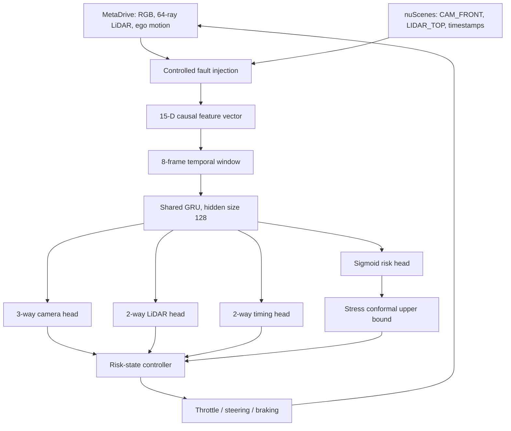

# ChronoSafe-Drive Technical Report

## Self-Diagnosis, Risk Calibration, and Minimal-Risk Maneuvers under Multi-Sensor Perception Degradation

### Abstract

ChronoSafe-Drive is an AMD Radeon and ROCm Physical AI system for autonomous
driving under persistent multimodal perception degradation. The system combines
physics-based MetaDrive simulation with public nuScenes camera/LiDAR streams,
extracts 15 causal health and timing features, and applies an eight-step
factorized GRU to diagnose camera, LiDAR, and temporal faults while predicting
continuous driving risk. Timestamp-authenticity augmentation exposes the model
to missing, drifting, jittered, swapped, and spoofed metadata. A stress-aware
split-conformal procedure converts risk predictions into conservative upper
bounds, which drive a frozen three-state minimal-risk controller. On 20 unseen
MetaDrive seeds, the system reaches a minimal-risk condition in every run with
zero premature triggers, 97.0714% mean scenario accuracy, and 99.8333% mean
upper-risk coverage. On held-out nuScenes scenes, timestamp-robust training
improves severe corruption accuracy by 11.38 to 27.32 percentage points while
retaining 99.3446% intact accuracy. AMD ROCm inference is sub-millisecond and
reaches 1.37 million temporal sequences per second at batch 1024. The complete
pipeline demonstrates multimodal perception, robustness, calibrated decision
making, GPU acceleration, and closed-loop physical control.

## 1. Problem statement

Autonomous-driving stacks assume that camera images, LiDAR measurements, and
their timestamps describe the same current world state. This assumption can
fail gradually or persistently. Images may blur or freeze; LiDAR returns may
drop out; delivery delay may grow; and timing metadata may be missing or
incorrect. A detector trained only on isolated faults may also fail when two
modalities degrade together.

ChronoSafe-Drive studies the following question:

> Can a causal, multimodal temporal model diagnose persistent and compound
> perception degradation, estimate a statistically calibrated risk upper bound,
> and trigger a minimal-risk maneuver without premature stopping?

The project is designed around the complete Physical AI loop rather than an
offline classifier alone: perception evidence changes diagnosis, diagnosis
changes calibrated risk, risk changes the driving mode, and the resulting
control action changes the simulated vehicle state.

### 1.1 Target application and practical value

The target application is a safety supervisor for multimodal autonomous-driving
systems operating in complex environments. It is not intended to replace the
primary perception or planning stack. Instead, it monitors whether camera,
LiDAR, and packet-timing evidence remain trustworthy and requests reduced-speed
or minimal-risk behavior before persistent degradation can propagate into
unsafe control.

The same architecture is applicable to autonomous shuttles, delivery vehicles,
industrial mobile robots, and other Physical AI systems that must remain safe
during partial sensor, synchronization, or communication failure. Its practical
value is the integration of diagnosis, calibrated uncertainty, and physical
control rather than a fault classifier that stops at an offline metric.

## 2. Contributions

1. **Factorized temporal diagnosis.** A shared GRU models temporal health while
   independent camera, LiDAR, and timing heads preserve the compositional
   structure of multi-sensor degradation.
2. **Timestamp-authenticity augmentation.** The training protocol corrupts the
   metadata channel itself, including the difficult case where stale packets
   are marked as current, and calibrates against the worst timestamp-stress
   domain.
3. **Calibrated minimal-risk control.** A split-conformal upper risk bound feeds
   a hysteretic state machine with a calibration-only threshold and a latched
   stop state.
4. **Leakage-resistant real-data protocol.** All derived tracks from one
   nuScenes scene remain together, and adjacent scenes are grouped by complete
   `log_token` before train/calibration/test assignment.
5. **Reproducible AMD ROCm evidence.** Training, evaluation, AMP verification,
   and deployment-style inference are executed on an AMD Radeon `gfx1100` GPU
   using PyTorch ROCm/HIP 7.2.

### 2.1 Team structure and individual contribution

ChronoSafe-Drive is a three-member team submission with the following declared
contributions:

- **Wang Zhenyu — Team Lead and Primary Developer:** problem definition, system
  architecture, degradation design, dataset construction, model and controller
  implementation, AMD ROCm training and benchmarking, calibration protocol,
  experiments, statistical evaluation, visualization, documentation
  integration, and technical submission delivery.
- **Wang Guanyu — Demo Video Producer:** demo planning, screen recording,
  editing, English subtitles, and final video production.
- **Han Liuxuan — Research Materials Coordinator:** collection, organization,
  and verification of competition, technical, and reference materials used to
  support the project and submission.

Except for the demo-video production and research-material coordination roles
listed above, the remaining project work was completed by Wang Zhenyu.
Third-party open-source frameworks and datasets are identified in the
repository documentation and remain subject to their own licenses.

## 3. System overview



## 4. Multimodal degradation model

### 4.1 Controlled perception conditions

Seven scenario labels are used consistently across the simulator and real
sensor streams:

1. clean;
2. progressive camera blur;
3. camera freeze;
4. LiDAR dropout;
5. dynamic cross-modal delay;
6. camera freeze plus LiDAR dropout; and
7. camera blur plus dynamic delay.

The continuous target risk is a clipped weighted sum of observable controlled
severity:

```text
r = clip(0.25 * blur + 0.30 * freeze + 0.35 * dropout + 0.20 * delay, 0, 1)
```

Here, blur, dropout, and delay are normalized to their configured maximum
severity. This target defines the controlled experimental risk and is not
presented as a certified real-world collision probability.

### 4.2 Timestamp stress conditions

Training applies timestamp augmentation to 60% of sampled sequences. A selected
sequence receives one of the following conditions:

- a 30% missing-timestamp burst;
- three-frame progressive camera clock drift;
- one-frame random timestamp jitter;
- swapped camera and LiDAR timestamp channels; or
- timestamps spoofed to appear clean.

Stress calibration and final testing use stronger missing, drift, and jitter
levels. Corruption is applied only to causal timestamp features; ground-truth
labels and risk targets remain unchanged.

## 5. Causal feature representation

No clean reference stream is available to the deployed model. At each step, the
extractor produces:

- camera mean, standard deviation, log sharpness, and temporal change;
- LiDAR mean, standard deviation, minimum range, zero ratio, and temporal
  change;
- normalized ego speed;
- normalized camera packet age and LiDAR packet age;
- cross-modal packet-age skew;
- cross-modal temporal-change disagreement; and
- the temporal change in LiDAR zero ratio.

The resulting feature vector has dimension 15. Eight consecutive vectors form
one causal model input with shape `[8, 15]`.

## 6. Factorized temporal model

For an input window `x[t-7:t]`, the shared GRU produces a final hidden state:

```text
h_t = LayerNorm(GRU(x[t-7:t]))
```

Four prediction heads operate on `h_t`:

- camera state: normal, blur, or freeze;
- LiDAR state: normal or dropout;
- timing state: synchronized or delayed; and
- continuous risk in `[0, 1]`.

The three factor predictions are composed deterministically into the seven
evaluation scenarios. The final robust model contains 56,968 parameters, uses
hidden size 128, and is trained with factor cross-entropy and risk regression.
The direct seven-class scenario-loss weight is fixed to zero in the selected
robust variant to retain factor compositionality.

Training mixes 60,000 MetaDrive sequences with 60,000 nuScenes sequences per
run, uses batch size 512 for 100 epochs, and repeats the frozen protocol with
random seeds `2026`, `2027`, and `2028`.

## 7. Stress-aware conformal risk calibration

Let `r_i` be the controlled target risk and `r_hat_i` the predicted risk for a
calibration sample. The nonconformity score is:

```text
e_i = abs(r_i - r_hat_i)
```

For target miscoverage `alpha = 0.1`, a finite-sample conformal quantile is
computed independently for each held-out calibration domain and timestamp
stress condition. The deployed radius is the maximum selected radius:

```text
q_stress = max_domain,condition Quantile_0.9(e)
upper_risk = min(1, r_hat + q_stress)
```

This deliberately conservative selection protects against the strongest
calibration-time timestamp condition. Test domains never participate in radius
or threshold selection.

## 8. Minimal-risk maneuver controller

The control policy exposes three interpretable modes:

- `NORMAL`: nominal steering and speed control;
- `DEGRADED`: reduced target speed and conservative commands; and
- `MINIMAL_RISK`: latched braking until the vehicle reaches a near-stop.

An eight-step warm-up prevents decisions before a full temporal window exists.
Hysteresis prevents rapid mode switching. The minimal-risk threshold is selected
from only MetaDrive calibration seeds `113` and `127`; candidate thresholds are
evaluated against success, premature triggering, and delay. Threshold `0.62`
achieves 100% calibration success, 0% premature triggers, and the lowest valid
mean trigger delay, and is frozen before external testing.

## 9. Data and leakage prevention

### 9.1 nuScenes trainval

The public nuScenes v1.0-trainval conversion contains:

- 850 scenes;
- 34,149 aligned `CAM_FRONT` + `LIDAR_TOP` pairs;
- 239,043 degradation samples;
- 5,950 temporal tracks; and
- 15 features per step.

The split contains 592 training, 128 calibration, and 130 test scenes. The unit
of grouping is the complete nuScenes `log_token`, which prevents adjacent
driving snippets from the same collection log from appearing in different
partitions. All augmentations from one scene remain in the same partition.

### 9.2 MetaDrive

MetaDrive provides physical vehicle dynamics, camera rendering, LiDAR returns,
and closed-loop actuation. Training, calibration, internal test, and external
closed-loop seeds are disjoint. Twenty external seeds are frozen in the
protocol and reported without outcome-based selection.

### 9.3 Renderer integrity

MetaDrive 0.4.3 can fail in a display-less environment during SimplePBR setup.
Bypassing the camera effects allows execution but changes the camera features by
more than 20 standard deviations and invalidates the closed-loop diagnosis
result. The official evaluation therefore uses `xvfb-run`, disables the global
render pipeline consistently, and leaves the camera-effect code unmodified. A
three-seed probe confirms exact 15-feature equality with the original training
data (`mean_abs_diff = 0`, `shift_sd = 0`). All raw-headless bypass results are
excluded from claims.

## 10. Experimental results

### 10.1 Timestamp robustness

Each condition contains 21,973 temporal sequences from the same leakage-controlled
95-scene nuScenes test subset. Both model variants are summarized over three
training seeds; the robust column reports mean +/- standard deviation across
those seeds.

| Condition | Standard v3 | Robust v3 mean +/- SD | Gain |
|---|---:|---:|---:|
| Intact | 99.8271% | 99.3446% +/- 0.1093% | -0.4825 pp |
| Missing 50% | 84.7828% | 97.7715% +/- 0.0730% | +12.9887 pp |
| Jitter, two frames | 85.3047% | 96.6868% +/- 0.4945% | +11.3821 pp |
| Timestamp channels swapped | 72.0202% | 99.3446% +/- 0.1093% | +27.3244 pp |
| Metadata spoofed clean | 67.9637% | 95.0818% +/- 0.0682% | +27.1181 pp |

The result supports the central claim: corrupting timestamp metadata during
training substantially improves robustness to persistent metadata failure while
reducing intact accuracy by less than half a percentage point.

### 10.2 Fair nuScenes comparison

This comparison uses 95 scenes grouped into 8 independent `log_token` units;
every log containing a nuScenes-mini scene is excluded. Confidence intervals
use 10,000 paired log-cluster bootstrap resamples.

| Metric | Locked v2 | Robust v3 | Relative or absolute improvement |
|---|---:|---:|---:|
| Scenario accuracy | 80.5762% | 99.3446% | +18.7684 pp |
| Camera accuracy | 94.9438% | 99.7816% | +4.8378 pp |
| LiDAR accuracy | 85.7097% | 99.9985% | +14.2888 pp |
| Risk MAE | 0.060401 | 0.012068 | -80.02% |
| Conformal radius | 0.251078 | 0.058434 | -76.73% |

The standard v3 model reaches higher intact accuracy and lower risk MAE than
the robust v3 model. The final selection is therefore justified by the frozen
robustness objective and safety coverage, not by claiming dominance on every
clean-input metric.

### 10.3 External closed-loop evaluation

| Metric over 20 unseen seeds | Mean +/- SD or rate |
|---|---:|
| MRM success rate | 100% |
| MRM reached rate | 100% |
| Premature MRM rate | 0% |
| Scenario accuracy | 97.0714% +/- 2.8541% |
| Risk MAE | 0.020637 +/- 0.003302 |
| Upper-risk coverage | 99.8333% +/- 0.2796% |
| Trigger delay | 14.05 +/- 2.11 steps |
| Braking time | 8.55 +/- 3.15 steps |
| Final speed | 0.013786 +/- 0.002101 km/h |

The controller spends 53.2619% of steps in `NORMAL`, 24.8571% in `DEGRADED`,
and 21.8810% in `MINIMAL_RISK`, demonstrating a complete staged transition
rather than an immediate always-stop policy.

## 11. AMD Radeon and ROCm implementation

### 11.1 Platform

- AMD Radeon Graphics, `gfx1100`, 48 compute units;
- 47.984 GiB VRAM;
- HIP `7.2.53211`;
- PyTorch `2.9.1+rocm7.2.1`; and
- Linux 6.8, Python 3.12.

Training and inference both require `torch.cuda.is_available()` and a non-null
`torch.version.hip`; the scripts fail instead of silently falling back to CPU.

### 11.2 Real-sequence inference benchmark

The benchmark uses 30,142 frozen test sequences across 130 nuScenes scenes.
After 50 warm-up iterations, each precision/batch configuration is timed for
300 synchronized ROCm GPU-event iterations.

| Precision | Batch | p50 | p95 | p99 | Throughput | Peak allocated |
|---|---:|---:|---:|---:|---:|---:|
| FP32 | 1 | 0.558821 ms | 0.954580 ms | 1.019299 ms | 1,632.89 seq/s | 77.312 MiB |
| FP32 | 32 | 0.571206 ms | 0.974368 ms | 1.056337 ms | 51,199.80 seq/s | 77.794 MiB |
| FP32 | 256 | 0.636986 ms | 1.010295 ms | 1.078844 ms | 367,947.68 seq/s | 82.494 MiB |
| FP32 | 1024 | 0.714952 ms | 1.003659 ms | 1.064934 ms | 1,371,235.75 seq/s | 98.604 MiB |
| AMP FP16 | 1024 | 0.694567 ms | 1.086294 ms | 1.201812 ms | 1,364,850.70 seq/s | 88.600 MiB |

Batching increases FP32 throughput by approximately 840x while p50 latency
increases by only 1.28x. At batch 1024, AMP improves p50 by 1.029x and saves
approximately 10 MiB of peak allocated memory. Small-batch AMP is slower because
the compact recurrent model is launch-bound; this negative result is preserved
in the machine-readable benchmark rather than omitted.

AMP numerical verification uses 8,192 real test sequences. All three diagnostic
heads achieve 100% class agreement with FP32. Risk prediction MAE is
`0.00008262`; p99 error is `0.00033322`; maximum error is `0.00064528`.

## 12. Reproducibility

The repository preserves:

- frozen seed and split manifests;
- deterministic training options;
- SHA-256 hashes of benchmarked data, split, and checkpoint;
- JSON/CSV per-run and aggregate metrics;
- PNG figures with the underlying machine-readable tables;
- calibration-only MRM threshold selection;
- a dependency-free verifier that checks public claims against frozen JSON; and
- explicit hardware, HIP, PyTorch, and timing metadata.

Exact commands are in the root `README.md`. Raw media and generated datasets are
excluded; generation instructions, small checkpoints, and the split manifest
remain at their documented reviewer paths.

## 13. Final deliverables and output formats

The competition submission is organized as a dedicated public source
repository and contains the following deliverables:

| Deliverable | Format | Purpose |
|---|---|---|
| Project source code | Python package and executable scripts | Data construction, training, evaluation, benchmarking, and closed-loop control |
| Technical report | Markdown | Target application, architecture, data, AMD use, innovations, results, and limitations |
| Reproducibility guide | Markdown plus pinned dependency file | Environment setup and step-by-step result reproduction |
| Frozen protocol | JSON and Markdown | Seeds, splits, calibration policy, and statistical rules |
| Model artifacts | PyTorch checkpoints with SHA-256 records | Reproduce the selected model without retraining |
| Quantitative evidence | JSON, CSV, Markdown, and PNG | Machine-readable metrics and reviewer-facing figures |
| Closed-loop demonstration | Public English video no longer than 3 minutes | Show commands or interface actions, execution, mode transitions, and results |
| Dataset documentation | Markdown and generation scripts | Provenance, licensing constraints, split policy, and regeneration |

The submission excludes raw nuScenes media and other large licensed data. These
are obtained from their official source and converted with the included scripts.
Reviewer-facing commands use the persistent AMD cloud workspace path and fail
explicitly when the required ROCm/HIP device is absent.

## 14. Limitations and responsible use

1. The evaluated faults are controlled corruptions, not naturally annotated
   hardware failures.
2. nuScenes supports offline sensor evaluation; physical control is evaluated
   in MetaDrive rather than on a road vehicle.
3. The 15-dimensional representation prioritizes explainability and efficient
   temporal health monitoring over end-to-end visual semantics.
4. Upper-risk coverage is empirical under the frozen domains and does not imply
   universal safety certification.
5. The controller is a research prototype and must not be deployed as the sole
   safety mechanism in a real vehicle.

All users must comply with nuScenes licensing terms and applicable privacy,
legal, and ethical requirements. The repository does not redistribute raw
nuScenes images or point clouds.

## 15. Conclusion

ChronoSafe-Drive demonstrates that temporal sensor-health diagnosis becomes
substantially more robust when timestamp metadata is treated as a fallible input
rather than trusted ground truth. Combining factorized diagnosis, stress-aware
risk calibration, and a frozen minimal-risk controller produces a transparent
closed loop that succeeds on every unseen MetaDrive test seed. The system is
trained and evaluated on AMD Radeon and ROCm, with reproducible sub-millisecond
inference, numerical AMP verification, and complete machine-readable evidence.
